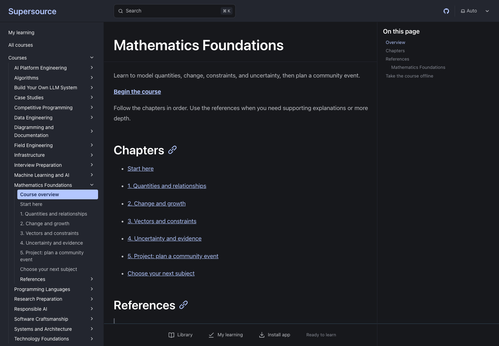
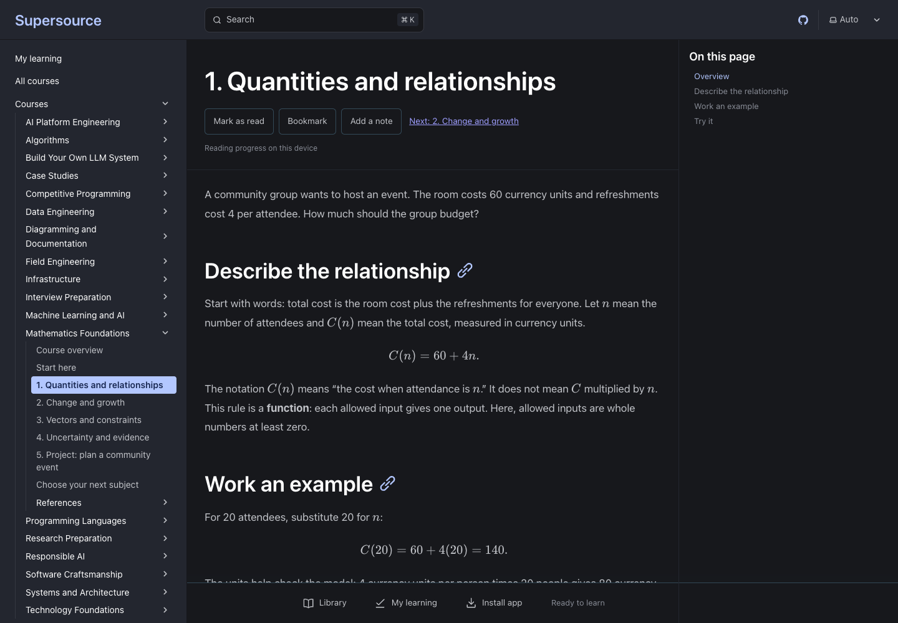

<p align="center">
  <h1 align="center">Openlearn</h1>
  <p align="center">
    Free, self-paced learning across technology, mathematics, and engineering, for people from all backgrounds. Technical books explained from first principles, with worked solutions and checks of your reasoning. Read online or download a PDF.
    <br /><br />
    <a href="https://github.com/urmzd/openlearn/releases/latest">Download</a>
    &middot;
    <a href="https://github.com/urmzd/openlearn/issues">Report Bug</a>
    &middot;
    <a href="https://openlearn.urmzd.com">Browse Courses</a>
  </p>
</p>

<p align="center">
  <a href="https://github.com/urmzd/openlearn/actions/workflows/ci.yml"></a>
  &nbsp;
  <a href="LICENSE"></a>
</p>

## Screenshots


<details>
<summary>See the course outline and reading experience</summary>

The course outline keeps chapters in order and supporting references separate.



Chapters introduce one idea at a time, with worked examples and rendered equations.



</details>

Captured with [teasr](https://github.com/urmzd/teasr). Rebuild the website, then run `teasr run --config teasr.toml` to refresh these screenshots.

## Features

- **First principles, made concrete:** chapters derive an idea from its assumptions, work a small example by hand, then connect the reasoning to a complete solution.
- **Book library:** 18 subject books and two reading guides across mathematics, algorithms, ML, systems, data engineering, infrastructure, and related subjects.
- **Build Your Own LLM System:** follow a complete LLM platform (tokenizers, attention, KV caches, kernels, inference, serving, and operations) through annotated reference solutions in [`course/solutions/`](course/solutions/).
- **Test your understanding:** predict a result before revealing it, explain why it follows, and use review questions to find gaps in your reasoning.
- **Test and validate:** inspect the reference code, check its assumptions and invariants, and use examples, boundary cases, and failure scenarios to decide whether its behavior meets the requirement.
- **Worked problem sets:** mathematics problem sets show every answer with its derivation and the common wrong answers.
- **Read anywhere:** use the mobile book reader with full-text search, inline code and equations, or download a published PDF for offline reading.
- **Publish from one source:** use a course manifest to select the same Markdown lessons for its website, PDF, and downloadable pack.

## The learning principle

As code generation becomes easier, the ability to understand, reason, test, and validate becomes more important. Producing code is only part of the work. You still need to decide what it should do, explain why a design fits its constraints, and gather evidence that it behaves correctly.

These books show the reasoning and the solution together. Start with the assumptions and first principles, follow a small example, then inspect how the implementation expresses the idea. Pause to predict an outcome or defend a choice before reading the explanation. A worked answer gives you something to question, test, and compare with your own reasoning.

Understanding means being able to explain the mechanism, anticipate a failure, choose a test that could expose it, and interpret the result. Passing tests are evidence within the cases they cover; validation asks whether those cases and assumptions match the actual requirement. A reference solution is a worked design under stated constraints, not a claim that one implementation is best everywhere.

Use [How to read these books](content/references/how-to-read.md) for the predict, reason, test, and validate reading method. Nothing is graded, and reaching the end of a page is not evidence of mastery.

## Installation

Read the [website](https://openlearn.urmzd.com) without installing anything. Download PDFs and source packs from [releases](https://github.com/urmzd/openlearn/releases/latest). The reader links to published PDFs where available; download one to read offline.

To read the sources locally or publish a course:

```bash
git clone https://github.com/urmzd/openlearn.git
cd openlearn
```

| Requirement | Used for |
|---|---|
| Git | Clone the repository |
| Python 3.11+ | List, validate, and export courses |
| Pandoc and XeLaTeX | Build course PDFs (optional) |
| Node.js 24 and pnpm | Serve the website locally (optional) |

## Quick Start

| Start here | What to expect |
|---|---|
| [Technology Foundations](content/courses/computer-science/README.md) | Explore programming, mathematics, systems, data, AI, and other areas of technology at your own pace |
| [Build Your Own LLM System](content/courses/build-an-llm/README.md) | One LLM platform, end to end, explained module by module through its reference solution |
| [Course catalogue](content/courses/README.md) | Subject-specific study plans and other learning routes |
| [Practice](practice/README.md) | Predict-the-output puzzles and data-structure implementations, each with a worked answer |

Chapters connect first principles, worked examples, interfaces, **solutions explained step by step**, pitfalls, and review questions. Predict each step before reading it, explain the result in your own words, then identify a test or counterexample that could challenge your explanation.

## Usage

### List and export a course

```bash
python3 scripts/course_catalog.py list
python3 scripts/course_catalog.py validate
python3 scripts/course_catalog.py export --course mathematics --zip
```

Read the Markdown sources in `outputs/packs/mathematics/` or share `outputs/packs/openlearn-mathematics.zip`. For a typeset offline edition, download or build a PDF. Export refuses to overwrite an existing destination; use `--output` with a fresh directory for another export.

### Build a PDF

Install Pandoc, XeLaTeX, and Bash 4.3 or newer, then run:

```bash
./scripts/build-book.sh --course mathematics
```

The result is `outputs/openlearn-mathematics.pdf`. See [course publication](docs/courses.md) for the publishing workflow and [the build script](scripts/build-book.sh) for rendering options and recommended diagram tools.

### Serve a course

Install Node.js 24 and pnpm 11.6, then run:

```bash
cd apps/web
pnpm install --frozen-lockfile
OPENLEARN_COURSE=mathematics pnpm dev
```

Omit `OPENLEARN_COURSE` to serve the full catalogue.

## Configuration

| Setting | Purpose |
|---|---|
| Course `openlearn.json` | Reading order, shared lessons, and references |
| `OPENLEARN_COURSE` | Select one course for a website build or development server |
| `OPENLEARN_SITE_URL` | Set the public URL for an independent course deployment |

See [course authoring and publication](docs/courses.md) for manifest fields.

## Architecture

A course references canonical lessons through its manifest. The web app, PDF builder, and pack exporter use the same publication inventory. The mobile reader adds search, ordered chapter contents, published PDF links, and a reading position stored on your device. Reference solutions live in [`course/solutions/`](course/solutions/) (LLM system) and [`practice/build/`](practice/build/) (data structures); chapters quote and explain them.

Read the [course publication guide](docs/courses.md) and [web reader guide](docs/pwa.md) for implementation details. Consult the [source register](content/references/sources.md) for attribution, resource access, and validation evidence.

## Agent Skill

This repo's conventions are available as portable agent skills in [`skills/`](skills/).

## License

[Apache License 2.0](LICENSE). Linked resources and individual assets retain their stated licenses and access terms.
