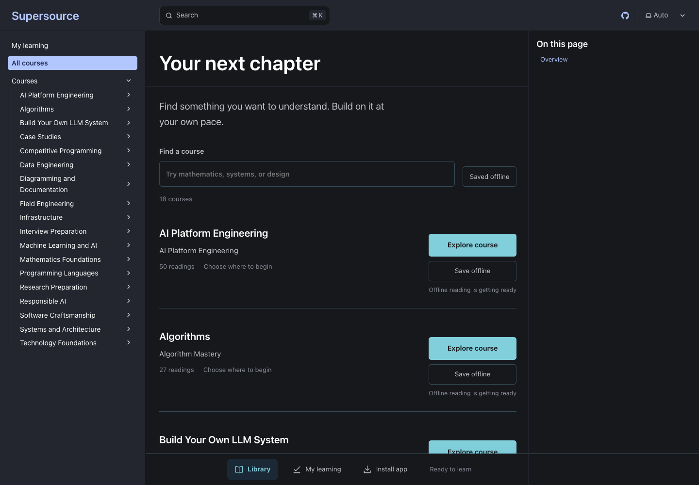

<p align="center">
  <h1 align="center">Openlearn</h1>
  <p align="center">
    Free, self-paced technical books explained from first principles, with worked solutions and checks of your reasoning. Read online or download a PDF.
    <br /><br />
    <a href="https://github.com/urmzd/openlearn/releases/latest">Download</a>
    &middot;
    <a href="https://github.com/urmzd/openlearn/issues">Report Bug</a>
    &middot;
    <a href="https://openlearn.urmzd.com">Browse Books</a>
  </p>
</p>

<p align="center">
  <a href="https://github.com/urmzd/openlearn/actions/workflows/ci.yml"></a>
  &nbsp;
  <a href="LICENSE"></a>
</p>

<p align="center">
  
</p>

## Features

- **First principles, made concrete:** chapters derive an idea from its assumptions, work a small example by hand, then connect the reasoning to a complete solution.
- **Book library:** six primary books, two field guides, and two reading paths. AI model building, applications, evaluation, and responsible deployment share one AI Engineering book.
- **Build Your Own LLM System:** follow a complete LLM platform (tokenizers, attention, KV caches, kernels, inference, serving, and operations) through annotated reference solutions in [`course/solutions/`](course/solutions/).
- **Check your understanding:** predict a result before revealing it, explain why it follows, and use review questions to find gaps in your reasoning.
- **Test and validate:** check reference code against its assumptions, invariants, boundary cases, and failure scenarios to decide whether it meets the requirement.
- **Worked problem sets:** mathematics problem sets show every answer with its derivation and the common wrong answers.
- **Read anywhere:** use the mobile book reader with full-text search, inline code and equations, or download a published PDF for offline reading.
- **Publish from one source:** use a course manifest to select the same Markdown lessons for its website, PDF, and downloadable pack.

## Installation

Read the [website](https://openlearn.urmzd.com) without installing anything, or download PDFs and source packs from [releases](https://github.com/urmzd/openlearn/releases/latest).

### Prerequisites

| Requirement | Used for |
|---|---|
| Git | Clone the repository |
| Python 3.11+ | List, validate, and export courses |
| Pandoc and XeLaTeX | Build course PDFs (optional) |
| Node.js 24 and pnpm | Serve the website locally (optional) |

### From source

Clone the repository to read the sources locally or publish a course:

```bash
git clone https://github.com/urmzd/openlearn.git
cd openlearn
```

## Quick Start

| Start here | What to expect |
|---|---|
| [Technology Foundations](content/courses/computer-science/README.md) | Explore programming, mathematics, systems, data, AI, and other areas of technology at your own pace |
| [AI Engineering](content/courses/ai-engineering/README.md) | Learning foundations, model construction, training, inference, applications, evaluation, and responsible deployment |
| [Course catalogue](content/courses/README.md) | Subject-specific study plans and other learning routes |
| [Programming and Algorithms](content/courses/programming-and-algorithms/README.md) | Predict-the-output puzzles and data-structure implementations, each with a worked answer |

Predict each step before reading it, explain the result in your own words, then find a test or counterexample that could challenge your explanation. Nothing is graded, and reaching the end of a page is not evidence of mastery. See [How to read these books](content/references/how-to-read.md) for the full reading method.

## Usage

### List and export a course

```bash
python3 scripts/course_catalog.py list
python3 scripts/course_catalog.py validate
python3 scripts/course_catalog.py export --course mathematics --zip
```

Read the Markdown sources in `outputs/packs/mathematics/` or share `outputs/packs/openlearn-mathematics.zip`. For a typeset offline edition, download or build a PDF. Export refuses to overwrite an existing destination. Pass `--output` with a fresh directory for another export.

### Build a PDF

Install Pandoc, XeLaTeX, and Bash 4.3 or newer, then run:

```bash
./scripts/build-book.sh --course mathematics
```

The result is `outputs/openlearn-mathematics.pdf`. See [course publication](docs/guides/courses.md) for the publishing workflow and [the build script](scripts/build-book.sh) for rendering options and recommended diagram tools.

### Serve a course

Install Node.js 24 and pnpm 11.6, then run:

```bash
cd apps/web
pnpm install --frozen-lockfile
OPENLEARN_COURSE=mathematics pnpm dev
```

Omit `OPENLEARN_COURSE` to serve the full catalogue.

## Configuration

| Setting | Purpose |
|---|---|
| Course `openlearn.json` | Reading order, shared lessons, and references |
| `OPENLEARN_COURSE` | Select one course for a website build or development server |
| `OPENLEARN_SITE_URL` | Set the public URL for an independent course deployment |

See [course authoring and publication](docs/guides/courses.md) for manifest fields.

## Development

```bash
just course-lint             # validate manifests and relative links
just run-practice-solutions  # run every C and C++ reference solution
```

Rebuild the website, then run `teasr run --config teasr.toml` to refresh the screenshots in [`showcase/`](showcase/).

## Documentation

- [Course authoring and publication](docs/guides/courses.md)
- [Web reader](docs/guides/pwa.md)
- [How to read these books](content/references/how-to-read.md)
- [Source register](content/references/sources.md): attribution, resource access, and validation evidence

## Agent Skill

This repo's conventions are available as portable agent skills in [`skills/`](skills/).

## License

[Apache License 2.0](LICENSE). Linked resources and individual assets retain their stated licenses and access terms.
