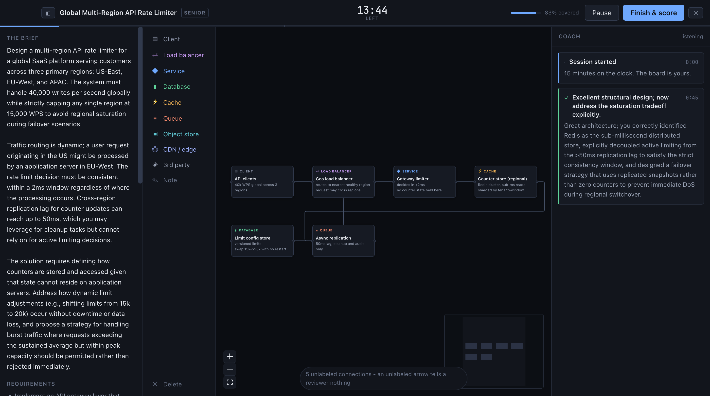
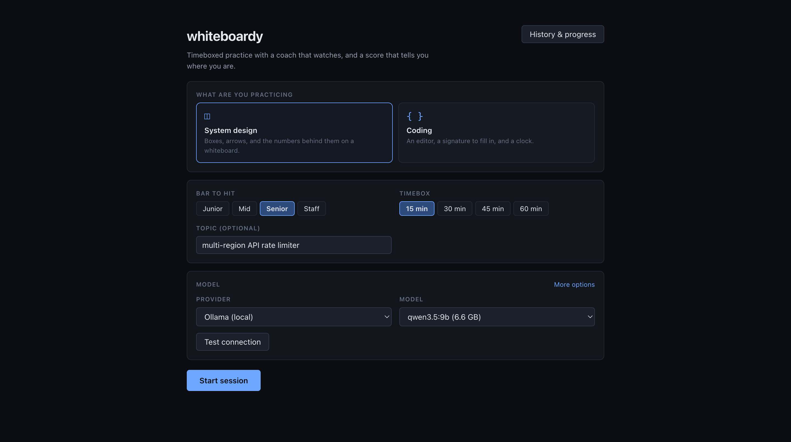
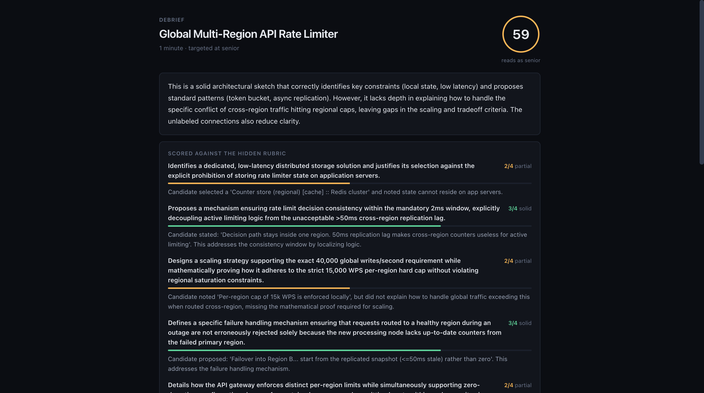
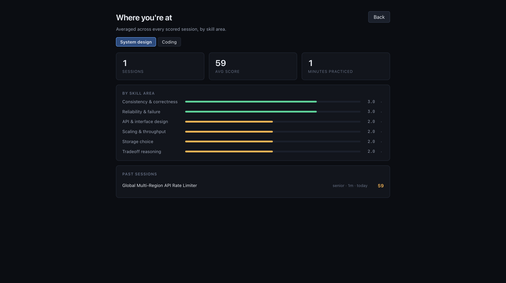

<p align="center">
  <h1 align="center">openlearn</h1>
  <p align="center">
    A desktop learning platform: read a course, practice it, and have it graded, with an AI professor alongside.
    <br /><br />
    <a href="https://github.com/urmzd/openlearn/releases">Download</a>
    &middot;
    <a href="https://github.com/urmzd/openlearn/issues">Report Bug</a>
  </p>
</p>

<p align="center">
  
</p>

> [!WARNING]
> **Beta, and still in testing.** Prompts, scoring calibration, and the saved-session
> format are all still moving. Scores are directional, not authoritative.

openlearn renders a **course pack**: a directory of markdown with an `openlearn.json`
manifest that names its tracks, its role paths, and its practice CLI. The app knows
nothing about any one course. The [supersource curriculum](../README.md) is the pack built
into the binary, and [languide](../packs/languide/) ships beside it; any other directory
with a manifest loads the same way.

It started as whiteboardy, a timeboxed practice harness, and that harness is still the
part that grades you: it writes an exercise from the chapter you just read, times you,
interrupts when it is worth interrupting, and scores what you produced against a rubric
written before you started. Runs fully local against [Ollama](https://ollama.com), or
against a hosted model.

## Features

- **Course packs.** Tracks, role paths, and documents come from the pack's manifest, so a
  course is swapped by pointing at a different directory.
- **Shared progress.** Path progress is read from the same `.done` files `ss learn`
  writes, so the terminal and the app never disagree about what is finished.
- **Search.** Full-text search across every document in the pack.
- **Sessions grounded in a chapter.** Start a session from a document and the exercise and
  its hidden rubric are generated from that material.
- **Three eval modes.** A board of components for system design, an editor for coding, and
  a written answer for everything else, each with its own fixed skill taxonomy.
- **A coach that mostly stays quiet**, and a **professor** that answers when asked, about
  the page you have open.
- **A profile that accumulates.** Rubric criteria map onto a fixed taxonomy, so scores
  compare across sessions.

## Installation

### Prerequisites

| Requirement | Version |
|-------------|---------|
| Go | 1.26.9+ |
| Node | 22+ |
| Wails | v2.11 |
| Ollama | any recent, with a model pulled |

### Build

```sh
git clone https://github.com/urmzd/openlearn
cd openlearn/app
make init
make build
```

The app lands in `build/bin/`. For a live-reloading dev loop, use `make dev`.


## Quick Start

```sh
ollama pull qwen3.5:9b
make build && open build/bin/openlearn.app
```

1. Pick a provider and model on the setup screen, then hit **Test connection**.
2. Choose a mode, a level, and a timebox. Start. Generation takes a moment on a local
   model: it writes the brief, then the hidden rubric.
3. Work. The coach reads your board or code on an interval and speaks only when it has
   something worth saying.
4. Hit **Finish & score** for the debrief, then check **Progress** once you have a few
   sessions behind you.

Anything in the 7-9B range and up is usable. Smaller models produce noticeably thinner
rubrics. Sessions are written to `~/.openlearn/sessions` as plain JSON, and nothing
leaves your machine unless you point it at a hosted provider.

<p align="center">
   &nbsp;  &nbsp; 
</p>
<p align="center"><em>Setup &middot; Debrief &middot; Progress</em></p>

Every criterion is scored 0-4 with the evidence that earned it, quoted from your board and
your notes. The overall number is computed from those scores and their weights, so it
cannot drift from the reasoning behind it. Ranking an area as a strength or a weakness is
withheld until it has at least two samples, and trend needs three, because calling
something a weakness off one data point is noise dressed as insight.

## Configuration

Settings live in `~/.openlearn/settings.json` and are editable from the setup screen.

| Provider | Model discovery | Notes |
|----------|-----------------|-------|
| Ollama | Automatic | Default. Fully local, no key. |
| Anthropic | Manual model id | Needs an API key |
| OpenAI | Manual model id | Needs an API key |
| Google | Manual model id | Needs an API key |

Provider plumbing comes from [saige](https://github.com/urmzd/saige)'s agent SDK.

## Architecture

The backend drives the UI over an [AG-UI](https://github.com/ag-ui-protocol/ag-ui)-shaped
event stream: a run is bracketed by `RUN_STARTED` and `RUN_FINISHED`, agent speech arrives
as `TEXT_MESSAGE_START` / `CONTENT` / `END`, and shared state moves as `STATE_SNAPSHOT`
plus `STATE_DELTA`. The frontend is a pure reduction of that stream and never polls, so
the agent decides when to respond rather than the UI asking.

See [docs/architecture.md](docs/architecture.md) for the full guide, including why problem
generation and each coaching tick are two LLM calls rather than one.

## Development

```sh
make check   # fmt, vet, lint, test, typecheck
make test    # Go tests only
make live    # exercise the harness against a real model (needs ollama)
make record  # recapture the reproducible showcase screens
```

`make live` is how prompt changes get validated. It asserts the things that actually
matter: that generated rubrics map onto the taxonomy, that curveballs exist, that the
coach streams rather than emitting one blob, and that near-empty work does not score well.
Override the model with `make live MODEL=qwen3.5:2b`.

See [CONTRIBUTING.md](CONTRIBUTING.md) for the full workflow.

## Known Gaps

This is where the beta label comes from.

- Scoring calibration is unvalidated across models. A 3B model and a 9B model do not grade
  the same work the same way, and neither has been checked against human judgment.
- Coach silence is a soft bias, not a guarantee. It sometimes speaks earlier than it
  should.
- Coding mode is exercised by the live tests but has not been driven end to end through
  the app the way system design has.
- The saved-session format is not stable yet, so old sessions may stop aggregating.
- No import, export, or replay of sessions.
- Coding mode has no execution and no test runner. Correctness is judged by reading.

## License

[Apache-2.0](../LICENSE)
