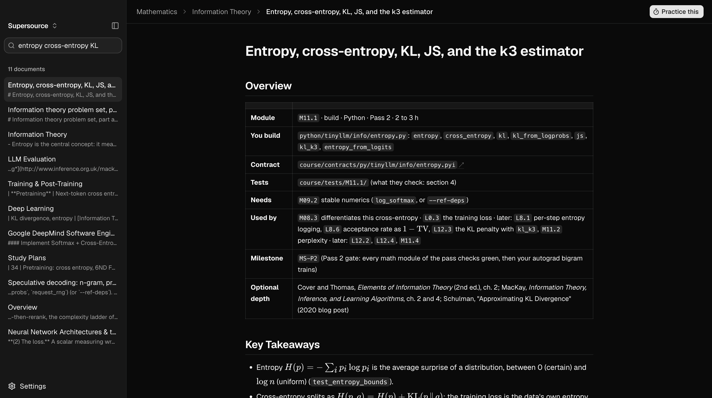

<p align="center">
  <h1 align="center">openlearn</h1>
  <p align="center">
    A desktop learning platform: read a course, practice it, have it graded, and bring your own agent.
    <br /><br />
    <a href="https://github.com/urmzd/openlearn/releases">Download</a>
    &middot;
    <a href="https://github.com/urmzd/openlearn/issues">Report Bug</a>
  </p>
</p>

<p align="center">
  
</p>

> [!WARNING]
> **Beta, and still in testing.** Prompts, scoring calibration, and the saved-session
> format are all still moving. Scores are directional, not authoritative.

openlearn renders a **course pack**: a directory of markdown with an `openlearn.json`
manifest that names its tracks, its role paths, and its exercises. The app knows
nothing about any one course. The [course catalogue](../../content/courses/README.md) supplies the reading packs built
into the binary, and [languide](../../packs/languide/) ships beside them. Exported course
packs and other directories with a manifest load the same way.

It started as whiteboardy, a timeboxed practice harness, and that harness is still the
part that grades you: it writes an exercise from the chapter you just read, times you,
interrupts when it is worth interrupting, and scores what you produced against a rubric
written before you started. Runs fully local against [Ollama](https://ollama.com), or
against a hosted model.

## Features

- **Course packs.** Tracks, role paths, eval modes, and exercises come from the
  pack's manifest. Open a folder or import a zip and the app teaches that course instead.
- **A reader built for courses.** Math, diagrams, tables, and links between documents,
  with full-text search across the pack.
- **Paths with shared progress.** Stages, what "done" means for each, and which you have
  finished, read from the same `.done` files `ol learn` writes.
- **Exercises that run for real.** Edit an attempt in the app and check it with the pack's
  own tests. The exit code is the verdict, the same one a terminal would give you.
- **Sessions grounded in a chapter.** Start from any document and the exercise and its
  hidden rubric are generated from that material: a board for system design, an editor for
  coding, a written answer for everything else.
- **A coach that mostly stays quiet** during a session: silence is the default.
- **Bring your own agent.** The app serves the open pack over [MCP](docs/mcp.md), so the
  agent you already use can read the course, see the page you have open and your progress,
  and check your exercises with the pack's own checker.
- **A profile that accumulates.** Rubric criteria map onto a fixed taxonomy, so scores
  compare across sessions.

## Installation

### Prerequisites

| Requirement | Version |
|-------------|---------|
| Go | 1.26.9+ |
| Node | 22+ |
| Wails | v2.11 |
| Ollama | any recent, with a model pulled |

### Build

```sh
git clone https://github.com/urmzd/openlearn
cd openlearn/apps/desktop
make init
make build
```

The app lands in `build/bin/`. For a live-reloading dev loop, use `make dev`.


## Quick Start

```sh
ollama pull qwen3.5:9b
make build && open build/bin/openlearn.app
```

1. Open **Timed session**, pick a provider and model under **Model**, and hit **Test
   connection**.
2. Open a chapter and hit **Practice this**, or start a **Timed session** cold. Choose a
   mode, a level, and a timebox. Start. Generation takes a moment on a local
   model: it writes the brief, then the hidden rubric.
3. Work. The coach reads your board or code on an interval and speaks only when it has
   something worth saying.
4. Hit **Finish & score** for the debrief, then check **Progress** once you have a few
   sessions behind you.

Anything in the 7-9B range and up is usable. Smaller models produce noticeably thinner
rubrics. Sessions are written to `~/.openlearn/sessions` as plain JSON, and nothing
leaves your machine unless you point it at a hosted provider.

<p align="center">
   &nbsp; 
</p>
<p align="center"><em>A session in progress &middot; The debrief</em></p>

Every criterion is scored 0-4 with the evidence that earned it, quoted from your board and
your notes. The overall number is computed from those scores and their weights, so it
cannot drift from the reasoning behind it. Ranking an area as a strength or a weakness is
withheld until it has at least two samples, and trend needs three, because calling
something a weakness off one data point is noise dressed as insight.

## Writing a course pack

A pack is a directory of markdown with an `openlearn.json` at its root. Paths in it are
relative to that directory.

```json
{
  "id": "my-course",
  "title": "My Course",
  "tagline": "One line about it.",
  "repo": "https://github.com/me/my-course",
  "paths": "paths",
  "featured": "main",
  "practice": "exercises.json",
  "modes": ["written"],
  "start": [{ "file": "README.md", "title": "Overview" }],
  "tracks": [{ "dir": "unit-1", "title": "Unit 1" }]
}
```

| Field | Meaning |
|-------|---------|
| `id`, `title` | Required. The id names the pack on disk, so keep it a plain directory name. |
| `tracks` | Directories of documents, in reading order. Each subdirectory is a topic, titled by its `README.md`. |
| `reference` | Same shape as `tracks`, for material that is browsable but not in the learning order. |
| `start` | Documents a new reader opens first. |
| `paths` | Directory holding one `<name>/path.tsv` per role path. See [paths/README.md](../../content/courses/build-an-llm/paths/README.md) for the format. |
| `featured` | The path the home screen leads with. |
| `modes` | Which timed-session modes fit the material: `system_design`, `coding`, `written`. Omit for all three. |
| `practice` | The exercise spec: which exercises exist and the commands that run them. See below. It only runs when the pack is opened from a folder. |
| `stageCheck` | Optional command that decides whether a path stage tied to a check may be marked done. `{path}` and `{stage}` are filled in; exit status 0 means yes. |
| `repo` | Where links to files the app does not render (code, configs) open. |

### Exercises

The exercise spec lists sets of exercises that are found and run the same way:

```json
{
  "sets": [
    {
      "kind": "build", "lang": "c", "mode": "attempt",
      "glob": "exercises/c/[0-9][0-9]-*",
      "run": { "steps": [["cc", "-o", "{out}/bin", "*.c"], ["{out}/bin"]] }
    },
    {
      "kind": "predict", "lang": "python", "mode": "predict",
      "glob": "snippets/[0-9][0-9]-*.py",
      "run": { "dir": "snippets", "steps": [["python3", "{name}.py"]] }
    }
  ]
}
```

| Mode | The learner writes | Verdict |
|------|--------------------|---------|
| `attempt` | The code. Their copy has every region between `SOLUTION-BEGIN` and `SOLUTION-END` marker lines replaced by a TODO. | The exit status of the steps, run in their copy |
| `predict` | The exact output of a snippet they can read but not edit | Whether it matches what the snippet prints |

Each `glob` match is one exercise, a file or a directory, named by its base name. `items`
lists exercises one by one instead. Steps are argument lists run without a shell: `{name}`
is the exercise, `{out}` a build directory outside the attempt, `{file}` the attempt's
single file, and a bare pattern such as `*.c` expands to the attempt's files. An attempt
with an executable `run.sh` is run through that instead.

Open it with **Courses > Open folder**, or zip the directory and use **Import zip**. See [course publication](../../docs/courses.md) to export one course from this repository.
[Languide](../../packs/languide/openlearn.json) is an example of a pack with documents and
paths only.

## Configuration

Settings live in `~/.openlearn/settings.json`. The model is set from the timed-session
screen, where it is used.

| Provider | Model discovery | Notes |
|----------|-----------------|-------|
| Ollama | Automatic | Default. Fully local, no key. |
| Anthropic | Manual model id | Needs an API key |
| OpenAI | Manual model id | Needs an API key |
| Google | Manual model id | Needs an API key |

Provider plumbing comes from [saige](https://github.com/urmzd/saige)'s agent SDK.

## Architecture

The backend drives the UI over an [AG-UI](https://github.com/ag-ui-protocol/ag-ui)-shaped
event stream: a run is bracketed by `RUN_STARTED` and `RUN_FINISHED`, agent speech arrives
as `TEXT_MESSAGE_START` / `CONTENT` / `END`, and shared state moves as `STATE_SNAPSHOT`
plus `STATE_DELTA`. The frontend is a pure reduction of that stream and never polls, so
the agent decides when to respond rather than the UI asking.

See [docs/architecture.md](docs/architecture.md) for the full guide, including why problem
generation and each coaching tick are two LLM calls rather than one.

## Development

```sh
make check   # fmt, vet, lint, test, typecheck
make test    # Go tests only
make live    # exercise the harness against a real model (needs ollama)
```

`make live` is how prompt changes get validated. It asserts the things that actually
matter: that generated rubrics map onto the taxonomy, that curveballs exist, that the
coach streams rather than emitting one blob, and that near-empty work does not score well.
Override the model with `make live MODEL=qwen3.5:2b`.

See [CONTRIBUTING.md](CONTRIBUTING.md) for the full workflow.

## Known Gaps

This is where the beta label comes from.

- Scoring calibration is unvalidated across models. A 3B model and a 9B model do not grade
  the same work the same way, and neither has been checked against human judgment.
- Coach silence is a soft bias, not a guarantee. It sometimes speaks earlier than it
  should.
- Coding mode is exercised by the live tests but has not been driven end to end through
  the app the way system design has.
- The saved-session format is not stable yet, so old sessions may stop aggregating.
- No import, export, or replay of sessions.
- Coding mode has no execution and no test runner. Correctness is judged by reading.

## License

[Apache-2.0](../../LICENSE)
