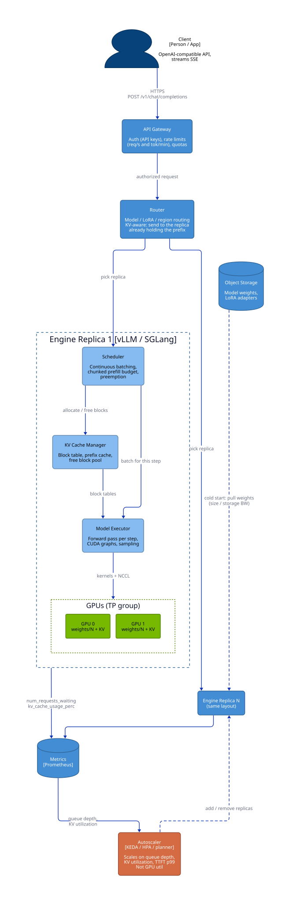

# Step time and the roofline

This part of [Serving, Capacity & Load Testing: Math to Code](README.md) develops the mechanisms below. Work the numerical examples or trace the code before checking the answer.

> **Learning objectives**
> - Identify whether compute, memory traffic, communication, or overhead limits a workload.

## The step-time equation

A serving engine runs a loop: pick a batch of sequences, run one forward pass, append one token to each (or a chunk of prompt for sequences still prefilling), and repeat. The **step time** of that loop is

$$t_\text{step} \approx \max\left(\frac{\text{FLOPs}_\text{step}}{\text{peak\_FLOPs} \times \text{MFU}},\ \frac{\text{bytes}_\text{step}}{\text{HBM\_BW} \times \text{MBU}}\right) + t_\text{comm} + t_\text{overhead}$$

$$\text{bytes}_\text{step} \approx \frac{W_\text{active}}{N_\text{gpu}} + \sum_\text{seq} \frac{\text{ctx}_\text{seq} \times \text{KV}_\text{tok}}{N_\text{gpu}}$$

where MFU and MBU are the fractions of peak compute and peak memory bandwidth the engine actually achieves. Every metric a customer cares about is a function of that equation. TPOT is $t_\text{step}$ during decode; TTFT is queueing plus the prefill steps; throughput is $\text{batch} / t_\text{step}$; and cost is the fleet price in USD/hour divided by throughput in the corresponding units. Every engine knob changes a term of it: batch size, bytes per weight, bytes per KV element, $N_\text{gpu}$, or how prefill tokens are mixed in. The engineer's job is to know which term dominates for this customer's traffic and to move that one.

It also helps to know where this loop sits in a production stack. The gateway and router decide *which* replica runs a request; the engine's scheduler and KV cache manager decide *when*, and *with how much memory*; and the autoscaler closes the loop on queue depth and KV utilization.



The first term of the step-time equation to understand is the `max`: whether a step is limited by compute or by memory. That is what the roofline tells you.

## Prefill versus decode: the roofline

The **arithmetic intensity** of a computation is $I = \text{FLOPs} / \text{bytes moved}$. The **roofline model** says attainable throughput is $\min(\text{peak\_FLOPs}, I \times \text{BW})$, and the **ridge point** $I^* = \text{peak} / \text{BW}$ separates memory-bound work ($I < I^*$) from compute-bound work. For an H100 SXM, with 989 TFLOP/s of dense BF16, 1979 TFLOP/s of dense FP8, and 3.35 TB/s of HBM3, the ridge point is $I^* \approx 295$ FLOP/B for BF16 and about 590 FLOP/B for FP8. The H200 keeps the same FLOPs but raises bandwidth to 4.8 TB/s, which is why it decodes faster in the same price class.

Linear layers dominate the FLOPs, so they decide which side of the ridge a step falls on. For a $d_\text{in} \times d_\text{out}$ weight and $T$ tokens in the step, the FLOPs are $2 T d_\text{in} d_\text{out}$ and the weight bytes are $b\, d_\text{in} d_\text{out}$, so $I \approx 2T/b$. At BF16 ($b = 2$), **the intensity equals the number of tokens in the step**. That one fact explains the two phases.

In **prefill**, $T$ is the prompt length, say 2048, so $I \approx 2048 \gg 295$: prefill is compute-bound. A lower bound on prefill time is $t \approx 2Pn / (\text{peak} \times \text{MFU})$ for $P$ parameters and $n$ prompt tokens. For Llama-3.1-8B with a 2048-token prompt, that is $2 \times 8 \times 10^9 \times 2048 / 989 \times 10^{12} \approx 33$ ms at 100% MFU, and roughly 50 to 60 ms in practice.

In **decode**, $T$ is the batch size $B$, since each sequence contributes one new token. At $B = 1$, $I \approx 1$, and the GPU's compute is about 300 times underused. The step costs one full read of the weights plus the KV history. That gives a bound on single-sequence decode speed:

$$\text{tok/s per sequence} \le \frac{\text{BW} \times \text{MBU}}{W/N + \text{ctx} \times \text{KV}_\text{tok}/N}$$

For Llama-3.1-8B in BF16 on one H100, the weights alone give $3.35 \times 10^{12} / 16.06 \times 10^9 \approx 209$ tok/s, and about 202 tok/s with a 4k-token KV history. Real engines reach an **MBU** of 60 to 85%. Decode is a bandwidth problem and prefill is a compute problem: a decode step reads every weight once to produce one token per sequence.

**Batching** is what rescues decode, and it is the whole economic engine of an inference cloud. Increasing $B$ adds only KV bytes per step, because the weights are shared, so aggregate tokens per second rise almost linearly until one of three things happens: the KV reads dominate, KV memory runs out, or $B$ approaches $I^*$ and decode turns compute-bound. Note that attention itself never batches. Each sequence reads its own KV, so attention's intensity stays around 1, raised to the group size by GQA.

**Mixture-of-experts** models complicate the picture. Their per-token FLOPs scale with **active** parameters, but at large batch nearly every expert is touched each step, so bytes per step trend toward **total** parameters. MoE is cheap at high batch and expensive at batch 1.

The decode section of [`code/capacity.py`](code/capacity.py) implements exactly this reasoning, computing both the memory time and the compute time of a step and taking the larger:

```python
w_read = m.active * a.weight_bytes / n_gpus              # weights touched per step, per GPU
step_bytes_b = w_read + batch * avg_ctx * kv_tok_per_gpu  # plus every sequence's KV history
t_mem_b = step_bytes_b / (hbm_bw * mbu)
t_cmp_b = 2 * m.active * batch / (peak * tp)              # linear-layer FLOPs
agg_tok_s = batch / max(t_mem_b, t_cmp_b)
```

## Summary

Identify whether compute, memory traffic, communication, or overhead limits a workload. State the assumptions before applying the result to a different workload.

## Review questions

1. Can increasing batch size move decode toward a compute bottleneck?

   <details><summary>Answer</summary>

   Yes. Reusing weights across more sequences raises arithmetic intensity; attention traffic, communication, and latency constraints still matter.

   </details>

[Chapter contents](README.md) · [Next: Memory budget and serving SLOs](02-memory-budget-and-slos.md)
