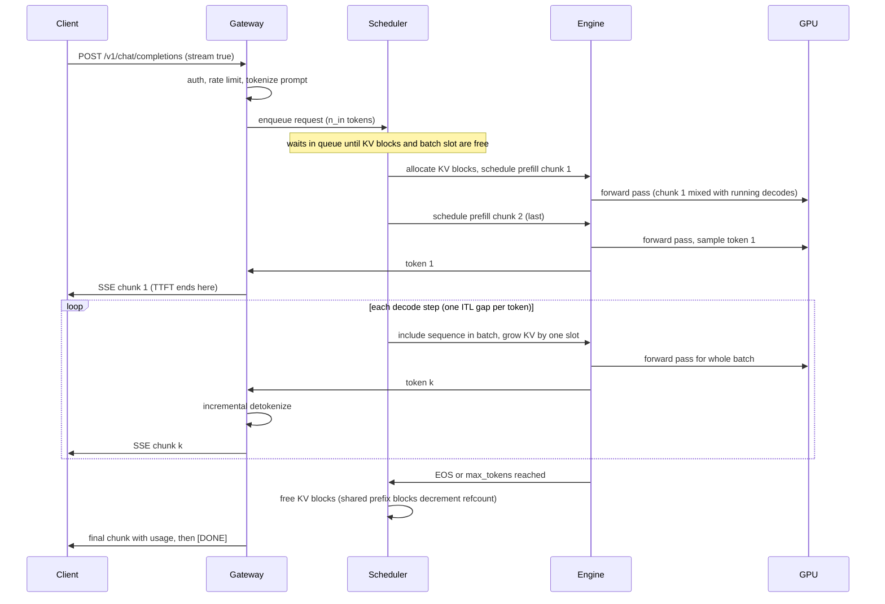

# Memory budget and serving SLOs

This part of [Serving, Capacity & Load Testing: Math to Code](README.md) develops the mechanisms below. Work the numerical examples or trace the code before checking the answer.

> **Learning objectives**
> - Derive cache capacity and distinguish admitted concurrency from stable throughput.

## The memory budget

If batching is the lever, memory is the limit: after the weights, every remaining byte is KV cache, and the KV pool decides how many sequences can be in flight. Building the budget term by term shows where concurrency, context length, and cost per token come from.

**Weights** take $W = \text{params} \times \text{bytes/param}$: 2 bytes for BF16, 1 for FP8 or INT8, and about 0.5 for INT4 plus group scales. Under tensor parallelism each GPU holds $W/\text{TP}$.

**KV cache per token** is

$$\text{KV}_\text{tok} = 2 \times L \times n_\text{kv} \times d_\text{head} \times b_\text{kv}$$

where the 2 counts K and V. It is sharded across TP ranks by KV head, but **replicated** once $\text{TP} > n_\text{kv}$. **Grouped-query attention** shrinks $n_\text{kv}$: Llama-3.1-8B has 32 query heads but 8 KV heads, giving 128 KiB per token instead of the 512 KiB that multi-head attention would need. That factor of 4 is four times the concurrent users. **Multi-head latent attention** (MLA, in DeepSeek-V2 and V3) goes further, caching one compressed latent per layer shared by all heads: $\text{KV}_\text{tok} = L \times (d_c + d_\text{rope}) \times b = 61 \times (512 + 64) \times b$. At FP8 that is 34.3 KiB per token for a 671B model, smaller than the 8B Llama at BF16. The latent is **replicated** across TP ranks, which is why DeepSeek deployments use DP attention (SGLang `--enable-dp-attention`) or decode context parallelism (vLLM `--decode-context-parallel-size`).

**Activation headroom** is the remaining fixed cost. At startup the engine profiles a forward pass at `max_num_batched_tokens`, and it also needs CUDA graph pools and NCCL buffers. Budget 1 to 4 GiB per GPU, and more for large vocabularies, since the logits tensor is $\text{tokens} \times \text{vocab} \times 4$ bytes.

Putting the terms together, the KV pool is

$$\text{KV}_\text{pool} = \text{util} \times M_\text{gpu} - W/N - \text{activations}$$

where `util` is set by vLLM's `--gpu-memory-utilization` or SGLang's `--mem-fraction-static`. Concurrency then follows from one division: $\text{max\_tokens} = \text{KV}_\text{pool} / \text{KV}_\text{tok per GPU}$ and $\text{max\_seqs} = \text{max\_tokens} / \text{ctx}$. With PagedAttention, the context that counts is the **live** one, not `max_model_len`, because requests hold only the blocks they have filled.

### Working the budget for real models

Here is the budget computed by `capacity.py` for an H100 with 80 GiB, `util = 0.90`, a 2 GiB reserve, and 8,192-token sequences:

| Config | GPUs | Weights/GPU | KV pool/GPU | KV/token/GPU | Max KV tokens | Seqs @ 8k | Single-stream bound |
|--------|------|-------------|-------------|--------------|---------------|-----------|---------------------|
| 8B BF16, BF16 KV | 1 | 14.96 GiB | 55.04 GiB | 128 KiB | 450,912 | 55 | 202 tok/s |
| 8B FP8, FP8 KV | 1 | 7.48 GiB | 62.52 GiB | 64 KiB | 1,024,352 | 125 | 404 tok/s |
| 70B BF16 | 1 | 131.5 GiB | does not fit | | | | |
| 70B BF16, TP=2 | 2 | 65.75 GiB | 4.25 GiB | 160 KiB | 27,844 | 3.4 | 47 tok/s |
| 70B BF16, TP=4 | 4 | 32.88 GiB | 37.12 GiB | 80 KiB | 486,596 | 59 | 94 tok/s |
| 70B FP8, FP8 KV | 1 | 65.75 GiB | 4.25 GiB | 160 KiB | 27,844 | 3.4 | 47 tok/s |
| 70B FP8, FP8 KV, TP=2 | 2 | 32.88 GiB | 37.12 GiB | 80 KiB | 486,596 | 59 | 94 tok/s |

To check one row: 80 GiB at 0.90 is 72 GiB; subtract 14.96 GiB of 8B BF16 weights and the 2 GiB reserve to get 55.04 GiB of KV pool, which at 128 KiB per token holds about 451,000 tokens (450,912 in the table, which uses the unrounded weight size), or 55 sequences of 8,192 tokens.

Read the table the way a customer will. **70B BF16 on 2 GPUs technically fits and is useless**, since it holds about 3 concurrent 8k sequences. FP8 on TP=2 gives the same concurrency as BF16 on TP=4 with half the GPUs, which is why FP8 (with an accuracy check; see [Quantization: Math to Code](../01-quantization/README.md)) is the default recommendation for 70B-class dense models on Hopper. To reproduce the last row:

```bash
python code/capacity.py --preset llama-3.1-70b --tp 2 --weight-bytes 1 --kv-bytes 1
```

## Metrics, SLOs, and Little's law

The step-time equation and the memory budget describe the engine. The customer, though, experiences latency distributions, and the contract is written in those. Getting the definitions exactly right matters, because each one hides a different failure.

**TTFT** (time to first token) is queueing plus prefill, plus network. It governs perceived responsiveness for chat and streaming UIs. **TPOT** (time per output token) is $(\text{E2E} - \text{TTFT}) / (n_\text{out} - 1)$, a per-request average. **ITL** (inter-token latency) is each individual gap between tokens, and its p99 exposes stalls that the TPOT average hides: a long prefill scheduled into the batch freezes every decoding stream for one step. **E2E latency** is approximately $\text{TTFT} + \text{TPOT} \times (n_\text{out} - 1)$, and it is what batch and agent workloads care about. **Throughput** can mean output tokens per second (decode capacity), total tokens per second (input plus output, for prefill-heavy RAG), or requests per second, so always say which.

The number that sets the price is **goodput** ([DistServe](https://arxiv.org/abs/2401.09670)): the maximum request rate at which at least X% of requests meet **both** the TTFT and the TPOT SLO. SLOs are distributions. TTFT and TPOT at p99 under a stated arrival process are the contract; mean throughput at infinite load is a marketing number. Use p50 for typical experience and p99 for the contract, and compute percentiles over requests (or over individual ITL gaps), never over per-second averages: the p99 of a mean is meaningless.

These definitions come together in the **latency-throughput curve**. Plot TPOT p50 and p99 and TTFT p99 against achieved throughput as offered load rises. TPOT rises slowly as batches grow; then TTFT goes vertical when the arrival rate exceeds the service rate and the queue grows without bound. The usable operating point is the knee, before the vertical.

Two pieces of queueing theory let you predict that knee. **Little's law**, $L = \lambda W$, says the mean number of in-flight requests equals the arrival rate times the mean time in the system. At 10 req/s and a 6 s mean E2E, 60 requests are in flight, so you need `--max-num-seqs` of at least 60 **and** a KV pool for $60 \times$ the mean context in tokens, or the excess queues and TTFT grows. And for an M/M/1-like server, mean wait grows as $\rho / (1 - \rho)$ in the utilization $\rho$: at 90% utilization the queue is 9 times the service time, and at 95% it is 19 times. On bursty traffic, size for 60 to 75% of measured saturation.

It helps to see where each metric is measured in the life of one streaming request. TTFT spans arrival to the first server-sent-event chunk; every later gap is one ITL sample; TPOT is their mean.



Different workloads weight these metrics differently. The targets below are illustrative, but the pattern of which SLO matters, and what to optimize for it, is general:

| Workload | Primary SLO | Typical targets (illustrative) | What to optimize |
|----------|-------------|-------------------------------|------------------|
| Chat UI | TTFT p99, TPOT p50 | TTFT < 500 ms, TPOT < 30-50 ms (faster than reading) | Prefix caching, chunked prefill, moderate batch |
| Code completion | TTFT p99, E2E | TTFT < 200 ms, short outputs | Small model, spec decoding, low batch |
| RAG / long-context QA | TTFT at long inputs | TTFT < 2 s at 32k input | Prefill throughput, prefix cache, disaggregation |
| Agents / tool loops | E2E per turn | Many sequential calls, each adds TTFT | Prefix caching across turns, spec decoding |
| Offline batch | Cost per 1M tokens | Throughput only | Max batch, FP8, `--max-num-seqs` high |

## Summary

Derive cache capacity and distinguish admitted concurrency from stable throughput. State the assumptions before applying the result to a different workload.

## Review questions

1. Why is KV capacity not a promised concurrency SLO?

   <details><summary>Answer</summary>

   It is a memory bound. Queueing, compute, bandwidth, sequence lengths, and per-user latency can impose a lower limit.

   </details>

[Chapter contents](README.md) · [Next: Parallelism and disaggregation](03-parallelism-and-disaggregation.md)
