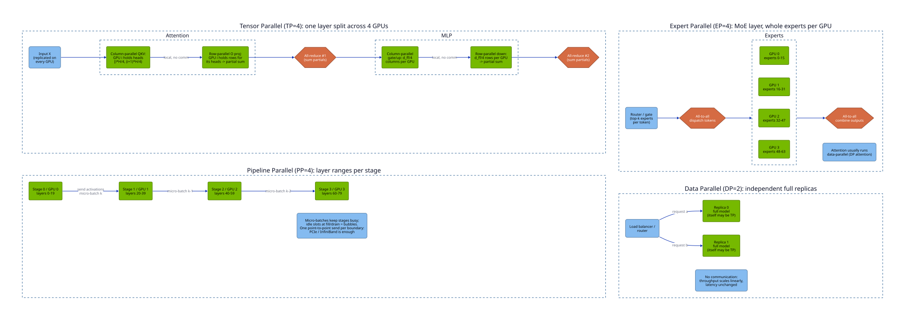
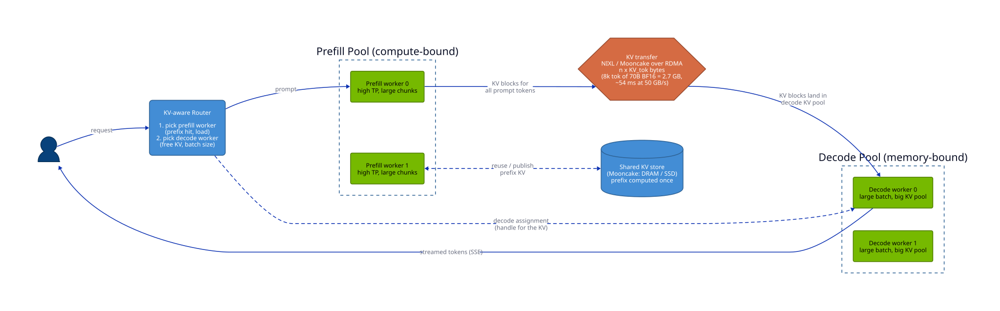

# Parallelism and disaggregation

This part of [Serving, Capacity & Load Testing: Math to Code](README.md) develops the mechanisms below. Work the numerical examples or trace the code before checking the answer.

> **Learning objectives**
> - Choose a serving layout using memory needs and interconnect costs.

## Parallelism: TP, PP, DP, EP, CP, and disaggregation

When a model does not fit one GPU, or one GPU cannot meet the latency SLO, the $N_\text{gpu}$ term and the $t_\text{comm}$ term of the step-time equation come into play. Each parallelism strategy places the model differently and pays a different communication cost.

**Tensor parallelism** (TP, from [Megatron-LM](https://arxiv.org/abs/1909.08053)) splits each matmul across $N$ GPUs. Weights and KV per GPU shrink by $N$, so **per-token latency drops**. The cost is two all-reduces per layer of $T \times d \times b$ bytes each, with ring time about $2(N-1)/N \times \text{size} / \text{link\_BW}$. TP needs NVLink: H100 NVLink 4 gives 900 GB/s per GPU, versus about 64 GB/s per direction for PCIe Gen5 x16. Keep TP inside one NVLink domain, which is 8 GPUs on HGX and 72 on GB200 NVL72.

**Pipeline parallelism** (PP) splits the layers into stages. It needs one point-to-point send per stage boundary per microbatch, so it tolerates PCIe and InfiniBand (NDR is 400 Gb/s, about 50 GB/s per port). It does not reduce single-request latency and it adds pipeline bubbles; use it to span nodes when a model will not fit in one NVLink domain.

**Data parallelism** (DP) runs independent replicas behind a load balancer. Throughput scales linearly, latency is unchanged, and there is no communication. It is the default for anything that fits on one GPU or one TP group: two TP=1 replicas of an 8B model beat one TP=2 replica on throughput per GPU.

**Expert parallelism** (EP) is for MoE models. It places whole experts on different GPUs and routes tokens to them with all-to-all communication, avoiding TP's per-expert matmul slicing (small experts slice badly). It is usually combined with DP attention, in which attention runs data-parallel and the MoE layers run expert-parallel. In vLLM that is `--enable-expert-parallel` with `--data-parallel-size`; in SGLang, `--ep-size` with `--enable-dp-attention`.

**Context or sequence parallelism** (CP) splits one long sequence's tokens across GPUs, ring-attention style, for prefill of prompts of 128k tokens and more, or shards its KV for decode. vLLM exposes `--prefill-context-parallel-size` and `--decode-context-parallel-size`.

The diagram shows how each strategy places the model and which collective it pays:



### Disaggregated prefill and decode

The last strategy separates the two phases themselves. **Disaggregated prefill/decode** runs prefill and decode on separate GPU pools and ships the KV cache between them. The rationale, from [DistServe](https://arxiv.org/abs/2401.09670) and [Splitwise](https://arxiv.org/abs/2311.18677), is that the phases interfere (a prefill stalls every decode in the batch) and want different parallelism and even different hardware. [Mooncake](https://arxiv.org/abs/2407.00079), from Kimi, adds a KV-cache-centric store across DRAM and SSD so that prefixes are computed once cluster-wide.

The **KV transfer cost** decides whether disaggregation pays: shipping $n \times \text{KV}_\text{tok}$ bytes must take less time than the decode interference it removes. For 8k tokens of 70B BF16 KV, that is $8192 \times 320$ KiB $\approx 2.7$ GB, about 54 ms at 50 GB/s RDMA, which is why disaggregation needs RDMA (NIXL, the Mooncake transfer engine) and not TCP. Implementations include vLLM's `--kv-transfer-config` with connectors (NIXL, LMCache, Mooncake), SGLang's `--disaggregation-mode prefill|decode`, and [NVIDIA Dynamo](https://github.com/ai-dynamo/dynamo), which orchestrates disaggregated vLLM, SGLang, or TensorRT-LLM workers with a KV-aware router and a planner that rebalances prefill and decode GPUs.

Disaggregated serving moves the prefill/decode split from inside one engine's batch to two GPU pools, with the router choosing a worker in each and the KV cache crossing RDMA:



The strategies compare as follows:

| Strategy | Reduces latency | Raises throughput | Interconnect need | Use when |
|----------|-----------------|-------------------|-------------------|----------|
| DP | No | Yes, linear | None | Model fits one GPU or one TP group |
| TP | Yes | Per replica | NVLink | Model too big for one GPU, or TPOT SLO too tight |
| PP | No | Yes, with bubbles | PCIe / IB fine | Model too big for one node |
| EP (+ DP attn) | Somewhat | Yes for MoE | NVLink / fast IB all-to-all | Large MoE (DeepSeek, Qwen-MoE, Llama-4) |
| CP | Yes for long prefill | No | NVLink | 128k+ contexts |
| P/D disaggregation | Stabilizes TPOT and TTFT | Yes at scale | RDMA | Long prompts, strict TPOT, many replicas |

### Working out the TP communication cost

To see why TP needs NVLink, compute $t_\text{comm}$ for Llama-3.1-70B decode at batch 64 in BF16 with TP=4:

```
per all-reduce:   T × d × b = 64 × 8192 × 2 B          = 1.05 MB
ring traffic:     2(N−1)/N × 1.05 MB = 1.5 × 1.05 MB   = 1.57 MB per GPU
per layer:        2 all-reduces                        = 3.1 MB
per step:         80 layers                            = 252 MB
time at ~450 GB/s effective NVLink (one direction)     ≈ 0.56 ms
time at ~50 GB/s effective PCIe Gen5                   ≈ 5 ms
```

Against a memory-bound step of roughly 16 ms (see `capacity.py --preset llama-3.1-70b --tp 4`), NVLink adds about 3% and PCIe adds about 30%, before the latency effects of 160 small collectives. This is why TP across PCIe-only cards, such as L40S boxes, is usually capped at 2, and why replicas (DP) beat TP there.

## Summary

Choose a serving layout using memory needs and interconnect costs. State the assumptions before applying the result to a different workload.

## Review questions

1. Why can a second GPU make a small model slower?

   <details><summary>Answer</summary>

   The extra synchronization and transfers can exceed the computation saved.

   </details>

[Chapter contents](README.md) · [Next: Engine controls and speculation](04-engine-controls-and-speculation.md)
