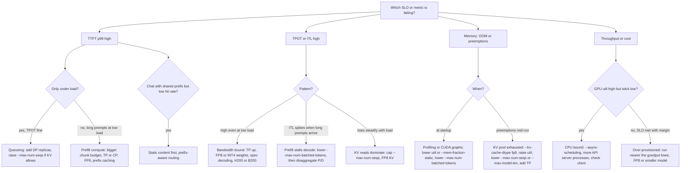

# Engine controls and speculation

This part of [Serving, Capacity & Load Testing: Math to Code](README.md) develops the mechanisms below. Work the numerical examples or trace the code before checking the answer.

> **Learning objectives**
> - Map a performance symptom to a measurable scheduling or execution control.

## Engine knobs

With the hardware layout decided, the engine's scheduler determines how well the GPUs are used. Every knob moves a point along one curve: bigger batches raise throughput and raise TPOT; chunked prefill trades a little TTFT for stable TPOT; speculative decoding buys latency at low load and costs throughput at high load. Five mechanisms underlie the flags.

**Continuous batching** ([Orca](https://www.usenix.org/conference/osdi22/presentation/yu)) schedules per iteration rather than per request, so sequences join and leave the batch every step. Every modern engine does this. **PagedAttention** ([2309.06180](https://arxiv.org/abs/2309.06180)) stores KV in fixed-size blocks with a block table, so memory is allocated as tokens arrive; this removes fragmentation and enables block sharing for prefixes.

**Chunked prefill** ([Sarathi-Serve](https://arxiv.org/abs/2403.02310)) caps the tokens per step (`max_num_batched_tokens`). Long prompts are split into chunks and co-scheduled with decodes, which bounds the step time so ITL p99 stays flat. A smaller budget gives better ITL and worse TTFT for long prompts; a larger one, the reverse.

**Prefix caching** hashes KV blocks by token content (vLLM) or keeps a radix tree of prefixes (SGLang's **RadixAttention**). System prompts, few-shot examples, multi-turn chat, and agent loops get TTFT near zero for the cached part. SGLang's `--schedule-policy lpm` (longest prefix match) orders the queue to maximize hits.

**Preemption** happens when the KV pool fills mid-generation: the engine evicts a sequence and recomputes it later. It shows up as TPOT spikes and a preemption counter in metrics. Fix it with more KV memory, a lower `--max-num-seqs`, or FP8 KV.

These mechanisms are controlled by flags. For each one, the useful question is which term of the memory budget or the step-time equation it changes; if you cannot answer that, you do not yet understand the flag. Here are the vLLM flags (`vllm serve`, [engine args](https://docs.vllm.ai/en/latest/configuration/engine_args.html)):

| Flag | Term it changes | Notes |
|------|-----------------|-------|
| `--tensor-parallel-size` / `-tp` | `N` in `W/N`, `KV/N` | Within NVLink domain |
| `--pipeline-parallel-size` / `-pp` | Layers per GPU | Across nodes |
| `--data-parallel-size` / `-dp` | Replicas | Also used for DP attention with EP |
| `--enable-expert-parallel` / `-ep` | MoE layout | EP instead of TP for MoE layers |
| `--max-model-len` | Max context | Must fit one sequence in the KV pool; lower it to start on small GPUs |
| `--gpu-memory-utilization` | `util` | Fraction of GPU memory for the engine; the KV pool is what is left after weights and profiling |
| `--max-num-seqs` | Max batch `B` | Upper bound on concurrency per step |
| `--max-num-batched-tokens` | Tokens per step | The chunked-prefill budget; defaults vary by version and GPU, read it from the startup log |
| `--enable-chunked-prefill` | Prefill mixing | On by default in the V1 engine |
| `--enable-prefix-caching` | Prefix reuse | On by default in V1; `--no-enable-prefix-caching` for clean benchmarks |
| `--kv-cache-dtype` | `b_kv` | `auto`, `fp8` (and `fp8_e4m3` / `fp8_e5m2` variants) |
| `--quantization` / `-q` | `b` for weights | `fp8`, `awq`, `gptq`, `compressed-tensors` checkpoints auto-detected |
| `--speculative-config` / `-sc` | Tokens per step | JSON: `{"method": "eagle3", "model": ..., "num_speculative_tokens": 3}`; methods include `draft_model`, `ngram`, `eagle`, `eagle3`, `mtp`, `suffix` |
| `--enable-lora`, `--max-loras`, `--max-lora-rank` | Adapter slots | `--max-loras` adapters per batch (default 1), rank options up to 512 |
| `--kv-transfer-config` | P/D disaggregation | JSON naming a KV connector |
| `--async-scheduling` | CPU overhead | Overlaps scheduling with GPU execution |

SGLang (`python -m sglang.launch_server`, [server arguments](https://docs.sglang.io/advanced_features/server_arguments.html)) exposes the same mechanisms under different names, plus a few scheduling controls of its own:

| SGLang flag | vLLM analogue | Notes |
|-------------|---------------|-------|
| `--tp-size` / `--tp` | `--tensor-parallel-size` | |
| `--dp-size` | `--data-parallel-size` | Router across replicas built in |
| `--ep-size`, `--enable-dp-attention` | `--enable-expert-parallel` | Standard DeepSeek recipe |
| `--context-length` | `--max-model-len` | |
| `--mem-fraction-static` | `--gpu-memory-utilization` | Weights + KV pool fraction; lower it if you see OOM during CUDA graph capture |
| `--max-running-requests` | `--max-num-seqs` | |
| `--chunked-prefill-size` | `--max-num-batched-tokens` | `-1` disables chunking |
| `--schedule-policy` | (none) | `fcfs` default; `lpm` for prefix-heavy traffic; also `dfs-weight`, `lof`, `priority`, `random` |
| `--schedule-conservativeness` | (none) | Higher reserves more KV for running requests, fewer preemptions |
| `--disable-radix-cache` | `--no-enable-prefix-caching` | RadixAttention is on by default |
| `--kv-cache-dtype` | `--kv-cache-dtype` | `auto`, `fp8_e4m3`, `fp8_e5m2`, `bf16`, plus FP4 variants on Blackwell |
| `--speculative-algorithm` | `--speculative-config` method | `EAGLE`, `EAGLE3`, `NEXTN` (MTP), `STANDALONE` (draft model), `NGRAM`; with `--speculative-draft-model-path`, `--speculative-num-steps`, `--speculative-eagle-topk`, `--speculative-num-draft-tokens` |
| `--enable-lora`, `--lora-paths`, `--max-loras-per-batch` | `--enable-lora`, `--max-loras` | `--max-loras-per-batch` default 8 |
| `--disaggregation-mode` | `--kv-transfer-config` | Separate prefill and decode servers |

Two other systems round out the picture. **TensorRT-LLM** compiles the model (or, with its PyTorch backend, loads it) with fused kernels tuned per GPU, and serves through `trtllm-serve` with an OpenAI-compatible API. It typically wins on NVIDIA hardware at fixed shapes and loses on iteration speed when the customer changes models weekly. **NVIDIA Dynamo** is a layer above engines: an OpenAI-compatible frontend, a KV-aware router that sends a request to the worker already holding its prefix, disaggregated prefill and decode with NIXL transfers, and a planner that scales the prefill and decode pools on SLO signals.

### From symptom to knob

In practice you work backward from a broken metric, diagnosing with the engine's Prometheus metrics first. This table maps each common symptom to its likely cause and the knob that addresses it:

| Symptom | Likely cause | Knob |
|---------|--------------|------|
| TTFT p99 spikes under load, TPOT fine | Queueing: arrival rate near capacity | Add replicas (DP), raise `--max-num-seqs` if KV allows |
| ITL p99 spikes when long prompts arrive | Prefill stalls decode | Lower `--max-num-batched-tokens` / `--chunked-prefill-size`; at scale, disaggregate P/D |
| TTFT high for long prompts at low load | Prefill compute | Raise chunk budget, TP, or CP; FP8 weights; prefix caching for shared context |
| TPOT high at low load | Bandwidth per GPU | TP up, FP8/INT4 weights, speculative decoding, H200/B200 |
| TPOT degrades steadily with load | Batch growing, KV reads dominate | Cap `--max-num-seqs`; FP8 KV; accept the curve |
| Preemptions / recompute in logs | KV pool exhausted | `--kv-cache-dtype fp8`, raise `util`, lower `--max-num-seqs` or `--max-model-len`, add TP |
| OOM at startup | Profiling or CUDA graph capture | Lower `util` / `--mem-fraction-static`, lower `--max-num-batched-tokens` |
| Low prefix-cache hit rate on chat | Unstable prompt prefix, or replicas not prefix-aware | Put static content first; use prefix-aware routing (SGLang router, Dynamo, llm-d) |
| GPU util high, tok/s low | CPU-bound scheduler, tiny batches, detokenization | `--async-scheduling`, more API server processes, check client |
| Throughput fine, cost too high | Over-provisioned for SLO | Find goodput knee, run nearer it, consider FP8 or a smaller model |

The same table works as a decision path, starting from the metric that breaks the SLO:

## Speculative decoding

One knob deserves its own derivation, because whether it helps depends on exactly where you sit on the roofline. The idea ([Leviathan et al.](https://arxiv.org/abs/2211.17192)) is that a cheap drafter proposes $\gamma$ tokens and the target model verifies all $\gamma + 1$ positions in one forward pass. Since decode is memory-bound, verifying 5 tokens costs about the same bytes as producing 1. Rejection sampling keeps the output distribution **exactly** the target's.

With a per-token acceptance rate $\alpha$, assumed independent across positions, the expected number of tokens produced per target step is

$$\mathbb{E}[\text{tokens}] = \frac{1 - \alpha^{\gamma+1}}{1 - \alpha}$$

and the speedup is $S = \mathbb{E}[\text{tokens}] / (1 + \gamma c)$, where $c$ is the drafter's step cost relative to the target. For example, with $\alpha = 0.8$ and $\gamma = 4$, $\mathbb{E} = (1 - 0.328)/0.2 = 3.36$; with $c = 0.05$, the size of an EAGLE head, $S = 3.36 / 1.2 = 2.8\times$.

The same arithmetic shows when it hurts. At high batch the target step is already near the ridge point. Verification multiplies the tokens per step by $\gamma + 1$, so once the step is compute-bound it costs about $(\gamma + 1)\times$ as much, and $S \to \mathbb{E} / (\gamma + 1) = 3.36 / 5 = 0.67$: a 33% slowdown. The rule is a big win at low concurrency and neutral to negative at high concurrency. Measure $\alpha$ on the customer's traffic, not on a benchmark.

The drafter can come from several places, and each family's acceptance rate is driven by something different:

| Method | Drafter | `α` driver | Engine support |
|--------|---------|------------|----------------|
| Draft model | Small model of the same family (e.g. 1B for 70B) | Family similarity | vLLM `draft_model`, SGLang `STANDALONE` |
| [Medusa](https://arxiv.org/abs/2401.10774) | Extra decoding heads on the target | Head training | Largely superseded by EAGLE |
| [EAGLE-3](https://arxiv.org/abs/2503.01840) | One-layer head on target's multi-layer features, trained with test-time simulation | Fused low/mid/high features | vLLM `eagle3`, SGLang `EAGLE3` |
| MTP ([DeepSeek-V3](https://arxiv.org/abs/2412.19437)) | Multi-token-prediction modules trained with the model | Native | vLLM `mtp`, SGLang `NEXTN` |
| N-gram / prompt lookup | Copy spans from the prompt | Output repeats input (RAG, code edit, summarization) | vLLM `ngram`, SGLang `NGRAM` |
| Suffix decoding | Suffix trees over prompt and prior outputs | Repetitive agent loops | vLLM `suffix` |

> **Tip:** Configure low. Start at `num_speculative_tokens` of 2 or 3: the acceptance-weighted gain flattens fast, while the high-batch penalty grows linearly in $\gamma$.

## Summary

Map a performance symptom to a measurable scheduling or execution control. State the assumptions before applying the result to a different workload.

## Review questions

1. What must remain fixed during a speculative decoding speed comparison?

   

Answer

   The target model and distribution, request mix, output budget, hardware, and quality criteria. Count draft and verification cost.

   

[Chapter contents](README.md) · [Next: Adapters and elastic capacity](05-adapters-and-elastic-capacity.md)
