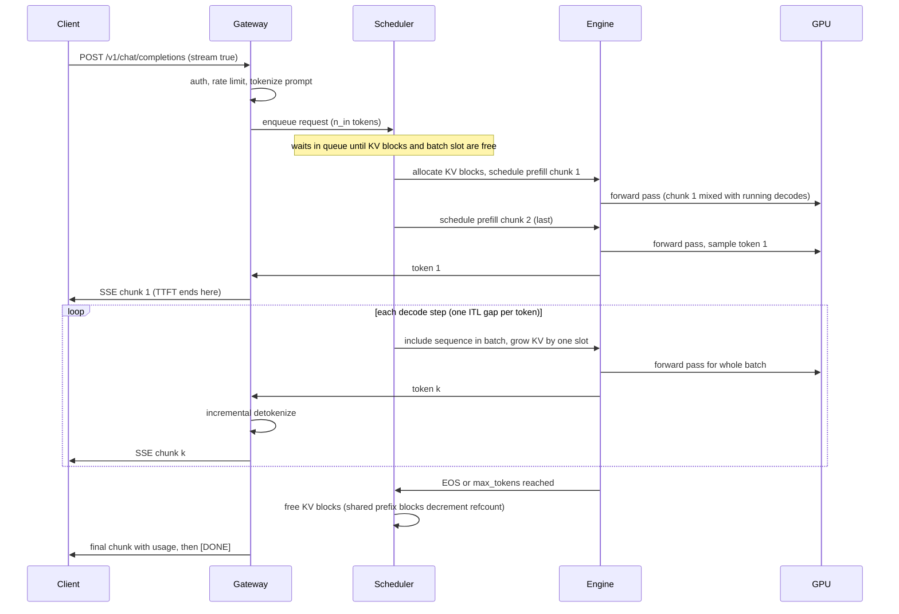
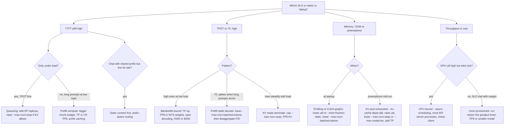

# Serving, Capacity & Load Testing: Math to Code

The chapter so far has explained how inference works: prefill and decode, the KV cache, batching, quantization, and parallelism. This section turns that understanding into a professional skill: sizing, configuring, benchmarking, and explaining a real LLM deployment. Picture the engineer who inherits a customer deployment at an inference cloud from an ML or performance engineer and must defend every number in it, both to a researcher who asks *why* and to a buyer who asks *how much*. Everything here is organized as math first, then the code and engine flags that implement it.

The thread that ties it together is a single equation for the time of one engine step. Once you can write it down, every metric a customer cares about, time to first token, time per output token, throughput, and cost, becomes a function of it, and every engine knob becomes a way of changing one of its terms. We derive the roofline that separates prefill from decode, build a memory budget that decides concurrency, define the metrics and SLOs that form the contract, and then work through parallelism, engine knobs, speculative decoding, multi-LoRA serving, and load-testing methodology. The section ends with a runbook that takes a customer's SLO to a deployment config.

This section builds on the chapter opening, [LLM Systems & Inference](../README.md) (prefill, decode, and the KV cache), and on [Quantization: Math to Code](../01-quantization/README.md) for what FP8 and INT4 buy. The queueing and percentile math uses Poisson processes from [Probability and Statistics](../../../mathematics/13-probability-statistics/README.md) in *Mathematics*, and the metrics side connects to [Observability](../../../systems/11-observability/README.md) in *Systems Engineering*. Runnable, stdlib-only tools live in [`code/`](code/README.md): a capacity calculator and an open-loop load generator with an offline mock engine. Engine flags were reviewed against the vLLM and SGLang documentation in October 2026.

> **Learning objectives**
> - Write the step-time equation for a serving engine and use the roofline to explain why prefill is compute-bound and decode is bandwidth-bound.
> - Build a GPU memory budget and derive maximum concurrency from the KV-cache size per token.
> - Define TTFT, TPOT, ITL, throughput, and goodput, and use Little's law and queueing intuition to size for a target load.
> - Choose a parallelism strategy and engine flags for a workload, and map a failing SLO to the knob that fixes it.
> - Design an open-loop load test, find the goodput knee, and present cost per million tokens to both a technical and a business audience.

## The step-time equation

A serving engine runs a loop: pick a batch of sequences, run one forward pass, append one token to each (or a chunk of prompt for sequences still prefilling), and repeat. The **step time** of that loop is

$$t_\text{step} \approx \max\left(\frac{\text{FLOPs}_\text{step}}{\text{peak\_FLOPs} \times \text{MFU}},\ \frac{\text{bytes}_\text{step}}{\text{HBM\_BW} \times \text{MBU}}\right) + t_\text{comm} + t_\text{overhead}$$

$$\text{bytes}_\text{step} \approx \frac{W_\text{active}}{N_\text{gpu}} + \sum_\text{seq} \frac{\text{ctx}_\text{seq} \times \text{KV}_\text{tok}}{N_\text{gpu}}$$

where MFU and MBU are the fractions of peak compute and peak memory bandwidth the engine actually achieves. Every metric a customer cares about is a function of that equation. TPOT is $t_\text{step}$ during decode; TTFT is queueing plus the prefill steps; throughput is $\text{batch} / t_\text{step}$; and cost is $\$/\text{hr}$ divided by throughput. Every engine knob changes a term of it: batch size, bytes per weight, bytes per KV element, $N_\text{gpu}$, or how prefill tokens are mixed in. The engineer's job is to know which term dominates for this customer's traffic and to move that one.

It also helps to know where this loop sits in a production stack. The gateway and router decide *which* replica runs a request; the engine's scheduler and KV cache manager decide *when*, and *with how much memory*; and the autoscaler closes the loop on queue depth and KV utilization.


The first term of the step-time equation to understand is the `max`: whether a step is limited by compute or by memory. That is what the roofline tells you.

## Prefill versus decode: the roofline

The **arithmetic intensity** of a computation is $I = \text{FLOPs} / \text{bytes moved}$. The **roofline model** says attainable throughput is $\min(\text{peak\_FLOPs}, I \times \text{BW})$, and the **ridge point** $I^* = \text{peak} / \text{BW}$ separates memory-bound work ($I < I^*$) from compute-bound work. For an H100 SXM, with 989 TFLOP/s of dense BF16, 1979 TFLOP/s of dense FP8, and 3.35 TB/s of HBM3, the ridge point is $I^* \approx 295$ FLOP/B for BF16 and about 590 FLOP/B for FP8. The H200 keeps the same FLOPs but raises bandwidth to 4.8 TB/s, which is why it decodes faster in the same price class.

Linear layers dominate the FLOPs, so they decide which side of the ridge a step falls on. For a $d_\text{in} \times d_\text{out}$ weight and $T$ tokens in the step, the FLOPs are $2 T d_\text{in} d_\text{out}$ and the weight bytes are $b\, d_\text{in} d_\text{out}$, so $I \approx 2T/b$. At BF16 ($b = 2$), **the intensity equals the number of tokens in the step**. That one fact explains the two phases.

In **prefill**, $T$ is the prompt length, say 2048, so $I \approx 2048 \gg 295$: prefill is compute-bound. A lower bound on prefill time is $t \approx 2Pn / (\text{peak} \times \text{MFU})$ for $P$ parameters and $n$ prompt tokens. For Llama-3.1-8B with a 2048-token prompt, that is $2 \times 8 \times 10^9 \times 2048 / 989 \times 10^{12} \approx 33$ ms at 100% MFU, and roughly 50 to 60 ms in practice.

In **decode**, $T$ is the batch size $B$, since each sequence contributes one new token. At $B = 1$, $I \approx 1$, and the GPU's compute is about 300 times underused. The step costs one full read of the weights plus the KV history. That gives a bound on single-sequence decode speed:

$$\text{tok/s per sequence} \le \frac{\text{BW} \times \text{MBU}}{W/N + \text{ctx} \times \text{KV}_\text{tok}/N}$$

For Llama-3.1-8B in BF16 on one H100, the weights alone give $3.35 \times 10^{12} / 16.06 \times 10^9 \approx 209$ tok/s, and about 202 tok/s with a 4k-token KV history. Real engines reach an **MBU** of 60 to 85%. Decode is a bandwidth problem and prefill is a compute problem: a decode step reads every weight once to produce one token per sequence.

**Batching** is what rescues decode, and it is the whole economic engine of an inference cloud. Increasing $B$ adds only KV bytes per step, because the weights are shared, so aggregate tokens per second rise almost linearly until one of three things happens: the KV reads dominate, KV memory runs out, or $B$ approaches $I^*$ and decode turns compute-bound. Note that attention itself never batches. Each sequence reads its own KV, so attention's intensity stays around 1, raised to the group size by GQA.

**Mixture-of-experts** models complicate the picture. Their per-token FLOPs scale with **active** parameters, but at large batch nearly every expert is touched each step, so bytes per step trend toward **total** parameters. MoE is cheap at high batch and expensive at batch 1.

The decode section of [`code/capacity.py`](code/capacity.py) implements exactly this reasoning, computing both the memory time and the compute time of a step and taking the larger:

```python
w_read = m.active * a.weight_bytes / n_gpus              # weights touched per step, per GPU
step_bytes_b = w_read + batch * avg_ctx * kv_tok_per_gpu  # plus every sequence's KV history
t_mem_b = step_bytes_b / (hbm_bw * mbu)
t_cmp_b = 2 * m.active * batch / (peak * tp)              # linear-layer FLOPs
agg_tok_s = batch / max(t_mem_b, t_cmp_b)
```

## The memory budget

If batching is the lever, memory is the limit: after the weights, every remaining byte is KV cache, and the KV pool decides how many sequences can be in flight. Building the budget term by term shows where concurrency, context length, and cost per token come from.

**Weights** take $W = \text{params} \times \text{bytes/param}$: 2 bytes for BF16, 1 for FP8 or INT8, and about 0.5 for INT4 plus group scales. Under tensor parallelism each GPU holds $W/\text{TP}$.

**KV cache per token** is

$$\text{KV}_\text{tok} = 2 \times L \times n_\text{kv} \times d_\text{head} \times b_\text{kv}$$

where the 2 counts K and V. It is sharded across TP ranks by KV head, but **replicated** once $\text{TP} > n_\text{kv}$. **Grouped-query attention** shrinks $n_\text{kv}$: Llama-3.1-8B has 32 query heads but 8 KV heads, giving 128 KiB per token instead of the 512 KiB that multi-head attention would need. That factor of 4 is four times the concurrent users. **Multi-head latent attention** (MLA, in DeepSeek-V2 and V3) goes further, caching one compressed latent per layer shared by all heads: $\text{KV}_\text{tok} = L \times (d_c + d_\text{rope}) \times b = 61 \times (512 + 64) \times b$. At FP8 that is 34.3 KiB per token for a 671B model, smaller than the 8B Llama at BF16. The latent is **replicated** across TP ranks, which is why DeepSeek deployments use DP attention (SGLang `--enable-dp-attention`) or decode context parallelism (vLLM `--decode-context-parallel-size`).

**Activation headroom** is the remaining fixed cost. At startup the engine profiles a forward pass at `max_num_batched_tokens`, and it also needs CUDA graph pools and NCCL buffers. Budget 1 to 4 GiB per GPU, and more for large vocabularies, since the logits tensor is $\text{tokens} \times \text{vocab} \times 4$ bytes.

Putting the terms together, the KV pool is

$$\text{KV}_\text{pool} = \text{util} \times M_\text{gpu} - W/N - \text{activations}$$

where `util` is set by vLLM's `--gpu-memory-utilization` or SGLang's `--mem-fraction-static`. Concurrency then follows from one division: $\text{max\_tokens} = \text{KV}_\text{pool} / \text{KV}_\text{tok per GPU}$ and $\text{max\_seqs} = \text{max\_tokens} / \text{ctx}$. With PagedAttention, the context that counts is the **live** one, not `max_model_len`, because requests hold only the blocks they have filled.

### Working the budget for real models

Here is the budget computed by `capacity.py` for an H100 with 80 GiB, `util = 0.90`, a 2 GiB reserve, and 8,192-token sequences:

| Config | GPUs | Weights/GPU | KV pool/GPU | KV/token/GPU | Max KV tokens | Seqs @ 8k | Single-stream bound |
|--------|------|-------------|-------------|--------------|---------------|-----------|---------------------|
| 8B BF16, BF16 KV | 1 | 14.96 GiB | 55.04 GiB | 128 KiB | 450,912 | 55 | 202 tok/s |
| 8B FP8, FP8 KV | 1 | 7.48 GiB | 62.52 GiB | 64 KiB | 1,024,352 | 125 | 404 tok/s |
| 70B BF16 | 1 | 131.5 GiB | does not fit | | | | |
| 70B BF16, TP=2 | 2 | 65.75 GiB | 4.25 GiB | 160 KiB | 27,844 | 3.4 | 47 tok/s |
| 70B BF16, TP=4 | 4 | 32.88 GiB | 37.12 GiB | 80 KiB | 486,596 | 59 | 94 tok/s |
| 70B FP8, FP8 KV | 1 | 65.75 GiB | 4.25 GiB | 160 KiB | 27,844 | 3.4 | 47 tok/s |
| 70B FP8, FP8 KV, TP=2 | 2 | 32.88 GiB | 37.12 GiB | 80 KiB | 486,596 | 59 | 94 tok/s |

To check one row: 80 GiB at 0.90 is 72 GiB; subtract 14.96 GiB of 8B BF16 weights and the 2 GiB reserve to get 55.04 GiB of KV pool, which at 128 KiB per token holds about 451,000 tokens (450,912 in the table, which uses the unrounded weight size), or 55 sequences of 8,192 tokens.

Read the table the way a customer will. **70B BF16 on 2 GPUs technically fits and is useless**, since it holds about 3 concurrent 8k sequences. FP8 on TP=2 gives the same concurrency as BF16 on TP=4 with half the GPUs, which is why FP8 (with an accuracy check; see [Quantization: Math to Code](../01-quantization/README.md)) is the default recommendation for 70B-class dense models on Hopper. To reproduce the last row:

```bash
python code/capacity.py --preset llama-3.1-70b --tp 2 --weight-bytes 1 --kv-bytes 1
```

## Metrics, SLOs, and Little's law

The step-time equation and the memory budget describe the engine. The customer, though, experiences latency distributions, and the contract is written in those. Getting the definitions exactly right matters, because each one hides a different failure.

**TTFT** (time to first token) is queueing plus prefill, plus network. It governs perceived responsiveness for chat and streaming UIs. **TPOT** (time per output token) is $(\text{E2E} - \text{TTFT}) / (n_\text{out} - 1)$, a per-request average. **ITL** (inter-token latency) is each individual gap between tokens, and its p99 exposes stalls that the TPOT average hides: a long prefill scheduled into the batch freezes every decoding stream for one step. **E2E latency** is approximately $\text{TTFT} + \text{TPOT} \times (n_\text{out} - 1)$, and it is what batch and agent workloads care about. **Throughput** can mean output tokens per second (decode capacity), total tokens per second (input plus output, for prefill-heavy RAG), or requests per second, so always say which.

The number that sets the price is **goodput** ([DistServe](https://arxiv.org/abs/2401.09670)): the maximum request rate at which at least X% of requests meet **both** the TTFT and the TPOT SLO. SLOs are distributions. TTFT and TPOT at p99 under a stated arrival process are the contract; mean throughput at infinite load is a marketing number. Use p50 for typical experience and p99 for the contract, and compute percentiles over requests (or over individual ITL gaps), never over per-second averages: the p99 of a mean is meaningless.

These definitions come together in the **latency-throughput curve**. Plot TPOT p50 and p99 and TTFT p99 against achieved throughput as offered load rises. TPOT rises slowly as batches grow; then TTFT goes vertical when the arrival rate exceeds the service rate and the queue grows without bound. The usable operating point is the knee, before the vertical.

Two pieces of queueing theory let you predict that knee. **Little's law**, $L = \lambda W$, says the mean number of in-flight requests equals the arrival rate times the mean time in the system. At 10 req/s and a 6 s mean E2E, 60 requests are in flight, so you need `--max-num-seqs` of at least 60 **and** a KV pool for $60 \times$ the mean context in tokens, or the excess queues and TTFT grows. And for an M/M/1-like server, mean wait grows as $\rho / (1 - \rho)$ in the utilization $\rho$: at 90% utilization the queue is 9 times the service time, and at 95% it is 19 times. On bursty traffic, size for 60 to 75% of measured saturation.

It helps to see where each metric is measured in the life of one streaming request. TTFT spans arrival to the first server-sent-event chunk; every later gap is one ITL sample; TPOT is their mean.



Different workloads weight these metrics differently. The targets below are illustrative, but the pattern of which SLO matters, and what to optimize for it, is general:

| Workload | Primary SLO | Typical targets (illustrative) | What to optimize |
|----------|-------------|-------------------------------|------------------|
| Chat UI | TTFT p99, TPOT p50 | TTFT < 500 ms, TPOT < 30-50 ms (faster than reading) | Prefix caching, chunked prefill, moderate batch |
| Code completion | TTFT p99, E2E | TTFT < 200 ms, short outputs | Small model, spec decoding, low batch |
| RAG / long-context QA | TTFT at long inputs | TTFT < 2 s at 32k input | Prefill throughput, prefix cache, disaggregation |
| Agents / tool loops | E2E per turn | Many sequential calls, each adds TTFT | Prefix caching across turns, spec decoding |
| Offline batch | Cost per 1M tokens | Throughput only | Max batch, FP8, `--max-num-seqs` high |

## Parallelism: TP, PP, DP, EP, CP, and disaggregation

When a model does not fit one GPU, or one GPU cannot meet the latency SLO, the $N_\text{gpu}$ term and the $t_\text{comm}$ term of the step-time equation come into play. Each parallelism strategy places the model differently and pays a different communication cost.

**Tensor parallelism** (TP, from [Megatron-LM](https://arxiv.org/abs/1909.08053)) splits each matmul across $N$ GPUs. Weights and KV per GPU shrink by $N$, so **per-token latency drops**. The cost is two all-reduces per layer of $T \times d \times b$ bytes each, with ring time about $2(N-1)/N \times \text{size} / \text{link\_BW}$. TP needs NVLink: H100 NVLink 4 gives 900 GB/s per GPU, versus about 64 GB/s per direction for PCIe Gen5 x16. Keep TP inside one NVLink domain, which is 8 GPUs on HGX and 72 on GB200 NVL72.

**Pipeline parallelism** (PP) splits the layers into stages. It needs one point-to-point send per stage boundary per microbatch, so it tolerates PCIe and InfiniBand (NDR is 400 Gb/s, about 50 GB/s per port). It does not reduce single-request latency and it adds pipeline bubbles; use it to span nodes when a model will not fit in one NVLink domain.

**Data parallelism** (DP) runs independent replicas behind a load balancer. Throughput scales linearly, latency is unchanged, and there is no communication. It is the default for anything that fits on one GPU or one TP group: two TP=1 replicas of an 8B model beat one TP=2 replica on throughput per GPU.

**Expert parallelism** (EP) is for MoE models. It places whole experts on different GPUs and routes tokens to them with all-to-all communication, avoiding TP's per-expert matmul slicing (small experts slice badly). It is usually combined with DP attention, in which attention runs data-parallel and the MoE layers run expert-parallel. In vLLM that is `--enable-expert-parallel` with `--data-parallel-size`; in SGLang, `--ep-size` with `--enable-dp-attention`.

**Context or sequence parallelism** (CP) splits one long sequence's tokens across GPUs, ring-attention style, for prefill of prompts of 128k tokens and more, or shards its KV for decode. vLLM exposes `--prefill-context-parallel-size` and `--decode-context-parallel-size`.

The diagram shows how each strategy places the model and which collective it pays:


### Disaggregated prefill and decode

The last strategy separates the two phases themselves. **Disaggregated prefill/decode** runs prefill and decode on separate GPU pools and ships the KV cache between them. The rationale, from [DistServe](https://arxiv.org/abs/2401.09670) and [Splitwise](https://arxiv.org/abs/2311.18677), is that the phases interfere (a prefill stalls every decode in the batch) and want different parallelism and even different hardware. [Mooncake](https://arxiv.org/abs/2407.00079), from Kimi, adds a KV-cache-centric store across DRAM and SSD so that prefixes are computed once cluster-wide.

The **KV transfer cost** decides whether disaggregation pays: shipping $n \times \text{KV}_\text{tok}$ bytes must take less time than the decode interference it removes. For 8k tokens of 70B BF16 KV, that is $8192 \times 320$ KiB $\approx 2.7$ GB, about 54 ms at 50 GB/s RDMA, which is why disaggregation needs RDMA (NIXL, the Mooncake transfer engine) and not TCP. Implementations include vLLM's `--kv-transfer-config` with connectors (NIXL, LMCache, Mooncake), SGLang's `--disaggregation-mode prefill|decode`, and [NVIDIA Dynamo](https://github.com/ai-dynamo/dynamo), which orchestrates disaggregated vLLM, SGLang, or TensorRT-LLM workers with a KV-aware router and a planner that rebalances prefill and decode GPUs.

Disaggregated serving moves the prefill/decode split from inside one engine's batch to two GPU pools, with the router choosing a worker in each and the KV cache crossing RDMA:


The strategies compare as follows:

| Strategy | Reduces latency | Raises throughput | Interconnect need | Use when |
|----------|-----------------|-------------------|-------------------|----------|
| DP | No | Yes, linear | None | Model fits one GPU or one TP group |
| TP | Yes | Per replica | NVLink | Model too big for one GPU, or TPOT SLO too tight |
| PP | No | Yes, with bubbles | PCIe / IB fine | Model too big for one node |
| EP (+ DP attn) | Somewhat | Yes for MoE | NVLink / fast IB all-to-all | Large MoE (DeepSeek, Qwen-MoE, Llama-4) |
| CP | Yes for long prefill | No | NVLink | 128k+ contexts |
| P/D disaggregation | Stabilizes TPOT and TTFT | Yes at scale | RDMA | Long prompts, strict TPOT, many replicas |

### Working out the TP communication cost

To see why TP needs NVLink, compute $t_\text{comm}$ for Llama-3.1-70B decode at batch 64 in BF16 with TP=4:

```
per all-reduce:   T × d × b = 64 × 8192 × 2 B          = 1.05 MB
ring traffic:     2(N−1)/N × 1.05 MB = 1.5 × 1.05 MB   = 1.57 MB per GPU
per layer:        2 all-reduces                        = 3.1 MB
per step:         80 layers                            = 252 MB
time at ~450 GB/s effective NVLink (one direction)     ≈ 0.56 ms
time at ~50 GB/s effective PCIe Gen5                   ≈ 5 ms
```

Against a memory-bound step of roughly 16 ms (see `capacity.py --preset llama-3.1-70b --tp 4`), NVLink adds about 3% and PCIe adds about 30%, before the latency effects of 160 small collectives. This is why TP across PCIe-only cards, such as L40S boxes, is usually capped at 2, and why replicas (DP) beat TP there.

## Engine knobs

With the hardware layout decided, the engine's scheduler determines how well the GPUs are used. Every knob moves a point along one curve: bigger batches raise throughput and raise TPOT; chunked prefill trades a little TTFT for stable TPOT; speculative decoding buys latency at low load and costs throughput at high load. Five mechanisms underlie the flags.

**Continuous batching** ([Orca](https://www.usenix.org/conference/osdi22/presentation/yu)) schedules per iteration rather than per request, so sequences join and leave the batch every step. Every modern engine does this. **PagedAttention** ([2309.06180](https://arxiv.org/abs/2309.06180)) stores KV in fixed-size blocks with a block table, so memory is allocated as tokens arrive; this removes fragmentation and enables block sharing for prefixes.

**Chunked prefill** ([Sarathi-Serve](https://arxiv.org/abs/2403.02310)) caps the tokens per step (`max_num_batched_tokens`). Long prompts are split into chunks and co-scheduled with decodes, which bounds the step time so ITL p99 stays flat. A smaller budget gives better ITL and worse TTFT for long prompts; a larger one, the reverse.

**Prefix caching** hashes KV blocks by token content (vLLM) or keeps a radix tree of prefixes (SGLang's **RadixAttention**). System prompts, few-shot examples, multi-turn chat, and agent loops get TTFT near zero for the cached part. SGLang's `--schedule-policy lpm` (longest prefix match) orders the queue to maximize hits.

**Preemption** happens when the KV pool fills mid-generation: the engine evicts a sequence and recomputes it later. It shows up as TPOT spikes and a preemption counter in metrics. Fix it with more KV memory, a lower `--max-num-seqs`, or FP8 KV.

These mechanisms are controlled by flags. For each one, the useful question is which term of the memory budget or the step-time equation it changes; if you cannot answer that, you do not yet understand the flag. Here are the vLLM flags (`vllm serve`, [engine args](https://docs.vllm.ai/en/latest/configuration/engine_args.html)):

| Flag | Term it changes | Notes |
|------|-----------------|-------|
| `--tensor-parallel-size` / `-tp` | `N` in `W/N`, `KV/N` | Within NVLink domain |
| `--pipeline-parallel-size` / `-pp` | Layers per GPU | Across nodes |
| `--data-parallel-size` / `-dp` | Replicas | Also used for DP attention with EP |
| `--enable-expert-parallel` / `-ep` | MoE layout | EP instead of TP for MoE layers |
| `--max-model-len` | Max context | Must fit one sequence in the KV pool; lower it to start on small GPUs |
| `--gpu-memory-utilization` | `util` | Fraction of GPU memory for the engine; the KV pool is what is left after weights and profiling |
| `--max-num-seqs` | Max batch `B` | Upper bound on concurrency per step |
| `--max-num-batched-tokens` | Tokens per step | The chunked-prefill budget; defaults vary by version and GPU, read it from the startup log |
| `--enable-chunked-prefill` | Prefill mixing | On by default in the V1 engine |
| `--enable-prefix-caching` | Prefix reuse | On by default in V1; `--no-enable-prefix-caching` for clean benchmarks |
| `--kv-cache-dtype` | `b_kv` | `auto`, `fp8` (and `fp8_e4m3` / `fp8_e5m2` variants) |
| `--quantization` / `-q` | `b` for weights | `fp8`, `awq`, `gptq`, `compressed-tensors` checkpoints auto-detected |
| `--speculative-config` / `-sc` | Tokens per step | JSON: `{"method": "eagle3", "model": ..., "num_speculative_tokens": 3}`; methods include `draft_model`, `ngram`, `eagle`, `eagle3`, `mtp`, `suffix` |
| `--enable-lora`, `--max-loras`, `--max-lora-rank` | Adapter slots | `--max-loras` adapters per batch (default 1), rank options up to 512 |
| `--kv-transfer-config` | P/D disaggregation | JSON naming a KV connector |
| `--async-scheduling` | CPU overhead | Overlaps scheduling with GPU execution |

SGLang (`python -m sglang.launch_server`, [server arguments](https://docs.sglang.io/advanced_features/server_arguments.html)) exposes the same mechanisms under different names, plus a few scheduling controls of its own:

| SGLang flag | vLLM analogue | Notes |
|-------------|---------------|-------|
| `--tp-size` / `--tp` | `--tensor-parallel-size` | |
| `--dp-size` | `--data-parallel-size` | Router across replicas built in |
| `--ep-size`, `--enable-dp-attention` | `--enable-expert-parallel` | Standard DeepSeek recipe |
| `--context-length` | `--max-model-len` | |
| `--mem-fraction-static` | `--gpu-memory-utilization` | Weights + KV pool fraction; lower it if you see OOM during CUDA graph capture |
| `--max-running-requests` | `--max-num-seqs` | |
| `--chunked-prefill-size` | `--max-num-batched-tokens` | `-1` disables chunking |
| `--schedule-policy` | (none) | `fcfs` default; `lpm` for prefix-heavy traffic; also `dfs-weight`, `lof`, `priority`, `random` |
| `--schedule-conservativeness` | (none) | Higher reserves more KV for running requests, fewer preemptions |
| `--disable-radix-cache` | `--no-enable-prefix-caching` | RadixAttention is on by default |
| `--kv-cache-dtype` | `--kv-cache-dtype` | `auto`, `fp8_e4m3`, `fp8_e5m2`, `bf16`, plus FP4 variants on Blackwell |
| `--speculative-algorithm` | `--speculative-config` method | `EAGLE`, `EAGLE3`, `NEXTN` (MTP), `STANDALONE` (draft model), `NGRAM`; with `--speculative-draft-model-path`, `--speculative-num-steps`, `--speculative-eagle-topk`, `--speculative-num-draft-tokens` |
| `--enable-lora`, `--lora-paths`, `--max-loras-per-batch` | `--enable-lora`, `--max-loras` | `--max-loras-per-batch` default 8 |
| `--disaggregation-mode` | `--kv-transfer-config` | Separate prefill and decode servers |

Two other systems round out the picture. **TensorRT-LLM** compiles the model (or, with its PyTorch backend, loads it) with fused kernels tuned per GPU, and serves through `trtllm-serve` with an OpenAI-compatible API. It typically wins on NVIDIA hardware at fixed shapes and loses on iteration speed when the customer changes models weekly. **NVIDIA Dynamo** is a layer above engines: an OpenAI-compatible frontend, a KV-aware router that sends a request to the worker already holding its prefix, disaggregated prefill and decode with NIXL transfers, and a planner that scales the prefill and decode pools on SLO signals.

### From symptom to knob

In practice you work backward from a broken metric, diagnosing with the engine's Prometheus metrics first. This table maps each common symptom to its likely cause and the knob that addresses it:

| Symptom | Likely cause | Knob |
|---------|--------------|------|
| TTFT p99 spikes under load, TPOT fine | Queueing: arrival rate near capacity | Add replicas (DP), raise `--max-num-seqs` if KV allows |
| ITL p99 spikes when long prompts arrive | Prefill stalls decode | Lower `--max-num-batched-tokens` / `--chunked-prefill-size`; at scale, disaggregate P/D |
| TTFT high for long prompts at low load | Prefill compute | Raise chunk budget, TP, or CP; FP8 weights; prefix caching for shared context |
| TPOT high at low load | Bandwidth per GPU | TP up, FP8/INT4 weights, speculative decoding, H200/B200 |
| TPOT degrades steadily with load | Batch growing, KV reads dominate | Cap `--max-num-seqs`; FP8 KV; accept the curve |
| Preemptions / recompute in logs | KV pool exhausted | `--kv-cache-dtype fp8`, raise `util`, lower `--max-num-seqs` or `--max-model-len`, add TP |
| OOM at startup | Profiling or CUDA graph capture | Lower `util` / `--mem-fraction-static`, lower `--max-num-batched-tokens` |
| Low prefix-cache hit rate on chat | Unstable prompt prefix, or replicas not prefix-aware | Put static content first; use prefix-aware routing (SGLang router, Dynamo, llm-d) |
| GPU util high, tok/s low | CPU-bound scheduler, tiny batches, detokenization | `--async-scheduling`, more API server processes, check client |
| Throughput fine, cost too high | Over-provisioned for SLO | Find goodput knee, run nearer it, consider FP8 or a smaller model |

The same table works as a decision path, starting from the metric that breaks the SLO:



## Speculative decoding

One knob deserves its own derivation, because whether it helps depends on exactly where you sit on the roofline. The idea ([Leviathan et al.](https://arxiv.org/abs/2211.17192)) is that a cheap drafter proposes $\gamma$ tokens and the target model verifies all $\gamma + 1$ positions in one forward pass. Since decode is memory-bound, verifying 5 tokens costs about the same bytes as producing 1. Rejection sampling keeps the output distribution **exactly** the target's.

With a per-token acceptance rate $\alpha$, assumed independent across positions, the expected number of tokens produced per target step is

$$\mathbb{E}[\text{tokens}] = \frac{1 - \alpha^{\gamma+1}}{1 - \alpha}$$

and the speedup is $S = \mathbb{E}[\text{tokens}] / (1 + \gamma c)$, where $c$ is the drafter's step cost relative to the target. For example, with $\alpha = 0.8$ and $\gamma = 4$, $\mathbb{E} = (1 - 0.328)/0.2 = 3.36$; with $c = 0.05$, the size of an EAGLE head, $S = 3.36 / 1.2 = 2.8\times$.

The same arithmetic shows when it hurts. At high batch the target step is already near the ridge point. Verification multiplies the tokens per step by $\gamma + 1$, so once the step is compute-bound it costs about $(\gamma + 1)\times$ as much, and $S \to \mathbb{E} / (\gamma + 1) = 3.36 / 5 = 0.67$: a 33% slowdown. The rule is a big win at low concurrency and neutral to negative at high concurrency. Measure $\alpha$ on the customer's traffic, not on a benchmark.

The drafter can come from several places, and each family's acceptance rate is driven by something different:

| Method | Drafter | `α` driver | Engine support |
|--------|---------|------------|----------------|
| Draft model | Small model of the same family (e.g. 1B for 70B) | Family similarity | vLLM `draft_model`, SGLang `STANDALONE` |
| [Medusa](https://arxiv.org/abs/2401.10774) | Extra decoding heads on the target | Head training | Largely superseded by EAGLE |
| [EAGLE-3](https://arxiv.org/abs/2503.01840) | One-layer head on target's multi-layer features, trained with test-time simulation | Fused low/mid/high features | vLLM `eagle3`, SGLang `EAGLE3` |
| MTP ([DeepSeek-V3](https://arxiv.org/abs/2412.19437)) | Multi-token-prediction modules trained with the model | Native | vLLM `mtp`, SGLang `NEXTN` |
| N-gram / prompt lookup | Copy spans from the prompt | Output repeats input (RAG, code edit, summarization) | vLLM `ngram`, SGLang `NGRAM` |
| Suffix decoding | Suffix trees over prompt and prior outputs | Repetitive agent loops | vLLM `suffix` |

> **Tip:** Configure low. Start at `num_speculative_tokens` of 2 or 3: the acceptance-weighted gain flattens fast, while the high-batch penalty grows linearly in $\gamma$.

<a id="7-multi-lora-serverless-vs-dedicated-cold-start-autoscaling"></a>

## Multi-LoRA, serverless versus dedicated, cold start, and autoscaling

The remaining decisions are about the fleet rather than one engine: how many models share a GPU, who pays for idle time, and how replicas come and go.

**Multi-LoRA** serving runs one base model with many adapters $\Delta W = BA$ of rank $r$. An adapter's size is $r \times (d_\text{in} + d_\text{out}) \times \text{modules} \times L \times b$. For Llama-3.1-8B with $r = 16$ on all 7 projections, that is about 42M parameters, 84 MB at BF16, versus 16 GB for a full fine-tune. [Punica](https://arxiv.org/abs/2310.18547) introduced **SGMV**, a kernel that batches requests for different adapters in one launch, and [S-LoRA](https://arxiv.org/abs/2311.03285) pages adapters between host and GPU in a unified pool with the KV cache. The cost is extra FLOPs proportional to $r$ and a throughput hit that grows with the number of distinct adapters per batch (`--max-loras` or `--max-loras-per-batch`).

**Serverless** deployments (shared, per-token pricing) let the provider multiplex many customers per GPU. The customer gets no cold starts on popular models but no control of batch size, no SLO isolation, and no custom weights. **Dedicated** deployments (per GPU-hour) give isolation, custom weights and flags, and predictable latency, but the customer pays for idle. The **break-even** is where sustained tokens per hour exceed $\text{GPU \$/hr} \div \text{serverless \$/token}$. At \$2.50 per hour and \$0.20 per 1M tokens, that is $2.50 / 0.20 \times 10^{-6} = 12.5\text{M}$ tokens per hour, or about 3,470 tok/s sustained per GPU. Below that, serverless wins; above it, dedicated wins if you can actually run near that utilization.

**Cold start** is $t \approx \text{image pull} + \text{weights}/\text{storage\_BW} + \text{engine init}$, where init covers profiling, CUDA graphs, and `torch.compile`. 140 GB of 70B BF16 weights at 1 GB/s from object storage takes 140 s; at 7 GB/s from local NVMe, 20 s. The mitigations are weights cached on node NVMe, streaming loaders (vLLM `--load-format runai_streamer`), precompiled graph caches, warm pools, and LoRA instead of full fine-tunes so the base model stays resident. [Model Loading: Hub to GPU](../03-model-loading/README.md) works through these terms in detail.

**Autoscaling** should key on queue depth (`vllm:num_requests_waiting`, `sglang:num_queue_reqs`), KV utilization (`vllm:kv_cache_usage_perc`, `sglang:token_usage`), and TTFT p99 against the SLO.

> **Warning:** Do not autoscale on CPU or GPU utilization. GPU utilization reads near 100% at batch 1 and at batch 200 alike.

**Scale-to-zero** saves money only if cold start is inside the customer's tolerance. Pair it with a minimum of one replica during business hours, and scale on queue depth with a lead time larger than the cold start.

<a id="8-load-testing-methodology"></a>

## Load-testing methodology

Every number so far has been a bound or a model. The deliverable is a measurement, and measurements are easy to get wrong. A good benchmark is open loop, uses realistic lengths, includes a warmup, and avoids accidental prefix-cache hits.

The first choice is the arrival model. A **closed-loop** test (N concurrent users, each sending after the previous response) is self-throttling: a slow server receives fewer requests, so latency looks fine. It answers "what do 64 concurrent users feel like" (`--max-concurrency`). An **open-loop** test (arrivals at rate $\lambda$ regardless of responses) exposes queueing, which is what production traffic does. Default to open loop.

For the arrivals themselves, **Poisson** inter-arrival gaps are $\sim \text{Exp}(\lambda)$. Real traffic is burstier, which vLLM's `--burstiness` below 1 (gamma inter-arrivals) models; when the customer has a production trace, replay it (vLLM's `timed_trace` dataset, AIPerf's Mooncake trace format).

**Length distributions** drive everything, because input and output lengths set prefill and decode work. Use the customer's histogram; otherwise use lognormal, not fixed, lengths. Force output length with `ignore_eos` so runs are comparable, and say that you did.

Three pitfalls corrupt results. Without a **warmup**, the first requests pay for CUDA graphs, JIT compilation, and allocator pools, so send a few requests first and exclude them. **Prefix-cache contamination** happens when identical prompts are reused across runs or rates, so you measure cache hits rather than prefill; randomize every prompt with a unique nonce at the start, or disable prefix caching, unless caching is what you are testing, in which case test it deliberately with a fixed shared prefix. And **client bottlenecks** appear because a single-process Python client tops out at a few thousand streaming connections; watch client CPU. NVIDIA replaced GenAI-Perf with the multiprocess [AIPerf](https://docs.nvidia.com/aiperf/getting-started/migrating-from-gen-ai-perf) for this reason.

The standard tools are `vllm bench serve` (with `--request-rate`, `--burstiness`, `--max-concurrency`, `--goodput ttft:500 tpot:40`, `--percentile-metrics`, and `--metric-percentiles`), `python -m sglang.bench_serving` (same shape, plus `--random-range-ratio`), AIPerf or GenAI-Perf for engine-agnostic runs, and [`code/loadgen.py`](code/loadgen.py) for understanding what they compute. The heart of `loadgen.py` is the open-loop arrival process. Note that it never waits on completions:

```python
theta = 1.0 / (rate * args.burstiness)
next_t += rng.gammavariate(args.burstiness, theta)   # burstiness=1 is Exp(rate): Poisson
time.sleep(max(0.0, next_t - time.perf_counter()))
threading.Thread(target=one_request, args=(...)).start()  # never wait on completions
```

Run offline against the `--mock` fake engine, in which ITL grows with batch size and at most 64 requests run at once, a three-rate sweep produces this:

```text
$ python code/loadgen.py --mock --sweep 2,8,32 --num-requests 120 --output-len 48 --endpoint chat \
      --slo-ttft-ms 300 --slo-tpot-ms 25
  rate  out tok/s  goodput  ttft p50  ttft p99  tpot p50  tpot p99
     2         87     1.69      22.3     167.4      12.8      14.4
     8        229     4.41      28.3     178.2      14.0      16.4
    32        373     4.43     177.6     391.2      23.0      27.4
```

Throughput keeps rising from rate 8 to rate 32 while goodput stays flat and TTFT p99 crosses the 300 ms SLO: the knee is between them. That table, plotted, is the deliverable. Try it yourself with `--mock --sweep` and watch TTFT p99 explode once offered load passes capacity, then repeat against a real `vllm serve` on one GPU.

### Presenting results

The presentation is part of the job. Show one chart: achieved output tokens per second (or requests per second) on the x-axis, TTFT p99 and TPOT p99 on the y-axis, one point per offered rate, with the SLO lines drawn and the operating point marked. State the setup: model, precision, GPU type and count, engine and version, flags, input and output length distributions, arrival process, prefix-cache state, and warmup. Then give the **cost per 1M output tokens** at the operating point:

$$\$/\text{1M} = \frac{\text{GPU \$/hr} \times N_\text{gpu}}{\text{tok/s} \times 3600} \times 10^6$$

Assuming \$2.50 per H100-hour, three deployments price out as follows:

| Deployment | Throughput at SLO | Formula | $ per 1M output tokens |
|------------|-------------------|---------|------------------------|
| 8B FP8, 1x H100, roofline bound (`capacity.py`, batch 125) | 10,070 tok/s | `2.50 / (10070 × 3600) × 1e6` | $0.069 |
| 8B FP8, 1x H100, measured at TPOT p99 < 40 ms (illustrative) | 4,000 tok/s | `2.50 / (4000 × 3600) × 1e6` | $0.174 |
| 70B FP8, 2x H100, measured (illustrative) | 1,500 tok/s | `5.00 / (1500 × 3600) × 1e6` | $0.926 |

The gap between the first two rows is the honest conversation: the bound assumes 100% MBU, a server that is 100% busy, and no SLO. Quote the measured number and explain the bound as the ceiling. Price input tokens separately: they cost prefill FLOPs, about $2P$ per token, and are usually 3 to 10 times cheaper per token than output.

The same result must be explained to two audiences. This table shows the same four facts told to a researcher and to a customer:

| Question | To a researcher | To a customer |
|----------|-----------------|---------------|
| Why is TPOT 23 ms at peak? | Memory-bound at 70% MBU: 33 GiB of weights plus about 19 GiB of KV read per GPU per step at 3.35 TB/s | About 40 tokens per second per user, several times faster than anyone reads |
| Why not more throughput? | KV pool is full at 59 sequences of 8k; past that we preempt | Beyond ~60 simultaneous long chats per replica, latency breaks your SLO, so we add a replica |
| Why FP8? | Halves weight and KV bytes; accuracy delta measured on your eval set | Same answers on your test set, half the hardware, half the price |
| Why not speculative decoding? | At batch 60 we are near the ridge; verification costs `γ + 1` tokens of compute | It helps quiet hours, hurts peak hours; we enable it on the low-traffic tier |

## A runbook: from customer SLO to deployment config

Everything in this section composes into one procedure. Run [`code/capacity.py`](code/capacity.py) for the model your customer asked about and derive each printed line by hand before you start; then follow these steps.

1. **Collect** the model (and acceptable quantization), the traffic shape (peak and mean req/s, input and output length histograms, shared-prefix fraction), the SLOs (TTFT p99, TPOT p99 or E2E), region and data constraints, and the budget.
2. **Fit** by running `capacity.py` for candidate precisions and TP degrees. Pick the smallest TP whose KV pool holds $L_\text{Little} \times \text{mean context} \times 1.5$ tokens. Prefer FP8 weights on Hopper or Blackwell after an accuracy check on the customer's eval.
3. **Check the TPOT floor**: the single-stream decode bound at 0.7 MBU must beat the TPOT SLO with margin. If not, raise TP, quantize, add speculative decoding (if concurrency is low), or move to H200 or B200.
4. **Check the TTFT floor**: prefill time for the p99 input length, about $2Pn / (\text{peak} \times 0.5)$, must fit inside the TTFT SLO with room for queueing. If not, use TP or CP, prefix caching, or disaggregation.
5. **Configure**: set `--max-model-len` to the real p99.9 context, not the model maximum; `--max-num-seqs` from Little's law; `--max-num-batched-tokens` to 2k to 8k (smaller for strict ITL); prefix caching on; and FP8 KV if KV-bound.
6. **Measure one replica** with an open-loop sweep using the customer's length distribution, and find goodput at the SLO.
7. **Scale out** to $\lceil \text{peak req/s} \div \text{goodput per replica} \div 0.7 \rceil$ replicas for headroom. Add prefix-aware routing if shared prefixes matter. Disaggregate prefill and decode only when long prompts and strict TPOT coexist at enough scale to keep both pools busy.
8. **Autoscale and alert** on queue depth and KV utilization; alert on TTFT and TPOT p99 against the SLO; track preemptions.
9. **Report** the curve, the config, the cost per 1M tokens, and a one-line explanation of which term of the step-time equation binds.

### A worked deployment

Consider a support chatbot on Llama-3.1-70B with a peak of 20 req/s, lognormal inputs with a mean of 2k tokens (1.5k of them a shared system prompt), a mean output of 300 tokens, and SLOs of TTFT p99 under 800 ms and TPOT p99 under 50 ms.

Little's law gives the in-flight load: $\text{E2E} \approx 0.3 + 300 \times 0.04 \approx 12$ s, so $L \approx 240$ requests in flight at peak, and $240 \times 2.3\text{k} \approx 550\text{k}$ KV tokens. FP8 on TP=2 holds about 487k tokens at 80 KiB per token, so plan two replicas at minimum before measuring. The 94 tok/s single-stream bound gives about 15 ms TPOT at 70% MBU, well under 50 ms. The config is

```bash
vllm serve ... -tp 2 --quantization fp8 --kv-cache-dtype fp8 --max-model-len 8192 \
    --max-num-seqs 160 --max-num-batched-tokens 4096 --enable-prefix-caching
```

behind a prefix-aware router, so that the 1.5k-token system prompt is prefilled once per replica. Then measure, and let goodput set the replica count.

## Where this leads

The papers behind this section form a sequence worth reading in order: Orca, then PagedAttention, then Sarathi-Serve, then DistServe, since each fixes the bottleneck the previous one exposed. Within this chapter, [Quantization: Math to Code](../01-quantization/README.md) supplies $b$ and $b_\text{kv}$ in the memory budget, [Inference Frameworks](../02-frameworks/README.md) covers choosing an engine before tuning it, and [LLM Serving Platforms](../05-serving-platforms.md) places the engine within platform layers such as Ray and OpenRouter.

Beyond this book, *AI Engineering* takes up routing between models and cascades for fleet-level cost and latency in [Model Routing & Cascades](../../24-model-routing/README.md), and how TTFT and ITL reach the client in [Streaming and SSE](../../../systems/04-streaming/README.md). In *Systems Engineering*, [Observability](../../../systems/11-observability/README.md) covers the Prometheus metrics, SLOs, and alerting that drive autoscaling, and [Cloud Native](../../../systems/09-cloud-native/README.md) covers KEDA and Knative scaling on queue depth. The Poisson processes, percentiles, and queueing results used here come from [Probability and Statistics](../../../mathematics/13-probability-statistics/README.md).

This is the core skill set of solutions and field-engineering roles at Fireworks AI, Together AI, and Baseten, who size, configure, benchmark, and price dedicated deployments and explain the curves to customers. NVIDIA builds Dynamo, TensorRT-LLM, and NIXL for disaggregated serving at rack scale; Anyscale, Modal, and Replicate compete on serverless cold start, autoscaling, and scale-to-zero economics; the SGLang (LMSYS) and vLLM maintainers work on the scheduler, prefix caching, speculative decoding, and expert parallelism; Moonshot (Mooncake) and DeepSeek pioneered KV-centric disaggregation, MLA, MTP, and large-scale EP; and Anthropic, OpenAI, and Google run fleet capacity planning around goodput-driven SLOs and cost per token.

### Further reading

- [PagedAttention / vLLM](https://arxiv.org/abs/2309.06180) (2309.06180), [Orca](https://www.usenix.org/conference/osdi22/presentation/yu) (OSDI 2022, iteration-level scheduling), [Sarathi-Serve](https://arxiv.org/abs/2403.02310) (2403.02310), [DistServe](https://arxiv.org/abs/2401.09670) (2401.09670), [Splitwise](https://arxiv.org/abs/2311.18677) (2311.18677), [Mooncake](https://arxiv.org/abs/2407.00079) (2407.00079)
- [vLLM docs](https://docs.vllm.ai/en/latest/) and [SGLang docs](https://docs.sglang.io/)
- [How to Scale Your Model](https://jax-ml.github.io/scaling-book/) (rooflines, inference chapter) and [Making Deep Learning Go Brrrr](https://horace.io/brrr_intro.html)
- Databricks, [LLM Inference Performance Engineering](https://www.databricks.com/blog/llm-inference-performance-engineering-best-practices) (MBU)
- [Speculative decoding](https://arxiv.org/abs/2211.17192) (2211.17192), [Medusa](https://arxiv.org/abs/2401.10774) (2401.10774), [EAGLE-3](https://arxiv.org/abs/2503.01840) (2503.01840)
- [Punica](https://arxiv.org/abs/2310.18547) (2310.18547), [S-LoRA](https://arxiv.org/abs/2311.03285) (2311.03285), [SGLang / RadixAttention](https://arxiv.org/abs/2312.07104) (2312.07104)
- [NVIDIA Dynamo](https://github.com/ai-dynamo/dynamo) and [TensorRT-LLM](https://nvidia.github.io/TensorRT-LLM/)

## Key terms

- **step time**: the duration of one engine iteration, the larger of its compute time and memory time plus communication and overhead.
- **arithmetic intensity**: FLOPs per byte moved; for a linear layer at BF16 it equals the number of tokens in the step.
- **ridge point**: the intensity $I^* = \text{peak}/\text{BW}$ that separates memory-bound from compute-bound work.
- **MBU / MFU**: the fraction of peak memory bandwidth or peak FLOPs an engine actually achieves.
- **KV pool**: the GPU memory left for KV cache after weights and activation headroom; it sets maximum concurrency.
- **TTFT, TPOT, ITL**: time to first token, mean time per output token, and each individual inter-token gap.
- **goodput**: the maximum request rate at which a target fraction of requests meet both the TTFT and TPOT SLOs.
- **Little's law**: $L = \lambda W$, mean in-flight requests equal arrival rate times mean time in system.
- **disaggregated serving**: running prefill and decode on separate GPU pools and transferring the KV cache between them.
- **open-loop load test**: a benchmark that sends requests at a fixed arrival rate regardless of responses, exposing queueing.

## Summary

- Decode is a bandwidth problem and prefill is a compute problem; batching amortizes the weight read and is the economic engine of inference.
- Memory decides concurrency: after weights, every byte is KV cache, and $\text{KV}_\text{tok} = 2 \times L \times n_\text{kv} \times d_\text{head} \times b$ turns the pool into a sequence count.
- SLOs are distributions; report goodput at p99 under a stated arrival process, not mean throughput at infinite load.
- Every knob moves a point along one latency-throughput curve, and every symptom maps to the term of the step-time equation that binds.
- Benchmark open loop with realistic lengths, a warmup, and no accidental prefix-cache hits, then present the curve and the cost per 1M tokens at the SLO point.

## Review questions

1. Why is the arithmetic intensity of a linear layer at BF16 equal to the number of tokens in the step, and what does that imply for prefill and decode on an H100?
   <details><summary>Answer</summary>FLOPs are $2Td_\text{in}d_\text{out}$ and weight bytes are $b\,d_\text{in}d_\text{out}$, so $I \approx 2T/b$, which is $T$ when $b = 2$. The H100's BF16 ridge point is about 295 FLOP/B. A 2048-token prefill has $I \approx 2048$, far above the ridge, so it is compute-bound; decode at batch 1 has $I \approx 1$, so it is memory-bound with compute about 300 times underused.</details>
2. Compute the single-stream decode bound for Llama-3.1-8B in BF16 on one H100 from weights alone.
   <details><summary>Answer</summary>$3.35 \times 10^{12}\ \text{B/s} / 16.06 \times 10^9\ \text{B} \approx 209$ tok/s. Adding a 4k-token KV history lowers it to about 202 tok/s, and real engines reach 60 to 85% of this bound.</details>
3. Why does 70B BF16 on TP=2 "fit but is useless", and why does FP8 on TP=2 match BF16 on TP=4?
   <details><summary>Answer</summary>At BF16, 65.75 GiB of weights per GPU leaves only 4.25 GiB of KV pool, about 27,844 tokens, or 3.4 sequences of 8k. FP8 halves the weights to 32.88 GiB per GPU and halves KV per token to 80 KiB, leaving 37.12 GiB of pool and 486,596 tokens, the same as BF16 at TP=4 but with half the GPUs.</details>
4. A deployment receives 10 req/s with a mean E2E latency of 6 s. What must `--max-num-seqs` and the KV pool accommodate?
   <details><summary>Answer</summary>By Little's law, $L = \lambda W = 10 \times 6 = 60$ requests are in flight on average, so `--max-num-seqs` must be at least 60 and the KV pool must hold about $60 \times$ the mean context in tokens. Otherwise the excess queues and TTFT grows.</details>
5. With acceptance rate 0.8 and 4 drafted tokens, what speedup does speculative decoding give at low and at high concurrency?
   <details><summary>Answer</summary>$\mathbb{E}[\text{tokens}] = (1 - 0.8^5)/(1 - 0.8) = 3.36$. At low concurrency, with a drafter cost of $c = 0.05$, $S = 3.36/1.2 = 2.8\times$. At high concurrency the step is compute-bound and verification costs about $\gamma + 1 = 5$ times as much, so $S \approx 3.36/5 = 0.67$, a 33% slowdown.</details>
6. Why should a load test be open loop, and what does the mock sweep show about goodput?
   <details><summary>Answer</summary>A closed-loop test self-throttles: a slow server receives fewer requests, so latency looks fine. An open-loop test sends at a fixed rate regardless of responses and exposes queueing, as production traffic does. In the mock sweep, output throughput rises from 229 to 373 tok/s between rates 8 and 32, but goodput stays flat at about 4.4 and TTFT p99 crosses the 300 ms SLO, so the knee lies between those rates.</details>
7. Why is TP across PCIe-only cards usually capped at 2?
   <details><summary>Answer</summary>For 70B decode at batch 64 with TP=4, each step moves about 252 MB of all-reduce traffic per GPU. At about 450 GB/s on NVLink that is 0.56 ms, about 3% of a 16 ms step; at about 50 GB/s on PCIe Gen5 it is about 5 ms, about 30%, before the latency of 160 small collectives. Data-parallel replicas avoid the communication entirely, so they beat TP on PCIe-only boxes.</details>
