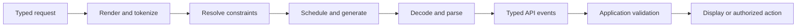

# Inference stack: from tokens to an interface

A language model predicts tokens. An application needs something more specific: an answer to display, a validated object, a tool request, or an event in a custom workflow. The inference stack supplies that meaning through preparation, generation constraints, interpretation, and delivery. Changing any one layer can change the application's behavior even when the model weights stay fixed.

This reference is provider-neutral learning material. The defaults below are **recommended design policies**, not claims about an OpenLearn deployment or changes to the book's reference implementation. Owner names describe responsibilities, not assigned teams. Actual provider defaults, supported features, and deployment values require verification in internal Notion notes.

## The contracts that give tokens meaning



Parsing and delivery can run while generation continues. Application authorization remains separate from generating a tool call.

| Boundary | Contract and invariant | Owner |
|---|---|---|
| Request to model input | Typed roles/content; complete correlated tool turns; pinned tokenizer/template; count tokens after rendering; explicit overflow decision | Model integration |
| Prepared input to generator | Effective parameters, constraint mode, output reservation, deadline, and capability/profile revision are known before admission | Inference API |
| Runtime to interpreter | Ordered token/delta events; channel and call identity where supported; explicit termination and usage availability | Runtime and integration |
| Interpreter to API | Separate visible text, permitted reasoning fields, and tool calls; provisional fragments cannot become executable arguments | Model integration |
| API to application | Stable request/attempt/call IDs; ordered typed events; terminal outcome or interruption; validation before action | API and application |

A custom interface needs an explicit protocol too. For example, a model could emit a domain-specific command language. Its grammar controls valid syntax, its parser constructs commands, and the application checks whether each command is meaningful and authorized. A command-shaped string alone supplies none of those guarantees.

### Worked example: a tool call is a state transition

Suppose a user asks for a parcel's status. The application exposes `lookup_parcel` with an object schema requiring a string `parcel_id`.

```text
1. Prepare: encode the messages and tool declaration using the model profile.
2. Generate: select a tool and generate its argument representation.
3. Interpret: emit call ID c1, name lookup_parcel, and argument fragments.
4. Complete: join fragments, parse JSON, validate the full schema.
5. Authorize: verify that the user may access this parcel.
6. Execute: run the lookup and correlate its result with c1.
7. Continue: prepare another model request containing that result.
8. Deliver: stream the visible answer and an explicit terminal event.
```

If the connection closes after `{"parcel_id":"AB`, the application has an incomplete call, not a lookup request. If a complete object contains the wrong parcel ID, syntax constraints have succeeded while the task has failed. Measure both validity and task correctness. Each continuation is another inference request and consumes additional latency and resources.

## Configuration resolution

Use one versioned **capability profile** for a model/backend combination. Bind the model revision, tokenizer, template, parser/formatter, supported constraint backend, context accounting, and baseline generation settings. Treat these as a compatibility unit.

For request-overridable values, the recommended precedence is:

```text
validated explicit request > workload profile > model integration profile > pinned runtime baseline
```

Hard limits, authorization, and quotas constrain the resolved value; they are not ordinary defaults. Reject prohibited values. If the API deliberately caps a value, disclose the effective value and reason. Deployment knobs have operator precedence and are not arbitrary request overrides.

Resolve omitted, null, zero, empty, and disabled values separately. An SDK default becomes an explicit request value when serialized. Do not silently inherit changing upstream defaults. Pin the resolved profile across retries; retain requested/effective values and provenance in restricted telemetry without logging prompt bodies.

In the tables, **request precedence** means the chain above, within capabilities and service bounds. **Deployment precedence** means explicit operator configuration over a pinned deployment profile, within hardware and runtime constraints. A default of “pin” requires an explicit value before rollout; it does not mean omission.

## Request preparation

| Knob | Owner, scope, default, precedence |
|---|---|
| Templates | Integration; model revision, applied per request. Default: pin a model-compatible template/tokenizer. Compatibility profile is authoritative; no caller template override by default. |
| Tool encoding | Integration owns encoding; application owns tool declarations. Scope: model profile plus request tool set. Default: no tools unless supplied, encode each declaration once. Profile encoding constrains request declarations. |
| Context limits | Integration declares model accounting; platform sets service cap; API validates requests. Default: pin cap and output reservation, reject overflow. Strictest model/service/workload bound wins. |
| Truncation | Application defines retention, preparation applies it per request. Default: disabled. Only an explicit permitted workload/request policy enables it; context bounds still win. |

| Knob | Effects, interactions, and tradeoffs | Failure symptoms | Measure its effect |
|---|---|---|---|
| Templates | Role markers and assistant prefixes change token input and role fidelity. Template, tools, parser, and special tokens must agree. More framing consumes context and prefill work; stable prefixes can support cache reuse. | Echoed markers, wrong speaker, lost instructions, tool syntax appearing as text | Golden rendered inputs; post-render token count; role/tool round trips; quality and cold/warm first-token latency |
| Tool encoding | Names, schemas, descriptions, IDs, and result correlation provide the model's tool interface. Rich descriptions can improve selection but consume tokens; similar tools increase ambiguity. Encoding must match tool choice and parser. | Invented tools, invalid arguments, orphan results, duplicate declarations | Tool token count; selection accuracy; argument validity; correlation checks; preparation/prefill time |
| Context limits | Account for rendered history, instructions, tools, and modality representations. In a shared window, input plus output reservation must fit. Longer input adds prefill work and KV memory and may reduce concurrency; nominal capacity does not guarantee retrieval quality. | Overflow rejection, allocation failure, evidence forgotten at long lengths | Input-length distribution; rejection rate; latency and KV occupancy by length; accuracy versus evidence position |
| Truncation | Dropping input reduces cost but loses evidence. Preserve required instructions and whole tool-call/result groups; re-render and recount. Summarization adds computation and can alter facts. | Forgotten constraints, missing citations, broken tool history | Dropped messages/tokens by category; retained-fact accuracy; quality versus full input; net latency/token savings |

For a hypothetical shared context of 8,192 tokens, a rendered input of 7,500 and output reservation of 1,024 exceed capacity by 332. Reducing visible answer length alone does not fix admission unless the actual reserved budget also changes. Trimming raw messages before rendering cannot establish that the final input fits.

## Generation

For positive temperature, a common sampler computes probabilities proportional to `exp(logit / temperature)`. Top-k restricts candidate count; top-p restricts cumulative probability mass. The ordering of scaling, penalties, constraints, and filters affects the distribution and must be verified for an implementation. [The nucleus-sampling paper](https://arxiv.org/abs/1904.09751v2) explains the motivation for adapting the candidate set to probability mass.

| Knob | Owner, scope, default, precedence |
|---|---|
| Temperature | Application within integration capabilities; per request. Default: pin workload value. Request precedence; verify whether zero denotes greedy decoding. |
| Top-p | Application; per request when supported. Default: disable nucleus filtering using a verified representation, commonly 1. Request precedence. |
| Top-k | Application; per request when supported. Default: disabled using verified semantics. Request precedence; reject unsupported settings. |
| Token budget | Application chooses, API/platform enforce; per attempt. Default: finite workload cap with explicit units. Request precedence within context/service bounds. |
| Stop sequences | Application supplies, integration matches; per request. Default: no custom stops, retain protocol termination. Request list replaces workload custom list; model protocol rules remain authoritative. |

| Knob | Effects, interactions, and tradeoffs | Failure symptoms | Measure its effect |
|---|---|---|---|
| Temperature | Higher values flatten probabilities; lower values concentrate choices. Diversity trades against consistency. Interacts with filters, constraints, precision, and seed. Length and latency effects are indirect. Greedy selection does not guarantee identical output across hardware or revisions. | Incoherence at extremes, repetition, unstable task accuracy | Repeated fixed-prompt quality/diversity; error rate; actual lengths and latency under fixed load |
| Top-p | Keep a nucleus meeting the probability-mass threshold. Lower values usually reduce alternatives. Temperature/filter order and grammar masking change the candidates; aggressive combined filters can collapse diversity. | Repetition, lost useful alternatives, unexpected migration differences | Controlled threshold sweep with temperature fixed; quality/diversity, lengths, acceptance of supplied value |
| Top-k | Keep up to k highest-ranked candidates. Predictable candidate bound trades against excluding useful continuations; interacts with top-p and constraints. Disable representations are not portable. | Collapsed outputs or no apparent effect because a field was ignored | Sweep k with other settings fixed; parameter-acceptance checks; quality, diversity, length, latency |
| Token budget | Bounds generation work and KV growth. Units can include hidden reasoning, so visible text is not necessarily the total budget. Large reservations may affect admission; early termination need not use the full cap. | Truncated answers/JSON, empty visible response after reasoning, length finish reason | Actual visible/total usage where available; cap-hit rate; incomplete objects; latency and cost per successful task |
| Stop sequences | Matching a delimiter terminates generation, possibly inside JSON or arguments. Define token versus text matching, matched-text inclusion, and cross-chunk behavior. Lookbehind can delay flushing. | Missing suffixes, premature termination, delimiter leakage, stream/nonstream disagreement | Boundary-fragment fixtures; premature-stop rate; finish reasons; added buffering delay |

## Structured output

A schema in the prompt, constrained decoding, and validation after generation provide different guarantees. State which mechanism the interface uses. Independent full-schema and business validation remain necessary. Declare the schema dialect and supported subset; the [JSON Schema reference](https://json-schema.org/understanding-json-schema/reference) explains dialects, vocabularies, and validation keywords.

| Knob | Owner, scope, default, precedence |
|---|---|
| Schemas | Application owns semantics, integration owns supported subset/enforcement. Per request. Default: unconstrained text. Request schema replaces workload schema only where permitted; reject unsupported/conflicting features. |
| Grammars | Integration owns compiler/backend, application selects permitted grammar. Per request; compiled artifacts may be cached. Default: disabled. Resolve one constraint plan; reject unsupported schema/grammar combinations. |
| Tool choice | Application; per request. Default: no tools when absent; pin selection policy when tools exist. Request precedence under allowlist/capabilities; parallel-call permission is separate. |

| Knob | Effects, interactions, and tradeoffs | Failure symptoms | Measure its effect |
|---|---|---|---|
| Schemas | Stronger shape constraints reduce malformed output but restrict expressiveness and can add setup cost. Enforcement may cover only a subset. Refusal, truncation, or interruption can prevent completion. | Unsupported-schema errors, schema-invalid completed objects, syntactically valid wrong answers | Cold/warm setup and first-token time; independent full-schema validity; refusal/incomplete rates; task correctness |
| Grammars | Mask invalid token continuations under tokenizer rules. Compilation/cache and per-token masking affect latency. Stops, EOS, token budget, and grammar must agree. Syntax control does not establish truth. | Compile errors, empty candidate set, dead ends, output incomplete at cap | Compile/cache-hit time; decode rate versus unconstrained run; independent parse rate; completion rate |
| Tool choice | Distinguish none, automatic, required, and named-tool modes. Forced use increases workflow predictability but can elicit inappropriate arguments when facts are missing. Templates, schemas, parser, and budget must agree. | Plain text when a call is required, disallowed tool, wrong call count | Mode compliance; correct-tool rate; validated arguments; call count; authorized task success |

## Output interpretation

| Knob | Owner, scope, default, precedence |
|---|---|
| Formatter/parser backend | Integration; model/backend profile. Default: pin a compatible version. Compatibility binding wins; reject unknown protocols. |
| Reasoning handling | Integration owns channels/accounting, application owns permitted display/storage. Profile and supported request modes. Default: designated visible answer only; no raw reasoning logging or reconstruction. Capability/privacy policy bounds requests. |
| Special-token handling | Integration; tokenizer/parser profile. Default: interpret known control tokens and preserve legitimate content. Pinned protocol rules override generic cleanup preferences. |

| Knob | Effects, interactions, and tradeoffs | Failure symptoms | Measure its effect |
|---|---|---|---|
| Formatter/parser backend | Convert generation events to text, channel events, correlated calls, finish reasons, and usage. Parse incrementally across arbitrary fragments. Strictness exposes malformed output; lenient repair can hide protocol drift. Formatting can change content. | Dropped/duplicate calls, arguments shown as text, silent repairs, stream/nonstream mismatch | Golden fragmented protocol fixtures; exact text/call extraction; parse errors and overhead; explicitly counted repairs |
| Reasoning handling | Separate effort controls, supported exposed summaries, and channel extraction. Extra computation can improve some tasks while increasing time to visible answer and token use. Never guess hidden channels from ordinary text delimiters. | Channel leakage, exhausted cap before answer, unexplained usage gap | Channel-isolation fixtures; first-visible-text time; quality; visible/total usage with unavailable fields marked unknown |
| Special-token handling | Control tokens can delimit roles/channels or terminate output. A token ID differs from literal text resembling its spelling. Blanket removal can corrupt examples; preservation can leak protocol markers. | Leaked markers, merged roles, deleted literal content, early stop | Token-ID versus literal-string fixtures; exact content preservation; termination accuracy; leakage rate |

## Serving runtime

| Knob | Owner, scope, default, precedence |
|---|---|
| Batching | Platform; deployment scheduler/pools. Default: pin token/sequence limits, wait window, and prefill policy from load tests. Deployment precedence. |
| Concurrency | Platform owns replica/fleet caps, gateway owns tenant admission. Default: bounded active requests and bounded queue. All applicable caps constrain admission. |
| KV cache | Platform; deployment allocation, precision, eviction, prefix reuse/offload. Default: pin budget/isolation; enable reuse/offload after validation. Deployment precedence within memory and isolation bounds. |
| Parallelism | Platform; deployment topology. Default: simplest topology meeting model-fit/load requirements, benchmarked and pinned. Deployment precedence. |
| Quantization | Integration owns quality acceptance, platform owns artifacts/kernels. Deployment/model revision. Default: reference precision; accept a named recipe before enabling it. Artifact compatibility constrains deployment precedence. |

| Knob | Effects, interactions, and tradeoffs | Failure symptoms | Measure its effect |
|---|---|---|---|
| Batching | Amortizes work and improves utilization, but waiting adds queue delay. Continuous admission and chunked prefill affect fairness. Batch size, lengths, concurrency, and KV budget jointly set capacity. | High aggregate rate with poor tails, decode stalls behind prefills, starvation, OOM | Input/output tokens/s separately; requests/s; p50/p95/p99 queue/first-token/inter-token latency; utilization and failures |
| Concurrency | More in-flight work improves utilization until saturation; beyond it, contention/queues grow. Request count alone ignores sequence lengths and cache demand. Retry load consumes capacity too. | Queue growth, overload errors, timeouts, throughput plateau | Offered/admitted/completed rates; active/queued requests; latency and rejection curves by workload |
| KV cache | Reuses attention state; compatible shared prefixes can save prefill. Cached-token count and KV precision determine memory. Offload saves device memory at transfer cost; eviction causes recomputation; cache precision can alter numerics. | Allocation failure, churn, cold/warm latency gap, stale/incompatible reuse | Allocated/used KV bytes; token occupancy; prefix hits and saved tokens; evictions/transfers; cold/warm latency |
| Parallelism | Tensor sharding adds collectives; pipeline stages add bubbles; replicas duplicate weights to add capacity; expert sharding applies to suitable models. Network/topology and batches determine scaling. Reduction order can change numerics. | Idle stages, communication stalls, imbalance, poor scaling | Per-device utilization/memory; collective/stage time; latency/throughput versus device count; task parity |
| Quantization | Distinguish weight, activation, and KV precision. Lower precision can reduce memory/bandwidth; kernel support and dequantization determine speed. Numerical changes may alter tokens and tool arguments. | Quality loss, rare argument failures, NaNs, slow kernel fallback | Memory; prefill/decode rates separately; tail latency; task/tool/schema accuracy against reference precision |

For a conventional attention KV cache before sharding and allocator overhead:

```text
KV bytes ≈ 2 × layers × cached tokens × KV heads × head dimension × bytes per element
```

The factor 2 accounts for keys and values. Reducing weight precision does not automatically reduce KV precision. Budget weights, KV, temporary workspace, and allocator overhead separately. See [the block manager](05-block-manager-and-prefix-cache.md), [continuous batching](03-continuous-batching.md), and [chunked prefill](04-chunked-prefill.md) for the worked implementations.

## API delivery

| Knob | Owner, scope, default, precedence |
|---|---|
| Streaming buffers | Gateway, parser, SDK; connection and intermediary configuration. Default: bounded buffers, timely complete-event flushing, backpressure; pin byte/time thresholds. Server bounds constrain requests; each intermediary can buffer. |
| Timeouts | Application owns overall deadline, gateway/platform own phase limits. Logical request and attempt. Default: finite overall plus queue/connect/first-event/idle limits. Earliest deadline wins; pass remaining budget downstream. |
| Retries | One coordinated SDK/gateway owner; application owns workflow side effects. Logical request. Default: bounded transient retries before output/side effects, jittered backoff; no automatic replay after output. Deadline/nonretryable errors win. |
| Cancellation | SDK initiates, gateway propagates, worker/scheduler release resources. Each attempt. Default: best-effort propagation on cancel/disconnect/deadline with bounded cleanup. Terminal for delivery; background work requires a separate explicit contract. |

| Knob | Effects, interactions, and tradeoffs | Failure symptoms | Measure its effect |
|---|---|---|---|
| Streaming buffers | Small flushes improve responsiveness at framing/network cost. UTF-8 decoding, parser state, and stop lookbehind can delay output. Backpressure bounds memory for slow clients. Event boundaries differ from token and network-chunk boundaries. | Bursty UI despite smooth decode, malformed events, memory growth | Model-to-delivery delay; first byte/event/visible text; inter-event gaps; occupancy and slow-reader tests through actual intermediaries |
| Timeouts | Queue, prefill, reasoning, decode, and delivery share the budget. Heartbeats may satisfy idle timers without visible progress. Client timeout does not prove worker termination. | Consistent-duration cutoffs, timeout storms, compute after deadline | Timeout rate by phase; remaining budget at admission; successful latency; post-deadline compute |
| Retries | Recover transient failures but amplify load and can produce different answers or overlapping generations. Stable logical IDs and separate attempt IDs aid diagnosis; IDs alone do not guarantee deduplication. | Duplicate actions/chunks, retry storm, cost rises without more completed work | Attempts/request; recovery rate; concurrent duplicate attempts; tokens/compute per successful task; fault injection |
| Cancellation | Stop scheduling/decode and release KV/buffers; closing the client stream alone may leave work running. Completion races require terminal-state arbitration. Cancellation cannot undo external side effects. | Zombie requests, retained cache, late events, continued usage | Cancel-to-worker-stop/resource-release time; tokens after cancel; orphan count; races during queue/prefill/decode/tool handoff |

SSE framing uses UTF-8 and blank-line event boundaries. Reconnection behavior in the browser's EventSource API does not establish application-level replay or inference deduplication. Define those separately. See the [SSE standard](https://html.spec.whatwg.org/multipage/server-sent-events.html).

## Failure behavior is part of the interface

Normalize outcomes internally without assuming every wire API supports the same finish reasons. Keep generation status separate from task status: a tool handoff is not a completed task.

| Condition | Recommended behavior |
|---|---|
| Unsupported field/combination, invalid schema/grammar | Reject before scheduling where possible; identify the safe field/category |
| Context overflow | Reject, or apply an explicitly chosen retention policy and report it |
| Budget/deadline/disconnect during structured generation | Mark incomplete; never execute partial arguments |
| Completed but invalid object or parser mismatch | Explicit validation/protocol failure; any repair is a separately identified attempt |
| Refusal | Typed refusal where supported; do not fabricate a business-schema success |
| Overload | Bounded queue or explicit rejection; honor retry guidance within deadline |
| Transport EOF without terminal event | Incomplete response, even if HTTP started successfully |
| Cancel racing with completion | Select one terminal delivery outcome; clean up resources idempotently |

## Measure the whole path

Define timestamps before comparing numbers. Server first-token time, client first byte, and first visible answer measure different events. Reasoning events, heartbeats, and tool fragments are not visible answer text.

```text
end-to-end ≈ preparation + constraint setup + queue + prefill + decode + delivery overhead
decode duration ≈ actual generated tokens / effective decode rate
```

Some stages overlap, so use traces rather than adding overlapping spans blindly. Report first-token and first-visible-answer latency, inter-token and inter-event gaps, end-to-end p50/p95/p99, input/output throughput, error/incomplete/cancel rates, peak memory, and successful tasks per unit cost. Include failures in the denominator. Average time per output token can hide stalls; inspect the gap distribution too.

1. Pin model, tokenizer, template, parser, runtime, constraint backend, hardware, and precision. Record effective settings and provenance.
2. Use representative prompt/output lengths, tools, schemas, long-context evidence, and reasoning workloads. Compare one knob at a time, with repeated samples for stochastic generation.
3. Separate cold model/constraint/cache runs from warm runs. A fixed seed is useful evidence within a pinned setup, not a cross-system determinism promise.
4. Test below and across saturation with controlled offered load. Then test interactions: batch × concurrency × lengths; context × reservation × KV; sampling × constraints × precision; buffering × stops × cancellation.
5. Inject malformed/fragmented protocol events, incomplete JSON, disconnects, overload, retry overlap, and cancel/completion races. Accept a change only if quality and resource targets both hold.

Continue with [serving metrics and tracing](08-serving-metrics-and-tracing.md), [the open-loop load generator](11-load-generator.md), and [the regression gate](12-run-comparison-and-regression-gate.md).

## Relating the reference to this book's implementation

This general policy does not add fields or features to the worked server. Its concrete contracts live in [the versioned API subset](../../../../course/contracts/openapi/openai-subset.v1.yaml), [sampling specification](../../../../course/contracts/spec/sampling.md), and [runtime schema](../../../../course/contracts/config/runtime.schema.json). The API's product-compatible naming does not imply full compatibility or shared defaults with another service. Inspect the endpoint and milestone before using a setting.

The [server lesson](06-openai-server-on-tokio.md) explains the transport and preparation implementation; [tool calls and constrained decoding](10-tool-calls-and-constrained-decoding.md) explains the grammar and extraction implementation. Keep educational implementation facts distinct from deployed operational claims.

## Internal Notion notes

Provider-specific behavior and sensitive operational details belong only in access-controlled internal Notion notes. This public reference contains no provider deployment claims. Do not commit provider verification records, deployment inventories, endpoints, routing/tenant details, incident traces, prompts, raw reasoning, or credentials here.

| Internal note | Required fields |
|---|---|
| Verified provider behavior | Provider/product/API/backend/model revision; exact knob; supported values and omitted/null/zero behavior; actual default/precedence; accounting and constraint subset; parser/stop/stream behavior; deduplication/cancellation guarantees; authoritative versioned source or controlled-test evidence; verification date and owner |
| Operational configuration | Restricted environment/profile reference; current effective values and provenance; benchmark/quality/SLO evidence; capacity/cache/topology/precision; deadlines/retries/cleanup; rollout/rollback; owner and review date |

Label each claim documented, observed, inferred, or unknown. Observed behavior must include tested conditions; do not generalize it to another version. Record conflicting evidence and reverify after upgrades. No provider notes or deployment values have been verified by this reference; link notes only from an appropriate internal index after storage and access are confirmed.

## Check your reasoning

1. A schema-valid tool call arrives, but its parcel ID belongs to another user. Which boundary failed?

   **Worked answer:** Structural generation and parsing may both be correct. Application authorization must reject the action. Schema validity cannot establish access rights. Test with a valid-shaped unauthorized ID and verify that no lookup executes.

2. Increasing concurrency raises tokens/s while p99 first-visible-answer latency doubles. Did the service improve?

   **Worked answer:** Only aggregate throughput improved. Compare admitted/completed load, queue delay, quality, and latency targets. If fewer tasks meet the deadline, useful capacity fell. Repeat at controlled offered load to expose queueing rather than client pacing.

3. The server emits tokens every 40 ms, but the UI updates once per second. Which dial should you investigate first?

   **Worked answer:** Trace generation-to-delivery timing and inspect streaming buffers along the parser/proxy/SDK path. Smooth model decode does not establish timely flushes. Use a slow-reader test to verify that reducing buffering still bounds memory.

4. A retry succeeds after a timeout. What evidence would establish that it did not double the work?

   **Worked answer:** Correlate the logical request with both attempt IDs, worker-stop acknowledgments, and per-attempt generated tokens. A successful retry alone says nothing about whether the first attempt kept running. Repeat with delayed cancellation and check overlap and resource release.
