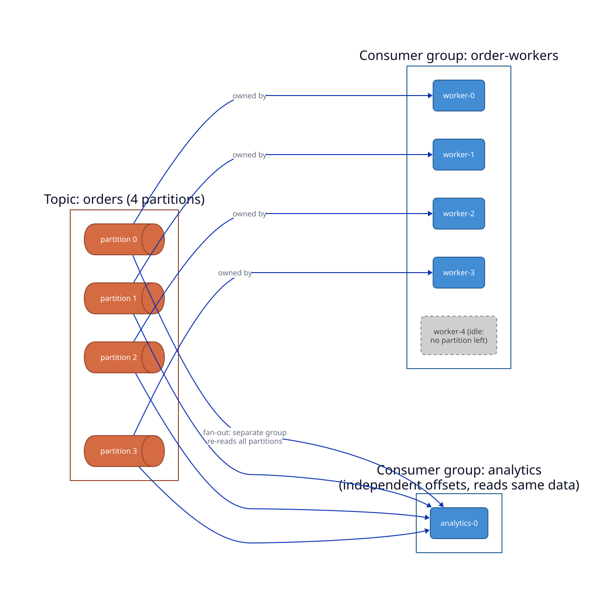
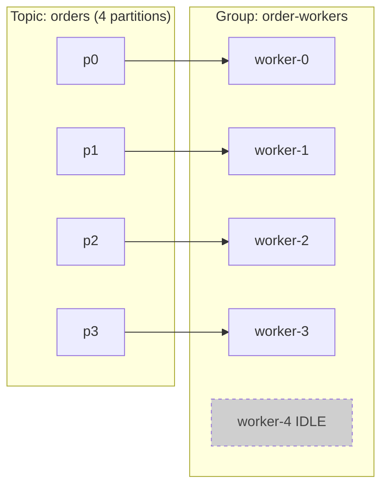

# Durable Orchestration and Workers

A request lives for milliseconds. A *process*, such as fulfilling an order, ingesting and indexing a corpus, or running a multi-day training job, lives for minutes to months, calls flaky services, and must survive the machine running it dying halfway through. The naive solution, a database state column plus cron plus retry glue, reinvents a buggy workflow engine every time. Durable execution names the pattern: persist the *progress* of a computation, its checkpoints, so the program is in effect immortal. It can crash and wake up mid-function with all its local state intact. Everything else in this chapter (workers, sagas, observability) is in service of making that illusion reliable and operable.

In this chapter you build such an engine yourself, in Go, with Temporal as the north star: history events and replay, task queues, `GetVersion`, Continue-As-New. Then you run the platform's own data pipeline, training runs, evaluations, and releases on it. The arc is bottom-up. The first sections build the foundation: an append-only event log, a workflow service on top of it, a task queue with fenced leases, and the protocol and SDK that let workers poll for work. The middle sections make execution durable: activities with retries and heartbeats, deterministic replay of workflow code, durable timers, and the signals, cancellation, and sagas that let the outside world steer a running workflow. The last sections put real work on the engine: a subprocess runner that lets Go workers run Python durably, an optional Raft layer that replicates the log across three servers, and the platform workflows `TrainRun`, `EvalSuite`, and `ModelRelease`.

> **Learning objectives**
> - Explain durable execution as checkpointing for workflows, and why recovery by replaying an event log requires deterministic workflow code.
> - Build a durable workflow engine from an event log, a task queue, and a worker SDK, and reason about its failure modes.
> - Make side-effecting steps safe under at-least-once delivery with idempotency keys, and undo partial work with sagas.
> - Run Python training and evaluation as durable activities that resume from checkpoints after any kill.
> - Release a model through a gated, approved, canaried, and reversible workflow.
> - Operate a pool of partitioned-log consumers: sizing, rebalancing, poison messages, and lag-based scaling.

## Before you begin

This chapter assumes the idempotency and partial-failure reasoning of [RPC and Protocols](../02-rpc-and-protocols/README.md) and the event sourcing of [Distributed Data and Caching](../04-distributed-data-and-caching/README.md). The engine is written in Go, so read [the Go primer](../../programming-languages/02-language-and-tool-primers/06-go.md) in *Programming Languages* if you have not, along with [Protocol Buffers and gRPC](../../programming-languages/02-language-and-tool-primers/10-protocol-buffers-and-grpc.md). Operating long-running workflows leans on [Observability](../../systems/04-observability/README.md) in *Systems and Architecture*, and the partitioned-consumer material at the end assumes [Messaging & Distributed Queueing](../../infrastructure/02-messaging-and-queueing/README.md) from *Infrastructure*.

## In this chapter

1. [The append-only event log](01-event-log.md). The segmented, fsynced write-ahead log that every other piece of the engine records into; the single source of truth.
2. [The workflow service](02-workflow-service.md). Idempotent workflow start, describe, list, and paged history over gRPC, with run state folded from the log.
3. [The task queue](03-task-queue.md). Visibility timeouts, fenced leases, retries that end in a dead-letter queue, and long polling.
4. [The task protocol and workers](04-task-protocol-and-workers.md). The task gRPC protocol, the Go worker SDK, and a worker pool that polls, executes, and reports back.
5. [Activities](05-activities.md). Retries with backoff and jitter, timeouts, heartbeats, and the idempotency keys that make side effects safe to repeat.
6. [Deterministic replay](06-deterministic-replay.md). Workflow code that rebuilds its state by replaying history, plus Continue-As-New, history paging, and payload limits.
7. [Durable timers and the test clock](07-durable-timers.md). Timers that survive restarts and fire exactly once, and a clock you can move forward in tests.
8. [Signals, cancellation, and sagas](08-signals-cancellation-and-sagas.md). How operators approve or cancel a running workflow, and how a saga undoes completed steps in reverse order.
9. [Subprocess activities: the Go runner and the Python helper](09-subprocess-activities.md). The file-and-exit-code contract that lets a Go worker run Python durably, resuming from the last heartbeated checkpoint.
10. [Raft high availability for the durable log (optional)](10-raft-ha.md). Three replicas that agree on one log, built from the majority-intersection fact; the engine is complete without it.
11. [Platform workflows: TrainRun and EvalSuite](11-trainrun-and-evalsuite.md). Training as segments with evaluation at fixed steps, resumable bit for bit after any kill.
12. [ModelRelease: gates, canary, burn check, and rollback](12-model-release.md). The release as a workflow: model card and ledger gates, human approval, a canary measured against the error budget, and a saga that rolls back.

The chapter also has a hands-on side quest, [Kafka consumer groups](side-quests/kafka-consumers/README.md), which puts the partitioned-consumer ideas at the end of this opening into practice.

## The problem: long-running, failure-prone processes

Before building anything, it helps to see the whole landscape the chapter covers. A real workflow is multi-step, long-lived, and distributed, and any step can fail, time out, or be interrupted by a deploy. Hand-rolled orchestration scatters state across a database column, a cron job, a retry wrapper, and a dead-letter queue, so correctness lives nowhere and bugs live everywhere. The recurring needs are always the same: **retry** with backoff, **timeouts**, **idempotency**, **resume-after-crash**, **visibility**, and **rollback**. Durable execution provides all of them as a single abstraction.

## Durable execution and checkpointing

The core pattern is to checkpoint every step. After each step's result is known, persist it durably *before* moving on; on recovery, read the last checkpoint and continue, never redoing completed work.

Temporal and Cadence implement this with an **event-sourced history and replay**. The engine records an append-only log of every event (step scheduled, step completed, timer fired). To recover, it **replays** that log through your workflow code to rebuild local variables and resume at the next unexecuted line. Your workflow looks like ordinary sequential code; the engine makes it crash-proof underneath.

That design carries one real constraint. Because recovery replays your code, workflow code must be **deterministic**: no `now()`, `random()`, or direct I/O inline. Those go through the engine, which records their results, so replay reproduces the same path.

DBOS takes a different route, **transactional checkpointing**: it persists workflow and step state in Postgres transactions, so recovery is "read the last committed step and continue". It is lighter-weight and leans on the database you already run. Either way, the idea is the same one that lets a multi-day GPU training run resume from its last saved checkpoint ([Training and Frameworks](../01-training-and-frameworks/README.md)), applied to arbitrary application workflows.

## The worker pattern

Durable execution decouples "what to do" from "who does it". The engine holds a durable queue of pending tasks (workflow steps and activities), and a pool of **workers** long-polls the queue, executes a task, and reports the result back: classic producer-consumer, made durable. Because all durable state lives in the engine, workers are stateless and horizontally scalable. They can crash, deploy, and autoscale freely; adding workers adds throughput, and losing workers just leaves tasks waiting in the queue.

The pattern also separates concerns. The **workflow** orchestrates; it is deterministic, the "what and when". **Activities** do the side-effecting work, the "how": call an API, run a model, write to a database. Activities get automatic retries, timeouts, and heartbeats. Named task queues route tasks to worker pools by capability (GPU workers, CPU workers, a region), which is how you would send embedding jobs to GPU workers and notifications to cheap CPU workers. None of this is exotic: it is the same worker pool as a thread pool, a Celery or Sidekiq queue, or a Kubernetes Job fan-out. Durable execution just persists the queue and the progress.

## Reliability patterns around workers

Retries are guaranteed in this world, so every step must be safe to repeat, and when you cannot roll forward you must be able to undo. The standard patterns each solve one problem:

| Pattern | Problem it solves |
|---------|-------------------|
| **Idempotency key** | Retries must not double-apply a side effect (charge, send, insert) |
| **Saga / compensation** | A multi-step transaction across services can't use 2PC; undo completed steps on later failure |
| **Transactional outbox** | Atomically commit a DB change *and* an event to publish (no dual-write inconsistency) |
| **Exactly-once (effectively)** | Combine idempotency + dedup so a step's *effect* happens once despite at-least-once delivery |
| **Circuit breaker / bulkhead** | Stop hammering a failing dependency; isolate failures to one pool |
| **Backpressure** | Bound the queue and shed/slow producers so workers aren't overwhelmed |
| **Poison-message / DLQ** | Quarantine a task that fails forever instead of blocking the queue |

At-least-once delivery is the cheap, available default. You reach *effectively-once* by making consumers **idempotent** and reconciling with **compensation**. There is no free exactly-once in a distributed system; you engineer it.

## Temporal, Cadence, and DBOS

The production engines make different tradeoffs, summarized here:

| | Temporal / Cadence | DBOS |
|---|--------------------|------|
| Recovery model | Event-sourced history + replay | Transactional state in Postgres |
| State store | Cassandra / Postgres / MySQL | Postgres (the one you already have) |
| Execution | Separate worker pool polling a service | Library in your process |
| Strength | Long-lived, complex, signal-driven workflows | Lightweight, SQL-native, fewer moving parts |
| Lineage | Cadence (Uber, OSS) → Temporal (fork) | Postgres-first durable execution |

Temporal is the heavyweight: months-long workflows, signals, child workflows, timers, versioning, and multi-language SDKs, at the cost of running a cluster that itself needs a sharded store (see [Distributed Data and Caching](../04-distributed-data-and-caching/README.md)). Cadence is the open-source ancestor Temporal forked from, with the same concepts and less activity. DBOS trades some power for simplicity: if you already run Postgres, you get durable execution without a separate system.

Two neighbouring tool families are easy to confuse with these. Schedulers such as Airflow and Dagster ([Orchestration & Modeling](../../data-engineering/04-orchestration-modeling/README.md) in *Data Engineering*) run *batch DAGs on a schedule*, while Temporal and DBOS run *durable arbitrary code* with fine-grained, event-driven, long-lived state; the tools overlap but are distinct. And distributed-compute frameworks such as [Ray](https://docs.ray.io/) (Core actors and tasks, Ray Train, Ray Serve) apply the worker-pool pattern to *in-memory distributed ML compute*: fast task and actor scheduling across a cluster, but **not durable**. Lose a node mid-task and the task reruns; lose the driver and the job dies. Temporal and DBOS persist progress, while Ray maximizes throughput. A common pattern uses Ray for the heavy parallel compute *inside* a step and a durable engine to orchestrate the steps reliably around it.

## Distributed observability

You cannot operate what you cannot see, and a workflow spanning services and hours is invisible without all three pillars of [Observability](../../systems/04-observability/README.md): **traces** (one request or workflow across services, as a span tree), **metrics** (aggregate rates and latencies, RED and USE), and **logs** (discrete events). A durable workflow needs all three because it spans services *and time*.

Distributed tracing with OpenTelemetry propagates a trace and span context across every RPC and queue hop, so a workflow's whole path is one connected trace that answers "where is execution #123 right now, and what is it waiting on?". Durable engines add workflow-native visibility on top: list running and failed workflows, inspect event history, see which step is retrying. Temporal's event log *is* an audit trail and a debugger. Correlation ids, threaded through logs, metrics, and traces, let you pivot between them.

## Profiling

Observability tells you *which* request or step is slow; profiling tells you *why*, where the CPU cycles, allocations, or wait time actually go inside it. Sampling CPU profilers (`py-spy`, `pprof`, `perf`, async-profiler) produce **flame graphs** in Brendan Gregg's style: read the widest frames, because that is where time goes. The **USE method** gives you a systematic way to find the bottleneck instead of guessing: for every resource, check **U**tilization, **S**aturation, and **E**rrors.

Tail latency is where users feel pain, so profile the p99 path, not the average. Workers make this concrete: a few slow activities drag the whole workflow's wall-clock time. The discipline is to form a hypothesis, measure, confirm, fix, and re-measure. The bottleneck is almost never where intuition first points; it is usually I/O wait, lock contention, or an N+1 query, not "the algorithm".

## Partitioned consumers

The durable engine owns *workflow* state. The other common worker shape is a pool of consumers reading a partitioned log such as Kafka, where the partition, not an engine, decides who does what. Read [Messaging & Distributed Queueing](../../infrastructure/02-messaging-and-queueing/README.md) first for the dynamics (queue versus log, push versus pull, delivery semantics); the runnable consumers and a hands-on lab are in the side quest [Kafka consumer groups](side-quests/kafka-consumers/README.md).

### The partition is the unit of everything

A **worker** is a process that pulls work off a log and does it. Once you accept at-least-once delivery, the entire job becomes operational: distribute partitions across a pool, keep the group stable through joins and leaves, make handlers tolerate redelivery, contain poison messages, and size the pool to the backlog. The unifying constraint is the **partition**: it is simultaneously the unit of ordering, the unit of assignment, and the **ceiling on useful parallelism** within a group.

The fifth worker is **idle**, because there is no partition left for it to own. This is the single most important operational fact about Kafka scaling, and it is why the KEDA replica cap in [Containers, Kubernetes & Workloads](../../infrastructure/01-containers-kubernetes/README.md) is the partition count.

### Partition count is the parallelism ceiling

Within one consumer group, **each partition is owned by exactly one consumer**. A consumer may own several partitions, but a partition is never split across two consumers in the same group. Useful parallelism is therefore at most the partition count, and workers beyond it get no assignment and sit idle, burning resources for nothing.

Pick the partition count for your *peak* worker count plus headroom. Over-partitioning costs metadata and end-to-end latency; under-partitioning permanently caps throughput. And forecast ahead rather than reacting, because **adding partitions later breaks key-to-partition stability**: the hash target changes, so events for `order_id=42` can land on a different partition than before, reordering them relative to history.

### Consumer groups and rebalancing

When a consumer joins, leaves, or dies, the group **rebalances**: partitions are reassigned across the surviving members. The mechanics cause real incidents.

The classic **eager** (stop-the-world) protocol revokes *all* partitions from *all* members and then reassigns from scratch, so consumption pauses across the entire group during the reassignment. It is cheap to reason about and expensive in availability. **Cooperative, incremental rebalancing** ([KIP-429](https://cwiki.apache.org/confluence/display/KAFKA/KIP-429%3A+Kafka+Consumer+Incremental+Rebalance+Protocol), `CooperativeStickyAssignor`) revokes *only* the partitions that must move and lets everyone else keep consuming, with no global stall. Use it for any group where a stop-the-world pause hurts, which is most of them; it is what [`consumer-go.go`](side-quests/kafka-consumers/consumer-go.go) and its siblings configure.

> **Warning:** If a consumer does not call `poll()` within `max.poll.interval.ms`, the broker assumes it is dead and kicks it, triggering a rebalance and reprocessing of its partitions. A handler that occasionally takes 6 minutes on a 5-minute interval will flap the whole group. Keep handlers fast, lower `max.poll.records` so each poll batch finishes in time, or raise the interval to cover the worst case.

Scale-down needs care too. On scale-down or rollout, Kubernetes sends `SIGTERM`. A worker that traps it and `Close()`s the consumer **leaves the group cleanly**, so its partitions are reassigned *immediately*. A worker that is simply killed leaves the group waiting out `session.timeout.ms` before it notices, a window of stalled partitions. This is the consumer side of graceful shutdown from [Containers, Kubernetes & Workloads](../../infrastructure/01-containers-kubernetes/README.md): trap SIGTERM, stop new work, finish in-flight work, commit, exit. All three example consumers implement it.

### Idempotency and atomic state changes

Because delivery is at-least-once, every handler must tolerate seeing the same message twice. The first tool is an **idempotency key**. Before doing the work, claim the message's natural key: Streamflow's `order-worker` does `SETNX order_id` in Redis, with a TTL. If the key already exists, this is a redelivery, so skip the work and let the offset advance. This is the [Idempotent Receiver](https://www.enterpriseintegrationpatterns.com/IdempotentReceiver.html) pattern; the Redis dependency appears in the C4 component diagram from [Containers, Kubernetes & Workloads](../../infrastructure/01-containers-kubernetes/README.md).

The second is the **transactional outbox**. The "wrote to the database but crashed before producing the event" hole is real. Close it by writing business state *and* the outgoing event into the *same* database transaction (an `outbox` table); a separate relay, or CDC, reads the outbox and publishes. State and event now commit atomically, with no lost or phantom events ([microservices.io: Transactional Outbox](https://microservices.io/patterns/data/transactional-outbox.html)).

The third is the order of offset commits. **Commit offsets only after durable work**, and **batch commits** for throughput. Committing before the work is at-most-once (loss on crash); committing after is at-least-once (a duplicate on crash, absorbed by the idempotency key). The examples set `enable.auto.commit=false` and commit explicitly after `handle()` returns.

### Retries, poison messages, and the dead-letter queue

Failures come in two kinds. A *transient* failure (a database blip, a downstream timeout) should be retried with backoff; it will likely succeed. A *poison* message (malformed, referencing deleted data, failing a hard invariant) will **never** succeed, and retrying it forever blocks the partition behind it. Because ordering is per partition, a stuck message is **head-of-line blocking**: everything behind it on that partition waits.

The **dead-letter queue** breaks the block. After N attempts, route the poison message to an `orders.DLQ` topic and move on, unblocking the partition. **Alert on DLQ depth**; a human or a repair job drains it. The DLQ edge appears in the Streamflow container diagram of [Containers, Kubernetes & Workloads](../../infrastructure/01-containers-kubernetes/README.md). Rather than blocking live traffic with in-line backoff, some designs also route transient failures to **tiered retry topics** (`orders.retry.5s`, `orders.retry.1m`, `orders.retry.10m`), each consumed by a delayed worker. Live consumption never stalls, retries escalate through the tiers, and whatever survives all tiers lands in the DLQ. Finally, bound the time per message: one slow handler must not block the batch, so set a per-message deadline and dead-letter the overrun, or you reintroduce the slow-handler rebalance described above.

### Sizing and operating the pool

Partitions are the maximum parallelism, so size the partition count for peak workers plus headroom; you cannot scale useful workers past it. Within that limit, **lag is the master signal**. Consumer lag is the log-end offset minus the committed offset, the number of messages behind. It is the right input for both alerting and autoscaling, because it directly measures whether the pool is keeping up, unlike CPU, which a worker blocked on I/O leaves low while lag explodes.

KEDA scales on lag. [Containers, Kubernetes & Workloads](../../infrastructure/01-containers-kubernetes/README.md) wires a KEDA `ScaledObject` to consumer-group lag: lag rises, KEDA raises worker replicas (capped at the partition count), the Cluster Autoscaler adds nodes if pods are Pending, new members join, a rebalance assigns them partitions, and lag drains. KEDA can also scale to **zero** when idle. When lag keeps rising but replicas already equal the partition count, more pods do nothing; they sit idle. The lever then is *more partitions*, with a one-time reshuffle of the key-to-partition mapping.

The techniques of this section, and when to reach for each, are collected here for reference:

| Technique | When to apply |
|-----------|---------------|
| One consumer per partition (group sizing) | Always: never run more workers than partitions |
| Cooperative/incremental rebalancing | Any group where stop-the-world stalls hurt |
| Tune `max.poll.records` / `max.poll.interval.ms` | When handlers are slow enough to risk false rebalances |
| Clean leave on SIGTERM | Every worker (fast partition reassignment on scale-down) |
| Idempotency key (SETNX) | Deduping redelivered messages |
| Transactional outbox | Atomic "update state + emit event" |
| Commit after durable work + batch commits | Every at-least-once consumer |
| Dead-letter queue | Any consumer that can receive poison messages |
| Tiered retry topics | When in-line retries would block live traffic |
| Scale on consumer lag (KEDA) | Sizing the worker pool to backlog |
| Add partitions (not pods) at the cap | When lag rises with replicas already = partitions |

## Patterns worth internalizing

A handful of ideas recur through every section that follows:

- **Persist progress, then proceed.** Checkpoint each step so the computation is crash-proof; recover by reading the last durable state, or by replaying the log.
- **Queue plus stateless worker pool.** Push all state into a durable store so workers become disposable and horizontally scalable.
- **At-least-once plus idempotency equals effectively-once.** There is no free exactly-once; engineer it with keys, dedup, and compensation.
- **Saga, not 2PC, across services.** Roll forward where you can, compensate where you can't.
- **Trace across hops, profile within them.** Observability locates the slow thing; profiling explains it. Measure before optimizing, every time.

## Where this chapter connects

The ideas here reach across the library. Idempotency, retries, and partial failure in [RPC and Protocols](../02-rpc-and-protocols/README.md) are why durable execution exists. Event sourcing, replay, and the log as truth in [Distributed Data and Caching](../04-distributed-data-and-caching/README.md) are how recovery reconstructs state, and the same chapter covers the sharded store Temporal needs underneath (Cassandra or Postgres). Checkpointed training pipelines in [Training and Frameworks](../01-training-and-frameworks/README.md) use the same checkpoint pattern with a different payload. Traces, metrics, logs, RED and USE, and SLOs in [Observability](../../systems/04-observability/README.md) are how you operate long-running workflows. Partitioned logs, consumer groups, and lag in [Messaging & Distributed Queueing](../../infrastructure/02-messaging-and-queueing/README.md) are the dynamics the partitioned consumers operate, and KEDA lag scaling and SIGTERM drains in [Containers, Kubernetes & Workloads](../../infrastructure/01-containers-kubernetes/README.md) are how you scale and stop the worker pool. Decorators wrapping workflows and retries in [Coding and Design Patterns](../06-coding-and-design-patterns/README.md) show how an engine's API is built.

Industry leans on the same patterns:

| Company | The pattern they lean on | Instance |
|---------|--------------------------|----------|
| Uber | Durable execution + worker pools | Built Cadence → Temporal for trips/payments |
| Stripe | Idempotent durable workflows | Idempotency keys, saga-style money movement |
| Netflix | Workflow orchestration at scale | Conductor; durable media pipelines |
| Datadog / Honeycomb | Distributed tracing as a product | OpenTelemetry, span-based debugging |
| Coinbase / Snap | Temporal for critical workflows | Payment and provisioning sagas |
| Training labs | Checkpoint/replay for long jobs | Resumable distributed training runs |

If you want to feel the ideas before reading the build, a short experiment with an off-the-shelf engine is worth an afternoon. Build a three-step pipeline (download, embed, index) as a Temporal or DBOS workflow and kill the worker mid-run; it resumes without redoing completed steps, and that is durable execution. Make a step non-idempotent ("charge the card"), force a retry, and watch the double charge; then fix it with an idempotency key. Add a compensation (a refund) and trigger a downstream failure to see the saga unwind. Finally, instrument the workflow with OpenTelemetry traces and profile the slowest activity to find where the wall-clock time actually goes.

## Further reading

- [Temporal documentation](https://docs.temporal.io/) and [DBOS documentation](https://docs.dbos.dev/), the primary references for this chapter.
- [Apache Cadence documentation](https://cadenceworkflow.io/docs/), Temporal's open-source ancestor.
- Temporal, ["What is durable execution"](https://temporal.io/blog/what-is-durable-execution).
- microservices.io, [the saga pattern](https://microservices.io/patterns/data/saga.html) and [the transactional outbox](https://microservices.io/patterns/data/transactional-outbox.html).
- [OpenTelemetry documentation](https://opentelemetry.io/docs/), for distributed tracing.
- Brendan Gregg, [*Systems Performance*](https://www.brendangregg.com/systems-performance-2nd-edition-book.html), for profiling.
