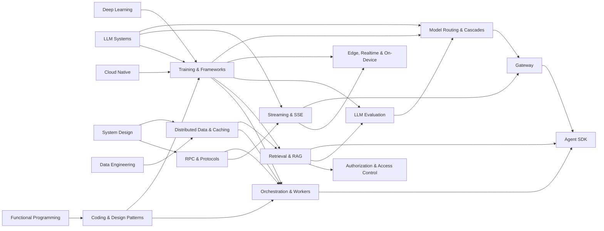

# AI Platform Engineering

This book is about the infrastructure layer underneath modern AI products, taught as **patterns, not products**. Frameworks, protocols, caches, and orchestrators churn constantly; the patterns underneath them barely move. Master the handful of fundamental patterns and every new tool becomes a recognizable instance of something you already understand.

The analogy is mathematics. Once you understand limits, derivatives, and integrals, every named technique downstream is a special case. The same is true here: *cache-aside*, *consistent hashing*, *idempotent retry*, *event-sourced replay*, *the worker pool*, *backpressure*, *the decorator*. Learn the pattern and how it works, and "what's trending this quarter" becomes derivative. The book names the popular tools (vLLM, Temporal, Redis, gRPC) as **instances of patterns**, and notes how companies apply them, but the pattern is the lesson. vLLM is *continuous batching plus a paged cache*; Temporal is *event-sourced durable execution plus a worker pool*; Redis is *an in-memory hash table you must invalidate*. Name the pattern and the tool is interchangeable.

## Who this book is for

The book is written for engineers who build or operate the systems around a model: ML engineers who want to see the platform their model runs on, backend and distributed-systems engineers moving into AI infrastructure, and anyone building a GenAI or retrieval product who wants to know why it behaves the way it does. You should already know how transformers are trained and served; the book picks up where that knowledge leaves off.

## What you will be able to do

By the end of the book you will be able to:

- Recognize that "distributed" is three problems, not one (training, data, and orchestration), and reach for the right family of patterns for each.
- Choose a caching pattern by its answer to the real question, "when does the lie expire?", and defend it against stampedes, herds, and penetration.
- Explain durable execution as checkpointing for workflows: persist every step, replay history to recover, run the code on a pool of workers.
- Profile before you optimize, whether the bottleneck is a GPU kernel, a slow query, a cache miss rate, or a workflow's tail latency.
- Build retrieval as information retrieval wearing a neural coat: hybrid dense and lexical search fused with RRF, bi-encoders to find and cross-encoders to rank.
- Treat authorization as a complexity ladder, from flat RBAC lookups to graph reachability in ReBAC, and filter retrieval by permission during the search.
- Evaluate models starting from information theory (cross-entropy, perplexity, bits per byte) and move on to benchmarks, judges, and RAG faithfulness.
- Place inference anywhere on the spectrum from datacenter to phone, route requests across a pool of models, and build the gateway and agent SDK that sit in front of them.

## How the book is organized

The chapters form a graph rather than a line. The diagram shows which chapters (and which chapters of other books) each one builds on:

A recurring confusion is that "distributed X" is one topic. It is three, and the book keeps them in separate chapters because the patterns differ:

| Problem | Lives in | The pattern family |
|---------|----------|--------------------|
| **Distributed training**: one model across many GPUs | [Training and Frameworks](01-training-and-frameworks/README.md) | parallelism and sharding (data, tensor, pipeline; FSDP and ZeRO) |
| **Distributed data**: one dataset across many nodes | [Distributed Data and Caching](04-distributed-data-and-caching/README.md) | partitioning, replication, caching, invalidation |
| **Distributed orchestration**: one workflow across many failures | [Durable Orchestration and Workers](05-durable-orchestration-and-workers/README.md) | durable execution, checkpoints, the worker pool |

[Training and Frameworks](01-training-and-frameworks/README.md) covers the frameworks a model is built in (PyTorch, JAX) and the parallelism and sharding patterns that spread training across GPUs, then embedding models, small language models, adapters, and serving with vLLM.

[RPC and Protocols](02-rpc-and-protocols/README.md) is about contracts between services: the RPC model and partial failure, serialization formats, gRPC and its four call types, and schema evolution.

[Streaming and SSE](03-streaming-sse/README.md) covers push delivery of tokens: the server-sent events protocol, how it compares with WebSockets and gRPC streaming, and backpressure and cancellation end to end.

[Distributed Data and Caching](04-distributed-data-and-caching/README.md) partitions, replicates, caches, and invalidates data, from consistent hashing and hot shards to cache-aside, write-through, and write-back, Cassandra's ring, knowledge graphs, and bitemporal data. Caching is the second-hardest problem in computer science, and invalidation is why.

[Durable Orchestration and Workers](05-durable-orchestration-and-workers/README.md) builds durable execution: event-sourced replay, the worker pool, idempotency, sagas, the outbox, and the observability and profiling that make long-running processes debuggable.

[Coding and Design Patterns](06-coding-and-design-patterns/README.md) is the vocabulary the other chapters are written in: decorators that wrap workflows and retries, the facade that hides a serving stack behind one call, and the closures and currying behind JAX, middleware, and configuration.

[Retrieval and RAG](07-retrieval-and-rag/README.md) builds retrieve-then-generate: encoders, chunking, BM25, hybrid fusion with RRF, reranking, multimodal documents, and the ingest, retrieval, and context-assembly pieces of the agent's search tool. Retrieval quality, not the model, is the usual ceiling.

[Authorization and Access Control](08-authorization-and-access-control/README.md) climbs the complexity ladder from RBAC and ABAC to ReBAC and NGAC, shows why nested groups are graph reachability (which is why Zanzibar exists), and applies it to permission-filtered retrieval.

[LLM Evaluation](09-llm-evaluation/README.md) starts from cross-entropy and bits per byte, moves to benchmarks and contamination, and builds an eval runner, scorers, an LLM judge with position control, and paired A/B experiments. Intrinsic loss steers training; extrinsic evaluation decides whether the model is good.

[Edge, Realtime and On-Device Inference](10-edge-realtime-inference/README.md) walks the deployment spectrum from datacenter to phone, with llama.cpp and GGUF as the end-to-end local path, causal and chunked streaming encoders, and the efficiency architectures (sliding-window attention, GQA, MoE, Mamba) that escape the vanilla transformer's cost curve.

[Model Routing and Cascades](11-model-routing-and-cascades/README.md) treats routing as approximating an oracle you cannot have: router families, cascades, escalation on category or a verifier rather than confidence alone, and the cost of the cache you abandon when you switch models.

[Gateway](12-gateway/README.md) builds the reverse proxy whose payload is a stream: API keys and trace propagation, then rate limits, routing, caching, and a usage ledger.

[Agent SDK](13-agent-sdk/README.md) closes the book with the principle that the model proposes and the program disposes: provider types, a tool registry, the agent loop, a deterministic tool gate, and durable agent runs.

## Reading paths

You do not have to read the chapters in order. If you come from ML or research, read [Training and Frameworks](01-training-and-frameworks/README.md), then [Distributed Data and Caching](04-distributed-data-and-caching/README.md), then [Durable Orchestration and Workers](05-durable-orchestration-and-workers/README.md) to see the platform around your model. If you come from backend or distributed systems, start with [RPC and Protocols](02-rpc-and-protocols/README.md), go through the data and orchestration chapters, and then loop back to training. If you want stronger fundamentals first, start with [Coding and Design Patterns](06-coding-and-design-patterns/README.md). If you are building a GenAI or RAG product, combine [Retrieval and RAG](07-retrieval-and-rag/README.md) with the embeddings material in [Training and Frameworks](01-training-and-frameworks/README.md), [Streaming and SSE](03-streaming-sse/README.md), and the caching material in [Distributed Data and Caching](04-distributed-data-and-caching/README.md), then read [Authorization and Access Control](08-authorization-and-access-control/README.md) for secure, multi-tenant retrieval and [LLM Evaluation](09-llm-evaluation/README.md) to measure it. If you are cutting an inference bill, read [LLM Evaluation](09-llm-evaluation/README.md) first, then [Model Routing and Cascades](11-model-routing-and-cascades/README.md) and the small-language-model material in [Training and Frameworks](01-training-and-frameworks/README.md): build the harness before you change which model answers. The [study plan](study-plan.md) suggests a paced route through the whole book.

## Prerequisites and related books

The book assumes the material in several chapters of other books: [Deep Learning](../machine-learning/02-deep-learning/README.md) (transformers, training loops) and [LLM Systems and Inference](../machine-learning/04-llm-systems/README.md) (serving, the KV cache, parallelism) in *Machine Learning and AI*; [System Design](../systems/01-system-design/README.md) and [Cloud Native](../systems/03-cloud-native/README.md) in *Systems and Architecture*; and *Data Engineering* ([its front matter](../data-engineering/README.md)) for OLTP versus OLAP, storage, and replication. The later chapters (gateway, agent SDK, and the build sections of retrieval and evaluation) build against the engine from *Build Your Own LLM System* ([its front matter](../build-an-llm/README.md)). *Programming Languages* ([its front matter](../programming-languages/README.md)) has the Go, Python, and protocol primers those chapters rely on.

## Conventions

Code listings carry a language tag and are usually excerpts; a `// ...` line marks code left out for clarity. Mathematics is set inline as $x$ or in display blocks. Call-outs marked **Warning** flag mistakes that are easy to make and expensive to discover. Each section opens with learning objectives and ends with key terms, a summary, and review questions whose answers are folded under **Answer**; try each question before opening the answer. Where a section builds a component, the complete, tested solution code lives under [`course/solutions/`](../../../course/solutions/) (for example `course/solutions/go/agent/` for the agent SDK), and wire contracts live under [`course/contracts/`](../../../course/contracts/). The section text links to the exact files it walks through.
