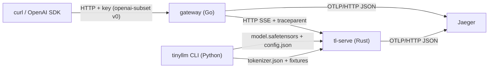

# The System the Solutions Build

One system, called `forge` in the reference solutions, grown in passes. This page is the map: what the components are, which language each is in, where its solution lives, and the contracts they meet at. Every contract is a file in [`course/contracts/`](../../../../../course/contracts/); the solution implements those files, and a component can be replaced by any other implementation that meets the same contract.

## Components after Pass 1 (the tracer)

| Component | Lang | Solution | What it does | Module |
|---|---|---|---|---|
| optional C exercises | C | [`c/src/`](../../../../../course/solutions/c/src/) | standalone kernels and data structures, specified by C headers and shared fixtures | rt.01, M03.1, ds.01 to ds.04 |
| `tinyllm` | Python | [`python/tinyllm/`](../../../../../course/solutions/python/tinyllm/) | the byte bigram fitted by counting, safetensors v0, tokenizer files, the `tinyllm` CLI | L0.0 |
| `tl-serve` | Rust | [`rust/crates/`](../../../../../course/solutions/rust/crates/) | a Candle engine streaming SSE completions from safetensors checkpoints; one OTLP span per request | L10.0 |
| gateway | Go | [`go/gateway/proxy/`](../../../../../course/solutions/go/gateway/proxy/), [`entry/go/cmd/gateway`](../../../../../course/solutions/entry/go/cmd/gateway/) | API-key check, SSE pass-through without buffering, `traceparent` and `X-Request-Id` | gw.00, obs.00 |
| deploy | Docker, Helm, kind | [`entry/deploy/`](../../../../../course/solutions/entry/deploy/) | engine and gateway images, charts, a kind cluster with NodePorts 30080 and 30686, Jaeger | dep.00 |
| docs | Markdown | [`docs/`](../../../../../course/solutions/docs/) | ADR-0001, the engine-crashloop runbook, postmortems | craft.02, ops.00 |
| CI | GitHub Actions | [`entry/.github/workflows/ci.yml`](../../../../../course/solutions/entry/.github/workflows/ci.yml), [`entry/.githooks/`](../../../../../course/solutions/entry/.githooks/) | commit lint and native tests for every language | craft.01 |
| manifest | TOML | [`system.toml`](../../../../../course/solutions/system.toml) | how the solution's entry points are built and started (build steps, then one command per role) | every pass |

Python and Rust exchange data through files: safetensors checkpoints, `tokenizer.json`, and shared fixtures. No language boundary uses FFI. [ADR-0001](../../../../../course/solutions/docs/adr/0001-languages-meet-at-process-and-file-boundaries.md) records why.

## Contract index

| Contract | File | Used from |
|---|---|---|
| C exercise contracts | [`c/include/tinyllm.h`](../../../../../course/contracts/c/include/tinyllm.h), [`tinyllm/abi.h`](../../../../../course/contracts/c/include/tinyllm/abi.h), [`tinyllm/matmul.h`](../../../../../course/contracts/c/include/tinyllm/matmul.h), rules in [`c/ABI.md`](../../../../../course/contracts/c/ABI.md) | optional standalone C modules |
| C test kit | [`c/include/ol_test.h`](../../../../../course/contracts/c/include/ol_test.h) | the C example tests |
| Python interfaces | [`py/tinyllm/`](../../../../../course/contracts/py/tinyllm/) (`lm/bigram.pyi`, `io/safetensors.pyi`) | L0.0 |
| HTTP API v0 | [`openapi/openai-subset.v0.yaml`](../../../../../course/contracts/openapi/openai-subset.v0.yaml) | L10.0 (engine tier), gw.00 (gateway tier) |
| Checkpoint | [`formats/safetensors.md`](../../../../../course/contracts/formats/safetensors.md), [`formats/config.schema.json`](../../../../../course/contracts/formats/config.schema.json) | L0.0 writes, L10.0 reads |
| Tokenizer | [`formats/tokenizer.md`](../../../../../course/contracts/formats/tokenizer.md) (the `bytes` tokenizer) | L0.0, L10.0 |
| Entry points | [`spec/cli-roles.md`](../../../../../course/contracts/spec/cli-roles.md) | every role the system starts |
| System manifest | [`config/system.schema.json`](../../../../../course/contracts/config/system.schema.json) | `system.toml` |
| Decision record | [`templates/ADR.md`](../../../../../course/contracts/templates/ADR.md) | craft.02 |

## The spiral

After every pass the system runs end to end: a request enters at the gateway, reaches a model the Python side trained, and leaves a trace in Jaeger. Later modules either upgrade a component behind an unchanged contract (the bigram retrained by autograd in Pass 2 still serves through the same checkpoint and the same engine) or change a contract through an explicit migration chapter. Because every pass keeps the earlier end-to-end paths working, a regression anywhere shows up as a broken path you already understood.

| Contract | How it grows |
|---|---|
| the model behind the checkpoint | count bigram (P1), autograd bigram (P2), the transformer family (P5), the Llama family served by the engine (P7 on) |
| standalone C kernels | optional exercises, checked against fixture files produced by Python references |
| HTTP `openai-subset` | v0 completions with SSE (P1), v1 with chat, usage, and tools (P7), v2 migration (P11) |
| gateway | proxy (P1), auth, limits, routing, cache, ledger (P7), usage policy (P10) |
| deploy | two charts and Jaeger (P1), per-role charts and the observability stack (P7), durable workers (P8) |
