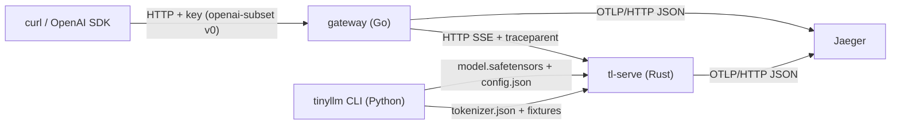

# The System the Solutions Build

The reference solutions build one system, called `forge`, and grow it in passes. This page is the map you will come back to throughout the course: what the components are, which language each is written in, where its solution lives, and the contracts where the components meet. Every contract is a file in [`course/contracts/`](../../../../../course/contracts/). The solution implements those files, and any component can be replaced by another implementation that meets the same contract.

## The components after the tracer

After [Pass 1](../course-p01-tracer/README.md), every layer of the final system exists in its thinnest form. The table lists each component with its solution directory and the section that explains it:

| Component | Language | Solution | What it does | Explained in |
|---|---|---|---|---|
| optional C exercises | C | [`c/src/`](../../../../../course/solutions/c/src/) | standalone kernels and data structures, specified by C headers and shared fixtures | [Optional standalone C kernels](../../p09-kernels/README.md), [Vectors, matrices, and matmul](../../../mathematics-for-computing/03-linear-algebra/01-vectors-matrices-and-matmul.md), and the data structures from [A growable array](../../../algorithms/16-systems-data-structures/01-growable-array.md) to [Heap top-k in C](../../../algorithms/16-systems-data-structures/04-binary-heap-top-k.md) |
| `tinyllm` | Python | [`python/tinyllm/`](../../../../../course/solutions/python/tinyllm/) | the byte bigram fitted by counting, safetensors v0, tokenizer files, the `tinyllm` CLI | [Byte bigram](../../p00-foundations/00-byte-bigram.md) |
| `tl-serve` | Rust | [`rust/crates/`](../../../../../course/solutions/rust/crates/) | a Candle engine streaming SSE completions from safetensors checkpoints, with one OTLP span per request | [Your first endpoint](../../p10-serving/00-your-first-endpoint.md) |
| gateway | Go | [`go/gateway/proxy/`](../../../../../course/solutions/go/gateway/proxy/), [`entry/go/cmd/gateway`](../../../../../course/solutions/entry/go/cmd/gateway/) | API-key check, SSE pass-through without buffering, `traceparent` and `X-Request-Id` | [The tracer gateway](../../../ai-platform-engineering/12-gateway/00-streaming-proxy.md), [One trace](../../../systems/04-observability/00-one-trace.md) |
| deploy | Docker, Helm, kind | [`entry/deploy/`](../../../../../course/solutions/entry/deploy/) | engine and gateway images, charts, a kind cluster with NodePorts 30080 and 30686, Jaeger | [Tracer deploy](../../../infrastructure/01-containers-kubernetes/00-tracer-deploy.md) |
| docs | Markdown | [`docs/`](../../../../../course/solutions/docs/) | ADR-0001, the engine-crashloop runbook, postmortems | [Architecture decision records](../../../diagramming/02-documentation-writing/01-architecture-decision-records.md), [First drill](../../../systems/05-incident-response-and-chaos/00-first-drill.md) |
| CI | GitHub Actions | [`entry/.github/workflows/ci.yml`](../../../../../course/solutions/entry/.github/workflows/ci.yml), [`entry/.githooks/`](../../../../../course/solutions/entry/.githooks/) | commit lint and native tests for every language | [The repository and its CI gate](../../../software-craftsmanship/05-code-review-and-ci/01-your-repo-and-ci-gate.md) |

The diagram shows how a request and the model's files move between those components:

Notice that Python and Rust exchange data only through files: safetensors checkpoints, `tokenizer.json`, and shared fixtures. No language boundary in the system uses FFI. [ADR-0001](../../../../../course/solutions/docs/adr/0001-languages-meet-at-process-and-file-boundaries.md) records why: a file or a process boundary can be tested from either side on its own, and either side can be rewritten without touching the other.

## The contracts

Those boundaries are only useful if they are written down. The contracts the tracer depends on, and the sections that first read or write them, are:

| Contract | File | Used from |
|---|---|---|
| C exercise contracts | [`c/include/tinyllm.h`](../../../../../course/contracts/c/include/tinyllm.h), [`tinyllm/abi.h`](../../../../../course/contracts/c/include/tinyllm/abi.h), [`tinyllm/matmul.h`](../../../../../course/contracts/c/include/tinyllm/matmul.h), rules in [`c/ABI.md`](../../../../../course/contracts/c/ABI.md) | the optional standalone C sections |
| C test kit | [`c/include/ol_test.h`](../../../../../course/contracts/c/include/ol_test.h) | the C example tests |
| Python interfaces | [`py/tinyllm/`](../../../../../course/contracts/py/tinyllm/) (`lm/bigram.pyi`, `io/safetensors.pyi`) | [Byte bigram](../../p00-foundations/00-byte-bigram.md) |
| HTTP API v0 | [`openapi/openai-subset.v0.yaml`](../../../../../course/contracts/openapi/openai-subset.v0.yaml) | [Your first endpoint](../../p10-serving/00-your-first-endpoint.md) (engine tier), [The tracer gateway](../../../ai-platform-engineering/12-gateway/00-streaming-proxy.md) (gateway tier) |
| Checkpoint | [`formats/safetensors.md`](../../../../../course/contracts/formats/safetensors.md), [`formats/config.schema.json`](../../../../../course/contracts/formats/config.schema.json) | written by [Byte bigram](../../p00-foundations/00-byte-bigram.md), read by [Your first endpoint](../../p10-serving/00-your-first-endpoint.md) |
| Tokenizer | [`formats/tokenizer.md`](../../../../../course/contracts/formats/tokenizer.md) (the `bytes` tokenizer) | both of the above |
| Entry points | [`spec/cli-roles.md`](../../../../../course/contracts/spec/cli-roles.md) | every role the system starts |
| System manifest | [`config/system.schema.json`](../../../../../course/contracts/config/system.schema.json) | how a system declares its build steps and the command for each role |
| Decision record | [`templates/ADR.md`](../../../../../course/contracts/templates/ADR.md) | [Architecture decision records](../../../diagramming/02-documentation-writing/01-architecture-decision-records.md) |

## The spiral

After every pass the system runs end to end: a request enters at the gateway, reaches a model the Python side trained, and leaves a trace. Later sections do one of two things. Most upgrade a component behind an unchanged contract; the bigram retrained by autograd in Pass 2, for example, still serves through the same checkpoint and the same engine. The rest change a contract, and they do it through an explicit migration. Because every pass keeps the earlier end-to-end paths working, a regression anywhere shows up as a broken path you already understood.

The table traces how each contract grows across the passes:

| Contract | How it grows |
|---|---|
| the model behind the checkpoint | count bigram (Pass 1), autograd bigram (Pass 2), the transformer family (Pass 5), the Llama family served by the engine (Pass 7 on) |
| standalone C kernels | optional exercises, whose outputs are compared with the Python reference's outputs for the same inputs |
| HTTP `openai-subset` | v0 completions with SSE (Pass 1), v1 with chat, usage, and tools (Pass 7), the v2 migration (Pass 11) |
| gateway | proxy (Pass 1); auth, limits, routing, cache, and ledger (Pass 7); usage policy (Pass 10) |
| deploy | two charts and Jaeger (Pass 1), per-role charts and the observability stack (Pass 7), durable workers (Pass 8) |
