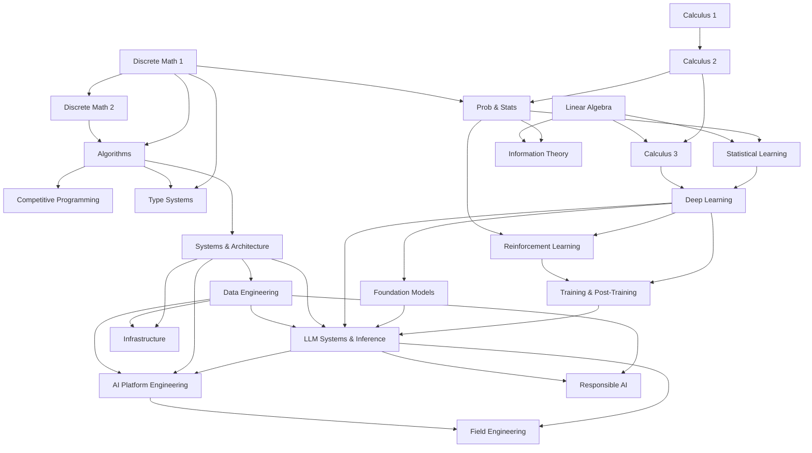

# Prerequisite Map

The books in this library depend on one another, and the map below shows how. An arrow from one subject to another means the first should come before the second. Use it to find your starting point: pick the subject you want to reach, follow the arrows backward, and begin at the earliest subject you do not yet know.

## Reading the map

The map has three roots. The mathematics begins with [Calculus 1](../mathematics-for-computing/02-calculus-1/README.md), [Linear Algebra](../mathematics-for-computing/04-linear-algebra/README.md), and [Discrete Math 1](../mathematics-for-computing/06-discrete-math-1/README.md) in *Mathematics for Computing*. Calculus continues through [Calculus 2](../mathematics-for-computing/03-calculus-2/README.md) to [Calculus 3](../mathematics-for-computing/05-calculus-3/README.md), which also needs linear algebra, and discrete mathematics continues to [Discrete Math 2](../mathematics-for-computing/07-discrete-math-2/README.md). [Probability and Statistics](../mathematics-for-computing/08-probability-statistics/README.md) needs Calculus 2 and Discrete Math 1, and [Information Theory](../mathematics-for-computing/12-information-theory/README.md) needs probability and linear algebra.

Computing begins with [Algorithms](../algorithms/README.md), which rests on both discrete mathematics chapters. From algorithms the path branches three ways: to [Competitive Programming](../competitive-programming/README.md); to [Type systems](../programming-languages/01-type-systems/README.md) in *Programming Languages*, which also needs Discrete Math 1; and to [Systems and Architecture](../systems/README.md). Systems leads on to [Data Engineering](../data-engineering/README.md), and the two together lead to [Infrastructure](../infrastructure/README.md).

Machine learning begins with [Statistical learning](../machine-learning/01-statistical-learning/README.md), which needs probability and linear algebra. [Deep learning](../machine-learning/02-deep-learning/README.md) follows it and also needs Calculus 3. From deep learning come [Reinforcement learning](../machine-learning/03-reinforcement-learning/README.md), which also needs probability; [Foundation models](../machine-learning/05-foundation-models/README.md); and [Training and post-training](../machine-learning/07-training-and-post-training/README.md), which also needs reinforcement learning.

The branches meet at [LLM systems and inference](../machine-learning/04-llm-systems/README.md), which draws on foundation models, deep learning, training and post-training, systems, and data engineering. [AI Platform Engineering](../ai-platform-engineering/README.md) builds on LLM systems, systems, and data engineering; [Field Engineering](../field-engineering/README.md) builds on LLM systems and AI platform engineering; and [Responsible AI](../responsible-ai/README.md) builds on data engineering and LLM systems.

The map shows the strict dependencies only. [*Build Your Own LLM System*](../build-an-llm/README.md) cuts across almost all of it in its own interleaved order, and its [course path](../build-an-llm/paths/course/README.md) names, pass by pass, which sections of these books to read and when.
