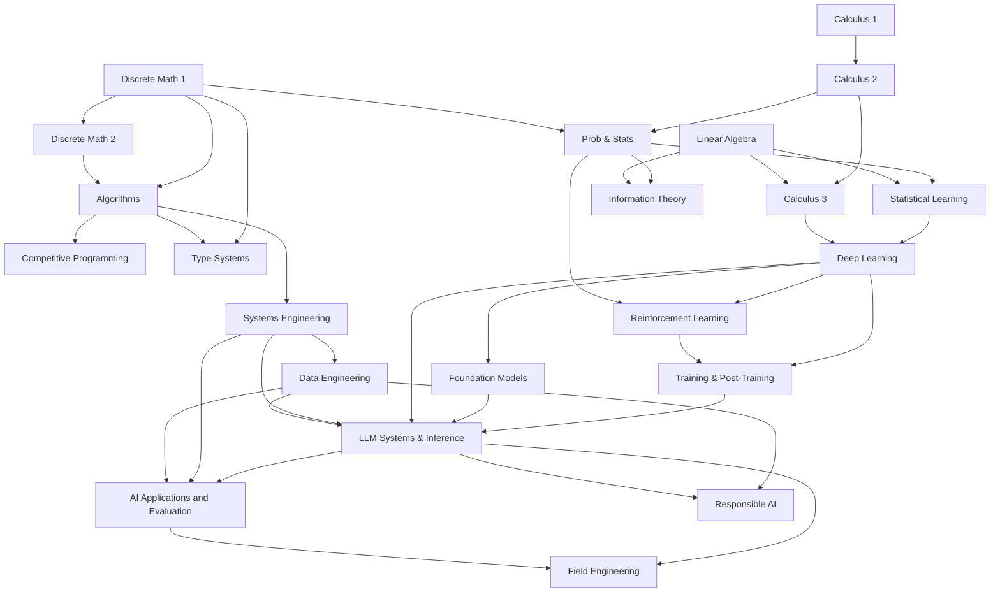

# Prerequisite Map

The map shows dependencies between topics within and across the six books. An edge names a topic prerequisite, rather than requiring completion of an entire book. An arrow from one subject to another means the first should come before the second. Use it to find your starting point: pick the subject you want to reach, follow the arrows backward, and begin at the earliest subject you do not yet know.

## Reading the map

The map has three roots. The mathematics begins with [Calculus 1](../mathematics/07-calculus-1/README.md), [Linear Algebra](../mathematics/09-linear-algebra/README.md), and [Discrete Math 1](../mathematics/11-discrete-math-1/README.md) in *Mathematics*. Calculus continues through [Calculus 2](../mathematics/08-calculus-2/README.md) to [Calculus 3](../mathematics/10-calculus-3/README.md), which also needs linear algebra, and discrete mathematics continues to [Discrete Math 2](../mathematics/12-discrete-math-2/README.md). [Probability and Statistics](../mathematics/13-probability-statistics/README.md) needs Calculus 2 and Discrete Math 1, and [Information Theory](../mathematics/17-information-theory/README.md) needs probability and linear algebra.

Computing begins with [Programming and Algorithms](../programming-and-algorithms/README.md), which rests on both discrete mathematics chapters. From algorithms the path branches three ways: to [Programming and Algorithms](../programming-and-algorithms/README.md); to [Type systems](../programming-and-algorithms/02-type-systems/README.md) in *Programming and Algorithms*, which also needs Discrete Math 1; and to [Systems Engineering](../systems/README.md). Systems Engineering develops architecture, messaging, deployment, and operations in one book. Its design and messaging chapters also prepare you for [Data Engineering](../data-engineering/README.md).

Machine learning begins with [Statistical learning](../ai-engineering/01-statistical-learning/README.md), which needs probability and linear algebra. [Deep learning](../ai-engineering/02-deep-learning/README.md) follows it and also needs Calculus 3. From deep learning come [Reinforcement learning](../ai-engineering/04-reinforcement-learning/README.md), which also needs probability; [Foundation models](../ai-engineering/05-foundation-models/README.md); and [Training and post-training](../ai-engineering/19-training-methods/README.md), which also needs reinforcement learning.

The branches meet at [LLM systems and inference](../ai-engineering/20-inference-engines/README.md), which draws on foundation models, deep learning, training and post-training, systems, and data engineering. The [applications and evaluation chapters](../ai-engineering/27-retrieval-and-rag/README.md) build on model and systems topics; [Field Engineering](../field-engineering/README.md) applies these ideas in delivery work. The [responsible deployment chapters](../ai-engineering/33-data-licensing/README.md) address data rights, privacy, evaluation, and professional responsibility alongside implementation.

The map shows the strict dependencies only. [*AI Engineering*](../ai-engineering/README.md) cuts across almost all of it in its own interleaved order, and its [course path](../ai-engineering/paths/course/README.md) names, pass by pass, which sections of these books to read and when.
