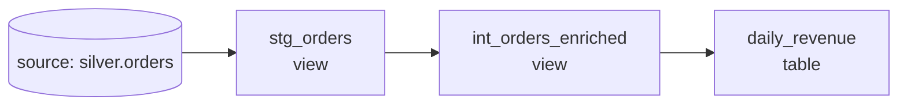

# The Streamflow dbt Project

This is a minimal, runnable dbt project that turns the silver order events written by the [Spark job](../../03-batch-streaming/spark/orders_bronze_to_silver.py) into a tested `daily_revenue` mart. It exists to make the ideas of [Orchestration and Modeling](../README.md) concrete: `ref()`, the model DAG, materializations, medallion layering, and tests. Read it alongside that chapter; every file here is short and commented.

## The DAG that `ref()` builds

The project has three models over one source. Each model names its upstream with `source()` or `ref()`, and dbt infers the graph below from those references:



You never wrote that ordering down. dbt inferred it from `source()` and `ref()`.

## How the project is laid out

Each file has one job, and the folder it lives in tells you its layer. The table below maps them.

| Path | Layer | Why |
|------|-------|-----|
| `models/staging/stg_orders.sql` | staging | one model per source; light rename/recast; the contract boundary |
| `models/intermediate/int_orders_enriched.sql` | intermediate | revenue-recognition rule defined once, reused by marts |
| `models/marts/daily_revenue.sql` | mart (gold) | business-facing, materialized as a table for BI |
| `models/**/_*.yml` | tests | `not_null` / `unique` / `accepted_values` schema tests + a source freshness check |
| `tests/assert_daily_revenue_is_sane.sql` | test | a custom *singular* test: grain uniqueness + non-negative revenue |

The staging model is the contract boundary with raw data: it only renames and recasts (`status` becomes `order_status`, `amount` becomes `order_amount`, `event_ts` becomes `ordered_at`) and is materialized as a view, cheap and always fresh. The intermediate model defines revenue recognition in exactly one place: only orders whose status is `completed` contribute their amount to `recognized_revenue`. The mart aggregates to a grain of one row per `order_date` and `currency`, with distinct order and customer counts and summed revenue, and is materialized as a table for fast dashboards. The materializations are set per folder in `dbt_project.yml`: staging and intermediate as views, marts as tables.

The source declaration points straight at the hive-partitioned Parquet the Spark job wrote, and its freshness check warns after 6 hours and errors after 24, using `event_ts` as the loaded-at field. The singular test is any `SELECT` that should return zero rows; it fails the build if any `(order_date, currency)` key appears more than once or any day's revenue is negative.

## Running it

The project runs on DuckDB, with zero infrastructure:

```bash
uv pip install dbt-duckdb
export DBT_PROFILES_DIR=$(pwd)          # uses profiles.example.yml -> rename to profiles.yml
export STREAMFLOW_SILVER=../warehouse/silver   # where the Spark job wrote parquet

dbt build      # = run (build models) + test (run every test), in DAG order
dbt docs generate && dbt docs serve     # browse the lineage graph
```

`dbt build` is the command to internalize. It walks the DAG and, for each node, builds it and then tests it, so a failing test stops bad data from propagating downstream.
