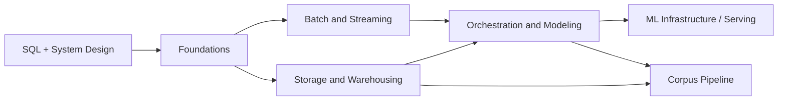

# Data Engineering

Data is almost never produced for the people who need it. An application database exists to run the application, a web server writes logs so operators can debug it, and a crawler fetches pages because someone pointed it at the web. The analyst who wants weekly revenue by region, the ML engineer who needs a clean training set, and the application that serves a recommendation all need that data in a different shape, at a different time, with guarantees nobody gave it at birth. Data engineering is the work of building the systems that move, store, and shape data so those consumers can use it reliably.

This book is for software engineers who are comfortable with SQL and with the basics of system design, and who want to understand how a modern data platform is put together: from storage formats and warehouses, through batch and stream processing, to orchestration, modeling, and data quality. It closes by applying all of it to one demanding pipeline: building the pretraining corpus for a language model.

## What you will be able to do

By the end of the book you will be able to:

- Place any data system on the lifecycle of generation, ingestion, storage, transformation, and serving, and name the undercurrents (governance, security, orchestration) that cut across it.
- Choose storage by access pattern: row-oriented systems for transactions (OLTP), column-oriented systems for analytics (OLAP), and open table formats over object storage for the lakehouse, which is collapsing the old divide between lake and warehouse.
- Design ELT pipelines that load raw data cheaply and transform it in place with SQL, with compute and storage decoupled and elastic.
- Build batch and streaming jobs with event time, watermarks, and windows, and reason precisely about delivery semantics.
- Make pipelines idempotent and replayable from the start, since idempotency and exactly-once semantics are the hardest and most important properties of any pipeline.
- Build a deterministic, licensed, deduplicated training corpus and explain every stage of it.

## How this book is organized

The chapters build on one another, as the dependency graph shows: foundations first, then storage and processing in either order, then orchestration and modeling, which draws on both. The corpus pipeline uses storage and orchestration ideas, and orchestration in turn leads on to ML infrastructure in other books.

[Foundations](01-foundations/README.md) gives you the vocabulary and the map the rest of the book assumes. It introduces the data engineering lifecycle, the OLTP-versus-OLAP distinction and how it drives storage layout and file formats, the shift from ETL to ELT, and the reliability ideas (consistency, idempotency) and batch-versus-streaming framing that later chapters develop.

[Storage and Warehousing](02-storage-warehousing/README.md) goes inside the storage layer: LSM-trees and B-trees, columnar execution, the warehouse, lake, and lakehouse, open table formats such as Iceberg and Delta, partitioning and clustering, and Kimball's dimensional modeling with star schemas, grain, and slowly changing dimensions.

[Batch and Streaming Processing](03-batch-streaming/README.md) treats batch as the bounded special case of streaming. It covers distributed processing and shuffles in Spark, Kafka's log and consumer groups, event time and watermarks, the Dataflow model's four questions (what, where, when, how), delivery semantics and checkpointing, and Flink for true streaming.

[Orchestration and Modeling](04-orchestration-modeling/README.md) turns a pile of scripts into a reliable, observable, dependency-aware system. It covers DAGs, idempotent tasks and backfills in Airflow and its peers, transformation as code with dbt, modeling for consumption, data quality testing, data contracts and governance, and data observability.

[Corpus Pipeline](05-corpus-pipeline/README.md) applies the book to the data that bounds a language model's quality. Its nine sections build a streaming pipeline from fetch with resume and checksums, through normalization, quality filters, exact and near-duplicate removal, decontamination, and PII scrubbing, to Parquet shards, tokenized training files, a licensing ledger and datasheet, and finally the whole build as a durable, resumable workflow.

### A running example

A small end-to-end pipeline for **Streamflow orders** runs through the middle of the book, so the concepts have working code rather than only prose. It runs locally on DuckDB with no cloud setup, and it uses the same Streamflow event-driven platform as *[Infrastructure](../infrastructure/)* and *[Diagramming and Documentation](../diagramming/)*. It has three stages:

| Stage | File | Chapter |
|-------|------|---------|
| Transform raw to clean (Spark, bronze to silver) | [`spark/orders_bronze_to_silver.py`](03-batch-streaming/spark/orders_bronze_to_silver.py) | [Batch and Streaming Processing](03-batch-streaming/README.md) |
| Model clean data into tested marts (dbt, silver to gold) | [`dbt/`](04-orchestration-modeling/01-dbt/) | [Orchestration and Modeling](04-orchestration-modeling/README.md) |
| Orchestrate the whole DAG (Airflow) | [`airflow/streamflow_orders_dag.py`](04-orchestration-modeling/airflow/streamflow_orders_dag.py) | [Orchestration and Modeling](04-orchestration-modeling/README.md) |

### Choosing a path

You do not have to read the book front to back. If you are new to data, start with Foundations and then Storage and Warehousing. If you come from backend or systems work, skim Foundations and focus on Batch and Streaming Processing. If your background is analytics or BI, go from Storage and Warehousing to Orchestration and Modeling, where dbt lives. If your focus is ML or MLOps, read Foundations and Batch and Streaming Processing, then the Corpus Pipeline, and continue to [LLM Systems](../machine-learning/04-llm-systems/) in *Machine Learning and AI*. For a paced schedule through the whole book, see the [reading plan](study-plan.md).

## Prerequisites and related books

You should be comfortable writing SQL and know the basics of [System Design](../systems/01-system-design/) from *Systems and Architecture*. Familiarity with the data structures in *[Algorithms](../algorithms/)* helps, especially for the hashing, Bloom filters, and sort-merge joins of the corpus chapter. The corpus chapter also leans on the asyncio and HTTP primers in *[Programming Languages](../programming-languages/)* and on the licensing and PII material in *[Responsible AI](../responsible-ai/)*.

The book connects onward in several directions. *[Infrastructure](../infrastructure/)* covers the messaging, search, and Apache stack that data platforms run on. *[Machine Learning](../machine-learning/)* and *[Build Your Own LLM System](../build-an-llm/)* consume the corpus this book builds, and *[AI Platform Engineering](../ai-platform-engineering/)* supplies the durable workflow engine the final corpus section runs on.

## Conventions

Code appears in fenced blocks with a language tag (`python`, `sql`, `bash`, `yaml`); listings that are abbreviated mark the omission with a comment or `...`. Mathematics is written in LaTeX notation, inline as $x$ and displayed on its own line. Diagrams use Mermaid.

Each chapter opens with learning objectives and a "Before you begin" note on prerequisites. Sections close with key terms, a summary, and review questions whose answers are hidden in collapsible blocks; try each question before you open its answer. Call-outs marked **Warning** flag mistakes that are easy to make and expensive to discover, and **Tip** call-outs give shortcuts worth remembering.

The Streamflow example code lives beside the chapters that use it. The full solution code for the corpus pipeline lives under [`course/solutions/`](../../../course/solutions/) (the Python package is in [`course/solutions/python/corpus/`](../../../course/solutions/python/corpus/)), and the interface contracts each section implements are under [`course/contracts/`](../../../course/contracts/).
