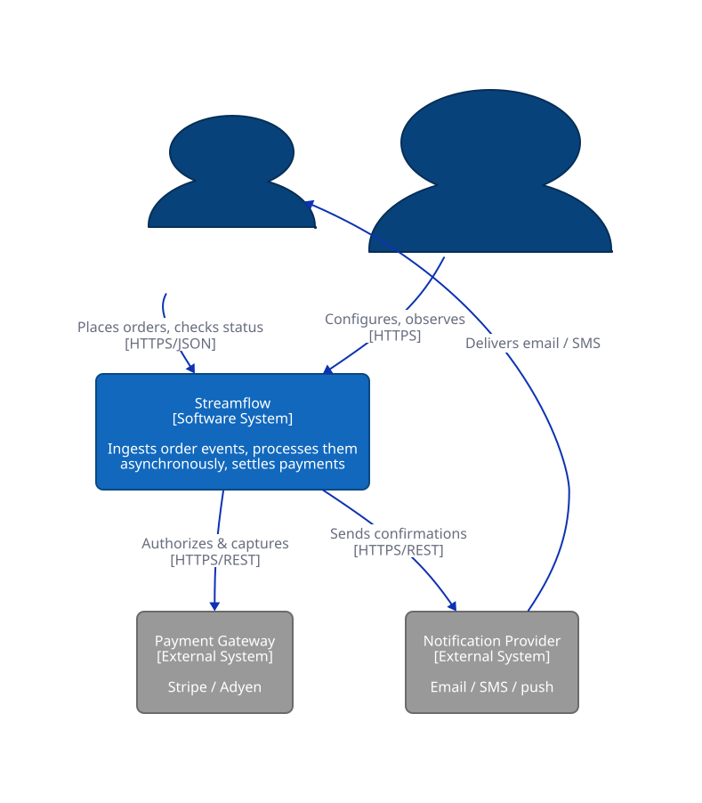
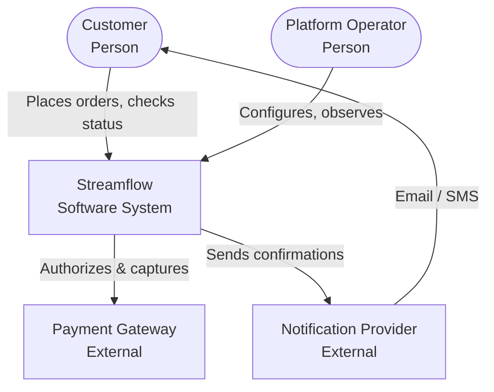
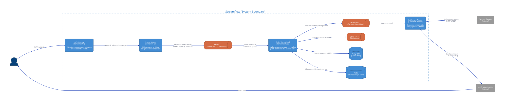
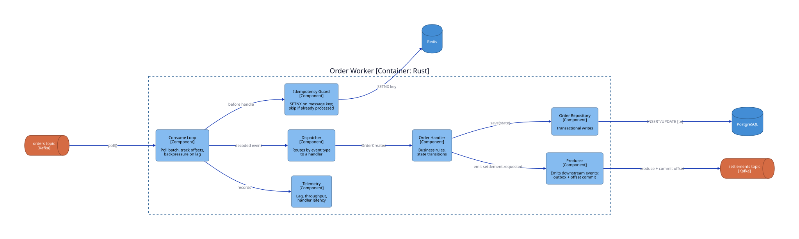
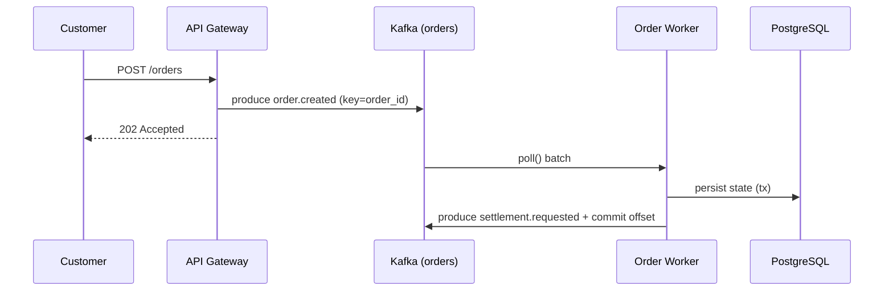
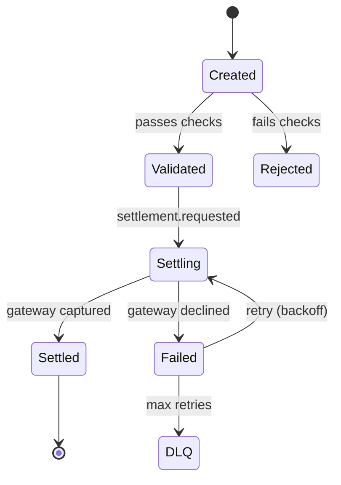

# Diagramming with the C4 Model

Every architecture diagram is an answer to a question, and most bad diagrams fail because nobody decided what the question was. The two classic failures are the "everything diagram," which mixes a CEO's mental model with a packet's TCP flags on one page, and the screenshot pasted into a wiki that can never be updated. This chapter fixes both. The C4 model fixes the first by giving you **abstraction levels** you can zoom between, like a map. Diagrams-as-code fixes the second by making the diagram a **source artifact**: text that lives next to the code, renders deterministically, and is reviewed in pull requests like any other change.

Simon Brown, who created C4, explains it with a map analogy. Google Maps lets you zoom from country to city to street to building, and you would never show a single map at every zoom level at once. C4 is that zoom control for software. Once you have it, you stop drawing one diagram that tries to say everything and therefore says nothing.

The chapter builds up in four steps. You start with the four C4 levels, drawn for Streamflow, the event-driven order platform used as a running example across several books. You then compare the text-to-diagram tools (D2, Mermaid, PlantUML, Structurizr, draw.io) and see the pattern this book uses. Third, you learn to pick a diagram type by the question it answers, since C4 covers structure but sequence, state, and data-shape questions want different pictures. Finally, you see how to keep diagrams embedded and living so they do not rot. The chapter's one section then applies all of it to a real LLM platform.

> **Learning objectives**
> - Name the four C4 levels, the audience and question each serves, and decide which levels a given system needs.
> - Choose between Mermaid, D2, PlantUML, Structurizr, and draw.io for a diagram, and explain the D2-plus-committed-SVG-plus-inline-Mermaid pattern.
> - Pick the right diagram type (container, sequence, state, entity-relationship, Gantt) from the question being asked.
> - Set up diagrams as embedded, living models: co-located, rendered in CI, reviewed as code, and generated where possible.

## Before you begin

You need nothing beyond a system worth drawing. It helps to have read about the systems you will see in the examples: [Containers, Kubernetes & Workloads](../../infrastructure/01-containers-kubernetes/) in *Infrastructure* for what a deployment looks like, and [Durable Orchestration and Workers](../../ai-platform-engineering/05-durable-orchestration-and-workers/) in *AI Platform Engineering* for how work fans out across queues. To follow along, install `d2` (`brew install d2`, or see [d2lang.com](https://d2lang.com/)) and render this chapter's diagrams from the [`diagrams/`](diagrams/) directory with `d2 c4-container.d2 out.svg`.

The primary references are all free: [the C4 model](https://c4model.com/) by Simon Brown, the lingua franca for software architecture diagrams; [D2](https://d2lang.com/), a modern text-to-diagram language and the source format for this chapter's C4 diagrams; and [Mermaid](https://mermaid.js.org/), diagrams-as-code that renders natively in GitHub Markdown.

## The C4 model: four levels of zoom

C4 defines four levels, each with its own audience and its own question. The table summarizes them.

| Level | Name | Audience | Answers |
|-------|------|----------|---------|
| 1 | **Context** | everyone, including non-technical readers | What is this system, who uses it, and what does it depend on? |
| 2 | **Container** | technical staff | What are the separately deployable or runnable units, and how do they communicate? |
| 3 | **Component** | developers of one container | What are the major code structures inside a container? |
| 4 | **Code** | rarely drawn by hand | Class and entity-relationship detail; generate it from code, do not maintain it |

The discipline that makes C4 work is restraint: **draw levels 1 and 2 for almost everything, draw level 3 only for containers with non-obvious internals, and almost never hand-draw level 4.** One vocabulary trap is worth flagging early. A "container" in C4 has nothing to do with Docker. It is *any* independently runnable thing: an application, a service, a database, a Kafka topic, a single-page app.

### Level 1: System context

At the context level the whole system is one box, and everything else is users and external systems. For Streamflow that means two people (a customer and a platform operator) and two external dependencies (a payment gateway and a notification provider).



<sub>Rendered from [`diagrams/c4-context.d2`](diagrams/c4-context.d2). The Mermaid equivalent below renders inline on GitHub.</sub>



### Level 2: Container

Zoom into the system box and you reach the container view. **This is the most useful diagram in practice**, because it maps one to one onto what you deploy (the subject of [Containers, Kubernetes & Workloads](../../infrastructure/01-containers-kubernetes/)) and onto how data flows between services (the subject of [Durable Orchestration and Workers](../../ai-platform-engineering/05-durable-orchestration-and-workers/)).



<sub>Source: [`diagrams/c4-container.d2`](diagrams/c4-container.d2).</sub>

### Level 3: Component

Zoom into one container, here the Order Worker, and you can show how a single message flows through its internals: the consume loop, the idempotency guard, the dispatcher, the handlers, the repository, and the producer.



<sub>Source: [`diagrams/c4-component.d2`](diagrams/c4-component.d2).</sub>

### The "+1": a deployment view

C4 also defines a **deployment diagram** that maps logical containers onto infrastructure nodes. It is the bridge into *Infrastructure*: it shows the same containers living as Kubernetes objects, and so it is kept beside the workload it depicts rather than in this chapter.


<sub>Source: [`infrastructure/01-containers-kubernetes/diagrams/deployment-k8s.d2`](../../infrastructure/01-containers-kubernetes/diagrams/deployment-k8s.d2).</sub>

## Diagrams as code: D2, Mermaid, and the rest

Knowing what to draw is half the problem; the other half is drawing it in a form that survives. Diagrams-as-code beats drag-and-drop for anything that must last, because a text file diffs, reviews, versions, and renders in CI like source. The tools differ mainly in where they render and how much layout control they give you, as this comparison shows.

| Tool | Renders in GitHub Markdown? | Strength | Use when |
|------|:--:|----------|----------|
| **Mermaid** | Yes, natively | Zero toolchain, lives in the README | Inline diagrams reviewers see without rendering; sequence, flow, ER, state |
| **D2** | No (commit the SVG) | Good layout from real layout engines (ELK, dagre), themes, classes | Canonical architecture diagrams you render to SVG and embed |
| **PlantUML** | No (commit the SVG) | Mature C4 macro library, broad UML coverage | Teams already standardized on UML or PlantUML |
| **Structurizr** | No (own viewer) | C4-native: one model, many auto-derived views | You want a single model and generated context, container, and component views |
| **draw.io** | No (image) | Freehand, fast for whiteboard-style sketches | One-off sketches; *not* for anything maintained |

This book uses a deliberate pattern: **author canonical architecture diagrams in D2, commit both the `.d2` source and the rendered `.svg`, and provide a Mermaid equivalent inline** so the diagram still renders when the reader has no toolchain. You get diffable source, a good-looking render, and GitHub-native display at once. For freehand sketches, [diagrams.net/draw.io](https://www.diagrams.net/) is fine; [PlantUML](https://plantuml.com/) and [Structurizr](https://structurizr.com/) (by the model's author) are the alternatives worth knowing.

D2 itself is small. Here is the syntax used in this chapter's files, a gateway producing to a Kafka topic that a worker consumes:

```d2
direction: right
api: "API Gateway\n[Container: Go]" { style.fill: "#438dd5" }
kafka: "orders\n[Kafka topic]" { shape: queue }
worker: "Order Worker\n[Container: Rust]" { style.fill: "#438dd5" }
api -> kafka: "produces"
kafka -> worker: "consumes (pull)"
```

Rendering is one command, and a watch mode live-reloads the browser while you edit:

```bash
d2 architecture.d2 architecture.svg   # render
d2 --watch architecture.d2            # live-reload in the browser while editing
```

Try one change for yourself: add a dead-letter-queue consumer to a `.d2` file and run `git diff`. You will notice that you just reviewed an *architecture change* as a code change, which is the whole point.

## Picking the diagram by the question

C4 covers *structure*. Most other questions are better answered by a different standard diagram, so pick the diagram type by the question you are answering, not by the tool you happen to have open. Mermaid draws all of the common ones inline:

| Question | Diagram | Mermaid type |
|----------|---------|--------------|
| What are the moving parts? | C4 container | `graph` / `flowchart` |
| In what order do services talk during a request? | **Sequence** | `sequenceDiagram` |
| What states can an order be in? | **State machine** | `stateDiagram-v2` |
| What is the data shape? | **Entity-relationship** | `erDiagram` |
| What is the release timeline? | **Gantt** | `gantt` |
| How does work fan out across queues? | Flow or **C4** | `flowchart` |

A sequence diagram answers "in what order, and where can it fail?" Here is the request path through Streamflow, from the customer's `POST` to the worker committing its offset:



A state machine answers a different question: what lifecycle does the worker enforce? It is the right picture whenever an idea involves transitions, such as orders, jobs, or sagas:



## Embedded, living models: diagrams that do not rot

A diagram is only worth drawing if it stays true. An embedded model, rendered in the repository, stays alive; a screenshot in a wiki is dead the moment it is pasted. Two properties keep a model healthy. It must be **embedded**, meaning it lives in the repository beside the code, and **living**, meaning a process (ideally automation) keeps it current. In practice that comes down to five habits.

First, **co-locate**: `diagrams/*.d2` lives in the repository, not a wiki, so the diagram moves with the code it describes. Second, **render in CI**: a job runs `d2 *.d2` (or `mmdc` for Mermaid) and fails if a `.d2` file no longer compiles, or regenerates the SVGs as a release artifact, so the diagram cannot silently break. Third, **review as code**: an architecture change *is* a diff to a `.d2` file in the same pull request as the code change, so reviewers see the structural change. Fourth, **generate level 4 from code** rather than maintaining it. Entity-relationship diagrams come from the schema and call graphs from the source; hand-maintained code-level diagrams always drift, so treat them as build output. Fifth, **date and own**: every embedded diagram carries a comment header saying what question it answers and when it was last validated, as the `.d2` files in this chapter's [`diagrams/`](diagrams/) directory do.

This is the same insight as docs-as-code in [Documentation writing](../02-documentation-writing/README.md): the artifact survives because it is treated like source, not like a deliverable that is "done."

A good way to test your understanding is to redraw Streamflow from scratch at each C4 level without looking. If you cannot, you do not yet understand the system, and finding that out is the point of the exercise.

## Choosing a technique

The ideas above reduce to a small catalog. When you face a new diagramming job, this table tells you where to start.

| Technique | When to apply |
|-----------|---------------|
| C4 context (level 1) | Onboarding docs, executive and cross-team communication, any new project's README |
| C4 container (level 2) | Design docs, the default "how does it work" diagram, capacity and operations planning |
| C4 component (level 3) | Only for a container with non-obvious internals worth explaining |
| Generate level 4 from code | ERDs and class diagrams; never hand-maintain them |
| Mermaid inline | Anything reviewers should see without a render step |
| D2 plus committed SVG | Canonical, presentation-grade architecture diagrams |
| Sequence diagram | Tracing a request; debugging "who calls whom, when" |
| State machine | Documenting a lifecycle or finite-state machine (orders, jobs, sagas) |
| Render in CI | Any diagram that must not be allowed to rot |

## Where diagramming shows up elsewhere

Diagramming connects to several other books. The container and deployment views *are* what you deploy, which is why they reappear in [Cloud Native](../../systems/03-cloud-native/) in *Systems and Architecture*. Sequence and data-flow diagrams are the working language of [System Design](../../systems/01-system-design/), where a design interview is live diagramming under time pressure. Diagrams-as-code and review-as-code follow the same "treat artifacts like source" principle as docs and tests in *[Software Craftsmanship](../../software-craftsmanship/)*. And entity-relationship diagrams should be generated from the schema, not drawn, which is the approach [Storage & Warehousing](../../data-engineering/02-storage-warehousing/) in *Data Engineering* takes to the data model.

The skill also matters in hiring. Google makes design docs mandatory and diagram-heavy, with context and container diagrams in every one. Amazon's "working backwards" documents and architecture reviews use C4-style views with clear ownership boundaries. Stripe is known for its documentation and for sequence diagrams of request flows, and Anthropic expects legible, reviewable architecture in design docs for safety-critical systems. At any Staff-plus level you are expected to communicate architecture, not just build it.

## In this chapter

- [C4 diagrams in D2](01-c4-diagrams-in-d2.md): draws the context, container, and engine-component views of the LLM platform from *Build Your Own LLM System* in D2, traces one request through the levels by hand, and explains why every box and arrow sits at the level it does.

## Further reading

- Simon Brown, [The C4 model](https://c4model.com/) (free).
- [D2 documentation](https://d2lang.com/) (free).
- [Mermaid documentation](https://mermaid.js.org/) (free).
- [Structurizr](https://structurizr.com/), C4-native modeling by the model's author.
