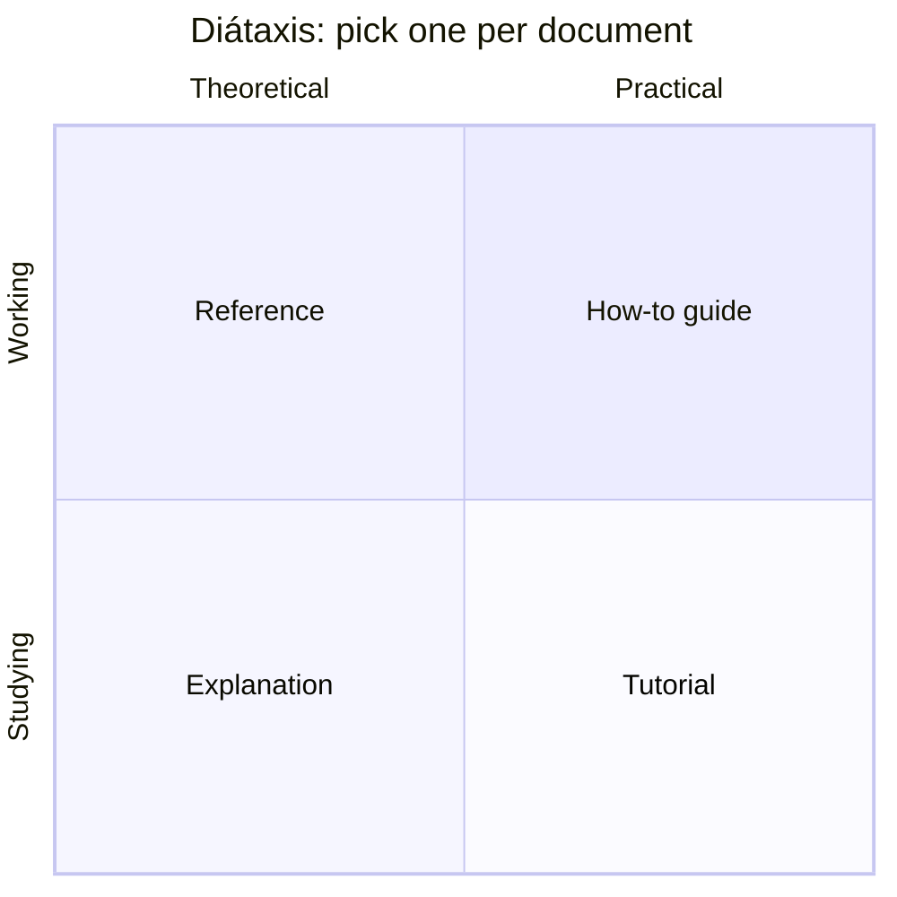

# Documentation Writing

Documentation is code's interface to humans across time. Code shows *what* the system does, tests show what must stay true, and only writing preserves *why* it is the way it is, which is the most expensive knowledge a team can lose. This chapter treats documentation the way the previous chapter treated diagrams: as a source artifact that is versioned, reviewed, tested, deprecated, and owned.

The central idea comes from Daniele Procida's Diátaxis framework. A reader arrives at a document in one of two states (studying or working) needing one of two things (practical steps or theoretical knowledge). Those two axes give **four irreducible documentation types**, and the cardinal sin is mixing them. A tutorial that keeps stopping to explain theory loses the beginner; a reference page that tells a story wastes the expert's time. Most "bad docs" are really the wrong *type* of doc. Name the type before you write, write to it, and most documentation problems dissolve.

The chapter moves from that framework to practice. You will see the four Diátaxis types, then how to treat documentation as code, then the mechanics of clear sentences (which are learnable, not a talent). From there it surveys the documents a Staff-plus engineer actually owns and closes with the one most often missing: the architecture decision record. The two sections that follow put the ideas to work on a real system, first by writing a decision record and then by writing runbooks and a Diátaxis index.

> **Learning objectives**
> - Classify any document as tutorial, how-to guide, reference, or explanation, and split a document that is secretly two types.
> - Apply docs-as-code practices: same-PR updates, review, tested samples, generated reference, and deliberate deprecation.
> - Rewrite prose using the core technical-writing mechanics: one idea per sentence, active voice, bottom line up front, lists and tables where they fit.
> - Name the documents a senior engineer owns, their Diátaxis type, and how each is kept alive.
> - Write an immutable, append-only architecture decision record.

## Before you begin

Read [Diagramming with the C4 Model](../01-diagramming-c4/README.md) first, because good documents are anchored by diagrams. For the two sections, you also need a repository you work in. The primary references are free: [Diátaxis](https://diataxis.fr/) by Daniele Procida, the framework for *what kind* of document you are writing; Google's [Technical Writing Courses](https://developers.google.com/tech-writing), the mechanics of clear prose; and chapter 10 of *Software Engineering at Google*, [Documentation](https://abseil.io/resources/swe-book/html/ch10.html). If you have two hours, take Google's [Technical Writing One](https://developers.google.com/tech-writing/one) and apply its rules to a document you already own.

## Diátaxis: the four types

The two axes of Diátaxis place every document in one quadrant:



Each type answers a different reader question, speaks in a different voice, and fails in a characteristic way when it is mixed with another:

| Type | Reader's question | Voice | Failure if mixed |
|------|-------------------|-------|------------------|
| **Tutorial** | "Teach me, I'm new" | "We will... now you'll see..." | Stops to explain theory; the beginner gets lost |
| **How-to guide** | "I have a goal, give me steps" | "To do X: 1, 2, 3" | Becomes a tutorial; the expert is slowed down |
| **Reference** | "What exactly is the signature or flag?" | Dry, complete, consistent | Tells a story; facts get buried |
| **Explanation** | "Why is it built this way?" | Discursive, links tradeoffs | Pretends to be steps; loses the argument |

A repository's `docs/` directory should have a place for each type. A single page trying to be all four is the most common documentation smell. A useful exercise: classify every document in a repository you know by its quadrant, find the one that is secretly two types fighting each other, and split it.

## Documentation as code

Knowing what type to write is the first decision. The second is how to keep the document true, and the answer is that everything good about source code applies to documents.

Documents are **versioned**: they live in the repository and change in the same pull request as the code they describe, so a behavior change with no doc change is an incomplete PR. They are **reviewed**: they go through code review, where reviewers catch "this example no longer compiles." They are **tested**: code samples run in CI ([doctests](https://docs.python.org/3/library/doctest.html), `cargo test --doc`, `go test` on `Example` functions), prose is linted with [Vale](https://vale.sh/), and links are checked, because an untested example *will* drift. They are **generated where possible**: API reference from docstrings or OpenAPI, ER diagrams from the schema, CLI help from the argument parser; hand-maintained reference rots, and generated reference cannot. And they are **deprecated deliberately**: mark stale documents, redirect, and delete. Out-of-date documentation is worse than none, because readers trust it. A document that is not tested against reality is a liability that confidently tells the reader something false, and the [testing mentality](../../software-craftsmanship/03-testing-mentality/) from *Software Craftsmanship* applies to documents as much as to code.

## The mechanics of clear writing

Clear writing is a learnable mechanic. Google's technical-writing rules, distilled to the ones that change your prose today, are these.

Put **one idea in each sentence and one topic in each paragraph**; if a sentence has two ideas, split it. Use **active voice and present tense**: "The worker commits the offset," not "the offset is committed." **Lead with the conclusion** (BLUF, bottom line up front): state the takeaway, then support it, because readers skim. Use **lists for sequences and sets and tables for comparisons**; running prose is the worst format for either, which is why this book puts comparisons in tables. **Define terms once and use them consistently**: do not call it a "worker" here and a "consumer" there unless you mean different things. **Cut filler**: "in order to" becomes "to," and "at this point in time" becomes "now." And **show, then tell**: a runnable example earns more trust than a paragraph of description.

## The documents senior engineers own

With the types and the mechanics in hand, you can map the documents a Staff-plus engineer is actually responsible for. Each has a Diátaxis type, a purpose, and a habit that keeps it alive.

| Document | Diátaxis type | Purpose | Keep alive by |
|----------|--------------|---------|---------------|
| **README** | Mix (gateway) | Orient a newcomer in under five minutes; link out to the rest | Treat it as the front door; see the repository's [README conventions](../../../../README.md) |
| **Design doc / RFC** | Explanation | Argue *why* before building; the artifact of thinking | Write before coding; archive after, with the decision captured in an ADR |
| **ADR** | Explanation | One immutable record per significant decision | Append-only; supersede, never edit |
| **Runbook** | How-to guide | Steps to operate or recover a system at 3 a.m. | Test it during a game day; update it after every incident |
| **API reference** | Reference | Exact signatures, parameters, errors | Generate it from source |
| **Postmortem** | Explanation | Blameless analysis of an incident | Track action items to closure |

## Architecture decision records

One row of that table deserves its own treatment, because it is the document teams most often skip. A design doc captures the thinking; an **architecture decision record** (ADR) captures the *decision* in a tiny, immutable, append-only file so that future engineers know why. Each file records one decision, with the forces, the costs, and the rejected options:

```markdown
# ADR-014: Bound worker parallelism with Kafka partition count

## Status
Accepted (2026-06-13). Supersedes ADR-009.

## Context
Order throughput is rising. We considered adding worker replicas freely,
but a Kafka consumer group caps useful parallelism at the partition count.

## Decision
Set the `orders` topic to 12 partitions and cap the worker HPA at 12 replicas.
Scale partitions (not just replicas) when sustained lag exceeds target.

## Consequences
+ Predictable scaling story; no idle workers.
- Repartitioning is operationally heavy; we must forecast 12-18 months ahead.
- Ordering is per-partition only; documented for downstream consumers.
```

The rule that makes ADRs work is that **they are immutable**. You do not edit ADR-009 when you change your mind; you write ADR-014, which supersedes it. The history of why the architecture is what it is then becomes a readable log. This is the textual twin of the embedded, living diagram from [Diagramming with the C4 Model](../01-diagramming-c4/README.md). To see the practice at scale, read the decision records of a project you use, such as Rust RFCs or Kubernetes KEPs, and compare them with your own.

## Choosing a technique

The chapter's practices reduce to a short catalog of when to apply what.

| Technique | When to apply |
|-----------|---------------|
| Classify by Diátaxis type | Before writing *any* document: name the type first |
| Docs in the same PR as code | Every behavior change |
| Test code samples in CI | Any document with runnable examples |
| BLUF: lead with the conclusion | Every document, email, and PR description |
| Tables for comparisons | Any comparison or enumerated set |
| ADR | Every significant, hard-to-reverse decision |
| Runbook plus game day | Any system you are on call for |
| Blameless postmortem | After every incident |

## Where documentation shows up elsewhere

Docs-as-code and deliberate deprecation are developed further in *[Software Craftsmanship](../../software-craftsmanship/)*, for which Google's documentation chapter is the canonical source. Runbooks and postmortems depend on [Observability](../../systems/04-observability/) in *Systems*, because you can only write a runbook for what you can observe, and every drill in [Incident Response and Chaos](../../systems/05-incident-response-and-chaos/) ends in a runbook or a postmortem you write. Good documents are anchored by the diagrams of [Diagramming with the C4 Model](../01-diagramming-c4/README.md), and the design doc is the deliverable of every exercise in [System Design](../../systems/01-system-design/).

Writing is also how senior engineers scale their influence. Google's design docs and readability reviews make documentation part of engineering, and ADRs are widespread there. Amazon replaces slide decks with the six-page narrative memo, treating writing as thinking. Stripe is known for its API reference and tested examples, and Anthropic relies on careful design docs and writeups for safety-critical work. In any Staff-plus role, RFCs, ADRs, and postmortems are the lever.

## In this chapter

- [Architecture decision records](01-architecture-decision-records.md): the five-section ADR template and its rules, a fully worked record for the byte tokenizer, and an annotated walkthrough of ADR-0001, the decision that languages meet only at process and file boundaries.
- [Runbooks and Diataxis docs](02-runbooks-and-diataxis.md): a goal-sorted Diátaxis index for the platform's documents and one runbook per paging alert, with an annotated walkthrough of the TTFT budget-burn runbook.

## Further reading

- Daniele Procida, [Diátaxis](https://diataxis.fr/) (free).
- Google, [Technical Writing Courses](https://developers.google.com/tech-writing) (free).
- *Software Engineering at Google*, ch. 10, [Documentation](https://abseil.io/resources/swe-book/html/ch10.html) (free).
- [Architecture Decision Records](https://adr.github.io/) (free).
- [Write the Docs](https://www.writethedocs.org/guide/) guide (free).
- *Docs for Developers* (Apress), recommended.
