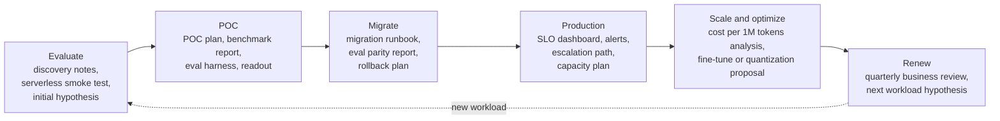

# Discovery

A customer cannot tell you how many GPUs they need. They can tell you what happened at last Tuesday's peak, how they grade an answer, and who can veto the deal. Discovery is the skill of collecting those observable facts and converting them into the inputs of a sizing formula and a map of who decides. Everything that comes after it, sizing, benchmarks, the proof of concept, the migration, the contract, is only as good as the numbers and the names collected here.

This chapter shows how to run the first calls with a customer so that they end in a sized, written **deployment hypothesis** rather than a pleasant conversation. Discovery has exactly one output: that hypothesis, with numbers attached. Every question you ask should map to a decision it can change, or it should be dropped. You will learn the rules of a discovery conversation, work through a question bank grouped by the decision each question changes, see how discovery fits into the whole customer journey, and then learn the mechanics: call agendas, a note template with a confidence column, and a fixed way to say "I don't know."

The chapter is usually led in practice by a sales engineer (SE) or forward deployed engineer (FDE), with a solutions architect (SA) joining for complex integrations. It ends with the exercise that introduces **Lexa**, the mock customer used by every chapter in the book.

> **Learning objectives**
> - Map each discovery question to the decision it changes (model, tier, GPU count, timeline, or people), and drop questions that change nothing.
> - Ask about past behavior and request artifacts instead of collecting opinions about the future.
> - Run a discovery call and a technical deep dive to a written agenda, and send notes with owners and dates the same working day.
> - Record a confidence level (measured, estimated, guessed) next to every number.
> - Answer a question you cannot answer yet with a committed follow-up instead of a guess.

## Before you begin

This chapter assumes you have read the [role landscape](../README.md#the-role-landscape) in the book's front matter and know the vocabulary of [LLM Systems & Inference](../../machine-learning/04-llm-systems/) in *Machine Learning and AI*: time to first token (TTFT), time per output token (TPOT), and prefix caching. The primary reference is *The Mom Test* by Rob Fitzpatrick (a paid book), whose central lesson is to ask about past behavior rather than opinions about the future. Two free supplements are worth reading alongside: [*Service Level Objectives*](https://sre.google/sre-book/service-level-objectives/), chapter 4 of *Site Reliability Engineering*, on SLIs, percentiles, and measuring what users see; and Palantir's [Dev versus Delta](https://blog.palantir.com/dev-versus-delta-demystifying-engineering-roles-at-palantir-ad44c2a6e87), the original description of the forward deployed model. The next chapter, [Qualification and Sizing](../02-qualification-and-sizing/README.md), turns the notes you collect here into numbers.

## The rules of a discovery conversation

Five rules separate a discovery call that produces a hypothesis from one that produces goodwill and nothing else.

The first is to **map every question to a decision**. If the answer cannot change the model, the tier, the GPU count, the timeline, or the people involved, the question wastes the customer's time.

The second is to prefer **past behavior over hypotheticals**. "What did last Tuesday's peak look like?" beats "What peak do you expect?" every time; *The Mom Test* is the book-length version of this rule. Ask what they did last Tuesday, not what they expect next year.

The third is to **ask for artifacts, not descriptions**. A day of sanitized request logs with token counts answers ten workload questions at once.

The fourth is to **record confidence**. "Peak is 50 req/s" read off a dashboard and "peak is 50 req/s" offered as a guess are different inputs, and the person sizing the deployment needs to know which is which.

The fifth is **do not lecture**. Do not bring specialists to a discovery call unless the customer brings theirs; it turns discovery into a presentation.

## The question bank

With the rules in place, you need the questions themselves. The bank below groups them by the decision they change, which is the point: the grouping is the skill, and a good exercise is to read the bank once and then rewrite it from memory, grouped by decision.

| Group | Questions | Decision it changes |
|---|---|---|
| **Business outcome** | What product feature does this power? What happens to the business if it is slow, wrong, or down for an hour? Who complains first? What metric moves if this works? | Priority of latency versus quality versus cost; who signs off |
| **Workload shape** | Requests per second at average and peak? What does the daily and weekly curve look like? Can you export a day of request logs with token counts? Input and output token distributions (p50, p95, max)? How much of each prompt is a shared system prompt, few-shot block, or retrieved document? Streaming or not? Multi-turn sessions, and how long? Agent loops with tool calls? Batchable offline work mixed in? | GPU count, prefix caching value, chunked prefill, batch versus online split |
| **Latency SLOs** | Which latency does the user feel: **TTFT**, **TPOT** (time per output token), or end-to-end? What percentile: p50, p95, p99? Measured where: client, gateway, or server? What is the timeout today and what happens on timeout? | Batch size ceiling, replica count, speculative decoding, region placement |
| **Quality bar** | How do you know an answer is good today? Do you have an eval set, how large, and is it labelled? Who wrote the rubric? Do you use an LLM judge, and which model? What score is "good enough"? Any golden conversations that must never regress? | POC exit criteria, quantization tolerance, whether a fine-tune is in scope |
| **Model choice and fine-tune status** | Which model serves this today, closed or open, which version? Have you tried open models, which, and what broke? Do you have a fine-tune, LoRA adapters, how many? Is the training data yours to use? | Model size, multi-LoRA serving, fine-tuning scope |
| **Data residency, compliance, security** | Which certifications must the vendor hold: SOC 2 Type II, HIPAA (BAA), GDPR, ISO 27001? Is **zero data retention** required, including for logs and metrics? Any region constraint (EU, specific country)? Must traffic stay in your VPC or cloud account? Private networking (PrivateLink, VPC peering)? Who runs the security review and how long does it take? | Serverless versus dedicated versus BYOC; timeline (see [Commercials and Security](../06-commercials-and-security/README.md)) |
| **Spend and cost target** | What do you spend per month on inference today? What is the target **cost per 1M tokens** or cost per request? Is spend growing faster than usage? Committed spend with another vendor? | Serverless versus dedicated breakeven, quantization, distillation |
| **Integration surface** | OpenAI SDK, Anthropic SDK, LangChain, a gateway (LiteLLM, OpenRouter, in-house)? Function calling, structured output or JSON schema, logprobs, n > 1, vision, embeddings? Retry and fallback logic today? | Migration effort, feature gaps to check before the POC |
| **Team and decision makers** | Who owns the integration day to day? Who decides, who can veto (security, finance, procurement)? Do they have an MLE, or is this an app team? Who is on call? | Call invitees, how much you build versus advise |
| **Timeline** | When does this need to be in production, and what drives that date? Any freeze windows, launches, renewals with the incumbent? | POC length, staffing, when to start the security review |

Calls run short, so know which questions survive any time cut. Ask these three on every first call, even if nothing else gets covered:

1. Can you send a sample of real requests with token counts (sanitized is fine)?
2. How do you measure quality today?
3. What would make you say no to this project?

## The customer journey

Discovery is the first step of a longer journey, and knowing the whole journey tells you which facts you will need later so you can ask for them now. The journey runs from evaluation through a proof of concept, migration, production, and optimization, to renewal, and a new workload restarts it.



Each step answers one customer question and produces one field artifact, and each is covered by a chapter of this book:

| Step | Customer question | Field artifact | Chapter |
|---|---|---|---|
| **Evaluate** | Is an open model good enough for us, and is this vendor fast enough? | Discovery notes, quality and latency smoke test on serverless, initial deployment hypothesis | this chapter, [Qualification and Sizing](../02-qualification-and-sizing/README.md) |
| **POC** | Does it hit our SLO and quality bar on our data? | POC plan with success criteria, benchmark harness and report, eval harness, POC readout | [Performance Testing Engagements](../03-performance-testing-engagements/README.md), [POC and Evaluation](../04-poc-and-evaluation/README.md) |
| **Migrate** | How do we move from OpenAI or Anthropic APIs without regressions? | Migration runbook: endpoint swap, template diffs, eval parity report, shadow-traffic plan, rollback plan | [Migration and Cutover](../05-migration-and-cutover/README.md) |
| **Production** | Will it stay up and stay fast? | SLO dashboard, alert thresholds, on-call contacts, escalation path, capacity plan | [Escalation and Handoff](../07-escalation-and-handoff/README.md) |
| **Scale / optimize** | Can we pay less or serve more? | Cost per 1M tokens analysis, fine-tune or distillation proposal, quantization and speculative decoding experiments with eval deltas | [Commercials and Security](../06-commercials-and-security/README.md) |
| **Renew** | Was it worth it? What is next year's workload? | Quarterly business review: SLO attainment, spend trend, incidents and resolutions, next workload hypothesis | [Commercials and Security](../06-commercials-and-security/README.md) |

If the journey stalls, the stalled step usually lacks its artifact.

## Running a call

Knowing what to ask is half the job; the other half is running the call so the answers are captured and acted on. Four rules apply to every call: send the agenda 24 hours ahead with the questions you need answered; name a note-taker (by default, you); end with owners and dates; and send the notes within the same working day.

The discovery call itself takes 45 minutes and follows this agenda:

| Min | Item |
|---|---|
| 0-5 | Introductions, roles, confirm the goal of the call: understand the workload well enough to propose a deployment |
| 5-15 | Business outcome and what success looks like |
| 15-35 | Workload, SLOs, quality measurement, constraints (question bank; skip what they sent ahead) |
| 35-40 | Gaps: data you need (request sample, eval set) |
| 40-45 | Next steps: who sends what by when; propose the technical deep dive |

The technical deep dive that follows is 60 minutes, and it is where you present your first hypothesis and invite the customer to break it:

| Min | Item |
|---|---|
| 0-5 | Recap discovery, confirm the hypothesis inputs are still right |
| 5-25 | Walk their architecture: request path, gateway, retries, where latency is measured |
| 25-45 | Present the deployment hypothesis and the math ([Qualification and Sizing](../02-qualification-and-sizing/README.md)); invite them to break it |
| 45-55 | Feature gaps: tool calling, structured output, logprobs, regions |
| 55-60 | Agree POC scope candidates |

The agendas for the POC kickoff and readout are in [POC and Evaluation](../04-poc-and-evaluation/README.md), and the incident call agenda is in [Escalation and Handoff](../07-escalation-and-handoff/README.md).

## The note template

Notes are the deliverable of every call, and they follow a fixed template so that anyone on the account can read them:

```markdown
# <Customer> / <call type> / <YYYY-MM-DD>

Attendees: <name, role, side>
Goal of call: <one line>

## Facts learned
- <fact> (source: <person or doc>)

## Numbers
| Metric | Value | Confidence (measured / estimated / guessed) |

## Decisions
- <decision> (decided by <name>)

## Open questions
- <question> -> owner <name>, due <date>

## Action items
- [ ] <action> -> owner, due

## Hypothesis changes
- <what changed in the deployment hypothesis and why>
```

The **confidence** column is the most useful field. It tells the person sizing the deployment which inputs to stress-test first. It will feel awkward at first; a good way to build the habit is to fill the template from a recorded meeting you attended on any topic.

## Saying "I don't know"

Sooner or later a customer asks something you cannot answer on the spot. Guessing on a technical call costs more than not knowing, because the customer will build on the guess. Use a fixed form instead: what you know, what you do not, and when they will hear back.

> "I know FP8 KV cache is supported on that engine. I don't know whether it is enabled for this model on our dedicated tier. I'll confirm with the performance team and reply by Thursday."

Then write the question in the open-questions list and reply by Thursday, even if the answer is "still checking."

Part of knowing what you do not know is knowing who does, and when to bring them in:

| Bring in | When | Not when |
|---|---|---|
| **MLE** | The question is about quality: eval design, fine-tuning feasibility, why outputs differ | The question is about latency or price |
| **Performance team (MTS)** | You have exhausted configuration you control and have a repro ([Escalation and Handoff](../07-escalation-and-handoff/README.md)) | On a first discovery call |
| **Research** | The ask needs a method that does not exist as a recipe yet | A known recipe has not been tried |
| **AE** | Scope, pricing, or contract terms come up | Technical questions |
| **Security / compliance owner** | A questionnaire, DPA, or BAA is requested ([Commercials and Security](../06-commercials-and-security/README.md)) | Before you know which certifications matter |

## Where this leads

Every question group in this chapter draws on another book. The workload questions make sense only if you know what TTFT, TPOT, prefix caching, and the batch-versus-online split change, which is the subject of [LLM Systems & Inference](../../machine-learning/04-llm-systems/). Asking where and how latency is measured relies on the percentiles, SLIs, and SLOs of [Observability](../../systems/04-observability/) in *Systems and Architecture*. The quality-bar questions about eval sets, judges, and rubrics come from [LLM Evaluation](../../ai-platform-engineering/09-llm-evaluation/) in *AI Platform Engineering*. And sending notes the same day is writing for a reader who was not in the room, the craft taught in [Documentation Writing](../../diagramming/02-documentation-writing/README.md).

The skill is tested directly in hiring. Sales engineer and FDE interviews at inference clouds such as Fireworks AI, Together AI, and Baseten often include a mock discovery call on an inference workload. Palantir's forward deployed ("Delta") model is embedded discovery with one customer. Solutions and applied AI roles at OpenAI and Anthropic run discovery for enterprise API adoption, and field engineers at Databricks and Snowflake run discovery that sizes a platform deployment before a POC. All of these are intermediate-level expectations.

The next chapter, [Qualification and Sizing](../02-qualification-and-sizing/README.md), takes your notes and turns them into a sized deployment hypothesis.

### Further reading

- Rob Fitzpatrick, *The Mom Test* (paid book). Asking about past behavior instead of opinions.
- [Service Level Objectives](https://sre.google/sre-book/service-level-objectives/), *Site Reliability Engineering* ch. 4 (free). SLIs, SLOs, and percentiles.
- [Dev versus Delta](https://blog.palantir.com/dev-versus-delta-demystifying-engineering-roles-at-palantir-ad44c2a6e87) (free). One customer and many capabilities, versus product engineers.
- [The Palantirization of everything](https://a16z.com/the-palantirization-of-everything/), a16z (free). Why startups copy the FDE model, and where it breaks.

## Exercise

This brief is the shared customer for every exercise in the book. Keep your documents in one folder, because later chapters build on them. Before you write anything, role-play a discovery call with a peer using the brief, then swap roles; note which questions the "customer" could not answer, because those become data requests.

### Brief: Lexa

> **Lexa** is a legal-tech company. Their contract-review feature sends a contract section and a 3,000-token instruction block to a closed frontier API and asks for a JSON list of risky clauses. Contract sections are 6,000 to 14,000 tokens; outputs are 400 to 1,200 tokens. Traffic is 3 req/s average, 8 req/s peak, weekdays 9:00 to 18:00 CET, near zero at night. A nightly job re-reviews 40,000 sections when the instruction block changes. Spend is $60k/month and growing 15% monthly. Their largest customers are EU law firms; contract text must stay in the EU and must not be retained. They have 150 hand-labelled sections with expert annotations. The VP of Engineering wants to cut cost by half by Q2; the CISO has not been involved yet. They say "latency is fine today, around 8 seconds per section."

### Deliverable

Write one page of **discovery notes** using the [note template](#the-note-template):

- Every fact from the brief in the Numbers or Facts section, with confidence marked.
- The ten questions you would still ask, each mapped to the decision it changes (use the question bank groups).
- The risks you see, at least one each for quality, latency, compliance, and commercial.
- The agenda for the technical deep dive you would send next.

### Done when

- No question appears without the decision it changes.
- "Latency is fine, around 8 seconds" is marked with its confidence and paired with a question about where and at what percentile it was measured.
- The CISO appears in the open questions with an owner and a date.
- A peer reading only your notes could size the deployment in the [Qualification and Sizing exercise](../02-qualification-and-sizing/README.md#exercise) without asking you a question.

## Key terms

- **Deployment hypothesis**: a written, sized proposal (model, tier, GPU count, cost) built from discovery facts and meant to be tested by a benchmark.
- **Confidence**: the label (measured, estimated, guessed) recorded next to each number, telling the sizer which inputs to stress-test first.
- **TTFT / TPOT**: time to first token and time per output token, the two latencies a streaming user feels.
- **Zero data retention**: a requirement that no prompt or completion data, including in logs and metrics, is kept by the vendor.
- **Customer journey**: evaluate, POC, migrate, production, scale and optimize, renew; each step has one field artifact.

## Summary

- Discovery has one output: a deployment hypothesis with numbers attached. Every question maps to a decision it can change, or it is dropped.
- Ask about past behavior and request artifacts; record confidence next to every number.
- Three questions survive any time cut: a sample of real requests with token counts, how quality is measured today, and what would make them say no.
- Every call has an agenda sent ahead, a note-taker, owners and dates at the end, and notes sent the same working day.
- "I don't know, I will reply by Thursday" beats a guess the customer will build on.

## Review questions

1. Why is "What peak do you expect next year?" a weaker question than "What did last Tuesday's peak look like?"
   <details><summary>Answer</summary>The first collects an opinion about the future, which is a guess; the second asks about observed behavior, which the customer can check on a dashboard. Measured facts and guesses are different inputs to sizing.</details>
2. A customer says "latency is fine, around 8 seconds." What do you record, and what do you ask next?
   <details><summary>Answer</summary>Record the number with its confidence (here, estimated or guessed, not measured). Then ask which latency it is (TTFT, TPOT, or end-to-end), at what percentile, and where it is measured (client, gateway, or server).</details>
3. Why does a single day of sanitized request logs beat a description of the workload?
   <details><summary>Answer</summary>It answers many workload questions at once and with measured confidence: arrival rate and its curve, input and output token distributions, shared prefix share, streaming, and session length.</details>
4. When should you not bring the performance team into a conversation?
   <details><summary>Answer</summary>On a first discovery call, and before you have exhausted the configuration you control and built a reproduction. Bringing specialists early turns discovery into a presentation.</details>
