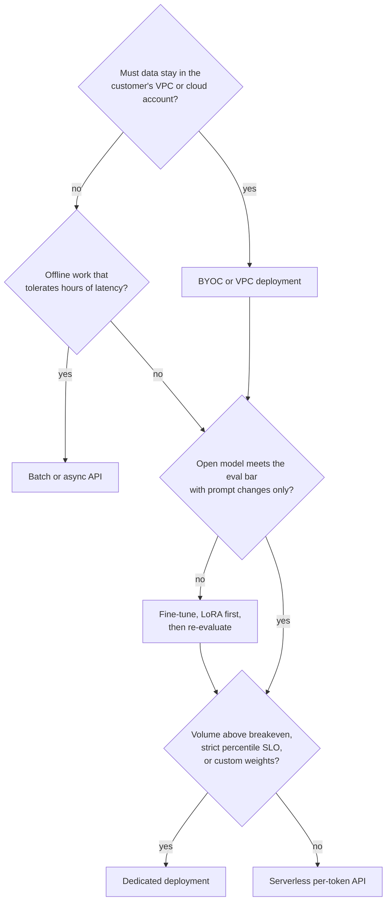

# Qualification and Sizing

Discovery leaves you with facts: an arrival rate, a length distribution, a latency target, a quality bar, a set of constraints. This chapter turns those facts into a **deployment hypothesis**: a sized proposal for model, tier, GPU count, quantization, and cost. You should expect the hypothesis to be wrong by up to 2x, and you should intend to correct it with a benchmark. A hypothesis is a written guess with its math visible, and its whole purpose is to give the benchmark something to confirm or refute.

Sizing is arithmetic on four numbers from discovery: arrival rate, input length, output length, and the latency SLO. Token rates give compute. Little's law gives concurrency. Concurrency times context gives KV-cache memory. Decode step time, measured against the TPOT target, gives sequences per replica. Every step has a published formula, and they are derived in [Serving, Capacity & Load Testing](../../machine-learning/04-llm-systems/serving-and-load/) in *Machine Learning*; this chapter applies them. The field skill is choosing honest inputs, stating assumptions, and knowing which step will bind.

Before any of that arithmetic, though, you have to decide whether the workload can win at all. The chapter therefore opens with qualification, then works a complete sizing example by hand, shows how to write the result as a hypothesis table with a risk to test on every row, and closes with the choice of surface: serverless, dedicated, batch, fine-tune, or bring-your-own-cloud.

> **Learning objectives**
> - Recognize the signals that a workload is a poor fit, and say so early.
> - Size a workload step by step: token rates, compute, Little's-law concurrency, KV memory, decode step time, and a TTFT check.
> - Size online and offline work separately, and identify when prefix caching is the largest lever.
> - Write a deployment hypothesis whose every row carries a risk the benchmark or eval will test, with the GPU count given as a range.
> - Choose between serverless, dedicated, batch, fine-tune, and BYOC surfaces for each path of a workload.

## Before you begin

You need your notes from [Discovery](../01-discovery/README.md) and sections 2, 3, and 11 of [LLM Systems & Inference](../../machine-learning/04-llm-systems/). The primary reference is [Serving, Capacity & Load Testing](../../machine-learning/04-llm-systems/serving-and-load/): the roofline, the memory budget, Little's law, the serverless-versus-dedicated breakeven, and the SLO-to-config runbook. Keep [`capacity.py`](../../machine-learning/04-llm-systems/serving-and-load/code/capacity.py) open to check every number below, and read Databricks' [LLM Inference Performance Engineering](https://www.databricks.com/blog/llm-inference-performance-engineering-best-practices) (free) for a second view. In practice the first pass is usually done by an FDE or SE, an SA takes multi-workload accounts, and the performance team reviews unusual models.

## Qualification: is this a fit?

Before sizing, check that the workload can win. A deal that fails here should be told so early, and five signals tell you most of what you need to know:

| Signal | Why it matters | What to do |
|---|---|---|
| No eval set and no plan to build one | The POC cannot pass or fail on quality | Offer to help build a small labelled set before the POC; otherwise do not start |
| Quality depends on a capability open models lack today (measured, not assumed) | Migration will regress | Propose a narrow sub-workload, or a routing setup ([Model Routing](../../ai-platform-engineering/11-model-routing-and-cascades/)) |
| Volume far below dedicated breakeven and no SLO | Serverless is fine; a heavy engagement costs more than it returns | Point them at serverless docs; light touch |
| Hard compliance need the vendor does not meet (for example, region not offered) | Blocks the deal regardless of performance | Confirm with the security owner before any technical work ([Commercials and Security](../06-commercials-and-security/README.md)) |
| No decision maker identified, no date | POCs without a decision drift | Ask "what would make you say no" again; get a name |

## Working an example by hand: a support copilot

Once the workload qualifies, you size it. The method is easiest to learn on one concrete brief, so here is a customer fresh from discovery:

| Item | Value |
|---|---|
| Use case | Agent-assist copilot drafting replies inside a support tool |
| Traffic | 50 req/s peak (6 h/day), 15 req/s average |
| Tokens | 2,000 input (1,200 shared system prompt and policy text), 300 output |
| SLO | TTFT p95 < 500 ms, streaming; TPOT p95 < 40 ms (they read as it streams) |
| Quality | Today on a closed frontier API; eval set of 400 graded tickets; a 70B-class open model matched it in their spike |
| Constraints | SOC 2 Type II; no prompt logging |

Assume a Llama-3.3-70B-class dense model: 70B parameters, 80 layers, 8 KV heads, head dimension 128. The hardware is an H100 SXM 80 GB, with about 3.35 TB/s of HBM bandwidth and about 1,979 dense FP8 TFLOPS at peak.

### Step 1: token rates at peak

Start with how many tokens per second the fleet must handle at peak, splitting prefill (input) from decode (output) and separating the part of the prompt that the prefix cache can serve:

```text
prefill tokens/s = 50 x 2,000            = 100,000
uncached prefill = 50 x (2,000 - 1,200)  =  40,000   (shared prefix hits the cache)
decode tokens/s  = 50 x 300              =  15,000
```

### Step 2: compute

Forward FLOPs per token are about $2N$ for a model with $N$ parameters; attention FLOPs are small at a 2k context. Multiply through:

```text
prefill: 40,000 x 2 x 70e9 = 5.6 PFLOP/s
decode : 15,000 x 2 x 70e9 = 2.1 PFLOP/s
total                      = 7.7 PFLOP/s
at ~40% of FP8 peak per GPU (~0.8 PFLOP/s): ~10 GPUs of pure compute
```

Without prefix caching, prefill alone would be 14 PFLOP/s, nearly double the fleet. **Prefix caching is the largest single lever in this workload**, and it is fragile. Confirm the shared prefix is byte-identical across requests: a timestamp or user name at the top of the system prompt destroys it.

### Step 3: concurrency from Little's law

Little's law says the number of requests in the system, $L$, equals the arrival rate times the time each request spends in the system. Time in system is TTFT plus 300 output tokens at the TPOT target:

```text
time in system = TTFT + 300 x TPOT = 0.5 + 300 x 0.040 = 12.5 s
L at peak      = 50 x 12.5 = ~625 concurrent sequences
```

### Step 4: KV-cache memory

Each token in flight holds keys and values for every layer: $2 \times \text{layers} \times \text{KV heads} \times \text{head dim} \times \text{bytes}$.

```text
FP8 KV per token = 2 x 80 x 8 x 128 x 1 B = 160 KiB
per sequence     = 2,300 tokens x 160 KiB = ~360 MiB (full)
unique per seq   = 1,100 tokens x 160 KiB = ~170 MiB (shared prefix stored once per replica)
fleet at peak    = 625 x 170 MiB = ~105 GiB
```

A tensor-parallel-4 (TP4) replica has 320 GB of HBM. After about 70 GB of FP8 weights and about 30 GB of activations and runtime overhead, roughly 220 GB is left for KV. Memory is not the binding constraint here; decode step time is. That is the usual pattern: under a TPOT SLO, decode step time, not memory, binds the replica count, but you must check both.

### Step 5: decode step time per replica

Decode is bandwidth-bound: each step reads the weights once and reads each sequence's KV cache. At a batch of 200 sequences on a TP4 replica:

```text
weights read : 70 GB / (4 x 3.35 TB/s x 0.7 efficiency)  = ~7.5 ms
KV read, B=200 seqs: 200 x 360 MiB / 9.4 TB/s            = ~8 ms
compute, B=200: 200 x 140 GFLOP / (4 x 0.8 PFLOP/s)      = ~9 ms (overlaps memory)
step time ~16-20 ms, plus interleaved prefill chunks -> TPOT ~25-35 ms
```

So about 200 sequences per TP4 replica fit under the 40 ms TPOT target, and $625 / 200$ gives 3 to 4 replicas at peak.

### Step 6: the TTFT check

The 800 uncached tokens cost $800 \times 140$ GFLOP $= 112$ TFLOP, which on a TP4 replica at about 3.2 PFLOP/s takes about 35 ms. A full cache miss (2,000 tokens) takes about 90 ms. TTFT p95 under 500 ms therefore holds as long as queueing stays bounded. In practice that means keeping replicas below roughly 80% of saturation throughput and enabling **chunked prefill**, so long prompts do not stall decode.

### Step 7: serverless versus dedicated

Finally, price the two main surfaces. Plug in current list prices; the numbers below are **placeholders** to show the method, and [Commercials and Security](../06-commercials-and-security/README.md) expands this into a full total cost of ownership.

```text
monthly tokens = 15 req/s x 2,300 tok x 2.592e6 s = ~89B tokens
serverless     = 89,000 x $P per 1M tokens         (P = $0.90 -> ~$80k/month)
dedicated      = GPU-hours x $R per GPU-hour
                 peak 12 GPUs x 6 h + floor 4 GPUs x 18 h = 144 GPU-h/day
                 144 x 30 x $R                       (R = $4.00 -> ~$17k/month)
effective cost = $17k / 89,000 = ~$0.19 per 1M tokens, only if autoscaling holds that floor
```

A good way to internalize the method is to redo this example by hand, then with [`capacity.py`](../../machine-learning/04-llm-systems/serving-and-load/code/capacity.py), and find the assumption that differs wherever the two disagree. Then change one input at a time (double the output length, remove prefix caching, switch to BF16) and predict the effect on GPU count before recomputing.

## Writing the hypothesis

The arithmetic becomes a hypothesis when you write it as a table in which every decision has a reason and a risk:

| Decision | Proposal | Why | Risk to test |
|---|---|---|---|
| Model | 70B-class dense, customer's spike choice | Matched quality in their spike | Eval parity on all 400 tickets |
| Tier | Dedicated, autoscaling 1 to 4 replicas; serverless for week-1 evaluation | Steady volume and a p95 SLO | Scale-up time versus the morning ramp |
| GPUs | TP4 on H100, 3 replicas at peak (12 GPUs), range 10 to 16 | Steps 2 and 5 | Measured saturation point per replica |
| Quantization | FP8 weights and FP8 KV cache | Halves weight reads and KV memory versus BF16 | Eval delta must stay inside the agreed tolerance |
| Prefix caching | On; system prompt frozen and placed first | Halves prefill compute | Hit rate on real traffic |
| Chunked prefill | On | Protects TPOT when a long prompt arrives | p99 TPOT under mixed lengths |
| Speculative decoding | Test EAGLE or MTP drafts off-peak | Helps TPOT at low batch; gains shrink near saturation | Acceptance rate on support replies |

Every entry in "risk to test" becomes a benchmark in [Performance Testing Engagements](../03-performance-testing-engagements/README.md) or an eval in [POC and Evaluation](../04-poc-and-evaluation/README.md). Give the GPU count as a range (10 to 16 here) rather than one number, because the benchmark picks the point. You will also present this table to buyers who are not technical, so practice explaining each step in one sentence; if you cannot, the "two audiences" table in [Serving & Load section 8](../../machine-learning/04-llm-systems/serving-and-load/#8-load-testing-methodology) helps.

## Choosing the surface

The hypothesis names a tier, and that choice deserves its own reasoning, because the surfaces differ in what the customer controls and what they pay for.

**Serverless** (shared, per-token pricing) needs no capacity planning and has no idle cost, but gives no control of batch size, SLO isolation, or custom weights. It is right for evaluation, for low or spiky volume, and for popular models. **Dedicated** (per GPU-hour) gives isolation, custom weights and flags, and predictable latency, and the customer pays for idle time. It is right above the breakeven volume (see [Breakeven](../06-commercials-and-security/README.md#breakeven)) or under a strict percentile SLO. **Batch or async** is for offline work that tolerates hours of latency, and it should always be priced separately from the online path. **Fine-tuning** is for when prompt changes plateau below the quality bar; start with LoRA, so the base model stays shared and multi-LoRA serving keeps cost down ([Serving & Load section 7](../../machine-learning/04-llm-systems/serving-and-load/#7-multi-lora-serverless-vs-dedicated-cold-start-autoscaling)). **BYOC or VPC** deployment is for when data must not leave the customer's cloud account or network; expect a longer timeline and fewer managed features, and check the vendor's current status, since some offerings are preview or enterprise only (see [what the companies sell](../README.md#what-the-companies-sell)).

The decision runs in a fixed order, from the hardest constraint to the softest:



A single customer often lands on more than one box: dedicated for the online path, batch for the nightly job, serverless for an internal tool. That is why online and offline work must be sized separately.

> **Warning:** A nightly batch job priced on an online deployment is the most common sizing mistake. It inflates the GPU count for the online path and overpays for work that could wait hours.

## Where this leads

The sizing steps rest on several other books. Steps 2 to 6 apply the roofline, memory budget, and Little's law from [Serving & Load](../../machine-learning/04-llm-systems/serving-and-load/). The quantization row draws on [Quantization](../../machine-learning/04-llm-systems/quantization/). Reading a model's `config.json` before sizing (GQA, MoE, MLA, and their KV cost) is covered in [Foundation Models](../../machine-learning/05-foundation-models/), and the fine-tune box in the decision draws on LoRA versus full fine-tuning in [Training & Post-Training](../../machine-learning/07-training-and-post-training/). When the answer is two models, see [Model Routing & Cascades](../../ai-platform-engineering/11-model-routing-and-cascades/) in *AI Platform Engineering*.

"How many GPUs for this workload?" is a standard advanced whiteboard question in FDE and SE interviews at Fireworks AI, Together AI, and Baseten. NVIDIA solutions architects size NIM and TensorRT-LLM deployments for enterprise customers; AI specialist SAs at AWS, GCP, and Azure size managed endpoints against self-hosted GPUs; and Anyscale and Modal have serverless-versus-reserved conversations daily.

The next chapter, [Performance Testing Engagements](../03-performance-testing-engagements/README.md), confirms or refutes the hypothesis.

### Further reading

- [Serving, Capacity & Load Testing](../../machine-learning/04-llm-systems/serving-and-load/), with [`capacity.py`](../../machine-learning/04-llm-systems/serving-and-load/code/capacity.py) to check every number.
- Databricks, [LLM Inference Performance Engineering: Best Practices](https://www.databricks.com/blog/llm-inference-performance-engineering-best-practices) (free).

## Exercise

Start with a warm-up, out loud and without writing: which surface would you propose, and why, for a 5 req/s internal chatbot, a nightly 200M-token classification job, and a regulated healthcare assistant that cannot leave the customer's VPC?

Then write the deliverable: a one-page **deployment hypothesis for Lexa** (see the [brief](../01-discovery/README.md#exercise)), built from your discovery notes.

- Pick a model size class and state the assumed config (layers, KV heads, head dimension) and GPU type.
- Size the **online path** and the **nightly job** separately: token rates, compute, Little's law concurrency, KV memory per sequence at 14k + 3k input, and replica count.
- State whether prefix caching applies (the 3,000-token instruction block) and what it saves.
- Choose a surface for each path using the decision flowchart.
- Fill the hypothesis table with a "risk to test" for every row.

### Done when

- Every number has its formula visible and its inputs traced to a line in your discovery notes.
- The nightly job is priced on a batch or async surface, not on the online deployment.
- The GPU count is a range, and the benchmark that will narrow it is named.
- The EU residency constraint appears in the surface choice.

## Key terms

- **Qualification**: checking, before any sizing, whether a workload can succeed with this vendor.
- **Little's law**: $L = \lambda W$; requests in the system equal arrival rate times time in system.
- **Prefix caching**: reusing the KV cache of a byte-identical shared prompt prefix so it is computed and stored once per replica.
- **Chunked prefill**: splitting a long prompt's prefill into chunks interleaved with decode steps so it does not stall streaming users.
- **Breakeven**: the volume above which dedicated GPU-hours cost less than serverless per-token pricing.
- **BYOC**: bring your own cloud; the deployment runs inside the customer's cloud account or VPC.

## Summary

- A hypothesis is a written guess with its math visible; its purpose is to give the benchmark something to confirm or refute.
- Size online and offline work separately; pricing a nightly batch job on an online deployment is the most common mistake.
- For workloads with a long shared system prompt, prefix caching is often the largest lever, and one dynamic token at the top of the prompt destroys it.
- Decode step time, not memory, usually binds the replica count under a TPOT SLO; check both.
- Every row of the hypothesis has a risk to test, and each risk becomes a benchmark or eval in the POC.

## Review questions

1. In the support-copilot example, what happens to prefill compute if a timestamp is added to the top of the system prompt?
   <details><summary>Answer</summary>The prefix is no longer byte-identical, so prefix caching stops working. Uncached prefill rises from 40,000 to 100,000 tokens/s, and prefill compute from 5.6 to 14 PFLOP/s, nearly doubling the fleet.</details>
2. Why is memory not the binding constraint in the example, and what is?
   <details><summary>Answer</summary>Peak KV demand is about 105 GiB across the fleet, while each TP4 replica has about 220 GB free for KV. The binding constraint is decode step time: about 200 sequences per replica fit under the 40 ms TPOT target, so 625 concurrent sequences need 3 to 4 replicas.</details>
3. Why give the GPU count as a range rather than a single number?
   <details><summary>Answer</summary>The hypothesis may be wrong by up to 2x. A range (10 to 16) states the uncertainty honestly and names what the benchmark must measure, the saturation point per replica, to pick the operating point.</details>
4. Where does Little's law come in, and what inputs does it need?
   <details><summary>Answer</summary>Step 3: concurrency equals arrival rate times time in system. Time in system is TTFT plus output tokens times TPOT, here $0.5 + 300 \times 0.040 = 12.5$ s, so 50 req/s gives about 625 concurrent sequences.</details>
