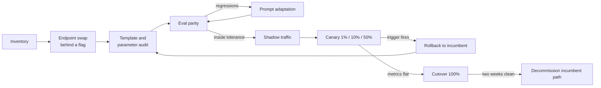

# Migration and Cutover

A migration replaces a component the customer has tuned prompts against for months. Those prompts implicitly encode the incumbent's chat template, its sampling defaults, and its quirks. Moving production traffic from a closed API (OpenAI, Anthropic, or another provider) to an open model on a new endpoint is therefore less about the endpoint and more about dependencies nobody wrote down. The work is to make those implicit dependencies explicit through an inventory and an audit, to prove the replacement on real traffic without exposing users (shadow traffic), and then to expose users gradually with an automatic way back (canary and rollback).

Most migrations fail on quality, not latency, and most quality failures are **formatting** rather than model capability: the chat template, stop tokens, sampling defaults, and tool-call parsing. An OpenAI-compatible endpoint makes the code change one line; it does not make the behavior identical, so every parameter must be audited.

This chapter follows a successful POC from [POC and Evaluation](../04-poc-and-evaluation/README.md). It gives you a nine-step playbook, the template and parameter audit, the mechanics of shadow, canary, cutover, and rollback, and ends with a failure-mode table to use when something goes wrong. In practice an FDE leads with the customer's engineering owner; at most companies this is where an SE hands off.

> **Learning objectives**
> - Run a migration through inventory, endpoint swap, audit, eval parity, prompt adaptation, shadow, canary, cutover, and a tested rollback.
> - Audit the template and parameter differences (chat template, BOS, stop tokens, sampling, tool calls, structured output, reasoning tokens, tokenizer, context length) that cause most regressions.
> - Design shadow traffic and canary steps with numeric, automatic rollback triggers and sticky routing.
> - Diagnose common post-migration symptoms from a failure-mode table, and know when to escalate.

## Before you begin

You need a passed POC and the eval parity method from [POC and Evaluation](../04-poc-and-evaluation/README.md). The primary reference is [Model Loading: Tokenizers and Chat Templates](../../ai-engineering/20-inference-engines/03-model-loading/03-cold-start-and-tokenizers.md#tokenizers-and-chat-templates) in *AI Engineering*, where template and tokenizer depth lives. Supplements are the chapters on deprecation and large-scale changes in [*Software Engineering at Google*](https://abseil.io/resources/swe-book) (free), [LLM Evaluation](../../ai-engineering/29-evaluation/) for parity checks, and [Serving & Load](../../ai-engineering/20-inference-engines/04-serving-and-load/) for the latency rows of the failure table.

To build intuition before an engagement, point an OpenAI SDK client at a local `vllm serve` running a small instruct model, and send the same request with and without an explicit `temperature` and `top_p`; note what changes. Then render a chat template locally from a model's `tokenizer_config.json`, compare the token IDs with what the server reports, and find one way they could differ.

## The migration playbook

A migration runs in nine steps, each with a condition that says it is done:

| Step | Action | Done when |
|---|---|---|
| **1. Inventory** | List every call site: model, parameters, features used (tools, JSON mode, logprobs, n, vision, seed) | Spreadsheet with every call site and its parameters |
| **2. Endpoint swap** | Point the OpenAI-compatible client at the new `base_url` and model name behind a feature flag | A single request succeeds through the customer's real code path |
| **3. Template and parameter audit** | Check every item in [Template and parameter differences](#template-and-parameter-differences) | Every item checked and noted |
| **4. Eval parity** | Run the customer's eval on incumbent and candidate with identical inputs; diff per case, not just aggregate ([Eval parity against the incumbent](../04-poc-and-evaluation/README.md#eval-parity-against-the-incumbent)) | Delta inside the agreed tolerance; every golden case passes; regressions read by a human |
| **5. Prompt adaptation** | Fix regressions by prompt changes first, fine-tune only if prompt changes plateau | Delta inside tolerance or a scoped fine-tune proposal |
| **6. Shadow traffic** | Mirror a slice of production to the candidate, discard responses, log latency, errors, and outputs | 3+ days covering a weekly peak; no new error classes; latency within SLO |
| **7. Canary** | Route 1%, 10%, 50% of real traffic with automatic rollback triggers on error rate and latency | Each step holds for an agreed period with product metrics flat |
| **8. Cutover** | 100% to candidate; keep incumbent credentials and code path live | Two weeks clean |
| **9. Rollback plan** | Flag flip back to incumbent, tested during canary, with a named owner | Rollback executed once in staging and timed |

The steps are not strictly linear. Eval parity loops through prompt adaptation until regressions are inside tolerance, and a canary trigger sends you back to the audit:

## Template and parameter differences

Step 3 is where most migrations are won or lost. Each item below is a place where an OpenAI-compatible endpoint can behave differently from the incumbent while accepting the same request:

| Item | What goes wrong | Check |
|---|---|---|
| **Chat template** | Server applies a different template than the model was trained with; system prompt dropped or merged into the first user turn | Render the template locally from the model's `tokenizer_config.json` and compare to server-side token IDs |
| **Duplicate BOS** | Client prepends BOS and the template adds another | Inspect the first token IDs of a rendered prompt |
| **Stop tokens** | Generation runs past the turn end, or stops early on a token that appears in content | Compare `eos_token_id` lists in `generation_config.json` versus server config |
| **Sampling defaults** | Incumbent default temperature differs from the model card's recommended settings; `top_p`, `top_k`, repetition penalty unset | Pin every sampling parameter explicitly in client code |
| **Tool call format** | Model emits tool calls in its native format; parser on the server does not match the model family | Run every tool-using eval case and assert parsed `tool_calls` |
| **Structured output** | JSON mode on the incumbent is not schema-constrained decoding on the new server, or vice versa | Validate 100% of outputs against the schema |
| **Reasoning tokens** | Reasoning models emit thinking blocks the client does not strip, inflating output and cost | Check for reasoning fields or tags in raw responses |
| **Tokenizer** | Same text, different token count: context limits, `max_tokens`, and cost shift | Re-count eval prompts with the new tokenizer |
| **Context length** | Served max length is lower than the model card's | Query the server's model metadata; test the p99-length prompt |

## Shadow, canary, cutover, rollback

Once the audit and eval parity pass, the remaining steps move real traffic. Shadow traffic proves the system under real load with no user risk; the canary proves it with bounded user risk. Skip neither.

**Shadow** traffic runs at the gateway or in application code. Each request goes to both providers; the incumbent's answer is returned to the user, and the candidate's latency, errors, `finish_reason`, and output are logged. Sample those outputs for human or judge comparison. Shadowing has a cost: the shadowed slice is paid for twice, once per provider, so size the slice deliberately. It also has a data-handling consequence. Production prompts now reach the new vendor, so the data processing agreement and the residency and retention terms must already be signed (see [Commercials and Security](../06-commercials-and-security/README.md)).

**Canary triggers** are numbers agreed in advance: an error rate above X, TTFT p95 above the SLO for Y minutes, or a product metric (thumbs-down rate, escalation rate) moving by more than Z. Automatic triggers beat manual ones at 2 a.m. Route the canary **stickily**, by user or session rather than per request, so a single conversation does not switch models mid-thread.

**Cutover** is a flag value, not a deploy, and the incumbent path stays deployable. Keep the incumbent's credentials and code path live for two weeks after cutover.

**Rollback** is rehearsed in staging during the canary, and timed. Name the person who can flip it, and make sure they have access outside business hours. A rollback plan is only real once it has been executed and timed.

## Common failure modes

When something goes wrong after a migration, the symptom usually points to a small set of causes, each with a first check:

| Symptom | Likely cause | First check |
|---|---|---|
| Quality drop after migration | Chat template mismatch or sampling defaults | Diff rendered token IDs; pin temperature and `top_p` |
| Quality drop after quantization | Outlier-sensitive layers or KV quantization on long context | Eval BF16 versus FP8 on the same cases; split long and short prompts |
| Outputs never stop or stop mid-sentence | Wrong stop tokens or `max_tokens` default | Inspect `finish_reason` distribution |
| Tool calls returned as plain text | Tool parser does not match the model family | Raw completion versus parsed response for one case |
| TTFT spikes when one long prompt arrives | No chunked prefill; long prefill blocks the batch | Engine config; correlate spikes with prompt length |
| TTFT high at moderate load | Queueing: replica past saturation, or autoscaler too slow | Waiting-queue metric; compare rate to closed-loop saturation |
| TPOT degrades as traffic grows | Batch too large for the TPOT target | Running sequences versus TPOT curve; cap max batch |
| Throughput falls, then requests restart | KV cache exhausted, preemption and recompute | Preemption counter, KV usage near 100% |
| Prefix cache hit rate near zero | Dynamic content (timestamp, user ID) at the start of the prompt | Diff the first 100 tokens of two requests |
| Cost overrun on dedicated | Low batch utilization: provisioned for peak, idle off-peak | GPU-hours versus tokens served by hour; autoscaling floor |
| Cost overrun on serverless | Volume crossed the dedicated breakeven, or output tokens grew (reasoning) | Monthly tokens versus breakeven; output length trend |
| Cold starts after idle | Scale-to-zero with large weights | Time from scale event to first 200; consider a minimum of one replica |
| Rate-limit errors at modest load | Account tier limits, not capacity | Response headers and tier limits |
| Nondeterministic outputs at temperature 0 | Batch-dependent numerics | Expected behavior; see [reproducibility](../../ai-engineering/20-inference-engines/05-serving-platforms.md#reproducibility-mechanism-availability-and-incentives) |
| Latency fine on server, slow for users | Client-side buffering, proxy without streaming, cross-region hops | Measure TTFT at the client and the server for one request ([Measuring from the customer's region](../03-performance-testing-engagements/README.md#measuring-from-the-customers-region)) |

A useful drill is to walk this table on a local setup and write, for each row, the exact command or metric you would check first. When the first check does not explain the symptom and the remaining knobs are not yours, escalate using the template in [Escalation and Handoff](../07-escalation-and-handoff/README.md).

## Where this leads

The audit in this chapter applies the chat templates, tokenizers, and `generation_config.json` of [Model Loading](../../ai-engineering/20-inference-engines/03-model-loading/), and the structured-output and latency rows draw on constrained and speculative decoding in [LLM Systems & Inference](../../ai-engineering/20-inference-engines/). The canary and rollback mechanics are feature flags and progressive delivery, covered in [Cloud Native](../../systems/09-cloud-native/) in *Systems Engineering*, and the canary triggers are SLO alerts from [Observability](../../systems/11-observability/). Retiring the incumbent path is a deprecation and large-scale change of the kind discussed in *[Software Engineering](../../software-engineering/)*.

At Fireworks AI, Together AI, and Baseten, "migrate from OpenAI in a week" engagements and debugging template mismatches are advanced day-to-day work. Teams using OpenRouter or LiteLLM do gateway-level provider swaps and fallbacks, and any platform team does progressive delivery of a critical dependency.

When a failure is not yours to fix, the next chapter, [Escalation and Handoff](../07-escalation-and-handoff/README.md), shows how to hand it on.

### Further reading

- [Model Loading: Tokenizers and Chat Templates](../../ai-engineering/20-inference-engines/03-model-loading/03-cold-start-and-tokenizers.md#tokenizers-and-chat-templates).
- [*Software Engineering at Google*](https://abseil.io/resources/swe-book) (free), chapters on deprecation and large-scale changes.

## Exercise

The deliverable is a **migration runbook for Lexa** (see the [brief](../01-discovery/README.md#exercise)), written after the POC from the [POC and Evaluation exercise](../04-poc-and-evaluation/README.md#exercise) passed:

- The inventory row for the contract-review call site, with every parameter they likely use (JSON output, `max_tokens`, temperature).
- The template and parameter audit filled for the chosen model, with how you would check each item.
- A shadow plan: traffic slice, duration covering a weekday peak, what is logged, and the EU-only data path.
- Canary steps with numeric rollback triggers, including one on JSON schema validity.
- The rollback owner and how the rollback was tested.

### Done when

- Every canary step has an automatic trigger with a number.
- Schema validity is checked on 100% of shadow outputs.
- The runbook says what happens to the nightly job during cutover.
- A peer could execute the rollback from the document alone.

## Key terms

- **Shadow traffic**: production requests mirrored to the candidate, whose responses are logged and discarded.
- **Canary**: routing a growing share of real traffic (1%, 10%, 50%) to the candidate, with automatic rollback triggers.
- **Sticky routing**: assigning traffic by user or session so one conversation stays on one model.
- **Cutover**: moving 100% of traffic by changing a flag value, with the incumbent path kept deployable.
- **Chat template**: the model-specific format that turns a list of messages into the token sequence the model was trained on.

## Summary

- Most migrations fail on quality, and most quality failures are formatting: chat template, stop tokens, sampling defaults, tool-call parsing.
- An OpenAI-compatible endpoint makes the code change one line, not the behavior identical; audit every parameter.
- Shadow traffic proves the system under real load with no user risk; the canary proves it with bounded risk. Skip neither.
- Canary triggers are numbers agreed in advance and fire automatically; routing is sticky by session.
- A rollback plan is real only once executed and timed; keep the incumbent path live for two weeks after cutover.

## Review questions

1. Why pin every sampling parameter explicitly in client code during a migration?
   

Answer
The incumbent's defaults (temperature, `top_p`, `top_k`, repetition penalty) may differ from the new server's or from the model card's recommendations. Prompts were tuned against the old defaults, so leaving them implicit changes behavior silently.

2. Why must the DPA and residency terms be signed before shadow traffic starts?
   

Answer
Shadowing sends real production prompts to the new vendor, even though users never see the responses. That is processing of customer data and needs the contract in place first.

3. The prefix cache hit rate is near zero after cutover. What is the first check?
   

Answer
Diff the first 100 tokens of two requests. Dynamic content such as a timestamp or user ID at the start of the prompt breaks the shared prefix.

4. Why route the canary by session rather than per request?
   

Answer
Per-request routing could switch models mid-conversation, producing inconsistent replies and making product metrics hard to attribute. Sticky routing keeps each conversation on one model.

