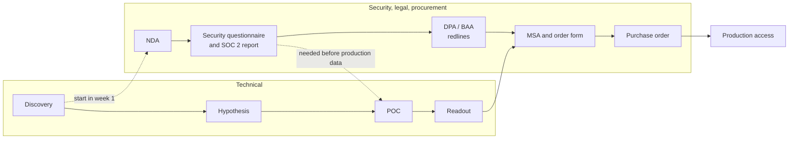

# Commercials and Security

Customers do not buy tokens per second. They buy a cost line and a risk profile. Once the technology works, two conversations decide the deal. The commercial conversation converts the benchmark into money: cost per 1M tokens, the total cost of ownership (TCO) of self-hosting versus serverless versus dedicated, the breakeven point, and the size of any commitment. The security conversation converts the deployment architecture into assurances: reports, contracts, and data flows. Both are evidence-based, both have owners other than the field engineer, and both take calendar time that the technical plan must account for.

This chapter covers both. It builds on the sizing in [Qualification and Sizing](../02-qualification-and-sizing/README.md) and the measured operating point from [Performance Testing Engagements](../03-performance-testing-engagements/README.md); the underlying cost formulas are derived in [Serving & Load sections 7 and 8](../../machine-learning/04-llm-systems/serving-and-load/#7-multi-lora-serverless-vs-dedicated-cold-start-autoscaling) in *Machine Learning*. You will compute blended and dedicated cost per 1M tokens, build a TCO, find the breakeven, size a commitment, and then learn what security documents customers ask for and how procurement and legal fit into the timeline.

> **Warning:** All prices in this chapter are placeholders chosen to show the method. They are not any vendor's list price. Plug in the current price sheet and the customer's real rates before showing a number to anyone.

> **Learning objectives**
> - Compute blended serverless cost per 1M tokens from a customer's input/output mix, and dedicated cost per 1M tokens at a measured operating point.
> - Build a TCO for self-host, dedicated, and serverless that includes utilization and engineering time.
> - Compute breakeven per GPU and per deployment, and check it against goodput and the traffic curve.
> - Recommend a commitment sized to the forecast floor, and name its risk.
> - Identify which security document (SOC 2, ISO 27001, BAA, DPA, transfer mechanism, ZDR terms) answers a customer's question, and run questionnaires and paperwork in parallel with the technical plan.

## Before you begin

You should have your hypothesis from [Qualification and Sizing](../02-qualification-and-sizing/README.md) and know from the [role landscape](../README.md#who-owns-what) that pricing authority sits with the account executive (AE). In practice the AE owns price and contract, the SE or FDE owns the cost model and the technical answers, and the vendor's security team owns questionnaire answers and reports.

The primary references are free: the [AICPA SOC 2 overview](https://www.aicpa-cima.com/topic/audit-assurance/audit-and-assurance-greater-than-soc-2), the [GDPR full text with article index](https://gdpr-info.eu/), and the [HHS HIPAA cloud computing guidance](https://www.hhs.gov/hipaa/for-professionals/special-topics/cloud-computing/index.html). Supplements are [45 CFR 164.504](https://www.ecfr.gov/current/title-45/subtitle-A/subchapter-C/part-164/subpart-E/section-164.504) (business associate contract requirements), the European Commission's page on [EU-US data transfers](https://commission.europa.eu/law/law-topic/data-protection/international-dimension-data-protection/eu-us-data-transfers_en), the [CSA Cloud Controls Matrix and CAIQ](https://cloudsecurityalliance.org/research/cloud-controls-matrix), all free, and the [Shared Assessments SIG](https://sharedassessments.org/sig/) (paid license). You will not give legal advice, but you must know which document a question is about, so read the headings of GDPR [Article 28](https://gdpr-info.eu/art-28-gdpr/) and [Chapter V](https://gdpr-info.eu/chapter-5/) once.

## Cost per 1M tokens

The basic unit of the commercial conversation is cost per 1M tokens, and the rule for quoting it is strict: quote it **at the measured operating point**, never at the roofline bound or at saturation.

**Serverless** prices are usually per token, often with separate input and output rates. Compute the **blended** rate from the customer's own mix, here the support copilot from [Qualification and Sizing](../02-qualification-and-sizing/README.md):

```text
cost per request = T_in x p_in / 1e6 + T_out x p_out / 1e6
blended $ per 1M = cost per request / (T_in + T_out) x 1e6

support copilot (02): T_in = 2,000, T_out = 300
placeholders: p_in = $0.60, p_out = $2.40 per 1M
cost per request = 2,000 x 0.60e-6 + 300 x 2.40e-6 = $0.00120 + $0.00072 = $0.00192
blended          = 0.00192 / 2,300 x 1e6 = ~$0.83 per 1M tokens
```

Input-heavy workloads such as RAG, long documents, and contract review are dominated by the input rate. Some providers discount cached input tokens; whether and by how much is vendor-specific, so **check the current price sheet**.

**Dedicated** cost per 1M tokens at an operating point has two forms, per hour and per month:

```text
$ per 1M = (GPU $/hr x GPUs) / (tokens/s served x 3600) x 1e6

over a month: $ per 1M = (GPU-hours x $/GPU-hour) / tokens served x 1e6
support copilot: (4,320 GPU-h x $4.00) / 89,000M tokens = ~$0.19 per 1M
```

The monthly form already includes idle time, which is why it is the honest one.

## TCO: self-hosting versus serverless versus dedicated

Self-hosting looks cheapest on a GPU price list because the list omits utilization and people. In fact the TCO of self-hosting is dominated by **utilization** and **engineering time**, not by the GPU hourly rate: a cheap GPU at 40% utilization with two engineers on call is not cheap. A real TCO includes every line below:

| Cost line | Self-host (own cloud GPUs) | Dedicated (vendor) | Serverless (vendor) |
|---|---|---|---|
| **GPU time** | All reserved hours, used or idle | GPU-hours including the autoscaling floor | None (in the token price) |
| **Utilization risk** | Customer's | Customer's, reduced by autoscaling | Vendor's |
| **Engineering** | Engine tuning, upgrades, kernels, autoscaling, on-call | Integration and monitoring | Integration |
| **Capacity risk** | Customer must secure GPUs | Vendor capacity, may need reservation | Rate limits by tier |
| **Hidden** | Observability, storage, egress, security review of the stack | Egress, private networking | Rate-limit headroom |

Applied to the support copilot (89B tokens a month, from the [worked example in Qualification and Sizing](../02-qualification-and-sizing/README.md#working-an-example-by-hand-a-support-copilot)), with **every price and salary a placeholder**, the TCO comes out as follows:

| Line | Self-host | Dedicated | Serverless |
|---|---|---|---|
| GPU or token cost | 12 GPUs x 720 h x $2.50 = $21,600 (no cheap autoscaling on reserved GPUs) | 4,320 GPU-h x $4.00 = $17,280 | 89,000 x $0.90 = $80,100 |
| Utilization of paid GPU-hours | ~50% (needs ~4,320 of 8,640 h) | High while the floor holds | n/a |
| Engineering | 1.5 FTE x $250k / 12 = $31,250 | 0.25 FTE = $5,208 | 0.1 FTE = $2,083 |
| Other (observability, storage, egress) | $2,000 | $500 | $0 |
| **Monthly total** | **~$54,850** | **~$22,990** | **~$82,180** |
| **Effective $ per 1M tokens** | ~$0.62 | ~$0.26 | ~$0.92 |

Read the result, not the digits. With these inputs, self-hosting loses to dedicated because of engineering time and idle reserved GPUs, and serverless loses because the volume is well above breakeven. The self-host column also assumes the customer's engine matches the vendor's throughput per GPU, which is the vendor's core claim and should be tested, not assumed (see [Performance Testing Engagements](../03-performance-testing-engagements/README.md)). To feel which inputs matter, rebuild the table in a spreadsheet with every input as a cell, then change utilization from 50% to 80% and engineering from 1.5 FTE to 0.5 FTE and see which moves the answer more.

## Breakeven

The TCO showed serverless losing "because the volume is above breakeven." That threshold can be computed two ways. Below it serverless wins; above it, dedicated wins, but only if utilization actually stays high.

**Per GPU**, dedicated is cheaper when the tokens a GPU serves per hour exceed what the same money buys on serverless. With a GPU-hour rate $R$ and a blended serverless price $P$ per 1M tokens:

```text
breakeven tokens per GPU-hour = R / (P / 1e6)
placeholders R = $4.00 per GPU-hour, P = $0.90 per 1M blended:
  4.00 / 0.90e-6 = ~4.44M tokens per GPU-hour = ~1,235 tokens/s sustained per GPU
```

**Per deployment**, a dedicated deployment has a minimum monthly cost, its floor, and volume below that floor's token equivalent belongs on serverless:

```text
floor: one TP4 replica, always on = 4 GPUs x 720 h x $4.00 = $11,520/month
breakeven monthly tokens = 11,520 / 0.90 x 1e6 = ~12.8B tokens/month (~4,900 tok/s average)
support copilot: 89B tokens/month -> well above breakeven -> dedicated
```

[Serving & Load section 7](../../machine-learning/04-llm-systems/serving-and-load/#7-multi-lora-serverless-vs-dedicated-cold-start-autoscaling) works the same formula with different placeholders. Before trusting any breakeven, make two checks. First, the dedicated deployment must actually serve that volume **within the SLO**, which is goodput (see [Reporting curves, goodput, and cost](../03-performance-testing-engagements/README.md#reporting-curves-goodput-and-cost)), not just at saturation. Second, the traffic curve matters: a workload with a high peak-to-mean ratio pays for idle GPUs unless autoscaling is fast enough for the ramp.

## Committed use and reserved capacity

With the tier chosen, the last commercial question is how much to commit to. The options trade a lower rate for risk the customer carries:

| Concept | What the customer gets | What the customer risks | Field rule |
|---|---|---|---|
| **On-demand** | Pay per hour or per token, no commitment | Price and availability not guaranteed | Use for evaluation and POCs |
| **Reserved capacity** | Specific GPUs held for a term at a lower rate | Pays whether used or not | Size to the measured floor, not the peak |
| **Committed spend** | A discount in exchange for spending an agreed amount over a term, often across products | Unused commitment may be forfeited (terms vary by vendor and contract; **not confirmed** for any specific vendor) | Commit to the floor of the forecast; leave growth to on-demand |
| **Ramp deal** | Commitment that grows by quarter as migration proceeds | Migration slips while the commitment rises | Tie ramp steps to migration milestones in [Migration and Cutover](../05-migration-and-cutover/README.md) |

The general rule is to commit to the **floor** of the forecast, not the peak, because unused commitment is money the customer may lose. The AE owns price and terms. The field engineer owns the inputs: the measured operating point, the forecast floor and peak, the migration schedule, and the risk list. Never quote a discount.

## Security and compliance

The second conversation runs alongside the first. Security and legal review is usually the longest pole, so start it in the first week of the POC, and answer questionnaires from the vendor's maintained answers, never from memory.

### What the customer will ask for

Most security questions resolve to one of a small set of documents. Knowing which document answers which question is the field engineer's job; interpreting the law is not.

| Item | What it is | What to provide | Source |
|---|---|---|---|
| **SOC 2 Type II** | Independent CPA attestation of a service organization's controls against the AICPA Trust Services Criteria: security, availability, processing integrity, confidentiality, privacy. Type II covers whether controls operated effectively **over a period** (commonly several months to a year); Type I covers design at a **point in time** | The current report from the vendor's trust center, usually under NDA; a bridge letter if the report period ended months ago | [AICPA](https://www.aicpa-cima.com/topic/audit-assurance/audit-and-assurance-greater-than-soc-2) |
| **ISO/IEC 27001** | Certification of an information security management system | Certificate and scope statement | [ISO](https://www.iso.org/standard/27001) |
| **HIPAA BAA** | A covered entity may disclose protected health information (PHI) to a business associate only with satisfactory written assurances, a contract meeting 45 CFR 164.504(e). HHS guidance treats a cloud provider handling ePHI as a business associate, directly liable for unauthorized uses and for Security Rule safeguards | Whether the vendor signs a BAA, for which products (often not all), and on which tiers | [45 CFR 164.504](https://www.ecfr.gov/current/title-45/subtitle-A/subchapter-C/part-164/subpart-E/section-164.504), [HHS cloud guidance](https://www.hhs.gov/hipaa/for-professionals/special-topics/cloud-computing/index.html) |
| **GDPR processor terms (DPA)** | The vendor processes personal data on the customer's behalf. Article 28 requires a contract setting the subject matter, duration, nature and purpose of processing, data types, and data subjects; sub-processors need the controller's prior written authorization | The vendor's DPA and sub-processor list | [Art. 28](https://gdpr-info.eu/art-28-gdpr/) |
| **International transfers** | Transfers outside the EU/EEA need a Chapter V basis: an adequacy decision (for example, the EU-US Data Privacy Framework, adopted 10 July 2023, for certified US companies) or safeguards such as standard contractual clauses | Transfer mechanism and certification status | [Chapter V](https://gdpr-info.eu/chapter-5/), [Commission](https://commission.europa.eu/law/law-topic/data-protection/international-dimension-data-protection/eu-us-data-transfers_en), [DPF](https://www.dataprivacyframework.gov/) |
| **Data residency** | Processing (and any storage) stays in a named region | Region list for the tier and model; where logs, metrics, and support access live | Vendor docs |
| **Zero data retention (ZDR)** | Prompts and completions are not stored after the request | Exactly what is still kept (token counts for billing, abuse-monitoring logs, error traces), for how long, and on which tiers | Vendor docs and contract |
| **No training on customer data** | Customer prompts and outputs are not used to train vendor models | Contract clause, not a blog post | Contract |
| **VPC / BYOC** | Private networking to a vendor deployment, or the deployment runs in the customer's cloud account | Network diagram, who operates it, who holds keys, which features are missing in that mode | Vendor docs ([what the companies sell](../README.md#what-the-companies-sell)) |

### Questionnaires

Most enterprise customers also send a questionnaire, which comes in one of three shapes:

| Questionnaire | Publisher | Shape |
|---|---|---|
| **CAIQ v4** | Cloud Security Alliance | About 260 yes/no questions aligned with the Cloud Controls Matrix, including the shared security responsibility model |
| **SIG** | Shared Assessments | Broad third-party risk questionnaire for any vendor, common in financial services and healthcare |
| **Custom spreadsheet** | The customer's security team | Often a mix of the above plus AI-specific questions: training on data, retention, model provenance, prompt injection handling |

The rules for answering are strict. Answer from the vendor's maintained answer library and current reports. Route any new question to the security team with a due date. Never improvise an answer about retention, sub-processors, or encryption.

> **Warning:** A wrong "yes" in a questionnaire can become a contractual misrepresentation.

To practice, download a public CAIQ from any cloud vendor's trust center and find the ten questions an inference vendor would find hardest: retention, sub-processors, and model training on customer data are good places to start.

## Procurement and legal in the timeline

The paperwork has its own critical path, and it runs in parallel with the technical one:



**Run both tracks in parallel.** Discovery should surface who owns the security review and how long it takes (see [the question bank](../01-discovery/README.md#the-question-bank)); start the review the day production data is mentioned. **Production data needs paperwork first**: a POC on real prompts usually needs the NDA, the security review, and the DPA (or BAA) signed. **Redlines take calendar time**: DPA and BAA terms go back and forth between legal teams, and the field engineer supplies accurate technical descriptions of data flows without negotiating terms. **Procurement has its own gates**, such as vendor onboarding, insurance certificates, and payment terms, so ask the customer's champion for their checklist early. How long each step takes varies widely by customer size and industry; this book gives no typical durations, because none are sourced. Ask the customer.

## Where this leads

The cost per token, breakeven, and autoscaling floor of the first three sections come from [Serving & Load](../../machine-learning/04-llm-systems/serving-and-load/). Questionnaire answers on access control draw on [Authorization & Access Control](../../ai-platform-engineering/08-authorization-and-access-control/) in *AI Platform Engineering*. VPC and BYOC architectures rest on the private networking and Kubernetes of [Cloud Native](../../systems/03-cloud-native/), and what ZDR means for logs and traces is a question for [Observability](../../systems/04-observability/), both in *Systems*.

TCO and breakeven conversations, plus trust center and questionnaire support, are routine at Fireworks AI, Together AI, and Baseten. AWS, GCP, and Azure run committed-use and reserved-capacity programs and publish BAA-eligible service lists. OpenAI and Anthropic have ZDR, data residency, and DPA conversations with enterprise API customers. For healthcare and legal-tech customers, BAA and residency are gating requirements and the conversation is at its hardest.

The last chapter of the engagement, [Escalation and Handoff](../07-escalation-and-handoff/README.md), covers what happens when production goes wrong.

### Further reading

- [AICPA SOC 2 overview](https://www.aicpa-cima.com/topic/audit-assurance/audit-and-assurance-greater-than-soc-2) (free).
- [GDPR full text with article index](https://gdpr-info.eu/) (free).
- [HHS HIPAA cloud computing guidance](https://www.hhs.gov/hipaa/for-professionals/special-topics/cloud-computing/index.html) (free).
- [CSA Cloud Controls Matrix and CAIQ](https://cloudsecurityalliance.org/research/cloud-controls-matrix) (free).

## Exercise

The deliverable is a two-page **commercial and security brief for Lexa** (see the [brief](../01-discovery/README.md#exercise)), built on your hypothesis from the [Qualification and Sizing exercise](../02-qualification-and-sizing/README.md#exercise) and your operating point from the [Performance Testing Engagements exercise](../03-performance-testing-engagements/README.md#exercise):

1. Blended cost per 1M tokens for their mix on serverless (placeholder prices, labelled), and dedicated cost per 1M at your operating point.
2. A TCO table for self-host, dedicated, and serverless, with the online path and the nightly job as separate rows, compared with their $60k/month spend and the "cut by half" goal.
3. The breakeven volume and where Lexa sits today and after six months of 15% monthly growth.
4. A commitment recommendation (floor, ramp) with the risk to Lexa if migration slips.
5. The CISO meeting: the list of documents you bring (report, DPA, sub-processor list, residency and retention statement) and the five questions you expect, each with who answers it.

### Done when

- Every price is labelled as a placeholder or sourced with a date.
- The nightly job is priced on a batch or async surface.
- The growth projection changes or confirms the tier choice, and the brief says which.
- No security answer is asserted without naming the document that supports it.

## Key terms

- **Blended rate**: the cost per 1M tokens for a customer's own input/output mix when input and output are priced separately.
- **TCO**: total cost of ownership, including GPU time, utilization, engineering, capacity risk, and hidden costs.
- **Breakeven**: the volume at which dedicated GPU-hours cost the same as serverless tokens, per GPU or per deployment floor.
- **Committed spend**: a discount in exchange for an agreed spend over a term; unused commitment may be forfeited.
- **SOC 2 Type II**: an independent attestation that controls operated effectively over a period, as opposed to Type I at a point in time.
- **DPA**: the data processing agreement that GDPR Article 28 requires between a controller and a processor.
- **Zero data retention (ZDR)**: prompts and completions are not stored after the request; what else is kept must be stated exactly.

## Summary

- Quote cost per 1M tokens at the measured operating point, never at the roofline bound or at saturation.
- Self-hosting TCO is dominated by utilization and engineering time, not the GPU hourly rate.
- Dedicated beats serverless above breakeven (GPU $/hr divided by serverless $ per token), and only if utilization stays high and the SLO holds.
- Commit to the floor of the forecast, not the peak; the AE owns price, the field engineer owns the inputs.
- Security and legal review is usually the longest pole: start it in week 1 and answer from maintained documents, never from memory.

## Review questions

1. Why is the monthly form of dedicated cost per 1M tokens the honest one?
   <details><summary>Answer</summary>It divides all GPU-hours paid for, including idle time off-peak, by the tokens actually served. The per-hour form at an operating point ignores the hours the deployment sits underused.</details>
2. In the placeholder TCO, why does self-hosting lose to dedicated even though its GPU rate is lower ($2.50 versus $4.00)?
   <details><summary>Answer</summary>Reserved GPUs cannot autoscale cheaply, so it pays for 12 GPUs around the clock at about 50% utilization, and it needs 1.5 FTE of engineering ($31,250 a month) against 0.25 FTE for dedicated.</details>
3. A customer's volume is twice the per-deployment breakeven. Is dedicated automatically the right answer?
   <details><summary>Answer</summary>No. Check that the deployment serves that volume within the SLO (goodput, not saturation throughput), and that the traffic curve's peak-to-mean ratio does not leave GPUs idle because autoscaling cannot follow the ramp.</details>
4. A questionnaire asks whether prompts are retained for abuse monitoring, and you think the answer is no. What do you do?
   <details><summary>Answer</summary>Do not answer from memory. Check the vendor's maintained answer library and ZDR terms; if the question is new, route it to the security team with a due date. A wrong "no" can become a contractual misrepresentation.</details>
