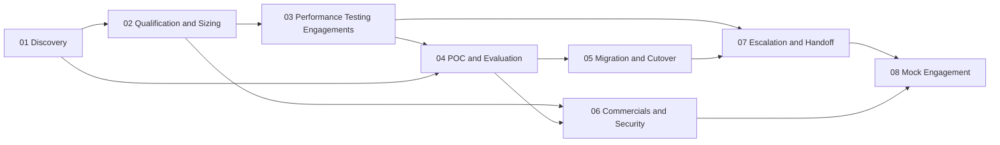

# Field Engineering

This book is about how customer-facing engineers at an inference and fine-tuning cloud turn technical depth into a customer outcome. It covers the whole arc of an engagement: discovery, sizing, benchmarks run for a customer, proofs of concept, migrations, commercials, security reviews, and escalations. It is written for **sales engineers (SE)**, **solutions architects (SA)**, and **forward deployed engineers (FDE)** at companies shaped like Fireworks AI, Together AI, or Baseten, and for engineers who want to move into those roles.

The book takes a firm position on what the job is. Every call and every week of work ends in a **written artifact** someone else can act on; if it did not produce one, it did not happen. Discovery exists to produce a **deployment hypothesis** with numbers, so a question that cannot change a number is not worth the customer's time. A benchmark run for a customer is a contract in progress: their traffic shape, their region, their SLO, curves instead of single numbers, and no promise the data does not support. A POC exists to make a decision, so its criteria must be able to fail. And escalations that list **what was ruled out** get acted on, while forwarded complaints get meetings.

## What you will be able to do

By the end of the book you will be able to:

- run a discovery conversation and write notes that produce a numeric deployment hypothesis;
- size a workload from first principles and choose between serverless, dedicated, and batch capacity;
- design and report a benchmark on the customer's own traffic, against their SLO;
- write a POC plan whose criteria can fail, and a staged migration with a tested rollback;
- answer commercial and security questions from evidence, and escalate a problem so the receiving team can act without a follow-up.

## How this book is organized

The chapters follow the order of a real engagement, and most of them build on the ones before. The dependencies look like this:

[Discovery](01-discovery/README.md) is where every engagement starts: the rules of a discovery conversation, a question bank, the customer journey, how to run a call, a note template, and how to say "I don't know". Its exercise introduces Lexa, the mock customer you carry through the book.

[Qualification and Sizing](02-qualification-and-sizing/README.md) turns discovery notes into numbers: the memory budget, Little's law, and the serverless versus dedicated breakeven, worked through an example you can check with `capacity.py`.

[Performance Testing Engagements](03-performance-testing-engagements/README.md) shows how to run a benchmark for a customer with tools such as [`vllm bench serve`](https://docs.vllm.ai/en/stable/cli/bench/serve.html) and [AIPerf](https://github.com/ai-dynamo/aiperf): on their traffic shape, from their region, against their SLO, reported as curves.

[POC and Evaluation](04-poc-and-evaluation/README.md) covers the plan for a proof of concept and the evaluation that decides it, building on [LLM Evaluation](../ai-platform-engineering/09-llm-evaluation/README.md) in *AI Platform Engineering*.

[Migration and Cutover](05-migration-and-cutover/README.md) is about moving a customer onto the platform after a successful POC without breaking them, including the tokenizer and chat-template parity issues described in [Model Loading](../machine-learning/04-llm-systems/03-model-loading/README.md).

[Commercials and Security](06-commercials-and-security/README.md) is for the moment procurement or the CISO joins the thread: cost per million tokens, total cost of ownership for self-hosted, serverless, and dedicated options, breakeven, committed capacity, security and compliance (SOC 2, GDPR, HIPAA), and where procurement and legal fall in the timeline.

[Escalation and Handoff](07-escalation-and-handoff/README.md) covers what to do when something is broken and it is not yours to fix: an escalation report template that lists what you ruled out, what each internal counterpart needs, running an incident call, and relaying research back to the customer, in the spirit of [*Postmortem Culture*](https://sre.google/sre-book/postmortem-culture/).

[Mock Engagement](08-mock-engagement/README.md) puts it all together. It runs one mock customer, Northstar Commerce, through seven artifacts against a platform you built yourself in *Build Your Own LLM System*, and closes with a [capstone](08-mock-engagement/08-capstone.md) that takes Lexa through every stage.

If you are reading for a specific situation rather than straight through, start where the situation is. New to customer-facing work? Begin with Discovery: the question bank and the note template are the whole job on day one. Asked "how many GPUs" on a call? Qualification and Sizing has the worked example and the serverless versus dedicated decision. Customer wants a benchmark? Go to Performance Testing Engagements. Running a POC? Read POC and Evaluation, then Migration and Cutover for what follows a successful one. Procurement or the CISO just joined? Commercials and Security. Something broken that is not yours to fix? Escalation and Handoff.

## Prerequisites and related books

You should be comfortable reading a latency percentile and a cost table. The technical depth (prefill and decode, the KV cache, load-testing math) lives in [LLM Systems & Inference](../machine-learning/04-llm-systems/README.md) and its [Serving, Capacity & Load Testing](../machine-learning/04-llm-systems/04-serving-and-load/README.md) section in *Machine Learning and AI*, and it is linked from here rather than repeated. When a chapter links into that material, open it and redo the math yourself: a field engineer who cannot defend a number in front of the customer's MLE loses the room. The mock engagement also draws on *Build Your Own LLM System*, *Software Craftsmanship*, and *AI Platform Engineering*.

The primary references are the Google SRE book's chapter on [*Service Level Objectives*](https://sre.google/sre-book/service-level-objectives/) (free), *The Mom Test* by Rob Fitzpatrick (a paid book), and the [vLLM benchmark CLI docs](https://docs.vllm.ai/en/stable/cli/bench/serve.html) (free). For supplementary reading, see [*The Site Reliability Workbook*: Implementing SLOs](https://sre.google/workbook/implementing-slos/), [*Postmortem Culture*](https://sre.google/sre-book/postmortem-culture/), [Dev versus Delta](https://blog.palantir.com/dev-versus-delta-demystifying-engineering-roles-at-palantir-ad44c2a6e87) (the original FDE model), and [The Palantirization of everything](https://a16z.com/the-palantirization-of-everything/), all free.

## Conventions

Each chapter works on the same mock customer, Lexa, whose brief is in the [Discovery exercise](01-discovery/README.md#exercise); each chapter's exercise produces one document, and together they form a full engagement file. Templates are given as code blocks: read every template aloud as if on a call, and if a line would make you hesitate, you do not yet know what it asks for. Math is set inline, as in $2 \times \text{layers} \times \text{KV heads} \times \text{head dim} \times \text{bytes}$. Call-outs marked **Warning** flag the mistakes that most often cost an engagement. Sections end with key terms, a summary, and review questions whose answers are folded under each question; try to answer before you open them. The model answers for the mock engagement live in the repository under [`course/solutions/docs/engagement/`](../../../course/solutions/docs/engagement/discovery.md).

## The role landscape

Before the first chapter, it helps to know what these companies sell, who owns which part of an engagement, and where to go for technical depth when a customer asks a hard question. Company facts below were checked against primary sources on October 6, 2026. Product surfaces change monthly, so recheck before a call.

### What the companies sell

All three sell GPU time wrapped in software. The wrapper differs: a per-token API, a dedicated deployment, a training job, or raw cluster capacity. A field engineer has to know which wrapper fits a workload and what each costs the customer in control and money.

| Surface | Fireworks AI | Together AI | Baseten |
|---|---|---|---|
| **Serverless per-token API** | Pay-per-token serverless models ([quickstart](https://docs.fireworks.ai/getting-started/quickstart)) | Serverless inference, OpenAI-compatible ([quickstart](https://docs.together.ai/docs/quickstart), [product](https://www.together.ai/serverless-inference)) | Model APIs, compatible with OpenAI Chat Completions and Anthropic Messages (beta); tool calling, structured output, JSON mode ([Model APIs](https://docs.baseten.co/inference/model-apis/overview)) |
| **Dedicated / on-demand deployment** | On-demand deployments on dedicated GPUs with autoscaling ([on-demand quickstart](https://docs.fireworks.ai/getting-started/ondemand-quickstart), [why on-demand](https://fireworks.ai/blog/why-gpus-on-demand)) | Dedicated endpoints, single-tenant GPUs ([docs](https://docs.together.ai/docs/dedicated-endpoints)) | Dedicated deployments of open or custom models ([first model](https://docs.baseten.co/development/model/build-your-first-model)) |
| **Fine-tuning** | Managed: SFT, DPO, LoRA. Training API: LoRA and full-parameter, custom loops, RL (GRPO and others via SDK). RFT listed ([intro](https://docs.fireworks.ai/fine-tuning/finetuning-intro)) | SFT, LoRA (default) or full fine-tuning, preference tuning with DPO ([overview](https://docs.together.ai/docs/fine-tuning-overview), [DPO](https://docs.together.ai/docs/fine-tuning/preference-tuning)). RL not listed in fine-tuning docs at review | Training Jobs and Loops ([training](https://docs.baseten.co/training/overview), [loops](https://docs.baseten.co/loops/overview)). Supported method list **not confirmed** |
| **Batch / async** | Batch inference ([docs](https://docs.fireworks.ai/guides/batch-inference)) | Batch API ([docs](https://docs.together.ai/docs/batch-inference)) | Async inference with webhooks on any dedicated deployment, queue up to 72 h ([docs](https://docs.baseten.co/inference/async)). No separate batch product **confirmed** |
| **Embeddings / rerank** | Embeddings and reranking ([docs](https://docs.fireworks.ai/guides/querying-embeddings-models)) | Embeddings and rerank API; rerank models need a dedicated endpoint ([rerank](https://docs.together.ai/docs/inference/embeddings/rerank)) | BEI engine for embeddings and reranking ([BEI](https://docs.baseten.co/engines/bei/overview)) |
| **Custom model deploy** | Custom model upload on on-demand deployments ([announcement](https://fireworks.ai/blog/custom-models-h100s-on-demand-deployments)); multi-LoRA serving ([blog](https://fireworks.ai/blog/multi-lora)) | Custom model upload ([docs](https://docs.together.ai/docs/custom-models)); Dedicated Container Inference for your own Docker image ([docs](https://docs.together.ai/docs/dedicated-container-inference)) | **Truss** (package model code) and **Chains** (multi-step, multi-model pipelines) ([Chains](https://docs.baseten.co/development/chain/overview), [Truss CLI](https://docs.baseten.co/reference/cli/truss/overview)) |
| **GPU clusters** | Not a headline product at review; **not confirmed** | H100, H200, B200, GB200 clusters with storage for training or large batch ([docs](https://docs.together.ai/docs/gpu-clusters-overview), [product](https://www.together.ai/gpu-clusters)) | Not offered as a raw cluster product; **not confirmed** |
| **BYOC / VPC / self-hosted** | Bring Your Own Cluster on customer Kubernetes, Private Preview, enterprise only, inference only ([BYOC](https://docs.fireworks.ai/ecosystem/integrations/byoc/overview)); SageMaker as a compute option ([blog](https://www.fireworks.ai/blog/aws-sagemaker)) | Together Enterprise Platform in customer VPC or on-prem ([announcement](https://www.together.ai/blog/introducing-the-together-enterprise-platform), [architecture](https://docs.together.ai/docs/together-deployments)) | Baseten Cloud, single-tenant isolated VPC, self-hosted in customer VPC, hybrid ([hosting options](https://docs.baseten.co/hosting-options/overview)) |
| **Engine work** | **FireAttention** custom kernels: V3 targets AMD MI300, V4 targets NVFP4 on B200 ([V3](https://fireworks.ai/blog/fireattention-v3), [V4](https://fireworks.ai/blog/fireattention-v4-fp4-b200)) | Together inference engine, **Together Kernel Collection**, **ATLAS** runtime-learning speculator ([ATLAS](https://www.together.ai/blog/adaptive-learning-speculator-system-atlas), [research](https://www.together.ai/blog/foundational-research-powering-efficient-inference-at-scale)) | **Baseten Inference Stack**: Engine-Builder-LLM on TensorRT-LLM, BIS-LLM for MoE, speculative decoding (EAGLE, MTP, n-gram), KV-aware routing ([guide](https://www.baseten.co/resources/guide/the-baseten-inference-stack/), [BIS-LLM](https://docs.baseten.co/engines/bis-llm/overview)) |

Notes on the table:

- Vendor speedup numbers (for example FireAttention versus vLLM, ATLAS throughput) are the vendor's own benchmarks on the vendor's chosen workload. Treat them as hypotheses to reproduce on the customer's traffic ([Performance Testing Engagements](03-performance-testing-engagements/README.md)), the same rule as in [LLM Serving Platforms](../machine-learning/04-llm-systems/05-serving-platforms.md).
- Compliance claims change and are contractual. Fireworks publishes SOC 2 Type II and HIPAA status and a no-logging default for open-model prompts ([data security](https://docs.fireworks.ai/guides/security_compliance/data_security)). Together documents its posture at [privacy and security](https://docs.together.ai/docs/privacy-and-security). For any customer, get the current report from the trust center, not from a blog ([Commercials and Security](06-commercials-and-security/README.md)).
- Together also sells **Sandbox** and **Managed Storage** ([products](https://www.together.ai/products)); Baseten documents a **Frontier Gateway** for model labs ([overview](https://docs.baseten.co/overview)). These are outside the scope of this book.

**Common to all three**: an OpenAI-compatible request surface, a serverless tier for evaluation, a dedicated tier for SLOs, fine-tuning feeding deployment, and a proprietary engine layer on top of or beside vLLM, SGLang, or TensorRT-LLM. The differentiator they sell is the engine and the people. Field engineers are part of the people.

### Who owns what

| Role | Owns | Does not own | Typical artifact |
|---|---|---|---|
| **Sales engineer (SE)** | Pre-sales technical fit for one deal: demos, discovery, first sizing, security questionnaire answers, technical win | Post-sale delivery, engine internals | Discovery notes, demo, questionnaire answers, initial hypothesis |
| **Solutions architect (SA)** | Reference architectures and integration patterns across many accounts; pre-sales fit for complex deals | Deep per-customer build | Architecture diagram, RFP answers, reference design |
| **Forward deployed engineer (FDE)** | The customer's technical outcome: discovery, deployment hypothesis, POC, migration, first-line diagnosis, translating customer problems into internal tickets; often writes code in the customer's repo | Engine internals, model research, pricing authority | Discovery notes, POC plan, benchmark report, migration runbook, escalation report |
| **MLE (customer-facing or platform)** | Fine-tuning runs, eval pipelines, model packaging, quality debugging | Contract, account relationship | Training config, eval report, model card |
| **MTS / performance engineer** | Engine, kernels, scheduler, quantization recipes, per-model tuning | Customer relationship, POC scope | Engine flags, kernel patch, perf regression fix |
| **Research scientist** | New methods: speculators, quantization schemes, post-training recipes | Production SLOs | Paper, prototype, recipe |
| **Account executive (AE)** | Commercial relationship, pricing, contract, renewal | Technical claims | Order form, mutual action plan |

Titles overlap between companies. At some, the FDE, SE, and SA are one person; at others, the FDE writes production code and the SE never leaves pre-sales. Ask in the interview which rows the role covers. The chapters mark which role usually leads each activity.

### Where the depth lives

| Customer says | Where to get the depth |
|---|---|
| "Why is DeepSeek cheaper to serve than a dense model of the same size?" | [Foundation Models](../machine-learning/05-foundation-models/) (MoE, MLA), [LLM Systems](../machine-learning/04-llm-systems/) |
| "Our fine-tune works in Transformers but outputs garbage on your endpoint." | [Model Loading](../machine-learning/04-llm-systems/03-model-loading/) (chat templates, tokenizers), [Migration and Cutover](05-migration-and-cutover/README.md) |
| "How many GPUs do we need for 50 req/s?" | [Serving & Load](../machine-learning/04-llm-systems/04-serving-and-load/), [Qualification and Sizing](02-qualification-and-sizing/README.md) |
| "Latency spikes every few minutes." | [Serving & Load](../machine-learning/04-llm-systems/04-serving-and-load/) (chunked prefill, preemption), [Escalation and Handoff](07-escalation-and-handoff/README.md) |
| "Should we do LoRA or full fine-tuning? Or RL?" | [Training & Post-Training](../machine-learning/07-training-and-post-training/) |
| "Is it cheaper than running it ourselves?" | [Commercials and Security](06-commercials-and-security/README.md) |
| "Why should we trust an open model over GPT or Claude?" | [POC and Evaluation](04-poc-and-evaluation/README.md) (eval parity on their data) |
