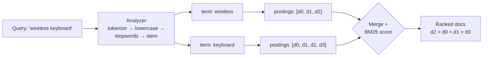
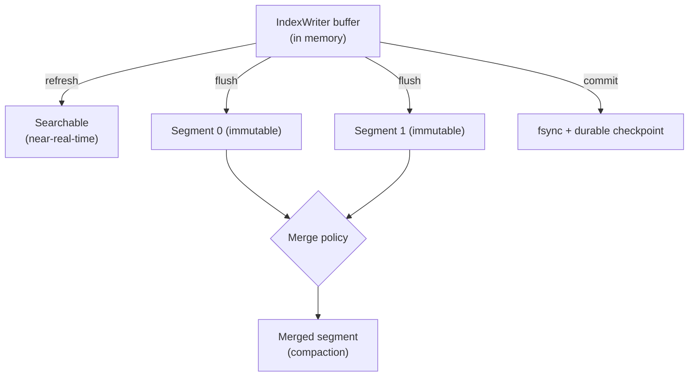
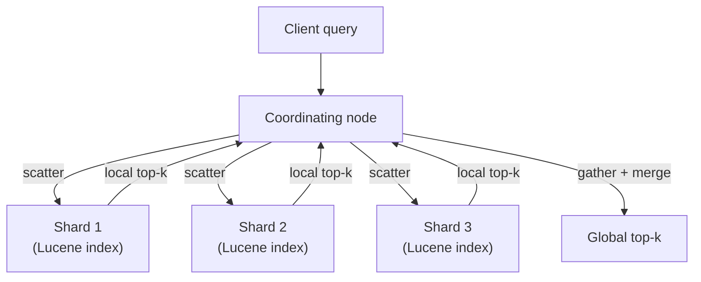

# Search and Indexing

A search engine answers one question: which documents contain these terms, ranked by relevance, fast enough for a person to wait on the answer? The naive approach, scanning every document for every query, is hopeless at any real scale. This chapter shows how search engines avoid it, starting from the one data structure that makes search possible and ending at the distributed engines that run it in production.

The arc is simple to state. The **inverted index** flips the problem around: precompute, for each term, the sorted list of documents that contain it, so a query *intersects* (AND) or *unions* (OR) a few short lists instead of scanning the corpus. An **analyzer** decides what counts as a term. Ranking is a numeric score, **BM25**, summed over the matched terms, and you will derive it from TF-IDF so that you know exactly what its two parameters do. Keeping the index fast under constant writes forces the **segment** model, immutable shards merged in the background, which is an LSM tree wearing a search hat. Scaling past one machine forces **sharding and replication**, which is really all an engine like Elasticsearch is. Along the way you will see where lexical search ends and learned and dense retrieval begin, and when an embeddable library beats a cluster.

> **Learning objectives**
> - Describe the inverted index (term dictionary, postings lists, skip pointers, positions, FST) and how Boolean queries are answered by merging postings.
> - Explain why index-time and query-time analysis must match, and diagnose the stemming asymmetry trap.
> - Derive BM25 from TF-IDF and predict how changing $k_1$ and $b$ changes a ranking.
> - Explain Lucene's segment write path, including merges, tombstone deletes, and the difference between refresh, flush, and commit.
> - Describe the scatter-gather read path of a sharded engine, compare Elasticsearch, OpenSearch, and Solr, and decide when an embeddable library is the better choice.

## Before you begin

This chapter assumes basic data structures (tries, B-trees, heaps). The segment model will feel familiar if you have met LSM trees and the append-only log in [Batch and Streaming Processing](../../data-engineering/03-batch-streaming/README.md) in *Data Engineering*, and the sharding discussion assumes you know how a service is deployed and scaled from [Containers, Kubernetes, and Workloads](../01-containers-kubernetes/README.md).

The chapter's code lets you check the math yourself. [`code/bm25_from_scratch.py`](code/bm25_from_scratch.py) and [`code/bm25_from_scratch.rs`](code/bm25_from_scratch.rs) both build an inverted index over a tiny Streamflow corpus of orders and products, rank queries by BM25, and print *identical* scores, which shows that the math is the implementation and not a library trick. Try changing `k1` to `0` and watch term frequency stop mattering, so that every match counts once; then change `b` to `0` and watch long documents stop being penalized. The production path is [`code/tantivy-example/`](code/tantivy-example/) (`cargo run`): the same inverted index and BM25, but with a real analyzer, on-disk segments, and a commit step. Notice that it has the same shape as the from-scratch version.

As you read, keep one question in mind for any query: would a lexical index find this, or do I need a dense one? Exact identifiers (`order 8801`) are lexical wins; paraphrases (`broken delivery`) are dense wins. That instinct is the whole motivation for hybrid retrieval.

## The inverted index

Everything in search is built around one structure. Indexing a document means analyzing it into terms, then appending the document to each term's postings list.

The index has two parts. The **term dictionary** maps each term to a pointer, and the **postings list** is the sorted sequence of `(doc_id, term_frequency, [positions])` entries for that term. The postings are sorted by `doc_id` so that two lists can be merged in linear time.

That sorting is what makes **Boolean merges** cheap. `A AND B` walks both postings lists with two pointers, always advancing the one with the smaller `doc_id`: a sorted-list intersection. `A OR B` is the corresponding union. Long postings lists also embed **skip pointers**, so an AND can jump past large runs of non-matching `doc_id`s instead of stepping one at a time, which takes intersection from $O(n)$ toward $O(n / \text{skip})$.

Storing each term's **positions** enables phrase queries. With positions, `"wireless keyboard"` (exact adjacency) can be answered, not just "both terms appear somewhere."

Finally, Lucene stores the term dictionary itself as a **finite-state transducer (FST)**: a minimized automaton that maps term bytes to a postings offset. Shared prefixes *and* suffixes collapse, so millions of terms fit in memory and lookups cost $O(\text{term length})$. The FST is also why Lucene can do fast prefix queries and fuzzy queries, the latter by intersecting an edit-distance automaton with the term FST.

In [`code/bm25_from_scratch.py`](code/bm25_from_scratch.py), `InvertedIndex.add` builds exactly this `term → [Posting(doc_id, tf)]` map.

## Analysis and tokenization

The index stores terms, so the next question is what a term is. Get this wrong and nothing matches.

Lucene's **Analyzer** is a pipeline: a **Tokenizer** splits text into tokens, and then a chain of **TokenFilters** transforms them. The tokenizer splits on word boundaries; Lucene's `StandardTokenizer` follows the Unicode segmentation rules, while the chapter's code uses a maximal-alphanumeric-run tokenizer. A **lowercase filter** collapses `Keyboard` and `keyboard` into one term. A **stopword filter** drops words like `the`, `and`, and `of`: they appear in nearly every document (a huge $n(q)$), so their IDF is close to zero and they only bloat the postings. A **stemming filter** maps `orders`, `ordering`, and `ordered` to a shared stem so that a search for `order` matches all of them. Lucene ships Porter, KStem, and Snowball stemmers; the code uses a tiny suffix stripper to show where stemming sits in the pipeline.

The rule that ties this together is that the *same* analyzer must run at index time and at query time, or the query terms will not match the indexed terms.

> **Warning:** If you stem at index time but not at query time, `keyboards` (indexed as `keyboard`) will not match the query token `keyboards`. Analyzer parity is one of the most common causes of "why does nothing match" bugs.

## Scoring: from TF-IDF to BM25

Matching tells you *which* documents contain the terms. Ranking tells you which matter most. Start with the intuition: a document is more relevant to a term if (a) the term appears *often* in it (term frequency, TF) and (b) the term is *rare* across the corpus (inverse document frequency, IDF). **TF-IDF** multiplies the two:

$$
\text{tfidf}(q, D) = f(q, D) \cdot \ln\frac{N}{n(q)}
$$

Here $f(q,D)$ is the count of term $q$ in document $D$, $N$ is the corpus size, and $n(q)$ is the number of documents containing $q$. TF-IDF has two flaws. TF grows without bound, yet a document that repeats a word 100 times is not 100 times more relevant. And it ignores document length, so a long document accumulates matches for free. **BM25 (Okapi BM25)** fixes both:

$$
\text{score}(D, Q) = \sum_{q \in Q} \text{IDF}(q) \cdot \frac{f(q, D)\,(k_1 + 1)}{f(q, D) + k_1\left(1 - b + b\,\dfrac{|D|}{\text{avgdl}}\right)}
$$

with Lucene's smoothed, non-negative IDF:

$$
\text{IDF}(q) = \ln\!\left(1 + \frac{N - n(q) + 0.5}{n(q) + 0.5}\right)
$$

Each parameter has a clear intuition. $k_1$ controls **term-frequency saturation** and is typically 1.2 to 2.0. The TF factor is a saturating curve: as $f(q,D) \to \infty$ it approaches the ceiling $k_1 + 1$, so the second occurrence of a term adds a lot and the twentieth adds almost nothing. Set $k_1 = 0$ and TF collapses to binary, present or absent. Saturation is BM25's single biggest improvement over raw TF-IDF.

$b$ controls **length normalization** and is typically 0.75. The factor $\left(1 - b + b\,|D|/\text{avgdl}\right)$ divides the score by how much longer than average the document is. With $b = 1$ the score is fully normalized, so a long document must *concentrate* the term to score well; with $b = 0$ normalization is off and long documents win on volume. In the Streamflow corpus the product-catalog document is long, and $b$ is what stops it from dominating just by listing many words.

The IDF's `+0.5` smoothing and its leading `1 +` keep IDF at or above zero even for terms that appear in almost every document, so a common term can never *subtract* from a score.

Real documents have fields, such as a product `title` and a `description`. **BM25F** (fielded BM25) applies per-field length normalization and per-field *boosts* before summing, so a title match can outweigh a description match. This is what `title^3 description` style boosting compiles to.

The code is the formula, line for line. The `bm25_search` functions in the [Python file](code/bm25_from_scratch.py) and the [Rust file](code/bm25_from_scratch.rs) compute exactly the expression above and print identical scores. The [Tantivy example](code/tantivy-example/) uses BM25 as its default scorer, so you see the same ranking from a real engine.

## The segment model and the write path

So far the index has been static. A real index is updated continuously while it serves queries, and the way Lucene manages that is the key to its performance: a Lucene index is not one file you mutate but a set of **segments**, each a small, immutable, self-contained inverted index.

New documents are buffered in memory and periodically flushed as a *new* segment. You never edit an existing segment, which is exactly the append-only discipline of LSM-tree storage and the Kafka log from [Batch and Streaming Processing](../../data-engineering/03-batch-streaming/README.md). Many small segments slow search, because each query touches all of them, so a **merge policy** (Lucene's `TieredMergePolicy`) compacts small segments into bigger ones in the background. That is the LSM *compaction* step, and it is the dominant source of write amplification and I/O in a busy index. Because segments are immutable, a **delete** only marks the `doc_id` in a *live-docs* bitset, a tombstone; the bytes are reclaimed when that segment is merged. An update is a delete followed by an add.

Three operations on this write path are routinely conflated, and they are different things:

- **refresh** makes recently indexed documents *searchable* by opening a new reader over the in-memory buffer. This is what "near-real-time search" means; the default in Elasticsearch is about one second. It is cheap and frequent.
- **flush** writes the in-memory buffer to a Lucene segment on disk and clears the transaction log.
- **commit** fsyncs and records a durable checkpoint that survives a crash. It is expensive and infrequent.

Tuning these trades search freshness against indexing and I/O cost.

Two more pieces complete the picture. A Lucene **Codec** is the pluggable on-disk format for each part of a segment: postings, doc values, term dictionary, stored fields, and vectors. Postings use delta encoding plus bit-packing or PFOR, and the codec is where compression and read speed are tuned. And modern Lucene (9.x and later) stores dense vectors in a per-segment **HNSW** graph (a `KnnVectorField`), so the *same* engine does approximate-nearest-neighbor dense retrieval alongside BM25. That is what makes single-engine hybrid search possible. The ANN index internals are covered in [Retrieval and RAG](../../ai-platform-engineering/07-retrieval-and-rag/README.md) in *AI Platform Engineering*.

## Learned and dense retrieval

BM25 is a *sparse, lexical* ranker: it matches surface terms. It cannot match `broken delivery` to a document that says `damaged shipment`. The frontier of retrieval addresses that gap, and this chapter names the methods while leaving the retrieval and RAG depth to [Retrieval and RAG](../../ai-platform-engineering/07-retrieval-and-rag/README.md).

**SPLADE** is learned *sparse* retrieval: a transformer predicts a sparse term-weight vector over the whole vocabulary, including terms that are not in the text (expansion). The result still lives in an inverted index, so you get semantic matching on BM25-style infrastructure. **ColBERT and ColBERTv2** use *late interaction*: they encode the query and document into per-token vectors and score by summing, for each query token, its maximum similarity to any document token (MaxSim). This is more expressive than a single-vector bi-encoder and is indexable with per-token ANN. **Dense bi-encoders with HNSW** produce one vector per query and per document and search by nearest neighbor. They are fast and semantic but miss exact terms.

Because lexical and dense retrieval fail in opposite ways, **hybrid** sparse-plus-dense fusion wins. **Reciprocal Rank Fusion (RRF)**, which sums $1/(k + \text{rank})$ across the result lists, is the robust default. This is the boundary between the two books: the fusion, reranking, and RAG story belongs to [Retrieval and RAG](../../ai-platform-engineering/07-retrieval-and-rag/README.md), while this chapter owns the BM25 half and the HNSW *index* that the dense half searches.

## Engines on top of Lucene

Lucene is a library. A single Lucene index lives in one process on one machine, and serving a large corpus with high availability needs sharding, replication, and a query coordinator. That layer, not the search math, is what Elasticsearch, OpenSearch, and Solr provide.

A logical index is partitioned into **shards**, and each shard is one complete Lucene index with its own segments. Sharding is how the corpus scales past one machine.

> **Warning:** The shard count is fixed when the index is created. Choosing it badly is a classic operational mistake, because changing it later means reindexing.

**Replicas** are copies of a shard, kept for availability and read throughput. One primary handles writes; replicas serve reads and take over on failure.

The read path is **scatter-gather**. A query hits a *coordinating node*, which fans it out to one copy of every shard (scatter). Each shard runs the query against its local segments and returns its top-k, and the coordinator *merges* the per-shard top-k lists into a global top-k (gather). This is why deep pagination is expensive: every shard must return `from + size` results for the merge to be correct.

The write path routes each document to a shard by `hash(routing_key) % num_primary_shards`. The document lands in that shard's IndexWriter buffer and becomes searchable on the next **refresh**: the same near-real-time model as before, now distributed.

Three engines dominate. **Elasticsearch** is the dominant engine, with rich aggregations and the ELK stack. In 2021 Elastic relicensed it from Apache-2.0 to the dual SSPL / Elastic License, a response to AWS reselling it as a managed service; in 2024 Elastic added AGPL-3.0 as an option, making it OSI-open again. **OpenSearch** is AWS's 2021 fork of the last Apache-2.0 Elasticsearch (7.10), now under the Linux Foundation and licensed Apache-2.0. Choose it when you want a permissive license or AWS-managed search. **Apache Solr** is the older Lucene-based engine (Apache-2.0), with strong faceting and a mature configuration model, common in libraries and enterprise search.

You do not always need any of them. If your corpus fits on one node, you do not need cross-node high availability, and you control the host process, then **Lucene as a library, Tantivy (Rust), or Bleve (Go)** give you BM25 and an inverted index with none of the cluster's operational cost. The [Tantivy example](code/tantivy-example/) is exactly this: a full BM25 search engine in about 60 lines, with no server. Reach for Elasticsearch, OpenSearch, or Solr when you genuinely need the distributed layer.

## Embeddable alternatives

When you want Lucene's ideas without the JVM or a cluster, two libraries stand out. **Tantivy** (Rust, Lucene-inspired) has the same architecture (schema, analyzers, immutable segments, FST term dictionaries, BM25 default scoring) as a fast embeddable library. It powers [Quickwit](https://quickwit.io/) for log search and [ParadeDB](https://www.paradedb.com/) for full-text search inside Postgres, and it is what [`code/tantivy-example/`](code/tantivy-example/) demonstrates. **Bleve** (Go) is an embeddable full-text index for Go services, with pluggable analyzers and storage backends; it is used inside tools like Couchbase and in many Go applications that want search without an external engine. Both are the right answer when "add a search box" should not mean "operate a three-node cluster."

## Choosing a technique

The chapter's techniques, and when each applies, are collected here for reference.

| Technique | When to apply |
|-----------|---------------|
| Inverted index + postings | Any keyword search at all (the foundation) |
| Skip lists on postings | Long postings lists with frequent AND queries |
| FST term dictionary | Large vocabulary; prefix/fuzzy queries |
| Same analyzer at index + query time | Always (analyzer parity prevents silent no-match) |
| BM25 (tune `k1`, `b`) | The default lexical ranker; start here |
| BM25F + field boosts | Multi-field docs (title vs body) |
| Immutable segments + background merge | Continuous indexing under read load |
| refresh vs flush vs commit, tuned | Trade search freshness against indexing/IO cost |
| Sharding + replicas | Corpus or QPS exceeds one node |
| Embeddable library (Tantivy/Bleve/Lucene) | Single-node search; no cluster wanted |
| BM25 + dense, fused (RRF) | When exact-term and semantic recall both matter |
| SPLADE / ColBERT | Semantic matching while keeping IR infrastructure |

## Where this leads

The split between this chapter and [Retrieval and RAG](../../ai-platform-engineering/07-retrieval-and-rag/README.md) in *AI Platform Engineering* is deliberate: this chapter owns the index and the engine, and that one owns hybrid fusion, reranking, RAG, the HNSW and ANN internals of the dense half, and the encoders behind SPLADE, ColBERT, and dense retrieval. Lucene's write path is an LSM tree and an append-only log, the same model as in [Batch and Streaming Processing](../../data-engineering/03-batch-streaming/README.md). How an Elasticsearch or OpenSearch cluster is deployed and scaled ties back to [Containers, Kubernetes, and Workloads](../01-containers-kubernetes/README.md). The next chapter, [The Apache Stack](../04-apache-stack/README.md), places Lucene and Solr on the map of the wider data ecosystem.

You will meet this material across the industry. Elastic builds Elasticsearch on Lucene and the ELK stack, and its licensing history is part of the story. AWS runs OpenSearch, the 2021 fork, as managed search. Solr shops rely on faceting for enterprise and library search. Quickwit and ParadeDB build on Tantivy for log search and Postgres full-text search. Algolia and Typesense build custom inverted indexes for latency-obsessed, typo-tolerant keyword search. And for almost any backend role, "add search to the product" means choosing between a library and an engine and tuning BM25.

### Further reading

- [Apache Lucene documentation](https://lucene.apache.org/core/documentation.html): the engine under every major search stack.
- [*The Probabilistic Relevance Framework: BM25 and Beyond*](https://www.staff.city.ac.uk/~sbrp622/papers/foundations_bm25_review.pdf) (Robertson and Zaragoza): the definitive BM25 derivation.
- [*Introduction to Information Retrieval*](https://nlp.stanford.edu/IR-book/) (Manning, Raghavan, Schütze): the IR textbook, free online.
- [Tantivy docs](https://docs.rs/tantivy/) and [source](https://github.com/quickwit-oss/tantivy); [Bleve source](https://github.com/blevesearch/bleve).
- [Elasticsearch guide](https://www.elastic.co/guide/) and [OpenSearch docs](https://opensearch.org/docs/latest/).
- [SPLADE](https://arxiv.org/abs/2107.05720), [ColBERTv2](https://arxiv.org/abs/2112.01488), and [HNSW (Malkov and Yashunin)](https://arxiv.org/abs/1603.09320) papers.

## Key terms

- **Inverted index**: a map from each term to the sorted list of documents that contain it.
- **Postings list**: the sorted `(doc_id, term_frequency, [positions])` entries for one term.
- **Analyzer**: the tokenizer-plus-filters pipeline that turns raw text into index terms; it must match at index and query time.
- **BM25**: a ranking function that extends TF-IDF with term-frequency saturation ($k_1$) and document-length normalization ($b$).
- **Segment**: a small, immutable, self-contained inverted index; a Lucene index is a set of them, compacted by background merges.
- **Refresh**: the cheap operation that makes buffered documents searchable, as opposed to flush (write a segment) and commit (durable fsync checkpoint).
- **Shard**: one complete Lucene index holding a partition of a logical index; replicas are copies of it.
- **Scatter-gather**: the read path in which a coordinator fans a query out to every shard and merges their top-k results.

## Summary

- The inverted index is the whole game: a query becomes a merge over a handful of sorted postings lists.
- Analysis decides what a term is, and index-time and query-time analyzers must match.
- BM25 is TF-IDF plus saturation ($k_1$) and length normalization ($b$); it remains the baseline every learned retriever is measured against.
- Lucene is an LSM tree for search: immutable segments, background merges, tombstone deletes, and distinct refresh, flush, and commit steps.
- Elasticsearch, OpenSearch, and Solr are sharding, replication, and coordination around per-shard Lucene indexes; when you do not need the cluster, Lucene, Tantivy, or Bleve as a library is simpler and cheaper.
- Lexical and dense retrieval fail in opposite ways, so hybrid wins; this book owns the index, and *AI Platform Engineering* owns what you do with the results.

## Review questions

1. Why are postings lists kept sorted by `doc_id`, and what do skip pointers add?
   

Answer
Sorting lets an AND be computed as a linear-time two-pointer intersection (advance the smaller <code>doc_id</code>) and an OR as a union. Skip pointers let the intersection jump over long runs of non-matching <code>doc_id</code>s, moving the cost from $O(n)$ toward $O(n/\text{skip})$.

2. Searches for `keyboards` return nothing, although many indexed documents mention keyboards. What is the likely cause?
   

Answer
Analyzer asymmetry: the index-time analyzer stemmed <code>keyboards</code> to <code>keyboard</code>, but the query was not run through the same stemmer, so the query term <code>keyboards</code> has no postings.

3. What happens to a BM25 ranking when you set $k_1 = 0$? When you set $b = 0$?
   

Answer
With $k_1 = 0$ the TF factor becomes constant, so term frequency stops mattering and every match counts once. With $b = 0$ length normalization is disabled, so long documents are no longer penalized and can win simply by containing more words.

4. Why can BM25's IDF never make a term reduce a document's score?
   

Answer
Lucene's IDF is $\ln(1 + (N - n(q) + 0.5)/(n(q) + 0.5))$. The argument of the logarithm is always at least 1, so IDF is non-negative even for terms in almost every document.

5. An engineer says "I set refresh to 1 second, so my index is durable every second." What is wrong?
   

Answer
Refresh only makes buffered documents searchable by opening a new reader. Durability comes from commit, which fsyncs a checkpoint; flush writes a segment and clears the transaction log. They are three different operations.

6. Why is deep pagination (`from=10000, size=10`) expensive on a sharded engine?
   

Answer
Under scatter-gather, each shard must return its own top <code>from + size</code> results so the coordinator can merge a correct global ranking. Every shard therefore sorts and ships 10,010 results to produce 10.

7. When would you choose Tantivy or Bleve over Elasticsearch?
   

Answer
When the corpus fits on one node, you do not need cross-node high availability, and you control the host process. An embeddable library gives you the inverted index and BM25 without the operational cost of a cluster.

