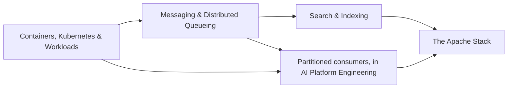

# Infrastructure

Most engineers can write a service. Far fewer can say what happens when it runs at scale, under failure, on shared infrastructure: where the state lives, whether a message is delivered exactly once or merely at least once, what bounds parallelism, which component coordinates the cluster, and how a query actually reaches an inverted index. This book is about that operational substrate, the containers and orchestration that schedule distributed systems, the messaging and coordination layers that move and order their data, and the search and storage engines underneath.

It is written for engineers with some professional experience shipping software who now need to reason about the runtime, not just the code. It treats the substrate as a first-class subject: the math of queues and delivery semantics, the architecture of the engines (Kubernetes, Kafka with KRaft, Redpanda, Lucene and Elasticsearch), and the caveats that cause real outages.

## What you will be able to do

By the end of the book you will be able to package and deploy a service on Kubernetes and explain the reconciliation model and its sharp edges (resource limits and OOM kills, probes, SIGTERM handling, disruption budgets); design an asynchronous architecture and defend its choices of queue or log, push or pull, and delivery semantics, with numbers from Little's Law; explain how cluster metadata is coordinated by ZooKeeper, KRaft, or Redpanda; build and rank an inverted index with BM25 and explain how Lucene keeps it fast under writes; and place any Apache data project on a map of the problems it solves.

## How this book is organized

The first chapters share one running example, **Streamflow**, an event-driven order platform, so that the containers you schedule are the consumers you scale over the log you model.

[Containers, Kubernetes, and Workloads](01-containers-kubernetes/README.md) starts from the container as a process with its own filesystem and a namespaced view of the kernel, then treats Kubernetes as a reconciliation loop. Its sections build a real deployment: Dockerfiles, a local kind cluster and registry, Helm charts with an observability stack, a Tilt development loop, CI, and charts for durable workers and agents. It also covers the caveats nobody warns you about and the independent axes of scaling, including event-driven scaling with KEDA.

[Messaging and Distributed Queueing](02-messaging-and-queueing/README.md) gives you the dynamics of asynchronous systems: queue versus log, push versus pull, competing consumers versus publish-subscribe, delivery semantics and the crash window, Little's Law, and the coordination story from ZooKeeper to KRaft to Redpanda.

The operational side of consuming (rebalancing, idempotency, dead-letter queues, lag-based scaling) lives in the [partitioned consumers](../ai-platform-engineering/05-durable-orchestration-and-workers/README.md#partitioned-consumers) part of [Durable Orchestration and Workers](../ai-platform-engineering/05-durable-orchestration-and-workers/README.md) in *AI Platform Engineering*, with working Kafka consumers in its [side quest](../ai-platform-engineering/05-durable-orchestration-and-workers/13-kafka-consumers/). Read it between the messaging and search chapters if you are building workers.

[Search and Indexing](03-search-and-indexing/README.md) goes from the inverted index and the derivation of BM25 down to Lucene's segment model and the engines built on it (Elasticsearch, OpenSearch, Solr), and shows when an embeddable library such as Tantivy beats a cluster. Its retrieval-augmented side connects to [Retrieval and RAG](../ai-platform-engineering/07-retrieval-and-rag/README.md).

[The Apache Stack](04-apache-stack/README.md) is the bird's-eye view: the Apache data ecosystem grouped into seven problem families, the Google-paper lineage behind it, and a table that maps problems to projects.

How you enter the book depends on why you are here. If you have been asked to "add Kubernetes support," start with the containers chapter. If you are designing an async architecture, read the messaging chapter and then the partitioned-consumers material. If you are building search, go straight to the search chapter. If you are mapping the ecosystem, read the Apache stack chapter first and follow its links. For a paced route through everything, see the [study plan](study-plan.md).

## Prerequisites and related books

You need some experience shipping software and Linux basics. Several other books pair closely with this one. [Cloud Native](../systems/03-cloud-native/README.md) in *Systems and Architecture* goes deeper on orchestration, and [System Design](../systems/01-system-design/README.md) in the same book supplies the consensus and replication theory. [Batch and Streaming Processing](../data-engineering/03-batch-streaming/README.md) in *Data Engineering* is the data-engineering view of the same Kafka. *Diagramming and Documentation*, starting from its [front matter](../diagramming/README.md), matters because you cannot draw a deployment or a consumer topology honestly until you understand its operational caveats.

## Conventions

Code appears in fenced listings with a language tag, and each chapter's runnable programs live in its `code/` directory (for example, the BM25 implementations in `04-search-and-indexing/code/`), with Kubernetes manifests in `01-containers-kubernetes/manifests/`. Math is set inline as $L = \lambda W$ or in display blocks. Call-outs marked **Warning** flag the caveats that cause outages. Each chapter opens with learning objectives and ends with key terms, a summary, and review questions whose answers are hidden in expandable blocks; try each question before you open its answer.
