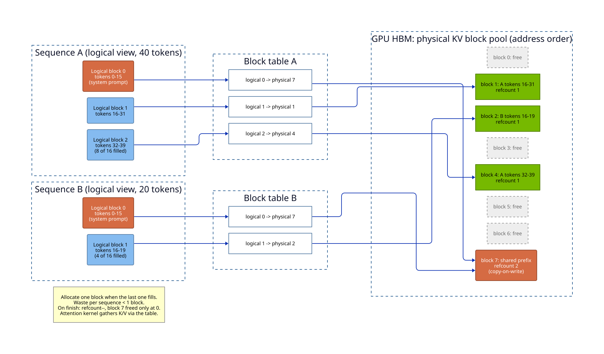

# LLM Systems & Inference

Training a model and serving it are different problems with different economics. Training is about *throughput over a fixed dataset*; inference is about *latency and throughput over an open-ended stream of requests*. A model is trained once but served billions of times, so inference dominates its lifetime cost. And inference has a defining constraint: autoregressive decoding generates one token per forward pass, and each pass must read the entire model's weights plus a growing KV cache from GPU memory. LLM inference is therefore *memory-bandwidth bound*, not compute bound. The bottleneck is moving weights and the KV cache through the GPU, not doing FLOPs, and the whole field of LLM serving is a fight against memory bandwidth.

This chapter follows that fight from the model's architecture to a deployed, load-tested fleet. The opening you are reading surveys the core ideas: the transformer seen from a serving perspective, the two phases of generation, the KV cache, batching, kernels, quantization, decoding tricks, parallelism, deployment, and the metrics that make up a serving contract. The sections that follow go deep on each layer: the quantizers that shrink weights and caches, the frameworks that run models across languages, the mechanics of loading a checkpoint onto a GPU, the capacity math and load testing behind a real deployment, the platforms that sit between an application and a token, the Kubernetes deployment of a GPU fleet, and the producer's side: packaging, publishing, and sharing a model you trained.

> **Learning objectives**
> - Explain why decode is memory-bandwidth bound while prefill is compute bound, and how each phase is optimized.
> - Size the KV cache from a model's architecture and explain how PagedAttention and prefix caching manage it.
> - Explain how continuous batching, FlashAttention, quantization, and speculative decoding each improve serving, and which resource (memory, bandwidth, or compute) and which phase each one helps.
> - Choose among tensor, pipeline, and expert parallelism given a model's size and the interconnect available.
> - Define TTFT, TPOT, throughput, and goodput, and explain the tension between throughput and per-user latency.

## Before you begin

This chapter assumes the transformer architecture and attention from [Deep Learning](../02-deep-learning/README.md); the [Foundation Models & Architectures](../05-foundation-models/README.md), [Neural Architectures & DL History](../06-neural-architectures/README.md), and [Training and Post-Training](../07-training-and-post-training/README.md) chapters of this book all feed into it. The deployment material assumes containers and Kubernetes from [Cloud Native](../../systems/03-cloud-native/README.md) in *Systems and Architecture*. The primary reference is Vijay Janapa Reddi's [*Machine Learning Systems*](https://mlsysbook.ai/) (free online), the systems-level companion to Goodfellow.

The best preparation is practical: serve a real model locally with vLLM before reading the theory, and watch GPU memory, tokens per second, and how batching changes them. As you read, ask of each optimization whether it reduces *memory*, *bandwidth*, or *compute*, and which phase, prefill or decode, it helps. And profile rather than guess: use `nvidia-smi`, Nsight, and the framework's own metrics to find the actual bottleneck before optimizing.

## In this chapter

1. **[Quantization: Math to Code](01-quantization/README.md).** The quantizer zoo (GPTQ, AWQ, SmoothQuant, NF4, GGUF k-quants, FP8, QuIP#, and TurboQuant) derived from the math and implemented in C, CUDA, and Rust.
2. **[Inference Frameworks: The Cross-Language Landscape](02-frameworks/README.md).** The inference stack across C (llama.cpp), Python (vLLM, TGI, SGLang), Rust (candle, mistral.rs), and Zig (ZML), with runnable Rust and Zig examples.
3. **[Model Loading: Hub to GPU](03-model-loading/README.md).** Hub repo anatomy, the safetensors byte layout, what `from_pretrained` does, how engines shard weights, cold-start math, and chat templates, with a triage playbook for failed loads.
4. **[Serving, Capacity & Load Testing: Math to Code](04-serving-and-load/README.md).** The roofline for prefill and decode, memory budgets, SLOs and goodput, parallelism, vLLM and SGLang knobs, load-testing methodology, and cost per token.
5. **[LLM Serving Platforms: How They Work and When to Use Them](05-serving-platforms.md).** How Anyscale, Ray, vLLM, SGLang, RouteLLM, and OpenRouter work, their use cases and trade-offs, and what reproducibility costs.
6. **[Deploying LLMs on Kubernetes: GPUs, Replicas, and Rollouts](06-gpu-kubernetes-deployment.md).** From the capacity plan to a running fleet: pod shape and replica math, GPU node pools, MIG and time-slicing, getting Hugging Face weights onto nodes, the vLLM Deployment, rollouts, autoscaling with lead time, LeaderWorkerSet, routing, and sizing separate prefill and decode pools.
7. **[From Training Run to Shared Model: Packaging, Publishing, and Use Cases](07-train-publish-share.md).** How architecture is stored, exporting your own checkpoint, how LoRA runs in training and serving, publishing to the Hub, sharing weights versus adapters versus endpoints, and six practical deployments sized end to end.

The rest of this opening builds the shared vocabulary those sections rely on.

## The transformer, seen from serving

The model being served is a **decoder-only stack**: an embedding, then $N$ transformer blocks (attention, MLP, residual connections, and normalization), then an unembedding. GPT, LLaMA, Mistral, and Qwen all share this shape, recapped here from [Deep Learning](../02-deep-learning/README.md) through an inference lens.

Self-attention computes $\text{Attention}(Q, K, V) = \text{softmax}(QK^\top / \sqrt{d_k})V$, which costs $O(n^2)$ in sequence length; this is why long context is expensive. At decode time, every new token attends to *all* previous tokens' keys and values, so you must keep them around. That stored state is the KV cache, and its size follows directly from the architecture:

$$\text{KV bytes} = 2 \times n_\text{layers} \times n_\text{kv heads} \times d_\text{head} \times \text{seq\_len} \times \text{batch} \times \text{bytes}$$

The KV cache size, in turn, dictates how many concurrent requests fit in memory. Several architectural variants change it. **Multi-Query Attention** (MQA) and **Grouped-Query Attention** (GQA) shrink the KV cache by sharing K and V heads across query heads. **Mixture-of-Experts** (MoE) routes each token to a few experts, raising the parameter count without raising per-token FLOPs. And positional schemes such as **RoPE** and **ALiBi** let models extrapolate to longer contexts than they were trained on.

## The two phases: prefill and decode

Generation has two distinct phases with opposite performance profiles, and they are optimized differently.

**Prefill** processes the entire prompt in one parallel forward pass and populates the KV cache. It is *compute-bound*: large matmuls saturate the GPU. Prefill determines **time to first token** (TTFT).

**Decode** generates tokens one at a time, each pass reading all the weights plus the KV cache to produce a single token per sequence. It is *memory-bandwidth-bound*: the GPU is mostly idle, waiting on memory. Decode determines **inter-token latency** (ITL) and **time per output token** (TPOT).

A useful mental model is that prefill is a sprint, one big burst of compute, while decode is a slow drip of thousands of tiny memory-bound steps. A serving system must schedule both without one starving the other. **Chunked prefill** helps by splitting long prompts so that prefill and decode can be interleaved in the same batch, smoothing latency spikes.

## The KV cache

The KV cache is the central data structure of inference. It stores the key and value tensors for every token already processed, per layer, so future tokens do not recompute them; this turns $O(n^2)$ regeneration into $O(n)$ incremental work. It trades memory for compute, and managing it well is what separates toy serving from production throughput.

The cache dominates memory because it grows linearly with sequence length and batch size; for long contexts it can exceed the model weights themselves. Naive serving makes this worse. Allocating one contiguous region per request wastes 60 to 80% of memory to internal and external fragmentation and to over-reservation for the maximum sequence length.

**PagedAttention**, introduced by vLLM, fixes this by managing the KV cache like virtual memory. The cache is stored in fixed-size *blocks* (pages), referenced through a block table and allocated on demand. Each sequence sees contiguous *logical* blocks, and the table maps them to whatever *physical* blocks were free. Fragmentation drops to nearly zero, and the design enables copy-on-write sharing of prompt prefixes: two sequences with the same system prompt point at one physical block with a reference count of 2, which is freed only when both finish.

**Prefix caching** generalizes that sharing across requests, reusing the KV blocks of a shared prompt prefix, such as a system prompt or few-shot examples. It is a large win for chat and RAG. The key result: PagedAttention raised serving throughput 2 to 4 times over prior systems, by reclaiming wasted KV memory and packing more requests into each batch.

## Batching strategies

Reclaimed memory pays off only if the scheduler fills it with work, which is the job of batching. Throughput and latency trade off directly through batch size, and the scheduling strategy decides how well that trade is made.

**Static batching** waits to assemble a fixed batch and runs it to completion. It is simple, but the whole batch waits for its slowest, longest sequence, giving terrible GPU utilization. **Continuous (in-flight) batching** schedules at the *token* level instead: as soon as one sequence finishes, it is evicted and a new request is admitted into the freed slot, mid-flight. This keeps the GPU saturated, and it is the default in vLLM, TGI, and TensorRT-LLM. Continuous batching is usually the single biggest throughput improvement available, often 5 to 20 times over static batching under real, variable-length traffic.

Batch size remains a **throughput-versus-latency knob**. Bigger batches give more tokens per second and a better cost per token, but higher per-request latency, and a serving SLO picks a point on that curve. **Disaggregated prefill and decode** goes further by running compute-bound prefill and memory-bound decode on *separate* GPU pools, so that each pool is sized for its own bottleneck.

## Attention and kernel optimization

Below the scheduler, kernels decide how efficiently each step uses the hardware. **FlashAttention** computes attention without materializing the full $n \times n$ attention matrix in HBM: it tiles the computation in fast SRAM and uses the online-softmax trick. Memory goes from $O(n^2)$ to $O(n)$, and it is faster thanks to better memory locality; FlashAttention-2 and -3 push further with better work partitioning. **PagedAttention kernels** compute attention reading K and V from non-contiguous paged blocks. **Fused kernels** combine operations such as layernorm, matmul, and activation to cut kernel-launch overhead and HBM round trips. And **CUDA graphs** capture the decode step as a graph, eliminating per-step launch overhead in the tiny, memory-bound decode loop.

## Quantization and compression

Quantization trades precision for memory bandwidth and footprint, and it works especially well for inference: fewer bytes per weight mean less memory traffic, which speeds up decode, the bandwidth-bound phase, and leaves more room for KV cache.

There are several flavors. **Weight-only quantization** to INT8 or INT4 (GPTQ, AWQ) keeps activations in higher precision and quantizes only the weights; AWQ protects salient weights, while GPTQ uses second-order error correction. **Weight-plus-activation** quantization uses FP8 (native on Hopper and Ada) or INT8, where SmoothQuant migrates activation outliers into the weights to make activations quantizable. **KV cache quantization** stores the cache in FP8 or INT8 to fit longer contexts and bigger batches. Beyond quantization, distillation, pruning, and small models suited to speculative decoding shrink the model itself.

> **Warning:** Aggressive quantization (INT4) can degrade quality on hard tasks. Always evaluate on your own benchmark, not just on perplexity.

[Quantization: Math to Code](01-quantization/README.md) covers the full quantizer zoo, GPTQ, AWQ, SmoothQuant, NF4, GGUF k-quants, FP8, QuIP#, and TurboQuant, with the underlying math translated into runnable C, CUDA, and Rust ([Burn](https://burn.dev/)) examples.

## Decoding optimizations

Decode's memory-bound single-token steps leave compute idle, and **speculative decoding** puts it to work. A small, fast *draft* model proposes $K$ tokens, and the big *target* model verifies them all in one parallel pass, accepting the longest correct prefix. This converts memory-bound single-token decode into compute-bound batch verification, for a 2 to 3 times speedup with an identical output distribution. **Medusa, EAGLE, and lookahead decoding** are self-speculation variants that add lightweight prediction heads instead of a separate draft model.

Other decoding controls shape output rather than speed. **Sampling parameters** (temperature, top-k, top-p or nucleus sampling, and repetition penalty) change what is generated without changing cost much. **Structured or constrained decoding** masks logits to force valid JSON or a grammar (Outlines, XGrammar), which is critical for tool-calling reliability.

## Multi-GPU and multi-node parallelism

When the model, or its KV cache, does not fit on one device, you must split it, and each choice has a different communication cost. **Tensor parallelism** (TP) splits each weight matrix across GPUs, with an all-reduce in every layer. It gives low latency but is communication-heavy, so keep it within one node's fast NVLink domain. **Pipeline parallelism** (PP) assigns different layers to different GPUs, with micro-batches flowing through the pipeline. Its communication is cheaper, but it introduces pipeline bubbles; it works better across nodes. **Expert parallelism** (EP), for MoE models, places different experts on different GPUs and routes tokens to their experts with all-to-all communication. **Sequence or context parallelism** splits the sequence dimension for very long contexts.

The rule of thumb is TP inside a node (NVLink) and PP or EP across nodes (slower interconnect). At this scale communication becomes the bottleneck, so topology awareness matters.

## Serving frameworks and runtimes

All of these techniques are packaged in serving frameworks, each with its own niche. This table summarizes the main ones:

| Framework | Niche | Key feature |
|-----------|-------|-------------|
| **vLLM** | General-purpose, high throughput | PagedAttention, continuous batching, broad model support |
| **TensorRT-LLM** | Max performance on NVIDIA | Compiled kernels, FP8, in-flight batching |
| **TGI** (HuggingFace) | Production HF ecosystem | Tensor parallel, token streaming, easy deploy |
| **SGLang** | Complex/structured generation | RadixAttention prefix sharing, fast structured output |
| **llama.cpp / Ollama** | Local, CPU/edge, GGUF | Runs quantized models on consumer hardware |
| **candle / mistral.rs** (Rust) | Safe single static binary, edge/WASM | Pure-Rust kernels + runtime, ISQ, OpenAI server |
| **ZML / llama.cpp.zig** (Zig) | Native compile, minimal deps, C interop | MLIR/XLA multi-vendor, or `@cImport` over llama.cpp |
| **Ray Serve / KServe** | Orchestration layer | Autoscaling, multi-model, request routing on top of a runtime |

[Inference Frameworks: The Cross-Language Landscape](02-frameworks/README.md) maps the full stack across C (llama.cpp and ggml), Python (vLLM, TGI, SGLang), Rust (candle, mistral.rs, burn, ratchet, luminal), and Zig (ZML, llama.cpp.zig), with runnable Rust and Zig examples. [LLM Serving Platforms](05-serving-platforms.md) covers the orchestration, gateway, and routing layers above the engines.

## Deployment: GPU clusters and Kubernetes

Serving meets [Cloud Native](../../systems/03-cloud-native/README.md) infrastructure when the framework is deployed on a cluster. On Kubernetes, the NVIDIA device plugin exposes `nvidia.com/gpu` as a schedulable resource, and node selectors, taints, and `nodeAffinity` pin pods to the right GPU SKU (A100, H100, L40S). GPUs can be shared: **Multi-Instance GPU** (MIG) partitions one A100 or H100 into isolated slices, while time-slicing shares a GPU across pods for low-traffic models. **Multi-node serving** uses LeaderWorkerSet or multi-host inference for models spanning nodes, with RDMA or InfiniBand and topology-aware scheduling for the parallelism interconnect.

**Autoscaling** should key on GPU-aware signals, such as queue depth, tokens per second, and KV-cache utilization, via KEDA or custom metrics, *not* CPU. Cold starts are brutal, because model weights run to tens or hundreds of gigabytes, so keep warm pools and use fast model loading: streaming from object storage, RDMA, or a local NVMe cache ([Model Loading: Hub to GPU](03-model-loading/README.md) does the math). **Operators** such as KServe, Ray, NVIDIA NIM, or KubeAI manage model deployments declaratively, with canary rollouts and scale-to-zero. The main **cost levers** are spot or preemptible GPUs with checkpointing, right-sizing the GPU to the model, and bin-packing many small models per GPU with MIG. [Deploying LLMs on Kubernetes](06-gpu-kubernetes-deployment.md) builds all of this as manifests, with the arithmetic behind each field.

## Serving metrics and SLOs

Finally, a serving system is judged by a handful of metrics, each driven by a different part of the system:

| Metric | Meaning | Driven by |
|--------|---------|-----------|
| **TTFT** | Time to first token | Prefill speed, queue wait, prompt length |
| **TPOT / ITL** | Time per output token | Decode speed (memory bandwidth), batch size |
| **Throughput** | Total tokens/sec across all requests | Batching, KV cache efficiency, hardware |
| **Goodput** | Throughput that *meets* SLOs | Scheduling quality under load |
| **Utilization** | GPU compute/memory busy fraction | Batching, phase mix |

The key tension is that optimizing throughput with big batches hurts TTFT and TPOT for individual users. Serving systems therefore schedule to maximize goodput: throughput *subject to* latency SLOs. [Serving, Capacity & Load Testing](04-serving-and-load/README.md) turns these definitions into capacity plans and load tests.

## Optimization at a glance

Each technique in this chapter targets a specific goal, and it works for a specific reason. This table collects them:

| Goal | Technique | Why it works |
|------|-----------|--------------|
| Less KV memory waste | PagedAttention | Virtual-memory-style paging, no fragmentation |
| More concurrent users | Continuous batching | Token-level scheduling keeps GPU full |
| Lower attention memory | FlashAttention | Tiled, no n×n matrix in HBM |
| Smaller footprint | Quantization (AWQ/GPTQ/FP8) | Fewer bytes → less bandwidth |
| Smaller KV cache | GQA/MQA, KV quantization | Fewer/cheaper K-V heads |
| Faster decode | Speculative decoding | Parallel verify > serial generate |
| Reuse shared prompts | Prefix / RadixAttention caching | Skip recomputing common prefixes |
| Model too big for 1 GPU | Tensor / pipeline parallelism | Split weights across devices |

## Where this leads

This chapter connects to much of the rest of the library. The model being served, with its attention, transformers, and scaling laws, comes from [Deep Learning](../02-deep-learning/README.md). Kubernetes, autoscaling, containers, and GPU scheduling form the deployment substrate in [Cloud Native](../../systems/03-cloud-native/README.md); caching, load balancing, queueing, and SLOs for request routing and capacity planning come from [System Design](../../systems/01-system-design/README.md); and tail latency, RED and USE metrics, and profiling for measuring TTFT and TPOT come from [Observability](../../systems/04-observability/README.md), all in *Systems and Architecture*. Quantization as lossy compression, the bits-per-weight versus quality tradeoff, rests on [Information Theory](../../mathematics-for-computing/12-information-theory/README.md) in *Mathematics for Computing*. Getting data to and from the model through streaming pipelines and feature serving is the subject of [*Data Engineering*](../../data-engineering/README.md).

These skills are in demand across the industry: at NVIDIA (TensorRT-LLM, kernel optimization, FP8, Triton, MIG); at Anthropic, OpenAI, and Google DeepMind, where inference serving at scale, KV cache management, parallelism, latency SLOs, TPU inference, and cost per token are research-level problems; at Databricks (model serving with vLLM and MosaicML, GPU orchestration); at Meta (LLaMA serving, quantization research, edge inference); and at Together, Fireworks, and Anyscale, which sell high-throughput serving as a product.

### Further reading

- Vijay Janapa Reddi, [*Machine Learning Systems*](https://mlsysbook.ai/) (free online)
- [vLLM documentation](https://docs.vllm.ai/)
- Lilian Weng, [*Large Transformer Model Inference Optimization*](https://lilianweng.github.io/posts/2023-01-10-inference-optimization/)
- [*The Full Stack LLM Bootcamp*](https://fullstackdeeplearning.com/llm-bootcamp/)
- [Hugging Face TGI](https://huggingface.co/docs/text-generation-inference) and [NVIDIA TensorRT-LLM](https://nvidia.github.io/TensorRT-LLM/) documentation
- The PagedAttention (vLLM) and FlashAttention papers, the two most load-bearing systems papers in modern serving

## Key terms

- **prefill**: the compute-bound forward pass over the whole prompt that populates the KV cache and determines TTFT.
- **decode**: the memory-bandwidth-bound generation of one token per sequence per forward pass, which determines TPOT.
- **KV cache**: the stored keys and values of all processed tokens, per layer, that let each new token attend without recomputation.
- **PagedAttention**: KV-cache management in fixed-size blocks mapped through a block table, like virtual memory.
- **continuous batching**: token-level scheduling that admits and evicts sequences every step to keep the GPU full.
- **speculative decoding**: drafting several tokens cheaply and verifying them in one target-model pass, preserving the output distribution.
- **tensor / pipeline / expert parallelism**: splitting a model across GPUs by weight matrix, by layer, or by MoE expert.
- **goodput**: throughput that meets the latency SLOs.

## Summary

- LLM inference is memory-bandwidth bound: each decode step reads all the weights plus the KV cache to produce one token per sequence.
- Prefill is compute-bound and sets TTFT; decode is memory-bound and sets TPOT; they are scheduled and optimized differently.
- The KV cache is the central data structure of serving, and PagedAttention with prefix caching is what makes production throughput possible.
- Throughput and latency trade off through batch size; continuous batching is the single biggest practical win for serving many users.
- A model that does not fit on one GPU forces a parallelism choice (tensor, pipeline, or expert), each with a different communication cost.

## Review questions

1. Why is decode memory-bandwidth bound while prefill is compute-bound?
   

Answer
Prefill processes the whole prompt in one pass, so each weight read is reused across many tokens and the large matmuls saturate the GPU's compute. Decode produces one token per sequence per pass but must still read every weight and the KV cache, so the GPU spends most of its time waiting on memory.

2. Write the KV cache size formula and explain why GQA increases the number of concurrent users.
   

Answer
$2 \times n_\text{layers} \times n_\text{kv heads} \times d_\text{head} \times \text{seq\_len} \times \text{batch} \times \text{bytes}$, where the 2 counts K and V. GQA shares each K/V head among several query heads, reducing $n_\text{kv heads}$; a smaller cache per token means more sequences fit in the memory left after the weights.

3. How does PagedAttention reduce memory waste, and how does it let two requests share a system prompt?
   

Answer
Contiguous per-request allocation wastes 60 to 80% of memory to fragmentation and over-reservation for the maximum length. PagedAttention allocates fixed-size blocks on demand and maps each sequence's logical blocks to arbitrary physical blocks through a block table. Two sequences with the same prefix can point at the same physical block, with a reference count of 2, freed only when both finish.

4. Why does continuous batching beat static batching on real traffic?
   

Answer
Under static batching, the whole batch waits for its longest sequence, so finished slots sit idle. Continuous batching evicts a finished sequence and admits a new request into its slot at the next token step, keeping the GPU saturated; under variable-length traffic this is often a 5 to 20 times throughput improvement.

5. Where should tensor parallelism and pipeline parallelism be used, and why?
   

Answer
Tensor parallelism needs an all-reduce in every layer, so keep it inside one node's fast NVLink domain; it lowers latency. Pipeline parallelism only passes activations between stages, so it tolerates the slower interconnect between nodes, at the cost of pipeline bubbles.

6. For each of FlashAttention, quantization, and speculative decoding, say which resource it saves and which phase it mainly helps.
   

Answer
FlashAttention reduces attention memory from $O(n^2)$ to $O(n)$ and HBM traffic through tiling in SRAM, helping long-context attention, especially in prefill. Quantization reduces bytes per weight (and per KV element), saving memory and bandwidth, which mainly speeds up decode and frees room for KV cache. Speculative decoding spends idle compute to verify several tokens per pass, speeding up memory-bound decode.

