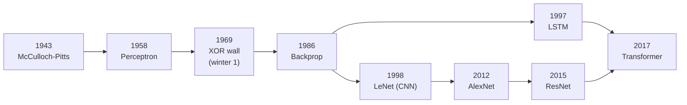
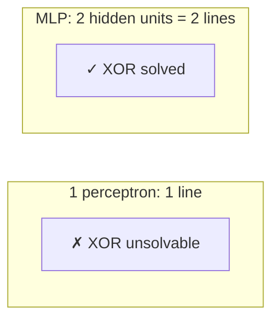
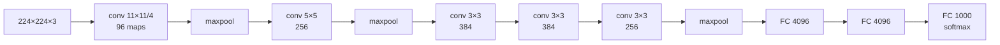

# Neural Network Architectures & the History of Deep Learning

A neural network is a **parameterized, differentiable function** built by composing simple pieces, an affine map $Wx + b$ followed by a nonlinearity, and fit by **gradient descent** on a loss, with the gradients supplied by **backpropagation** (reverse-mode automatic differentiation). Every architecture in this chapter, the perceptron, the MLP, the CNN, the RNN, and the LSTM, is *the same idea* with a different wiring of those pieces. Each wiring encodes a prior belief, an *inductive bias*, about the structure of the data, and the history of the field is the history of discovering which wirings make hard problems learnable.

This chapter tells that story in full, from a 1943 model of a neuron to AlexNet and beyond. It covers the **history**, the **foundational math**, and the **architectures**, deriving each from its equations and then writing it in code. Where [Deep Learning](../02-deep-learning/README.md) surveys the field through Goodfellow's textbook, this chapter is its deep, implementation-first companion: the point throughout is the correspondence between math and code. We begin with a timeline, then derive the four mathematical objects everything reduces to. We watch the perceptron fail on XOR and depth fix it, build convolutional networks up to ResNet, take AlexNet apart choice by choice, and then turn to sequences with RNNs, the vanishing gradient, and the LSTM and GRU. The chapter ends by comparing CNNs, RNNs, and Transformers and drawing out the through-lines.

> **Learning objectives**
> - Derive the forward and backward equations of a fully connected layer and explain why backpropagation computes all gradients in one backward pass.
> - Explain why a single perceptron cannot learn XOR and how a hidden layer trained by backpropagation solves it.
> - Write the convolution, RNN, LSTM, and GRU equations, and connect each to its implementation in `code/`.
> - Explain the six design choices that made AlexNet work and why ResNet's residual connection allows very deep networks.
> - Compare CNNs, RNNs, and Transformers by inductive bias, long-range dependencies, parallelism, and cost.

## Before you begin

You need [Linear Algebra](../../mathematics-for-computing/04-linear-algebra/README.md) and the chain rule from [Calculus 3](../../mathematics-for-computing/05-calculus-3/README.md) in *Mathematics for Computing*, and [Statistical Learning](../01-statistical-learning/README.md) from earlier in this book. The primary references are [*Deep Learning*](https://www.deeplearningbook.org/) by Goodfellow et al. (Chapters 6, 9, and 10, free), [Stanford CS231n](https://cs231n.github.io/) (free, the canonical CNN course), and Karpathy's [Neural Networks: Zero to Hero](https://karpathy.ai/zero-to-hero.html) (free, backpropagation from scratch).

Read the chapter top to bottom as a narrative; the math sections build on each other. Run the `code/` files in order: [`perceptron.c`](code/perceptron.c), watching it fail on XOR; then [`backprop_xor.c`](code/backprop_xor.c), watching hidden layers fix it; then [`conv2d.c`](code/conv2d.c) and [`lstm_cell.c`](code/lstm_cell.c). For each architecture, write the forward equations on paper and check them against the code. And read the AlexNet paper alongside the AlexNet section; it is short and readable, and you will recognize every trick.

## In this chapter

- [A history of computing and neural networks](#a-history-of-computing-and-neural-networks): the timeline from Turing to the Transformer, and the two AI winters.
- [The foundational math](#the-foundational-math): the neuron, the loss, gradient descent, and backpropagation.
- [The perceptron and why it failed](#the-perceptron-and-why-it-failed): the convergence theorem, the XOR wall, and the fix of depth.
- [Convolutional networks](#convolutional-networks): locality, parameter sharing, pooling, and the lineage from LeNet to ResNet.
- [AlexNet in depth](#alexnet-in-depth): the architecture and the six choices that started the deep learning era.
- [Recurrent networks](#recurrent-networks): hidden state, backpropagation through time, and vanishing gradients.
- [LSTM and GRU](#lstm-and-gru): gated, additive memory.
- [CNNs, RNNs, and Transformers compared](#cnns-rnns-and-transformers-compared) and [Through-lines](#through-lines): what the history teaches.

## A history of computing and neural networks

The timeline below runs from the definition of computation to the architecture behind today's LLMs. Read it for the rhythm: bursts of progress, two winters, and a revolution when ideas and resources finally met.

| Year | Event | Why it mattered |
|------|-------|-----------------|
| 1936 | Turing's universal machine | Defines computation; the substrate everything runs on |
| 1943 | **McCulloch & Pitts** neuron | First mathematical model of a neuron: a thresholded sum of weighted inputs |
| 1949 | Hebbian learning ("cells that fire together wire together") | First learning rule |
| 1958 | **Rosenblatt's Perceptron** | A neuron that *learns* its weights from data; huge hype |
| 1969 | **Minsky & Papert**, *Perceptrons* | Proved a single perceptron can't learn XOR → **first AI winter** |
| 1986 | **Backpropagation** (Rumelhart, Hinton, Williams) | Train *multi-layer* nets efficiently → XOR solved, field revived |
| 1989/98 | **LeNet** (LeCun) | Convolutions + backprop read handwritten digits (ran on ATM checks) |
| 1991 | Hochreiter identifies the **vanishing gradient** | Explains why deep/recurrent nets wouldn't train |
| 1995-2005 | SVMs & kernel methods dominate | Neural nets fall out of fashion → **second AI winter** |
| 1997 | **LSTM** (Hochreiter & Schmidhuber) | Gated memory solves vanishing gradients for sequences |
| 2006 | Deep belief nets (Hinton) | Layer-wise pretraining shows deep nets *can* be trained |
| 2009-12 | GPUs + ImageNet (Fei-Fei Li) | Compute and a big labeled dataset arrive together |
| **2012** | **AlexNet** wins ImageNet | 15.3% vs 26.2% error → the deep learning revolution starts |
| 2014 | VGG, GoogLeNet, GANs, seq2seq, Adam | Architectures and tooling explode |
| 2015 | **ResNet** | Skip connections train 100+ layers; surpasses human ImageNet error |
| 2017 | **Transformer** ("Attention Is All You Need") | Attention replaces recurrence; basis of modern LLMs |

The lineage forms a graph rather than a line, with convolution and recurrence developing in parallel until both feed into the Transformer:



Two patterns stand out. First, progress alternated between *ideas* (backpropagation, gating, attention) and *resources* (GPUs, ImageNet), and AlexNet is the moment they met. Second, the two AI winters were caused by hitting a mathematical wall, the perceptron's inability to learn XOR and the RNN's inability to learn long dependencies, and each thaw came from a *specific* fix: hidden layers with backpropagation, and the LSTM's additive cell state. The rest of the chapter works through those walls and fixes in order, starting with the math they share.

## The foundational math

Everything reduces to four objects.

**The artificial neuron.** Given inputs $x \in \mathbb{R}^n$, weights $w$, a bias $b$, and a nonlinearity $\varphi$,

$$y = \varphi(w^\top x + b) = \varphi\Big(\sum_i w_i x_i + b\Big)$$

A layer stacks $m$ neurons into a matrix, $y = \varphi(Wx + b)$ with $W \in \mathbb{R}^{m \times n}$. **This affine-map-then-nonlinearity is the only primitive.** Depth is just composition:

$$f(x) = \varphi(W_3\, \varphi(W_2\, \varphi(W_1 x + b_1) + b_2) + b_3)$$

**The loss** is a scalar measuring wrongness. For classification it is typically cross-entropy, $L = -\sum_c y_c \log \hat{y}_c$ with $\hat{y} = \operatorname{softmax}(z)$. Training means minimizing $L$ over the parameters $\theta = \{W, b\}$.

**Gradient descent** steps downhill: $\theta \leftarrow \theta - \eta \nabla_\theta L$, where the learning rate $\eta$ is the step size.

**Backpropagation is the chain rule run backward through a computation graph**, nothing more. For a composition $L = \ell(f(g(x)))$, the chain rule gives $\partial L / \partial x = \partial L / \partial f \cdot \partial f / \partial g \cdot \partial g / \partial x$. Reverse-mode automatic differentiation evaluates this product **right to left**, reusing each intermediate, so *all* the gradients cost one backward pass regardless of the number of parameters. For one linear layer $z = Wx + b$, $a = \varphi(z)$, with upstream gradient $\delta = \partial L / \partial a$:

```
∂L/∂z = δ ⊙ φ'(z)          (elementwise; ⊙ = Hadamard)
∂L/∂W = (∂L/∂z) xᵀ          (outer product)
∂L/∂b = ∂L/∂z
∂L/∂x = Wᵀ (∂L/∂z)          (the gradient to send to the previous layer)
```

These four lines, applied layer by layer, **are** training. Once you can derive them for one layer, every architecture is the same algorithm over a different graph. [`code/backprop_xor.c`](code/backprop_xor.c) contains the entire algorithm in about 100 lines of C with no libraries.

## The perceptron and why it failed

With the math in place, we can see exactly why the first learning neuron hit a wall. Rosenblatt's perceptron is one neuron with a step nonlinearity and a beautifully simple learning rule: for each misclassified example, nudge the weights toward the correct answer, $w \leftarrow w + \eta(\text{target} - \text{pred})x$. The perceptron convergence theorem guarantees that this **provably converges** if the data is *linearly separable*.

The catch Minsky and Papert exposed is that **XOR is not linearly separable**. No single line separates $\{(0,0), (1,1)\}$ from $\{(0,1), (1,0)\}$, so one perceptron *can never* learn it. The result killed funding for a decade.

The fix is depth. A network with **one hidden layer** can carve the input space into regions, and two hidden units, two lines, are enough for XOR. You can check this by hand with step activations. Let hidden unit $h_1 = \text{step}(x_1 + x_2 - 0.5)$, which computes OR, and $h_2 = \text{step}(x_1 + x_2 - 1.5)$, which computes AND, and let the output be $y = \text{step}(h_1 - h_2 - 0.5)$. On $(0,0)$ both hidden units are 0, so $y = 0$. On $(0,1)$ or $(1,0)$, $h_1 = 1$ and $h_2 = 0$, so $y = \text{step}(0.5) = 1$. On $(1,1)$ both are 1, so $y = \text{step}(-0.5) = 0$. That is XOR: "OR but not AND".



Hand-chosen weights prove the network *can* represent XOR. Learning those weights needs a way to assign credit to the internal neurons, and that is exactly what backpropagation provided in 1986. [`code/perceptron.c`](code/perceptron.c) shows the perceptron learning AND and OR and *failing* on XOR; [`code/backprop_xor.c`](code/backprop_xor.c) shows a two-layer MLP learning to solve it.

## Convolutional networks

Depth solves XOR, but fully connected depth does not scale to images. An MLP on a $224 \times 224 \times 3$ image has about 150K inputs, so a single fully connected layer of 4096 units has about 600M weights, and it learns nothing about the fact that a cat is a cat wherever it appears. The CNN fixes this by encoding two priors. **Local connectivity** means a neuron looks at a small patch, say $3 \times 3$, rather than the whole image, because vision is local. **Parameter sharing** means the *same* small filter slides across the whole image, so a feature detector for an edge or a texture is reused everywhere. Together they give **translation equivariance** and far fewer parameters. In the language of inductive bias, a CNN bakes in "nearby pixels matter, and a feature is the same anywhere".

The core operation is convolution, which in deep learning is really cross-correlation. For an input $X$ and a $k \times k$ filter $K$, the output feature map is

$$S(i, j) = \sum_{u=0}^{k-1} \sum_{v=0}^{k-1} X(i+u, j+v)\, K(u, v) + b$$

Stacking many filters gives many output channels, or feature maps. The main knobs are **stride** (the step size), **padding** (how borders are handled), and **dilation** (spaced taps). [`code/conv2d.c`](code/conv2d.c) implements this forward pass, and [`code/conv2d.cu`](code/conv2d.cu) is the CUDA version, with one thread per output pixel.

**Pooling**, a max or average over a window, downsamples the feature map and grants *approximate translation invariance*: a feature detected anywhere in the window survives. Meanwhile the **receptive field** grows with depth: stack enough $3 \times 3$ convolutions and a deep neuron "sees" the whole image.

The history of CNNs is a lineage in which each model fixes the bottleneck of the one before:

| Model | Year | Key idea | Depth | ImageNet top-5 error |
|-------|------|----------|------:|---------------------:|
| LeNet-5 | 1998 | conv+pool+FC, trained by backprop | 7 | (MNIST, pre-ImageNet) |
| **AlexNet** | 2012 | ReLU + dropout + 2-GPU training, at scale | 8 | **15.3%** |
| VGG-16 | 2014 | only 3×3 convs, very deep & uniform | 16 | 7.3% |
| GoogLeNet | 2014 | Inception modules, 1×1 convs (cheap channels) | 22 | 6.7% |
| **ResNet** | 2015 | residual `y = F(x)+x` trains 100+ layers | 152 | 3.6% |

ResNet's insight is worth isolating. If a block learns a *residual* $F(x) = H(x) - x$, so that it computes $F(x) + x$, then the identity map is free, gradients flow unimpeded through the $+x$ skip, and the degradation of very deep networks disappears. This is the same additive-path trick the LSTM uses across time, as you will see below.

## AlexNet in depth

AlexNet (Krizhevsky, Sutskever, and Hinton, 2012) is the single most important architecture in this chapter, not for novelty but for **proof at scale**. It won ILSVRC-2012 with a top-5 error of 15.3%, against 26.2% for the runner-up, and the field pivoted to deep learning within a year. Yet AlexNet did not invent anything fundamental: CNNs, ReLU, dropout, and GPUs all existed already. It *combined* them at scale on ImageNet, which is why it started the deep learning era.

The architecture has 5 convolutional layers and 3 fully connected layers, about 60M parameters and 650K neurons, ending in a 1000-way softmax:



Six choices made it work, and each is now standard practice.

1. **ReLU**, $\varphi(x) = \max(0, x)$, instead of tanh or sigmoid. It does not saturate, so gradients do not vanish, and training is about 6 times faster. This was the biggest single lever.
2. **Training on two GPUs** (GTX 580s with 3 GB each). The model was split across GPUs because it did not fit on one, which is why the diagram in the paper has two parallel streams.
3. **Dropout** with $p = 0.5$ in the fully connected layers. Randomly zeroing units prevents co-adaptation and acts as a cheap ensemble, which was essential with 60M parameters.
4. **Overlapping max-pooling**, with a $3 \times 3$ window and stride 2, which slightly reduces error compared with non-overlapping pooling.
5. **Local Response Normalization**, a lateral-inhibition normalization across channels. Batch normalization later superseded it, but it was part of the original recipe.
6. **Data augmentation**: random crops and flips and PCA color jitter expand the effective dataset and curb overfitting.

[`code/alexnet.py`](code/alexnet.py) defines the architecture in PyTorch as the canonical reference, and [`code/lenet.rs`](code/lenet.rs) builds the smaller LeNet in Rust with candle, showing the same primitives in a systems language.

AlexNet is the hinge of the whole field because it demonstrated that the CNN-plus-backpropagation ideas of the 1980s and 1990s needed only *scale*, in data and GPUs, to dominate. Every later architecture in this book descends from that lesson.

## Recurrent networks

Images have spatial structure; text, audio, and time series have temporal structure, and for them we want a model whose computation depends on the past. A recurrent network maintains a **hidden state** $h_t$, updated at each step:

$$h_t = \varphi(W_{hh} h_{t-1} + W_{xh} x_t + b), \qquad \hat{y}_t = W_{hy} h_t$$

The same weights are reused at every timestep. This is parameter sharing *across time*, the temporal analogue of the CNN's sharing across space, and the inductive bias is that "the past summarizes into a state". Training uses **backpropagation through time** (BPTT): unroll the recurrence into a deep feedforward graph with one layer per timestep, and backpropagate.

Unrolling exposes the problem. The gradient of the loss at step $t$ with respect to an early state involves a *product* of Jacobians:

$$\frac{\partial h_t}{\partial h_k} = \prod_{i=k+1}^{t} \frac{\partial h_i}{\partial h_{i-1}} = \prod W_{hh}^\top \operatorname{diag}(\varphi'(\cdot))$$

A product of $t - k$ matrices either **shrinks to zero**, if the relevant singular values are below 1, or **blows up**, if they are above 1. So a vanilla RNN cannot learn dependencies more than about 10 steps apart, which was exactly Hochreiter's 1991 finding. Exploding gradients can be patched with **gradient clipping**, but *vanishing* gradients need an architectural fix.

## LSTM and GRU

The LSTM (Hochreiter and Schmidhuber, 1997) is that fix. It adds a **cell state** $c_t$ that is updated *additively* and protected by multiplicative **gates**, sigmoids in $[0, 1]$ that decide how much to let through:

```
f_t = σ(W_f·[h_{t-1}, x_t] + b_f)      forget gate  — what to erase from memory
i_t = σ(W_i·[h_{t-1}, x_t] + b_i)      input gate   — what to write
g_t = tanh(W_g·[h_{t-1}, x_t] + b_g)   candidate     — the new content
c_t = f_t ⊙ c_{t-1} + i_t ⊙ g_t        cell update  — ADDITIVE
o_t = σ(W_o·[h_{t-1}, x_t] + b_o)      output gate
h_t = o_t ⊙ tanh(c_t)                  hidden state
```

The reason it works is in the cell update. When $f_t \approx 1$ and $i_t \approx 0$, the cell state passes through *unchanged*, $c_t = c_{t-1}$, so $\partial c_t / \partial c_{t-1} \approx 1$. The gradient travels along the cell state's "conveyor belt" without the repeated matrix multiplication that kills vanilla RNNs. This is the same additive-path idea as ResNet's skip connection. [`code/lstm_cell.c`](code/lstm_cell.c) implements all six equations for one timestep.

The **GRU** (Cho, 2014) simplifies the design, merging the cell and hidden state and using two gates, reset and update, instead of three. It has fewer parameters and often comparable performance, and its state update is additive again:

```
z_t = σ(W_z·[h_{t-1}, x_t])                       update gate
r_t = σ(W_r·[h_{t-1}, x_t])                       reset gate
h̃_t = tanh(W·[r_t ⊙ h_{t-1}, x_t])
h_t = (1 − z_t) ⊙ h_{t-1} + z_t ⊙ h̃_t            additive again
```

## CNNs, RNNs, and Transformers compared

Choosing an architecture is choosing an inductive bias, and also choosing *how computation parallelizes*. This table compares the three families on both counts:

| | **CNN** | **RNN / LSTM** | **Transformer** |
|--|---------|----------------|-----------------|
| Inductive bias | locality + translation equivariance | sequential, recent-past-summarized state | none structural; learns relations via attention |
| Natural data | grids (images, spectrograms) | ordered sequences | sequences/sets, multimodal |
| Long-range deps | needs depth (grows receptive field) | hard (vanishing grad; LSTM helps) | direct (any token attends to any token) |
| Parallelism over length | full (all positions at once) | **none** (must step `t-1` → `t`) | full (all positions at once) |
| Cost | O(n·k) per layer | O(n) sequential steps | O(n²) attention |
| Params reused across | space | time | none (positional encodings supply order) |

In practice, CNNs still dominate where locality is the right prior, as in vision, though Vision Transformers now compete. RNNs and LSTMs are largely **legacy** for NLP. Their killer weakness was the sequential dependency that prevents GPU parallelization across the sequence, which is precisely what the Transformer removed in 2017 by replacing recurrence with attention. That unlock made training on internet-scale text feasible and led directly to the models in [Foundation Models & Architectures](../05-foundation-models/README.md) and [LLM Systems & Inference](../04-llm-systems/README.md).

## Through-lines

Stepping back from the individual architectures, five lessons run through the whole history.

**An architecture is a prior.** It is an inductive bias made of linear algebra: you are encoding what you believe about the data's structure, so match the bias to the domain.

**Additive skip paths beat multiplicative chains.** ResNet, across depth, and the LSTM, across time, independently discovered that letting information pass *unchanged* by default keeps gradients alive. It is the most reused trick in the field.

**The bottleneck moves; it never disappears.** Linear separability gave way to depth and backpropagation; then vanishing gradients to the LSTM, ReLU, and ResNet; then sequential compute to the Transformer; and now quadratic attention to today's efficient-attention work.

**Scale is a first-class idea.** AlexNet's lesson, later made explicit by scaling laws, is that the same architecture with more data and compute often beats a cleverer architecture.

**It is all one algorithm.** Build a differentiable graph, define a loss, backpropagate, and descend. Master that once, and every architecture is a variation.

The techniques that recur across these architectures are collected here, with where each appears and why it matters:

| Technique | Where it appears | Why it matters |
|-----------|------------------|----------------|
| Backpropagation | every model | The one training algorithm; chain rule on a graph |
| ReLU activation | AlexNet onward | Non-saturating → no vanishing gradient, fast |
| Convolution + pooling | all CNNs | Locality, parameter sharing, translation (in)variance |
| Dropout | AlexNet FC layers | Cheap ensemble; curbs overfitting |
| Batch normalization | post-2015 CNNs | Stabilizes and speeds training (replaced LRN) |
| Residual / skip connection | ResNet, Transformers | Trains very deep nets; keeps gradients alive |
| Gating (forget/input/output) | LSTM, GRU | Additive memory path solves vanishing gradients |
| Gradient clipping | RNN training | Tames exploding gradients |
| BPTT | RNN/LSTM | Backprop over the time-unrolled graph |
| Data augmentation | AlexNet onward | Expands data, reduces overfitting |

## Where this leads

The math here comes from *Mathematics for Computing*: backpropagation and BPTT *are* the chain rule and Jacobians of [Calculus 3](../../mathematics-for-computing/05-calculus-3/README.md); every layer is $Wx + b$, and vanishing gradients are a statement about singular values, from [Linear Algebra](../../mathematics-for-computing/04-linear-algebra/README.md); and the cross-entropy loss is the KL divergence of [Information Theory](../../mathematics-for-computing/12-information-theory/README.md). Convolution is also an algorithm, and its speedups (im2col, FFT convolution, Winograd) belong to [*Algorithms*](../../algorithms/README.md). Within this book, [Deep Learning](../02-deep-learning/README.md) is the survey this chapter codes from scratch; [Foundation Models & Architectures](../05-foundation-models/README.md) and [LLM Systems & Inference](../04-llm-systems/README.md) explain why attention won and what it costs to run; and the infrastructure where GPU kernels for these models run is covered in [Cloud Native](../../systems/03-cloud-native/README.md) in *Systems and Architecture*.

These foundations come up everywhere: in NVIDIA's convolution and attention kernels, cuDNN, and hardware-aware architecture; in Google DeepMind's work from CNNs to Transformers, vision at scale, and JAX; in Anthropic's interest in why recurrence failed and attention won, and in interpretability; in CNN-based perception at Tesla and other autonomy companies, where it remains the workhorse for real-time vision; in Meta's self-supervised vision (DINO) and CNN-ViT hybrids; and in nearly every ML interview, which asks you to explain backpropagation, compare CNNs and RNNs, and say what made AlexNet work.

### Further reading

- [*Deep Learning*](https://www.deeplearningbook.org/) (Goodfellow et al.), Chapters 6, 9, and 10
- [Stanford CS231n](https://cs231n.github.io/)
- Karpathy, [Neural Networks: Zero to Hero](https://karpathy.ai/zero-to-hero.html)
- The primary papers, all free: [Perceptron (Rosenblatt 1958)](https://psycnet.apa.org/record/1959-09865-001), [Backpropagation (Rumelhart, Hinton, Williams 1986)](https://www.nature.com/articles/323533a0), [LeNet (LeCun 1998)](http://yann.lecun.com/exdb/publis/pdf/lecun-98.pdf), [AlexNet (Krizhevsky 2012)](https://papers.nips.cc/paper/4824-imagenet-classification-with-deep-convolutional-neural-networks), [LSTM (Hochreiter & Schmidhuber 1997)](https://www.bioinf.jku.at/publications/older/2604.pdf), [ResNet (He 2015)](https://arxiv.org/abs/1512.03385)

## Key terms

- **inductive bias**: the assumptions about data structure that an architecture builds in, such as locality for CNNs or a summarizing state for RNNs.
- **backpropagation**: reverse-mode automatic differentiation, the chain rule evaluated right to left over a computation graph.
- **linearly separable**: a dataset whose classes can be divided by a single hyperplane; the condition for perceptron convergence.
- **translation equivariance**: the property that shifting the input shifts the feature map correspondingly, produced by sharing filters across positions.
- **receptive field**: the region of the input that a given neuron depends on, which grows with depth.
- **residual connection**: a skip path computing $F(x) + x$, so the block learns only a residual and gradients flow through the identity.
- **backpropagation through time (BPTT)**: backpropagation over an RNN unrolled into one layer per timestep.
- **vanishing gradient**: the shrinking of gradients through a long product of Jacobians, which prevents learning long-range dependencies.
- **cell state**: the LSTM's additively updated memory, protected by forget, input, and output gates.

## Summary

- An architecture is an inductive bias made of linear algebra; the CNN assumes locality and translation equivariance, and the RNN assumes the past summarizes into a state.
- Backpropagation is the chain rule run backward through a computation graph; four lines per layer, applied in reverse, are all of training.
- The two AI winters came from mathematical walls (XOR for the perceptron, long dependencies for RNNs), and each thaw came from a specific fix: hidden layers with backpropagation, and the LSTM's additive cell state.
- AlexNet invented nothing fundamental; it combined CNNs, ReLU, dropout, and GPUs at scale on ImageNet, cutting top-5 error from 26.2% to 15.3%.
- Additive paths (ResNet across depth, LSTM across time) keep gradients alive, and the Transformer won by removing recurrence's sequential bottleneck.

## Review questions

1. Derive the gradients of a linear layer $z = Wx + b$, $a = \varphi(z)$ given $\delta = \partial L / \partial a$, and explain why backpropagation's cost does not grow with the number of parameters.
   <details><summary>Answer</summary>$\partial L/\partial z = \delta \odot \varphi'(z)$, $\partial L/\partial W = (\partial L/\partial z)x^\top$, $\partial L/\partial b = \partial L/\partial z$, and $\partial L/\partial x = W^\top(\partial L/\partial z)$, which is passed to the previous layer. Reverse mode evaluates the chain rule right to left and reuses every intermediate, so one backward pass yields the gradient for every parameter.</details>
2. Why can a single perceptron never learn XOR, and how does a hidden layer fix it?
   <details><summary>Answer</summary>A perceptron draws one line, and no line separates $\{(0,0),(1,1)\}$ from $\{(0,1),(1,0)\}$. With two hidden units you get two lines: for example $h_1 = \text{step}(x_1 + x_2 - 0.5)$ (OR), $h_2 = \text{step}(x_1 + x_2 - 1.5)$ (AND), and $y = \text{step}(h_1 - h_2 - 0.5)$, which is "OR but not AND". Backpropagation is what makes such hidden-layer weights learnable.</details>
3. What two priors does a CNN encode, and what do they buy compared with a fully connected layer on a 224×224×3 image?
   <details><summary>Answer</summary>Local connectivity (each neuron sees a small patch) and parameter sharing (the same filter slides everywhere). A single fully connected layer of 4096 units on about 150K inputs needs about 600M weights and has no notion that a feature is the same at every position; a convolution reuses a small filter everywhere, giving translation equivariance with far fewer parameters.</details>
4. Why does a vanilla RNN fail to learn long-range dependencies, and how does the LSTM fix it?
   <details><summary>Answer</summary>The gradient from step $t$ back to step $k$ is a product of $t - k$ Jacobians, $\prod W_{hh}^\top \operatorname{diag}(\varphi'(\cdot))$, which shrinks to zero or explodes depending on the singular values; vanilla RNNs manage only about 10 steps. The LSTM's cell state is updated additively, $c_t = f_t \odot c_{t-1} + i_t \odot g_t$, so with $f_t \approx 1$ and $i_t \approx 0$ we get $\partial c_t/\partial c_{t-1} \approx 1$ and the gradient passes along unchanged. Exploding gradients are handled separately by clipping.</details>
5. What made AlexNet work, given that it invented nothing fundamental?
   <details><summary>Answer</summary>It combined existing ideas at scale on ImageNet: ReLU (the biggest lever, about 6 times faster training), a two-GPU split, dropout of 0.5 in the fully connected layers, overlapping max-pooling, local response normalization, and data augmentation. The result, 15.3% top-5 error against 26.2%, showed that CNNs plus backpropagation needed only data and compute to dominate.</details>
6. What do ResNet and the LSTM have in common, and why did the Transformer replace RNNs for NLP?
   <details><summary>Answer</summary>Both use an additive path, $F(x) + x$ across depth and the additive cell update across time, that lets information and gradients pass unchanged by default. RNNs must compute step $t$ after step $t - 1$, so they cannot parallelize across the sequence on a GPU; the Transformer replaced recurrence with attention, which processes all positions at once and lets any token attend directly to any other, making internet-scale training feasible.</details>
