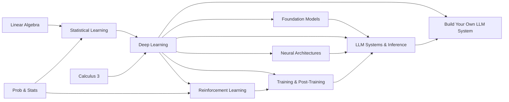

# Machine Learning and AI

This book runs from the statistical foundations of learning to the systems that train and serve today's large language models. It starts where every model starts, with fitting a function to data and understanding why it generalizes, then builds up deep learning, reinforcement learning, the architectures that made modern AI possible, and finally the engineering of foundation models: how they are trained, adapted, and served. Every primary textbook it leans on is free.

## Who this book is for

The book is for engineers and students who can program and have the mathematical foundations in hand, and who want to understand machine learning well enough to reason about it rather than only call it. That includes people heading toward research or alignment work, quantitative roles, ML infrastructure and MLOps, and AI engineering on top of foundation models. Each chapter pairs a free primary text with the papers and documentation that bring it up to date, and several chapters include small runnable programs that check their own formulas.

## What you will be able to do

By the end of the book you will be able to:

- Frame a learning problem statistically, reason about bias and variance, and choose and validate a classical model.
- Derive backpropagation and the main deep-learning architectures (MLPs, CNNs, RNNs and LSTMs, transformers) from their equations, and implement them.
- Formulate problems as Markov decision processes and apply value-based and policy-gradient reinforcement learning, through PPO and RLHF.
- Explain what makes a foundation model, how its architecture variants and modalities differ, and when to prompt, retrieve, or fine-tune.
- Estimate the compute, memory, and data budget of a training or fine-tuning run, and choose a parallelism and post-training method to match.
- Reason about LLM inference: prefill and decode, the KV cache, batching, quantization, and the cost and latency of serving.

## How the book is organized

The chapters move from foundations to systems. The first three are the classical core; the middle three take you from architectures to foundation models and their serving; the seventh shows how the models are made. The dependencies between them look like this:

[Statistical Learning](01-statistical-learning/README.md) is the framework everything else rests on: the bias-variance tradeoff, linear regression and model selection, classification with logistic regression, LDA, and naive Bayes, resampling and regularization with ridge and lasso, and trees, forests, boosting, SVMs, and unsupervised methods. Its primary texts are [*An Introduction to Statistical Learning*](https://www.statlearning.com/) and [*The Elements of Statistical Learning*](https://hastie.su.domains/ElemStatLearn/), both free.

[Deep Learning](02-deep-learning/README.md) follows [Goodfellow, Bengio, and Courville](https://www.deeplearningbook.org/) (free) through feedforward networks and backpropagation, regularization and optimization, CNNs and RNNs, practical methodology, autoencoders and generative models, and then beyond the book into transformers, attention, scaling laws, and self-supervised and transfer learning.

[Reinforcement Learning](03-reinforcement-learning/README.md) uses [Sutton and Barto](http://incompleteideas.net/book/the-book-2nd.html) (free) and OpenAI's [Spinning Up](https://spinningup.openai.com/en/latest/) to cover bandits and MDPs, dynamic programming, Monte Carlo and temporal-difference learning, function approximation and DQN, policy gradients and actor-critic methods, and PPO, DDPG, TD3, and SAC, ending with RLHF and model-based RL.

[LLM Systems and Inference](04-llm-systems/README.md) is the serving view of a transformer, built on [*Machine Learning Systems*](https://mlsysbook.ai/) and the [vLLM docs](https://docs.vllm.ai/) (both free): prefill versus decode and the TTFT and TPOT metrics, the KV cache, PagedAttention and prefix caching, continuous batching and FlashAttention, quantization and speculative decoding, tensor, pipeline, and expert parallelism, and deployment on GPU clusters. It has its own sections on [quantization](04-llm-systems/quantization/README.md), [serving and load testing](04-llm-systems/serving-and-load/README.md), [inference frameworks](04-llm-systems/frameworks/README.md), [model loading](04-llm-systems/model-loading/README.md), and [serving platforms](04-llm-systems/serving-platforms.md).

[Foundation Models and Architectures](05-foundation-models/README.md) covers the shift to building on foundation models and the adaptation ladder, the modern transformer variants (RMSNorm, RoPE, SwiGLU, MoE), attention mechanisms from MHA through MQA, GQA, and MLA, modalities and multimodal fusion, and diffusion models. Chip Huyen's *AI Engineering* is the optional reference, with free papers and documentation alongside it.

[Neural Architectures and the History of Deep Learning](06-neural-architectures/README.md) is the implementation-first companion to Deep Learning. It tells the story from the perceptron through the XOR winter to backpropagation, then derives and codes CNNs from LeNet to AlexNet and ResNet, and RNNs, backpropagation through time, and the LSTM and GRU gates, using [CS231n](https://cs231n.github.io/) and the original papers.

[Training and Post-Training](07-training-and-post-training/README.md) shows how a model is made before it is served: pretraining arithmetic and scaling laws, training memory and parallelism, SFT, RLHF, DPO, and GRPO, parameter-efficient fine-tuning with LoRA and QLoRA, and how to scope a fine-tune eval-first. It is grounded in the [Chinchilla](https://arxiv.org/abs/2203.15556) and [DPO](https://arxiv.org/abs/2305.18290) papers and the PyTorch and JAX documentation, with runnable code that checks its formulas.

Beyond these chapters, [*Build Your Own LLM System*](../build-an-llm/README.md) builds the whole stack end to end, from autograd and tokenizers to a serving engine and post-training, with a worked solution for every layer.

## Reading paths

You do not have to read the chapters in order. If you are new to machine learning, start with Statistical Learning, which is very accessible. If you have the basics, go straight to Deep Learning. If you are focused on alignment and AI safety, prioritize chapters 6-8 of Goodfellow in Deep Learning, then Reinforcement Learning and RLHF. For quantitative and trading roles, read Statistical Learning and Reinforcement Learning, especially bandits and MDPs. For MLOps and infrastructure roles, go from the transformer material in Deep Learning to LLM Systems and Inference, and pair it with [Cloud Native](../systems/03-cloud-native/README.md) in *Systems and Architecture* and with *[Data Engineering](../data-engineering/README.md)*. For AI engineering and generative-AI roles, read Deep Learning, then Foundation Models and Architectures, then LLM Systems and Inference. For foundations and interviews, pair Deep Learning with Neural Architectures, where backprop, CNNs, RNNs, LSTMs, and AlexNet are derived from the math and coded from scratch. And to understand the whole stack end to end, follow the [course path](../build-an-llm/paths/course/README.md) of *Build Your Own LLM System*, which walks through the solution of every layer.

The [reading plan](study-plan.md) paces the whole book.

## Prerequisites and related books

The book assumes the mathematics in *Mathematics for Computing*: [Linear Algebra](../mathematics-for-computing/03-linear-algebra/README.md), calculus from [Calculus 1](../mathematics-for-computing/01-calculus-1/README.md) through [multivariable calculus](../mathematics-for-computing/04-calculus-3/README.md), and [Probability and Statistics](../mathematics-for-computing/07-probability-statistics/README.md). The later chapters connect to *[AI Platform Engineering](../ai-platform-engineering/README.md)*, which covers the frameworks, retrieval, evaluation, and serving infrastructure around models, and to *[Build Your Own LLM System](../build-an-llm/README.md)*, which implements the stack.

## Conventions

Code listings carry a language tag. Mathematics is set inline as $x$ or in display blocks. Call-outs marked **Warning** flag mistakes that are easy to make and expensive to discover. Chapters that have been written as full prose open with learning objectives and end with key terms, a summary, and review questions whose answers are folded under **Answer**; try each question before opening the answer. Runnable companion code lives next to the chapter that uses it, in a `code/` directory (for example [`07-training-and-post-training/code/`](07-training-and-post-training/code/README.md)), and each file asserts the formula it implements.
