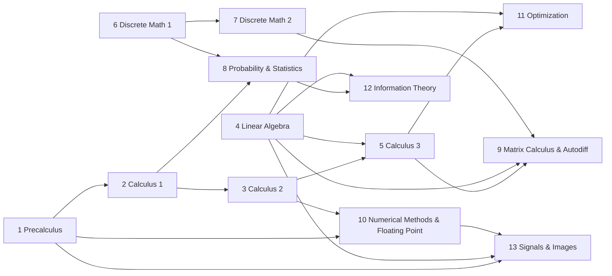

# Mathematics for Computing

This book teaches the mathematics that computer science, machine learning, and software engineering run on, from precalculus through calculus, linear algebra, discrete mathematics, and probability, and on to the mathematics a language-model system is built from: autodiff, floating point, optimization, information theory, and signal processing. Each topic is taught with derivations, worked examples, and proofs, and where it becomes code you also get the reference implementation and why it is written that way. It is for programmers who want the mathematics behind the systems they build, and for students who want a computing-minded companion to a standard mathematics sequence.

## What you will be able to do

- Differentiate, integrate, and approximate functions, and bound the error of a series approximation.
- Solve, factor, and project with matrices, and compute low-rank approximations and least-squares fits.
- Write proofs by induction and contradiction, count carefully, and reason about graphs and modular arithmetic.
- Estimate parameters and test claims about noisy measurements.
- Derive gradients of matrix expressions, implement forward- and reverse-mode autodiff, and bound the floating-point error of the result.

## Ways through this book

Reading every chapter and working its problem sets is roughly two semesters of study at eight to ten hours a week.

- **The whole book, in order** (two semesters): Chapters 1 to 13. You can enter at Chapter 1, 2, 4, or 6; if you study two subjects at once, pair Calculus with Discrete Math, then Linear Algebra with Probability and Statistics.
- **The mathematics of training a model** (about eight weeks): [1.1 Exponents and logs](01-precalculus/01-exponents-logs-and-units-of-information.md), [Chapter 4: Linear Algebra](04-linear-algebra/README.md), [5.1 Gradients and gradcheck](05-calculus-3/01-gradients-and-gradcheck.md) and [5.2 Jacobians](05-calculus-3/02-jacobians-and-the-chain-rule.md), [Chapter 9: Matrix Calculus and Autodiff](09-matrix-calculus-and-autodiff/README.md), [10.2 Stable numerics](10-numerical-methods-and-floating-point/02-stable-numerics.md), [Chapter 11: Optimization](11-optimization/README.md), then [12.1](12-information-theory/01-entropy-cross-entropy-and-kl.md) and [12.2](12-information-theory/02-perplexity-bits-per-byte-nll-accumulator.md) on losses and perplexity.
- **Writing numerical kernels** (about five weeks): [1.4 Horner and stable roots](01-precalculus/04-polynomials-horner-and-stable-roots.md), [2.2 Newton's method](02-calculus-1/02-newtons-method.md), [3.1 Taylor series](03-calculus-2/01-taylor-series.md), then [Chapter 10: Numerical Methods and Floating Point](10-numerical-methods-and-floating-point/README.md) in full.
- **Vision and speech front ends** (about four weeks): [4.1 Vectors, matrices, and matmul](04-linear-algebra/01-vectors-matrices-and-matmul.md), [1.2 Trig and Euler's formula](01-precalculus/02-trig-rotations-and-eulers-formula.md), [10.2 Stable numerics](10-numerical-methods-and-floating-point/02-stable-numerics.md), then [Chapter 13: Signals and Images](13-signals-and-images/README.md).

## Before you start

You should know school algebra and functions; Chapter 1 reviews the trigonometry the calculus chapters use. From Chapter 9 on, the code assumes Python and numpy, which [Python and numpy](../programming-languages/02-language-and-tool-primers/01-python-and-numpy.md) in *Programming Languages* covers. For a gentler start with no programming, read [*Mathematics Foundations*](../mathematics/README.md) first. Most of the code you write here is called by [*Build Your Own LLM System*](../build-an-llm/README.md); [*Machine Learning and AI*](../machine-learning/README.md) uses the probability, linear algebra, and optimization throughout, and [*Technology Foundations*](../computer-science/README.md) pairs them with mathematics labs. New to these books? [How to read these books](../../references/how-to-read.md) explains how sections, review questions, and solutions work.

## How the chapters depend on each other

