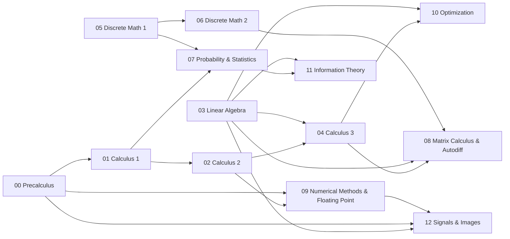

# Mathematics for Computing

This book covers the mathematics that computer science, machine learning, and software engineering run on. It starts at precalculus and single-variable calculus, goes through linear algebra, discrete mathematics, and probability and statistics, and then reaches the mathematics a language-model system is built from: matrix calculus and automatic differentiation, numerical methods and floating point, optimization, information theory, and the signal processing behind vision and speech front ends. Each topic is taught for understanding, with derivations, worked examples, and proofs. Where a topic becomes code, the book also shows the reference implementation and explains why it is written the way it is.

The book is for programmers who want the mathematics behind the systems they build, and for students who want a computing-minded companion to a standard mathematics sequence. If you would like a gentler start with no programming and no university mathematics, read *Mathematics Foundations* first: its [five introductory chapters and a practical project](../mathematics/README.md) lead naturally into this book.

## What you will be able to do

By the end of the book you will be able to:

- Differentiate, integrate, and approximate functions, and bound the error of a series approximation.
- Work with vectors, matrices, and linear maps: solve systems, factor matrices, project, and compute low-rank approximations.
- Write proofs by induction and contradiction, count carefully, and reason about graphs, recurrences, and modular arithmetic.
- Model uncertainty with random variables, estimate parameters, and test claims about noisy measurements.
- Derive gradients of matrix expressions in closed form and implement forward- and reverse-mode autodiff.
- Predict and bound floating-point error, and choose the stable formulation of a computation.
- Explain why the common optimizers and learning-rate schedules work, and measure information in bits and nats.
- Build the numerical front end of vision and speech models: convolution, resampling, the FFT, the STFT, and mel features.

## How the book is organized

The chapters follow a prerequisite graph rather than a single line. Precalculus, Calculus 1, Linear Algebra, and Discrete Math 1 have no college-level prerequisites, so you can enter at any of them.

The first eight chapters are the classical foundations, each built on a free open textbook.

[Precalculus](00-precalculus/README.md) is the toolbox the rest of the book is written in: exponents and logarithms (and the units of information they define), trigonometry, complex numbers and Euler's formula, sequences, and polynomials. Its companion text is OpenStax *Precalculus 2e*.

[Calculus 1](01-calculus-1/README.md) develops limits, derivatives, and integrals and the fundamental theorem that connects them: the mathematics of change and accumulation behind every training step and every averaged metric. It follows OpenStax *Calculus* Volume 1.

[Calculus 2](02-calculus-2/README.md) extends integration and then represents functions as infinite sums, which is how computers approximate $e^x$, $\sin x$, and $\operatorname{erf}$ and how you analyze the long-run behavior of iterative methods. It follows OpenStax *Calculus* Volume 2.

[Linear Algebra](03-linear-algebra/README.md) studies linear maps and the matrices that represent them: elimination and LU, orthogonality and QR, eigenvalues, and the SVD and least squares. Its companion text is Hefferon's *Linear Algebra*.

[Calculus 3](04-calculus-3/README.md) generalizes derivative and integral to several variables: gradients, Jacobians, multiple integrals, and the theorems of Green, Stokes, and Gauss. It follows OpenStax *Calculus* Volume 3.

[Discrete Math 1](05-discrete-math-1/README.md) teaches proof, together with sets, logic, induction, relations, functions, and counting. Its companion text is Hammack's *Book of Proof*.

[Discrete Math 2](06-discrete-math-2/README.md) covers the discrete structures that turn up most directly in algorithms and systems: graphs, number theory, recurrences, and advanced counting. It follows Levin's *Discrete Mathematics*.

[Probability and Statistics](07-probability-statistics/README.md) is the mathematics of reasoning under uncertainty: random variables, sampling, estimation, the central limit theorem, hypothesis tests, and calibration. It draws on Grinstead and Snell and OpenStax *Statistics*.

The last five chapters are the mathematics of a language-model system, and each has code that a system calls.

[Matrix Calculus and Autodiff](08-matrix-calculus-and-autodiff/README.md) treats a gradient as a linear map and a program as a composition of differentiable steps. It builds forward and reverse mode and derives the closed-form vector-Jacobian products of the common primitives, after Parr and Howard and Baydin et al.

[Numerical Methods and Floating Point](09-numerical-methods-and-floating-point/README.md) explains how floating point fails (overflow, underflow, cancellation, accumulated rounding), the algorithmic fix for each, and the error bounds that become test tolerances, from IEEE 754 to FP8 and microscaling formats. It draws on Goldberg and Higham.

[Optimization](10-optimization/README.md) answers the three questions every optimizer answers: which direction to step, how far in each coordinate, and how the step size should change over time. It uses Boyd and Vandenberghe for the convex vocabulary.

[Information Theory](11-information-theory/README.md) measures information with entropy and connects it to losses, perplexity, bits per byte, KL divergence, and mutual information, after *A Student's Guide to Coding and Information Theory* and MacKay.

[Signals and Images](12-signals-and-images/README.md) builds the numerical front end of vision and speech models: convolution as a linear map, image layouts, resampling, the DFT and FFT, the STFT, and the mel scale. It draws on Oppenheim and Schafer and on Smith's free signal-processing books.

Read the first seven chapters in order if you take one subject at a time, respecting the graph. If you have time for two at once, Calculus and Discrete Math pair well, followed by Linear Algebra alongside Probability and Statistics.

## Prerequisites and related books

The book assumes school algebra and functions; the calculus chapters also assume trigonometry, which Precalculus reviews. The later chapters assume Python and numpy, which [Python and numpy](../programming-languages/02-language-and-tool-primers/01-python-and-numpy.md) in *Programming Languages* covers.

Several books build on this one. *Build Your Own LLM System* is where most of the code written here is used: every topic with code has a call site in [that book](../build-an-llm/README.md), so the functions you build here are called by the system you build there. *Machine Learning and AI* ([start here](../machine-learning/README.md)) uses the probability, optimization, and linear algebra throughout. *Technology Foundations* pairs these chapters with [mathematics labs](../computer-science/README.md#mathematics-must-produce-working-artifacts) that ask you to prove a scheduler correct, implement least squares and PCA, check gradients, measure integration error, and simulate statistical inference. After this book, Deisenroth, Faisal, and Ong's [Mathematics for Machine Learning](https://mml-book.github.io/) is a good bridge to numerical optimization and data applications.

## Conventions

Mathematics is set inline as $x$ and in display as
$$\text{out} = \left\lfloor \frac{n + 2p - d(k - 1) - 1}{s} \right\rfloor + 1 .$$
Code listings are Python unless they say otherwise. Listings quote the reference solutions, usually with type hints dropped and routine argument validation elided as `...`; the comments in them are part of the explanation. The full solutions live in the repository under `course/solutions/` (for example [`course/solutions/python/tinyllm/sig/conv.py`](../../../course/solutions/python/tinyllm/sig/conv.py)), and the typed interfaces they implement are under `course/contracts/`.

Each section opens with the problem it solves and a short list of learning objectives, and ends with key terms, a summary, and review questions. Answers to review questions are folded under an **Answer** toggle; try each question before opening it. Warnings about mistakes that produce no error appear as call-outs:

> **Warning:** A call-out like this marks a bug that runs without complaint and quietly gives the wrong answer.

Each chapter closes with one or more problem sets of pen-and-paper problems, each followed by a collapsed worked answer that gives the result, the derivation, and the common wrong answers. Model proofs are also in `course/solutions/solve/`.

The primary texts are free to read online, but access and reuse permissions differ, so consult each source's license. The [source register](../../references/sources.md) lists the checked references.
