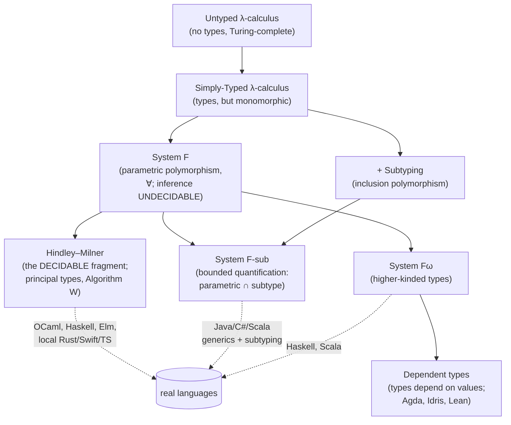

# Soundness and polymorphism

This part of [Type Systems and Polymorphism](README.md) develops the mechanisms below. Work the numerical examples or trace the code before checking the answer.

> **Learning objectives**
> - Relate progress and preservation to kinds of polymorphism.

## What a type system buys, and what it costs

A type system assigns each expression a **type**: a conservative, decidable over-approximation of the values the expression can produce. It then rejects any program whose types do not line up. "Conservative" is the price you pay. A sound type checker will reject *some* programs that would have run fine, and in exchange it *never* accepts one that goes wrong (progress) and the type of an expression *never* changes as it evaluates (preservation). Polymorphism is how a language buys back the expressiveness that conservatism costs, letting one piece of code serve many types without losing the guarantee.

The deepest result in the area, the **Curry–Howard correspondence**, says this is more than a metaphor. Types *are* propositions and well-typed programs *are* their proofs, so a type checker is a proof checker.

The polymorphic type systems you will meet form a lattice that trades power against decidability. The diagram below is the map for the rest of the chapter:

Practical languages live where the dotted lines land. Each picks a point on the lattice that trades theoretical power for an inference algorithm that terminates and error messages a human can read.

## Judgments, soundness, and Curry–Howard

The rest of the chapter stands on a small piece of notation. A type system is defined by a **typing judgment** $\Gamma \vdash e : \tau$, read "in context $\Gamma$ (a map from variables to types), expression $e$ has type $\tau$," together with a set of **inference rules** that derive judgments from other judgments. Type *checking* is the search for a derivation; type *inference* is the search for both the derivation *and* the $\tau$.

Inference rules read bottom-up: to establish the judgment below the line, establish the ones above it. The rule worth memorizing is application. If $\Gamma \vdash f : \sigma \to \tau$ and $\Gamma \vdash x : \sigma$, then $\Gamma \vdash f\ x : \tau$:

$$\frac{\Gamma \vdash f : \sigma \to \tau \qquad \Gamma \vdash x : \sigma}{\Gamma \vdash f\ x : \tau}$$

Notice that the two $\sigma$s must meet. Making them meet when neither is known yet is the job of unification, which you will see shortly.

Soundness, in the "syntactic approach" of Wright and Felleisen, is two lemmas. **Progress** says a well-typed term is either a value or can take a step; it is never *stuck*. **Preservation** (also called subject reduction) says that if $e : \tau$ and $e \to e'$, then $e' : \tau$; evaluation does not change the type. Together they give "well-typed programs don't go wrong." This is the theorem a language designer must prove, and a *soundness bug* (Java's array covariance, TypeScript's `any`) is a place where the proof has a hole.

Decidability is not free. Type checking System F is decidable, but inference is *not* (Wells, 1994). Every real ML-family language either restricts itself to a fragment (Hindley–Milner) or asks for annotations precisely to dodge that undecidability.

Curry–Howard makes the logic explicit: types correspond to propositions, programs to proofs, and evaluation to proof simplification. $A \to B$ is implication, a pair type is conjunction, a sum type is disjunction, and the uninhabited type (`never`, `Void`) is falsehood. This is why dependently typed languages such as Agda and Lean double as proof assistants, and why `\x.x : a -> a` is also a proof that $A \Rightarrow A$.

## The polymorphism taxonomy

With the notion of a type in hand, the next question is how one piece of code can have many of them. Christopher Strachey drew the first line in 1967, and Cardelli and Wegner completed the picture in 1985. Getting the vocabulary right is most of the battle, because the same word covers four quite different mechanisms.

**Parametric polymorphism** is *one* implementation that works uniformly for every type, precisely because it cannot inspect the type: `identity<T>(x: T): T`, `List<T>`, `map`. Reynolds' **parametricity**, popularized by Wadler as "theorems for free," says the type alone constrains the behavior. Anything of type $\forall a.\ a \to a$ *must* be the identity. This is the polymorphism of generics, of System F, and of Hindley–Milner.

**Ad-hoc polymorphism** is a *different* implementation per type, selected by the types involved. It comes in two flavors: **overloading** (`+` on integers versus strings) and **typeclasses, traits, and interfaces** (Haskell `Show`, Rust `Display`, Go method sets). What differs between languages is how the right implementation is dispatched, a question this chapter returns to below.

**Subtype (inclusion) polymorphism** lets code written for a type $T$ also accept any subtype $S <: T$, the Liskov substitution principle. It is the polymorphism of object-oriented programming and of Rust's `dyn Trait` and `Box<dyn ...>`.

**Coercion polymorphism** is implicit conversion, such as `int` to `float`. It is the weakest form and is often treated as a footnote.

Finally, **bounded quantification** is the intersection of parametric and subtype polymorphism: "for all $T$ *such that* $T <: \text{Bound}$." You write it as `<T extends Comparable>` in Java, `T: Ord` in Rust, a constraint interface in Go, and `Shape a =>` in Haskell. It is the workhorse of real generic code and the subject of **System F-sub**.

You can see all of these side by side in [`code/polymorphism.ts`](code/polymorphism.ts), which labels them 1 through 5; the same mechanisms reappear in every other code file.

## Summary

Relate progress and preservation to kinds of polymorphism. State the assumptions before applying the result to a different workload.

## Review questions

1. Does soundness imply a program terminates or meets its business requirement?

   

Answer

   No. It establishes the language-specific safety theorem, not total correctness.

   

[Chapter contents](README.md) · [Next: System F and type inference](02-system-f-and-type-inference.md)
