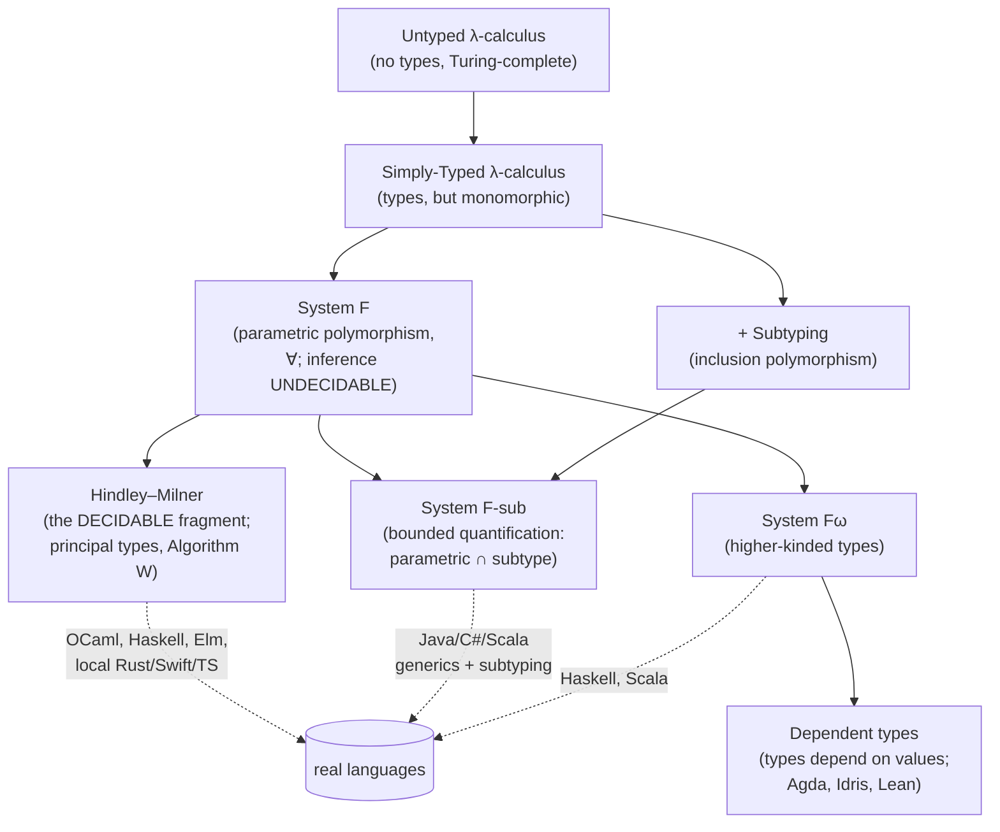

# Type Systems and Polymorphism

Every working programmer has fought a type checker, and most have wondered whether the fight was worth it. This chapter answers that question by treating a type system for what it is: a lightweight formal method, a decidable and purely syntactic proof system that rejects a whole class of programs *before they run*. Its correctness guarantee has a precise name, **soundness**, and a precise statement: soundness is **progress plus preservation**, or in the slogan, "well-typed programs don't get stuck." Nearly everything else in the area, from generics to variance annotations, is engineering built around that one theorem.

The second thread of the chapter is polymorphism, the machinery that buys back expressiveness without giving up the guarantee. "Polymorphism" turns out to be one word for four different mechanisms, and much of the confusion in "generics versus interfaces" arguments dissolves once you can name which one you mean. You will follow the classic lambda-calculus ladder from the simply typed calculus to System F, then see why full polymorphic inference is undecidable and how Hindley–Milner carves out the decidable slice that OCaml, Haskell, Elm, and the local inference in Rust, Swift, and TypeScript all descend from. From there the chapter turns practical: how ad-hoc polymorphism dispatches in Haskell, Rust, and Go; why `List<Dog>` is not automatically a `List<Animal>`; and why the same generic function has three different runtime stories depending on how a language compiles it.

The chapter is anchored by runnable code. [`code/hindley_milner.py`](code/hindley_milner.py) is the whole of Algorithm W in about 250 lines, and five companion programs in OCaml, TypeScript, Go, Rust, and Haskell walk the same running example (a `Shape` with `area`, a generic `Stack<T>`, and a `largest`/`Max` over ordered things) through type systems that make different choices. Running them side by side is the clearest way to see that the *concept* stays fixed while the *mechanism* changes.

> **Learning objectives**
> - Read typing judgments and inference rules, and state soundness as progress plus preservation.
> - Classify a piece of polymorphic code as parametric, ad-hoc, subtype, coercion, or bounded, and say which mechanism a given language feature uses.
> - Explain how Hindley–Milner inference works (unification, the occurs check, instantiation, and `let`-generalization) and trace it on small terms.
> - Derive the variance of a type constructor, including the contravariant rule for function arguments, and explain the soundness holes that real languages accept.
> - Predict the runtime cost of generics in a language from whether it monomorphizes, erases, or passes dictionaries.

## Before you begin

The chapter assumes the proof techniques from [Discrete Math 1](../../mathematics-for-computing/05-discrete-math-1/) in *Mathematics for Computing*: proofs, induction, and relations (the subtype relation `<:` is a partial order). Comfort reading inference rules helps, but the notation is taught here. You will get the most out of the code if you have already written some Python, C, Rust, and Go, so the five-language comparison lands on familiar ground.

## In this chapter

This chapter is a single extended opening rather than a set of separate sections. Its companion code lives in [`code/`](code/), and each listing is referenced at the point in the text where it matters:

- [`code/hindley_milner.py`](code/hindley_milner.py): Algorithm W end to end. It infers principal types for `\x.x`, `\f.\g.\x. f (g x)`, and `let id = \x.x in id id` with no annotations, then shows the occurs check rejecting `\x. x x`.
- [`code/inference.ml`](code/inference.ml): OCaml inferring the exact same principal types from the user's side.
- [`code/polymorphism.ts`](code/polymorphism.ts): structural, gradual typing with type-level computation (`DeepReadonly`) and explicit variance.
- [`code/generics.go`](code/generics.go): Go's type-set constraint model and GC-shape stenciling.
- [`code/traits.rs`](code/traits.rs): nominal traits and the split between static (`<T: Trait>`, monomorphized) and dynamic (`dyn Trait`, vtable) dispatch.
- [`code/typeclasses.hs`](code/typeclasses.hs): typeclasses as dictionary passing, plus the higher-kinded `Functor`.

A good way to work is to run the keystone first: read `unify`, `instantiate`, and `generalize` in [`hindley_milner.py`](code/hindley_milner.py), because that triple *is* ML type inference, and then open [`inference.ml`](code/inference.ml) to watch a production compiler reach the same answers. After that, run the four language files side by side. All of them print the same shape of output (`area`s, a `Stack`, a `largest`).

## What a type system buys, and what it costs

A type system assigns each expression a **type**: a conservative, decidable over-approximation of the values the expression can produce. It then rejects any program whose types do not line up. "Conservative" is the price you pay. A sound type checker will reject *some* programs that would have run fine, and in exchange it *never* accepts one that goes wrong (progress) and the type of an expression *never* changes as it evaluates (preservation). Polymorphism is how a language buys back the expressiveness that conservatism costs, letting one piece of code serve many types without losing the guarantee.

The deepest result in the area, the **Curry–Howard correspondence**, says this is more than a metaphor. Types *are* propositions and well-typed programs *are* their proofs, so a type checker is a proof checker.

The polymorphic type systems you will meet form a lattice that trades power against decidability. The diagram below is the map for the rest of the chapter:

Practical languages live where the dotted lines land. Each picks a point on the lattice that trades theoretical power for an inference algorithm that terminates and error messages a human can read.

## Judgments, soundness, and Curry–Howard

The rest of the chapter stands on a small piece of notation. A type system is defined by a **typing judgment** $\Gamma \vdash e : \tau$, read "in context $\Gamma$ (a map from variables to types), expression $e$ has type $\tau$," together with a set of **inference rules** that derive judgments from other judgments. Type *checking* is the search for a derivation; type *inference* is the search for both the derivation *and* the $\tau$.

Inference rules read bottom-up: to establish the judgment below the line, establish the ones above it. The rule worth memorizing is application. If $\Gamma \vdash f : \sigma \to \tau$ and $\Gamma \vdash x : \sigma$, then $\Gamma \vdash f\ x : \tau$:

$$\frac{\Gamma \vdash f : \sigma \to \tau \qquad \Gamma \vdash x : \sigma}{\Gamma \vdash f\ x : \tau}$$

Notice that the two $\sigma$s must meet. Making them meet when neither is known yet is the job of unification, which you will see shortly.

Soundness, in the "syntactic approach" of Wright and Felleisen, is two lemmas. **Progress** says a well-typed term is either a value or can take a step; it is never *stuck*. **Preservation** (also called subject reduction) says that if $e : \tau$ and $e \to e'$, then $e' : \tau$; evaluation does not change the type. Together they give "well-typed programs don't go wrong." This is the theorem a language designer must prove, and a *soundness bug* (Java's array covariance, TypeScript's `any`) is a place where the proof has a hole.

Decidability is not free. Type checking System F is decidable, but inference is *not* (Wells, 1994). Every real ML-family language either restricts itself to a fragment (Hindley–Milner) or asks for annotations precisely to dodge that undecidability.

Curry–Howard makes the logic explicit: types correspond to propositions, programs to proofs, and evaluation to proof simplification. $A \to B$ is implication, a pair type is conjunction, a sum type is disjunction, and the uninhabited type (`never`, `Void`) is falsehood. This is why dependently typed languages such as Agda and Lean double as proof assistants, and why `\x.x : a -> a` is also a proof that $A \Rightarrow A$.

## The polymorphism taxonomy

With the notion of a type in hand, the next question is how one piece of code can have many of them. Christopher Strachey drew the first line in 1967, and Cardelli and Wegner completed the picture in 1985. Getting the vocabulary right is most of the battle, because the same word covers four quite different mechanisms.

**Parametric polymorphism** is *one* implementation that works uniformly for every type, precisely because it cannot inspect the type: `identity<T>(x: T): T`, `List<T>`, `map`. Reynolds' **parametricity**, popularized by Wadler as "theorems for free," says the type alone constrains the behavior. Anything of type $\forall a.\ a \to a$ *must* be the identity. This is the polymorphism of generics, of System F, and of Hindley–Milner.

**Ad-hoc polymorphism** is a *different* implementation per type, selected by the types involved. It comes in two flavors: **overloading** (`+` on integers versus strings) and **typeclasses, traits, and interfaces** (Haskell `Show`, Rust `Display`, Go method sets). What differs between languages is how the right implementation is dispatched, a question this chapter returns to below.

**Subtype (inclusion) polymorphism** lets code written for a type $T$ also accept any subtype $S <: T$, the Liskov substitution principle. It is the polymorphism of object-oriented programming and of Rust's `dyn Trait` and `Box<dyn ...>`.

**Coercion polymorphism** is implicit conversion, such as `int` to `float`. It is the weakest form and is often treated as a footnote.

Finally, **bounded quantification** is the intersection of parametric and subtype polymorphism: "for all $T$ *such that* $T <: \text{Bound}$." You write it as `<T extends Comparable>` in Java, `T: Ord` in Rust, a constraint interface in Go, and `Shape a =>` in Haskell. It is the workhorse of real generic code and the subject of **System F-sub**.

You can see all of these side by side in [`code/polymorphism.ts`](code/polymorphism.ts), which labels them 1 through 5; the same mechanisms reappear in every other code file.

## From the simply typed lambda calculus to System F

Parametric polymorphism has a precise origin, and tracing it explains why inference is hard.

The **simply typed lambda calculus (STLC)** adds types to the lambda calculus and immediately loses Turing-completeness: every well-typed term halts, a property called *strong normalization*. STLC is also **monomorphic**. An identity function must be written separately at each type, and that limitation is the entire motivation for what follows.

**System F**, the polymorphic or second-order lambda calculus discovered independently by Girard (1972) and Reynolds (1974), adds **type abstraction** $\Lambda\alpha.\ e$ and **type application** $e\ [\tau]$. Now $\mathit{id} = \Lambda\alpha.\ \lambda(x{:}\alpha).\ x : \forall\alpha.\ \alpha \to \alpha$ is a *single* term usable at every type. This is exactly parametric polymorphism, and `Stack<T>` is its data-type form.

The catch is that System F type *inference* is undecidable. You can *check* an annotated System F program, but you cannot in general *recover* the $\Lambda$s and $[\tau]$s from unannotated code. Languages that expose full System F, such as Haskell with `RankNTypes` and Scala, require annotations at the hard spots.

**System Fω** goes one step further and adds **type-level functions**, operators that take types to types. That gives **higher-kinded types**: abstraction over type *constructors*, as in `Functor f`, which the frontier section returns to.

## Hindley–Milner: the decidable sweet spot

If full System F inference is undecidable, how do OCaml and Haskell infer types with no annotations at all? The answer is Hindley–Milner (Hindley 1969, Milner 1978, Damas and Milner 1982), and it is the keystone of this chapter.

HM is the restriction of System F in which polymorphism is introduced *only* at `let`, and quantifiers stay on the outside of a type (**prenex**, or rank-1, form). That restriction is exactly enough to make inference decidable *and* to give every term a unique best type.

That best type is the **principal type**: every typeable HM term has a single most-general type of which all its other types are instances. For example, `\f.\g.\x. f (g x)` has principal type `(a → b) → (c → a) → c → b`, and every other type you could give it is a specialization.

**Algorithm W** computes principal types with a recursive walk over the term that threads a **substitution** through, generating fresh type variables at each node and **unifying** them as constraints appear. It has four pieces: `unify` solves an equation $\tau_1 = \tau_2$; `instantiate` gives each *use* of a type scheme fresh variables; `generalize` closes a monotype into a $\forall$-scheme at a `let`; and the inference walk ties them together.

`let`-generalization is the whole trick. A lambda parameter stays monomorphic, because inside the body you do not yet know how it will be used, but a `let`-bound value is **generalized** so it can be reused at many types. That is why `let id = \x.x in (id 1, id "a")` typechecks while `(\id. (id 1, id "a")) (\x.x)` does not.

> **Warning:** Generalization interacts badly with mutation. With mutable references, naive generalization is *unsound*: you could store an `int` in a polymorphic reference and read it back as a `string`. ML's fix is the **value restriction**, which generalizes only syntactic values. It is a small, famous patch that keeps HM plus mutation sound.

[`code/hindley_milner.py`](code/hindley_milner.py) is Algorithm W end to end, and [`code/inference.ml`](code/inference.ml) shows OCaml inferring the same principal types in real code. Read them together: one *is* the inference engine, the other *uses* it.

## Unification and the occurs check

Inference reduces to solving equations between types, so the engine inside every ML-family compiler is a solver for those equations. **Unification** (Robinson, 1965) finds the **most general unifier**, the least-committal substitution that makes two types equal.

The algorithm is short. To unify $\tau_1$ and $\tau_2$: if either is a type variable $\alpha$, bind $\alpha$ to the other; if both are arrows, unify the arguments and then, under that substitution, the results; if both are the same constructor, succeed; otherwise fail with a type error.

There is one guard that matters. Before binding $\alpha := \tau$, the **occurs check** verifies that $\alpha$ does not occur *inside* $\tau$. Without it, `\x. x x` would unify $\alpha = \alpha \to \beta$ and build the **infinite type** $\alpha = \alpha \to \alpha \to \cdots$. The check is what keeps types finite, and it is the source of the classic error "occurs check: cannot construct the infinite type." [`code/hindley_milner.py`](code/hindley_milner.py) triggers it on `\x. x x`.

This view also explains what a type error *is*: a unification failure. ML messages say "expected `int`, got `string`" because they are reporting the two ends of a constraint that could not be made equal. The *location* blamed, however, is an artifact of traversal order, which is why HM error messages are famously sometimes misleading.

## Ad-hoc polymorphism: typeclasses, traits, and interfaces

Parametric code never needs to know which type it is running on. Ad-hoc code does: when you call `area(shape)`, something has to find the *right* body for that shape's type. Languages answer this dispatch problem in different ways, and the answer defines much of a language's flavor.

**Typeclasses** in Haskell use Wadler and Blott's *dictionary passing*. A declaration `class Shape a where area :: a -> Double` desugars into an extra hidden argument: a record of method implementations, the *dictionary*, which the compiler infers and threads through. A constraint `Shape a => ...` says "I need this dictionary." Resolution happens entirely at compile time, by type.

**Traits** in Rust are typeclasses with a performance contract. `impl Shape for Circle` is nominal and explicit. A bound `<T: Shape>` is monomorphized, so there is static dispatch and no dictionary at runtime, while `dyn Shape` uses a vtable for dynamic dispatch. [`code/traits.rs`](code/traits.rs) shows both: compare `total_area<T: Shape>` (one copy per type) with `describe_all(&[Box<dyn Shape>])` (one copy, vtable dispatch). It is the same trait with two runtime models.

**Interfaces** in Go are *structural*: a type satisfies `Shape` simply by having an `Area() float64` method, with no declaration. Go generics add **type sets**, where a constraint interface can enumerate a *union of concrete types* (`~int | ~float64`), so `Sum[T Numeric]` can use `+` without method dispatch at all. That type-set design is unique to Go; see [`code/generics.go`](code/generics.go).

Behind all of these sits the question of **coherence**. Typeclasses enforce *one* instance per (class, type) pair globally, so `Set`-like code can never see two different `Ord` instances for the same type; Rust's orphan rule addresses the same concern. Go and Java interfaces make no such guarantee, which is more flexible and less safe.

## Subtyping, variance, and structural versus nominal typing

Subtyping raises a question that parametric polymorphism alone never does: when does `Container` fit where a `Container<Super>` is expected? The rules that decide it are the ones programmers most often get wrong.

**Subtyping** $S <: T$ means "an $S$ is usable wherever a $T$ is expected." Records and objects subtype by **width** (having more fields makes a subtype) and by **depth** (fields subtype pointwise). Function types have their own rule, and it is the famous one.

**Variance** answers this: given `Dog <: Animal`, how are `F<Dog>` and `F<Animal>` related? There are three possibilities. A **covariant** constructor preserves the direction: a `Producer<Dog>` *is* a `Producer<Animal>`, because it only outputs values. Immutable containers and return types are covariant. A **contravariant** constructor reverses the direction: a `Consumer<Animal>` *is* a `Consumer<Dog>`, because it only takes inputs, and anything that can handle any animal can handle a dog. Function parameters are contravariant. An **invariant** constructor relates in neither direction: a mutable `Array<Dog>` is *not* an `Array<Animal>`, because through the `Animal` view you could store a `Cat`. Mutability forces invariance.

Putting the pieces together gives the function rule:

$$(A \to B) <: (A' \to B') \iff A' <: A \ \text{and}\ B <: B'$$

The argument is contravariant and the result is covariant. This one counterintuitive law explains Java's broken array covariance, C#'s `in`/`out` annotations, and TypeScript's `strictFunctionTypes`. [`code/polymorphism.ts`](code/polymorphism.ts) demonstrates and defends it. To feel the rule, uncomment the `const bad:` line in that file and watch the compiler reject assigning a `Consumer<Dog>` where a `Consumer<Animal>` is wanted. That single error is the contravariance rule defending you.

Languages also differ in *where* you state variance. **Declaration-site** variance (C# `in`/`out`, Scala `+T`/`-T`, Kotlin) annotates the type definition once. **Use-site** variance (Java's `? extends` and `? super`) annotates each use.

> **Warning:** Some languages deliberately accept soundness holes here. Java and C# **arrays are covariant but mutable**, so `Object[] a = new String[1]; a[0] = 1;` compiles and then throws `ArrayStoreException` *at runtime*. TypeScript's `any` and its bivariant method parameters are similar pragmatic compromises.

The last axis is how types are matched at all. **Structural** systems (TypeScript, Go) match types by **shape**; **nominal** systems (Rust, Haskell, Java, Scala) match by **declared name**. This is a design axis, not a quality axis. Structural typing enables gradual adoption and "just have the right fields." Nominal typing makes intent explicit and prevents *accidental* compatibility: two unrelated types `Meters` and `Feet` with the same shape stay distinct.

## The frontier: higher-kinded, associated, and dependent types

Type systems keep climbing past what most mainstream languages offer, and each rung buys more expressiveness at some cost to inference.

**Higher-kinded types (HKTs)** abstract over type *constructors*, not just types. `Functor f` works for `f = Maybe`, `f = []`, or `f = Tree`: anything of kind `* → *`. Haskell and Scala have them natively ([`code/typeclasses.hs`](code/typeclasses.hs) defines `Functor Tree`), Rust approximates them with generic associated types (GATs), and Go and Java cannot express them.

**Associated types** (Rust's `type Item;`, Haskell's type families) let a trait fix *one* related type per implementation, instead of letting the caller choose a parameter. `Iterator::Item` is the canonical example; see [`code/traits.rs`](code/traits.rs).

**GADTs** (generalized algebraic data types) let each constructor refine the result type. That lets you encode invariants such as a *well-typed* AST that cannot even represent `if 3 then …`.

**Dependent types** (Agda, Idris, Lean) let types mention *values*, as in `Vec n a`, a list whose length is part of its type. They collapse the Curry–Howard correspondence into a single language in which you write programs and prove theorems with the same syntax. This is the top of the ladder, and the price is that inference needs help and type checking can require proof search.

## How generics compile

Everything so far has been about what a type system accepts. The final question is what a generic function costs at runtime, and the answer depends on *how* the language compiles it. The same feature has three different runtime stories.

**Monomorphization** (Rust, C++ templates, and Go for non-pointer types) emits a specialized copy of the function for each concrete type. It is *fast*: calls are direct, inlinable, and unboxed. The cost is *code bloat* and slower compiles. C++ templates are monomorphization with duck typing, which is also why their error messages are notoriously long.

**Type erasure** (Java, and Scala on the JVM) keeps one copy. Type parameters vanish at runtime, so `List<String>` and `List<Integer>` are the same class, and values are **boxed**. The result is *small* and binary-compatible, but you lose types at runtime (`new T[]` is illegal and reflection cannot see type arguments) and you pay for boxing.

**Dictionary passing and GC-shape stenciling** (Haskell, and Go for pointer-shaped types) keep one copy parameterized by a runtime record of operations, the dictionary, or share one copy across all types with the same memory layout. This is the middle path: modest code size with some indirection.

The lesson for engineers is that "does this language have generics?" is the wrong question. "*How* are they implemented?" predicts your binary size, startup time, inlining behavior, and whether you can introspect types at runtime. [`code/generics.go`](code/generics.go) and [`code/traits.rs`](code/traits.rs) make the static-versus-dynamic choice explicit.

## Comparing mechanisms and languages

Two tables pull the chapter together. The first lines up each polymorphism mechanism against its theory and its spelling in four languages:

| Mechanism | One body or many? | Dispatch | Theory | TS | Go | Rust | Haskell/OCaml |
|-----------|-------------------|----------|--------|----|----|------|---------------|
| **Parametric** | one | none (uniform) | System F / HM | `<T>` generics | `[T any]` | `<T>` | `'a` / type vars |
| **Ad-hoc (overload)** | many | by static type | — | overloads | — (no overloading) | — | class methods |
| **Ad-hoc (class/trait)** | many | compile-time, by type | qualified types | structural iface | method-set iface + type sets | `trait` (static) | typeclass (dict) |
| **Subtype** | one (+ overrides) | runtime (vtable) | F-sub / `S<:T` | structural `<:` | `interface` value | `dyn Trait` | subtyping (limited) / variants |
| **Bounded** | one | compile-time | System F-sub | `<T extends C>` | `[T Constraint]` | `<T: Trait>` | `(C a) =>` / module sig |
| **Coercion** | n/a | implicit | — | limited | explicit only | explicit (`as`/`From`) | explicit |

The second summarizes the design choices each major language makes along the axes this chapter has covered:

| Language | Nominal / Structural | Inference | Generics compile to | Variance | Notable |
|----------|----------------------|-----------|---------------------|----------|---------|
| **TypeScript** | structural | local + `infer` (HM-ish) | erased to JS (none at runtime) | covariant by default, `strictFunctionTypes` for params | type-level computation, `any` escape hatch (unsound) |
| **Go** | structural interfaces | local only | GC-shape stenciling + dictionaries | invariant | type sets / unions, no HKT, no overloading |
| **Rust** | nominal traits | local (HM-style) | monomorphization (+ `dyn` vtables) | declared via lifetimes/variance | ownership in the types, associated types, GATs |
| **Haskell** | nominal | full HM + extensions | dictionary passing | role-based | typeclasses, HKT, GADTs, laziness |
| **OCaml** | nominal + structural objects | full HM | mostly uniform (boxed) + flambda | declared (`+`/`-`) | modules & functors, polymorphic variants |
| **Java/C#** | nominal | local (`var`/`<>`) | erasure (Java) / reified (C#) | use-site (Java) / declaration-site (C#) | array covariance hole, bounded wildcards |
| **Scala** | nominal | local + implicits | erasure (JVM) | declaration-site `+T`/`-T` | HKT, implicits/givens, path-dependent types |

## Where this leads

Type-system thinking reaches well beyond this chapter. The proof machinery that soundness is stated in (inference rules, derivations, induction, and relations such as the partial order `<:`) comes from [Discrete Math 1](../../mathematics-for-computing/05-discrete-math-1/) in *Mathematics for Computing*. In [*Software Craftsmanship*](../../software-craftsmanship/), "make illegal states unrepresentable," design by contract, and orthogonality are type-system ideas applied to everyday code. [Information Theory](../../mathematics-for-computing/11-information-theory/), also in *Mathematics for Computing*, offers a looser connection: the Curry–Howard–Lambek correspondence ties types to category theory, and a type can be read as a *compression* of a program's possible behaviors. In [LLM Systems & Inference](../../machine-learning/04-llm-systems/) in *Machine Learning and AI*, and throughout [*AI Platform Engineering*](../../ai-platform-engineering/), typed schemas (protobuf, Pydantic, TypeScript) are the contracts at every RPC and tool boundary, and structured-output decoding amounts to "make the model emit a well-typed value." A future chapter on compilers and parsing in this book will pick up where type checking begins: it is the phase after parsing, and GADTs can type the very ASTs a parser produces.

The ideas also show up directly in industry work. At OCaml and Haskell shops such as Jane Street and Citadel, "make illegal states unrepresentable" through variants and modules is a core interview theme, and HM inference, functors, and the value restriction are fair game. In Rust-heavy infrastructure (AWS, Cloudflare, Discord, Meta), trait bounds, `dyn` versus generics, variance, and the `Send`/`Sync` marker traits are daily design decisions. In large frontend and full-stack codebases (Stripe, Airbnb, Vercel), advanced TypeScript (conditional and mapped types, variance, the soundness gaps in `strict` mode) is how teams type an API so misuse will not compile. On compiler, language, and developer-tools teams, implementing inference, designing generics, and reasoning about soundness are the literal job. And in any large polyglot codebase, knowing *why* Go has no HKTs, *why* Java generics erase, and *why* `List<Dog>` is not a `List<Animal>` prevents whole categories of design mistakes and "fighting the type checker" churn.

### Further reading

- [*Types and Programming Languages*](https://www.cis.upenn.edu/~bcpierce/tapl/) by Benjamin Pierce: the definitive textbook, following the lambda calculus to STLC to System F to subtyping progression this chapter uses. The book is paid; Pierce's course slides and the companion *Software Foundations* are free.
- [*Programming Language Foundations in Agda*](https://plfa.github.io/) by Wadler, Kokke, and Siek (free, full text): STLC, type soundness, and inference, mechanized so the proofs run.
- [*Software Foundations* Vol. 2: *Programming Language Foundations*](https://softwarefoundations.cis.upenn.edu/plf-current/) (free): progress, preservation, and subtyping in Coq.
- Cardelli and Wegner, [*On Understanding Types, Data Abstraction, and Polymorphism*](https://dl.acm.org/doi/10.1145/6041.6042) (free PDF widely mirrored): the paper that names the polymorphism taxonomy.
- Damas and Milner, [*Principal type-schemes for functional programs*](https://dl.acm.org/doi/10.1145/582153.582176) (free): Algorithm W.
- Wadler, [*Theorems for Free!*](https://homepages.inf.ed.ac.uk/wadler/papers/free/free.pdf) (free): parametricity.
- Wadler and Blott, [*How to make ad-hoc polymorphism less ad hoc*](https://people.csail.mit.edu/dnj/teaching/6898/papers/wadler88.pdf) (free): typeclasses.
- The [TypeScript Handbook](https://www.typescriptlang.org/docs/handbook/intro.html), the [Go generics tutorial](https://go.dev/doc/tutorial/generics), and [Chapter 10 of the Rust Book](https://doc.rust-lang.org/book/ch10-00-generics.html) (all free).

## Key terms

- **Typing judgment**: the statement $\Gamma \vdash e : \tau$, that expression $e$ has type $\tau$ in context $\Gamma$.
- **Soundness**: the guarantee that well-typed programs do not get stuck, proved as progress plus preservation.
- **Parametric polymorphism**: one implementation that works uniformly at every type because it cannot inspect the type.
- **Ad-hoc polymorphism**: a different implementation per type, chosen by the types involved (overloading, typeclasses, traits, interfaces).
- **Bounded quantification**: parametric polymorphism restricted to types below a bound, as in `T: Ord`.
- **Principal type**: the most general type of a term, of which all its other types are instances.
- **Unification**: solving equations between types by finding the most general unifier.
- **Occurs check**: the test that a type variable does not appear inside the type it is being bound to, which keeps types finite.
- **Value restriction**: ML's rule that only syntactic values are generalized, keeping inference sound with mutable references.
- **Variance**: how subtyping on a type argument lifts to the constructed type: covariant, contravariant, or invariant.
- **Monomorphization**: compiling generics by emitting a specialized copy per concrete type.
- **Type erasure**: compiling generics to one copy whose type parameters vanish at runtime.

## Summary

- A type system is a decidable, conservative proof system; its central theorem is soundness, stated as progress plus preservation, and Curry–Howard identifies its types with propositions.
- "Polymorphism" names parametric, ad-hoc, subtype, and coercion mechanisms, with bounded quantification combining parametric and subtype polymorphism.
- System F gives full parametric polymorphism but undecidable inference; Hindley–Milner restricts polymorphism to `let` and rank-1 types so Algorithm W can infer principal types with no annotations.
- Unification with the occurs check is the engine of inference, and type errors are unification failures.
- Functions are contravariant in arguments and covariant in results; mutability forces invariance, and covariant mutable arrays are a deliberate soundness hole.
- How generics compile (monomorphization, erasure, or dictionaries and stenciling) determines their runtime cost more than whether a language "has generics."

## Review questions

1. What do progress and preservation each guarantee, and why do you need both for soundness?
   

Answer
Progress guarantees that a well-typed term is either a value or can take a step, so it is never stuck. Preservation guarantees that taking a step does not change the term's type. Progress alone says the current term is not stuck; preservation ensures the next term is still well typed, so progress applies again at every step. Together they give "well-typed programs don't go wrong."

2. Why does `let id = \x.x in (id 1, id "a")` typecheck under Hindley–Milner while `(\id. (id 1, id "a")) (\x.x)` does not?
   

Answer
A `let`-bound value is generalized into a scheme $\forall a.\ a \to a$, and each use is instantiated with fresh variables, so `id` can be used at `int` and at `string`. A lambda parameter stays monomorphic: `id` gets a single type variable, and unifying it with both `int → ...` and `string → ...` fails.

3. What does the occurs check prevent, and which term in the companion code triggers it?
   

Answer
It prevents binding a type variable to a type that contains it, which would build an infinite type. In `\x. x x`, inference must unify $\alpha = \alpha \to \beta$; the occurs check rejects this. `code/hindley_milner.py` demonstrates it on exactly that term.

4. Given `Dog <: Animal`, is `(Animal → Dog) <: (Dog → Animal)`? Explain using the function rule.
   

Answer
Yes. The rule requires the target's argument to be a subtype of the source's argument (`Dog <: Animal`, contravariance) and the source's result to be a subtype of the target's result (`Dog <: Animal`, covariance). Both hold, so a function that accepts any animal and returns a dog can be used wherever a function from dogs to animals is expected.

5. Why must a mutable `Array<Dog>` be invariant, and how does Java's array design violate this?
   

Answer
If `Array<Dog>` were a subtype of `Array<Animal>`, you could write a `Cat` through the `Animal` view and later read it as a `Dog`. Java makes arrays covariant anyway, so `Object[] a = new String[1]; a[0] = 1;` compiles, and the error is caught only at runtime with an `ArrayStoreException`.

6. Compare the runtime cost of a Rust `<T: Shape>` function, a Java generic method, and a Haskell `Shape a =>` function.
   

Answer
Rust monomorphizes: one specialized copy per type, with direct, inlinable calls but larger binaries and slower compiles. Java erases: one copy with boxed values and no type arguments at runtime, so it is small but pays for boxing and loses runtime type information. Haskell passes a dictionary: one copy that receives a record of method implementations, a middle path with modest code size and some indirection.

7. What is the difference between structural and nominal typing, and what does each protect against or enable?
   

Answer
Structural typing (TypeScript, Go interfaces) matches types by shape, which enables gradual adoption and lets any value with the right fields or methods fit. Nominal typing (Rust, Haskell, Java, Scala) matches by declared name, which makes intent explicit and prevents accidental compatibility, such as unrelated `Meters` and `Feet` types with the same shape being interchangeable.

