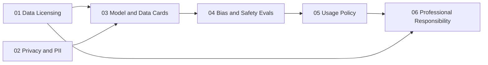

# Responsible AI

Training and serving a model comes with obligations: knowing where the data came from and whether you may use it, what personal data it holds, what the model can and cannot do, how it fails different groups, what you let people use it for, and what you owe when something goes wrong. This book treats each of those obligations as an engineering problem with an artifact at the end of it. Every topic is applied to the LLM system built in [*Build Your Own LLM System*](../build-an-llm/README.md), so the artifacts are real: a licensing ledger, a PII policy, a model card, safety evals, a usage policy enforced at your gateway, and a disclosure you write.

The book is for engineers who build or ship models and want their responsibility work to be as checkable as their code. It is not legal advice and it is not a survey of AI ethics. It shows how to make provenance auditable, how to measure bias and safety with honest intervals, and how to turn a policy into rules a gateway enforces, while being plain about what each check cannot tell you. A lawyer still decides what a license permits; a check can tell that a model card is complete and consistent, but not that it is true.

## What you will be able to do

By the end of the book you will be able to:

- Record the license of every training source at fetch time, decide each license per use in a machine-readable allowlist, and fail a build on anything unknown.
- Write a privacy policy that names every data flow, scrub personal data with typed placeholders, and measure your detector's precision and recall.
- Keep consent separate from licensing for voice and image data, and bind a model card's numbers to the evidence that produced them.
- Write a model card and a datasheet with intervals on every number and limitations grounded in measurements.
- Build bias and safety evals with Wilson and bootstrap intervals, and gate a release on interval bounds.
- Enforce a usage policy at the gateway that fails closed and keeps prompts out of its audit log.
- Review a published claim by the conclusion its readers will draw, and close every open point with an owner.

## How this book is organized

The six chapters follow the life of a model, from the data it learns from to what you owe after it ships. Each builds on the ones before it, as the dependency graph shows:

[Data Licensing](01-data-licensing/README.md) treats licensing as a provenance problem. You cannot honor terms you did not record, so the chapter builds a ledger row per source and an allowlist keyed by SPDX identifiers, with separate decisions for training and evaluation. Its primary references are the [SPDX License List](https://spdx.org/licenses/) and Longpre et al., [*The Data Provenance Initiative*](https://arxiv.org/abs/2310.16787).

[Privacy and PII](02-privacy-and-pii/README.md) maps where personal data enters and leaves the system, writes the policy the corpus scrub and gateway log redaction implement, and treats a detector as a classifier with a precision and a recall. Its second section extends the policy to biometric media, where a license to a recording is not consent. It draws on the [NIST Privacy Framework](https://www.nist.gov/privacy-framework) and Carlini et al., [*Extracting Training Data from LLMs*](https://arxiv.org/abs/2012.07805).

[Model and Data Cards](03-model-and-data-cards/README.md) writes the documents that carry a model's limits with it: a model card with an enforceable out-of-scope list and intervals on every number, a datasheet that is the ledger in prose, and an honest card for a third-party model. It follows Mitchell et al., [*Model Cards*](https://arxiv.org/abs/1810.03993), and Gebru et al., [*Datasheets for Datasets*](https://arxiv.org/abs/1803.09010).

[Bias and Safety Evals](04-bias-and-safety-evals/README.md) builds the bias and safety suites the release gate reads: paired-template bias gaps with bootstrap intervals, a measured toxicity scorer, refusal and over-refusal rates with Wilson intervals, and a gate that decides on evidence. Its anchors are Parrish et al., [*BBQ*](https://arxiv.org/abs/2110.08193), and Gehman et al., [*RealToxicityPrompts*](https://arxiv.org/abs/2009.11462).

[Usage Policy](05-usage-policy/README.md) turns what the evals find into a contract with users, enforced at the gateway with ordered rules and a linear-head classifier that fails closed. It draws on the [NIST AI RMF 1.0](https://www.nist.gov/itl/ai-risk-management-framework) and the [OWASP Top 10 for LLM Applications](https://genai.owasp.org/llm-top-10/).

[Professional Responsibility](06-professional-responsibility/README.md) closes the book with the duties that do not compile: the professional codes, coordinated disclosure, and a worked review of one consequential claim. Its references are the [ACM Code of Ethics](https://www.acm.org/code-of-ethics) and CERT's [*Guide to Coordinated Vulnerability Disclosure*](https://certcc.github.io/CERT-Guide-to-CVD/).

You do not have to read in order. If you are shipping a model at work, start with Model and Data Cards: writing the model card and datasheet first exposes the gaps, and the gaps tell you which other chapter to read. If you run an LLM API, read Usage Policy and then Privacy and PII, so you decide what you refuse and what you log before your first customer. If you are reporting a flaw in someone else's system, or in yours, go straight to Professional Responsibility.

## Prerequisites and related books

The reading needs no prerequisites. The applied sections assume the system they apply to: the [Corpus Pipeline](../data-engineering/05-corpus-pipeline/) chapter of *Data Engineering* for the licensing and privacy chapters, the capstone model of *Build Your Own LLM System* for the cards and evals, and the [Gateway](../ai-platform-engineering/12-gateway/) chapter of *AI Platform Engineering* for the usage policy. The evals use confidence intervals and ROC curves from [Probability & Statistics](../mathematics-for-computing/07-probability-statistics/) in *Mathematics for Computing*. Related material appears in *Software Craftsmanship* (the [Security](../software-craftsmanship/08-security/) chapter's threat model) and *Systems and Architecture* (incident response and postmortems).

## Conventions

Each section opens with the problem it solves and a **Learning objectives** call-out, works an example by hand with every number shown, then walks through the reference solution step by step, quoting its code and documents in annotated listings. Code and configuration appear in fenced listings tagged with their language (`toml`, `python`, `go`, `yaml`, `markdown`); comments marked as added for the walkthrough are not part of the reference files. Mathematics, such as the Wilson interval or the noisy-OR score, is set inline as $\hat p = k/n$ or in display. **Warning** call-outs flag the mistakes that silently ship a bad model or leak data.

Every section ends with key terms, a summary, and review questions whose answers are folded under each question; try to answer before you open them. The full reference solutions live in the repository's [`course/solutions/`](../../../course/solutions/) directory, the policies and cards under `course/solutions/docs/`, and the contracts they conform to under [`course/contracts/`](../../../course/contracts/). Further reading and the sources behind each chapter are collected in the [source register](../../references/sources.md).
