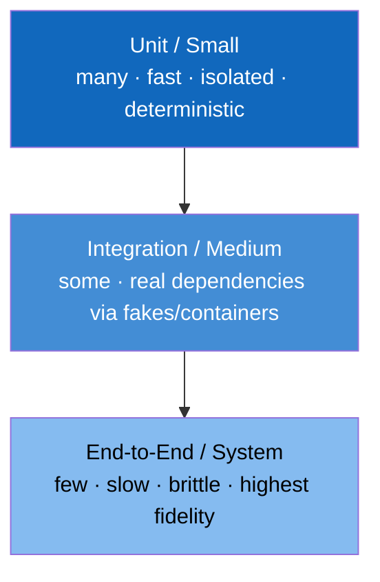

# The Testing Mentality

A test is a **falsifiable claim plus a cheap experiment that tries to break it**. The testing mentality generalizes that beyond unit tests: a type signature tests a claim about shapes; a code review tests a claim about readability; an alert tests a claim about health; a canary tests a claim about a release; an ADR's "Consequences" section tests a claim about the future. Engineers with the mentality reflexively ask, *"what would prove this wrong, and how cheaply can I find out?"*, and they ask it about their own beliefs first. Testing is a mentality, not a phase: it is the habit of treating every claim about code, infrastructure, docs, data, or a teammate's assumption as a hypothesis you can cheaply falsify.

This chapter opens with the ideas that shape any test strategy (the pyramid, testing behavior rather than implementation, fakes over mocks, and testing in production) and then turns into a ladder of practice sections, one per kind of test. Each section takes a piece of the real system the other books build, not toy code, shows a reference test suite for it, and explains why each test is there and which faults it kills. Throughout, a suite is judged by **mutation testing**: which planted faults it catches. The ladder starts with unit tests and mutation scoring, adds property-based tests, oracles, benchmarks, deeper mutation analysis, and contract tests, and ends with resilience tests and evals for models and agents, where the oracle is a statistic rather than an exact value.

> **Learning objectives**
> - Shape a test strategy by cost with the test pyramid, and recognize the ice-cream-cone anti-pattern.
> - Write tests that assert behavior through the contract, and prefer fakes to mocks.
> - Judge any test suite by the planted faults it catches, and argue each surviving mutant.
> - Choose the right kind of test (property, oracle, benchmark, contract, resilience, eval) for a given claim.
> - Treat production monitoring, canaries, and chaos experiments as tests run against the real system.

## Before you begin

This chapter builds on [Software Engineering at Google](../02-swe-at-google/README.md), whose testing chapters are the source of the pyramid, fakes-first, and Hyrum's Law, and on [Documentation and technical writing](../../diagramming/02-documentation-writing/README.md) in *Diagramming and Documentation*, because tests are executable documentation. The practice sections use Python, Go, and C; the primers in *Programming Languages* cover what you need. Each section names its own prerequisites from *Build Your Own LLM System*, *AI Platform Engineering*, and *Mathematics for Computing*.

## Shape your confidence by cost: the test pyramid

The goal of a test suite is confidence per unit cost. That argues for many fast, isolated tests and few slow, broad ones:



Small (unit) tests have no I/O, no clock, and no network; they take milliseconds, run on every save, and should be most of your tests. Medium (integration) tests use real dependencies through fakes or [Testcontainers](https://testcontainers.com/) (a real Kafka or Postgres in Docker) and take seconds. Large (end-to-end) tests exercise the whole system; they take minutes and are flaky by nature, so keep few of them and treat flakes as bugs.

The anti-pattern is the **ice-cream cone**: mostly end-to-end tests, few unit tests. Such a suite is slow and flaky, and it tells you *something* broke without telling you *what*. Invert it.

## Test behavior, not implementation

The single highest-leverage rule is that a good test states *what the code promises*, so it survives refactoring and fails only on real regressions. A test that breaks when you refactor without changing behavior is a liability, not an asset:

```python
# BAD -- couples to implementation. Refactoring the cache breaks this test
#        even though behavior is unchanged.
def test_calls_redis_setnx_once():
    worker.process(msg)
    redis_mock.setnx.assert_called_once()

# GOOD -- asserts the promise: a duplicate message is processed exactly once.
def test_duplicate_message_processed_once():
    worker.process(msg); worker.process(msg)          # same message twice
    assert db.count(order_id=msg.order_id) == 1        # observable behavior
```

This is **Hyrum's Law** turned to your advantage: depend only on the contract you intend to keep.

## Test doubles: fakes over mocks

The three common doubles differ in how much they couple a test to the implementation:

| Double | What it is | Google's stance |
|--------|-----------|-----------------|
| **Fake** | A working lightweight impl (in-memory DB, in-memory Kafka) | **Preferred** -- behaves correctly, tests survive refactors |
| **Stub** | Returns canned answers | Fine for simple inputs |
| **Mock** | Asserts *how* it was called | Use sparingly -- mock-heavy tests are brittle and test implementation |

Mock-heavy suites are the most common reason a test breaks during a no-op refactor. Reach for a fake first.

## Beyond example-based tests

Examples are only the start. **Property-based testing** asserts invariants over generated inputs (Hypothesis, proptest, QuickCheck): "encode then decode returns the original," "the consumer never skips an offset." It finds the edge cases you would never enumerate by hand, and invariants are properties of the algorithm, which ties it to *Algorithms*. **Fuzzing** feeds random or adversarial bytes to parsers and decoders; it targets the bug class behind a huge share of CVEs (`cargo fuzz`, `go test -fuzz`, libFuzzer). **Golden or snapshot tests** pin a complex output (a rendered diagram, an API response) and diff future runs, a cheap regression net for serializers and generators. **Contract tests** have the producer and consumer of an API each test against a shared contract, so a breaking change is caught in CI rather than in production (Pact, schema registries for Kafka).

## Testing things that aren't application code

The mentality applies everywhere knowledge can be wrong. For infrastructure, run `terraform plan` in CI, validate manifests with `kubeconform` or `kubeval`, and write policy tests (OPA/Conftest) for rules such as "no container runs as root"; a misconfigured manifest is a bug, and validating YAML before it reaches the cluster is the subject of [Containers, Kubernetes and workloads](../../infrastructure/01-containers-kubernetes/README.md) in *Infrastructure*. For data, write pipeline tests with [Great Expectations](https://greatexpectations.io/) or dbt tests ("no nulls in `order_id`," "row count within 3σ of yesterday"); bad data is a production incident, and dbt tests gate the pipeline in [Orchestration and modeling](../../data-engineering/04-orchestration-modeling/README.md) in *Data Engineering*. For documentation, run the code samples, as [Documentation and technical writing](../../diagramming/02-documentation-writing/README.md) recommends; an example that doesn't compile is a failing test. For diagrams, run `d2 *.d2` in CI so the build fails if a diagram no longer compiles ([Diagramming and the C4 model](../../diagramming/01-diagramming-c4/README.md)).

## Testing in production, because you already are

You cannot fully reproduce production, so test *against* it deliberately rather than pretending staging is enough. A **canary or progressive rollout** ships to 1% of traffic, watches the metrics, then ramps: a controlled experiment on the real system. **Synthetic monitoring** has a bot continuously exercise the critical path, so the first to know is you, not the customer. **Chaos engineering** injects failure (kill a pod, add latency, partition the network) to test the hypothesis "the system tolerates this"; start with a small blast radius and a defined steady-state metric. **SLOs and error budgets** make reliability a testable claim, and burning the error budget is the test failing in slow motion (see [Observability](../../systems/04-observability/README.md) in *Systems and Architecture*, which shows how you test in production through telemetry).

The practice is widespread in industry. Google runs presubmit testing at scale and teaches it one page at a time in Testing on the Toilet; Netflix invented chaos engineering with Chaos Monkey; Amazon relies on operational readiness reviews and canary deploys; and AI labs such as Anthropic run rigorous evals and safety tests to falsify claims about models before shipping. At Staff+ levels you set a team's testing bar, and the mentality matters more than any coverage percentage.

## Choosing a technique

The techniques map onto situations as follows:

| Technique | When to apply |
|-----------|---------------|
| Shape the test pyramid | Designing any service's test strategy |
| Test behavior, not implementation | Every test you write |
| Prefer fakes over mocks | Any test needing a dependency |
| Property-based testing | Encoders, parsers, invariant-heavy logic |
| Fuzzing | Any code that parses untrusted input |
| Contract tests | Any producer/consumer or service boundary |
| Manifest/policy tests | Any IaC or Kubernetes change |
| Data quality tests | Any data pipeline |
| Canary + synthetic monitoring | Every production release |
| Chaos experiments | Systems claiming resilience -- prove it |

To practice the mentality on your own work, read a few *Testing on the Toilet* posts (each is a five-minute mental model), take one function with example-based tests and add a property-based test to watch it find an edge case you didn't think of, and, for a system you run, write down the failure hypothesis you are most afraid of and design the smallest experiment that would confirm or refute it.

## In this chapter

The practice sections form a ladder, each placed where the system first needs that kind of test:

1. [TDD, unit tests, and mutation testing](01-tdd-unit-tests-and-mutation-grading.md) introduces test-first development and the mutation-testing primer (what a mutant is, killed versus survived, how the score and required semantic mutants work) on a failpoint kata the training CLI uses.
2. [Property-based tests with Hypothesis, proptest, rapid, and ol_prop.h](02-property-based-tests.md) states laws (roundtrip, idempotence, model, fixpoint, metamorphic) for a normalizer and a mini BPE, and shows why roundtrip alone misses faults.
3. [Oracles, golden and differential tests, gradcheck as a test](03-oracles-golden-and-gradcheck.md) tests hand-written backward passes with three oracles and shows why a shape check is not one.
4. [Benchmarks and perf gates](04-benchmarks-and-perf-gates.md) measures C kernels with a minimum estimator and builds a gate that compares base and head on the same machine.
5. [Mutation testing in depth](05-mutation-testing-in-depth.md) triages ten survivors of the sequence-metrics suite into equivalent and killable, and writes new semantic mutants from pitfalls.
6. [Contract tests](06-contract-tests.md) writes a consumer-driven pact for the gateway's client of the engine, with a two-sided mock and static provider verification.
7. [Resilience tests](07-resilience-tests.md) crashes a durable task queue at its worst moments with a fake disk and a manual clock, and checks durability, exclusivity, and exactly-once effects.
8. [Model evals as tests](08-model-evals-as-tests.md) turns held-out bits per byte and a seeded quality score into a regression test with a margin and an exact sign-flip test.
9. [Agent evals as tests](09-agent-evals-as-tests.md) designs a repeatable agent eval suite with disjoint splits, per-property scorers, and paired confidence intervals.

## Further reading

- [*Software Engineering at Google*, testing chapters (11-14)](https://abseil.io/resources/swe-book): testing at scale.
- [Google Testing Blog / Testing on the Toilet](https://testing.googleblog.com/): one-page lessons.
- [Hypothesis documentation](https://hypothesis.readthedocs.io/): property-based testing.
- [Principles of Chaos Engineering](https://principlesofchaos.org/).
- Martin Fowler, [Contract Tests](https://martinfowler.com/bliki/ContractTest.html).
- *Foundations of Software Testing* notes.
