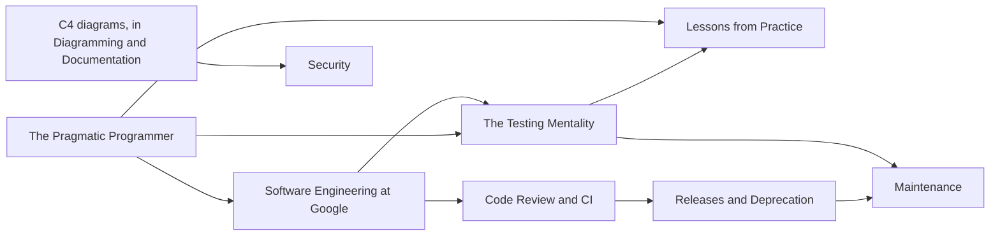

# Software Craftsmanship

Good software is not about clever code. It is about managing complexity over time: writing code that survives contact with reality, making a system legible to someone who was not there when it was built, and changing a working system without breaking it. This book is about the engineering practices, principles, and culture that make that possible, and about the judgment calls on tradeoffs that distinguish senior and staff engineers far more than raw coding ability does.

The book is for working programmers. It is a "how to think" book, not a "how to code" book, so it assumes some professional programming experience and spends its pages on why practices work rather than on syntax. Its first half draws on two classic texts, *The Pragmatic Programmer* for individual craft and *Software Engineering at Google* for organizational craft at scale, and on postmortems of real projects. Its second half applies those ideas to one running system, an LLM serving platform with a Go gateway and a Rust engine, through the gates every change passes: CI, code review, releases, deprecation, maintenance, and security review.

## What you will be able to do

- Apply the pragmatic levers (DRY, orthogonality, reversibility, design by contract, crashing early) to keep a codebase changeable.
- Reason about engineering at organizational scale: Hyrum's Law, code review culture, deprecation budgets, and CI as leverage.
- Treat testing as a mentality rather than a phase, from unit and property tests through mutation testing, contract tests, resilience tests, and model evaluations.
- Run a release process computed from history, write a deprecation policy, and migrate an interface in reversible phases.
- Upgrade dependencies safely and find a performance regression by bisection.
- Threat-model a whole system, inventory its supply chain, and review its secrets and authorization.

## How this book is organized

The chapters move from the individual to the organization, then from principles to a running system.

[The Pragmatic Programmer](01-pragmatic-programmer/README.md) covers individual craft: taking responsibility, the big levers of DRY, orthogonality, and reversibility, and why corrupted state that keeps running is worse than a clean failure.

[Software Engineering at Google](02-swe-at-google/README.md) widens the lens to organizational craft. Its central claim is that software engineering is programming integrated over time, and it covers culture, code review, Hyrum's Law, deprecation, and build and CI as leverage.

[The Testing Mentality](03-testing-mentality/README.md) reframes testing as the habit of treating every claim as a hypothesis you can cheaply falsify. Its sections build up a full testing practice for the running system: TDD and mutation grading, property-based tests, oracles and gradcheck, benchmarks and performance gates, contract tests, resilience tests, and model and agent evaluations as tests.

[Lessons from Practice](04-lessons-from-practice/README.md) is a set of postmortems of shipped and shelved projects. Each lesson illustrates a failure mode that recurs across stacks, and most of them would have taken under thirty minutes to prevent. They are the cheapest way to learn the principles: from someone else's mistakes.

[Code Review and CI](05-code-review-and-ci/README.md) sets up the gates every change passes through: a CI workflow that runs on every push and pull request, commit messages a machine can read, and the review of a change someone else wrote against the system you own.

[Releases and Deprecation](06-releases-and-deprecation/README.md) treats a version number as a promise about compatibility. You release from history rather than memory, and you remove behavior through a policy, because with enough users every observable behavior is depended on.

[Maintenance](07-maintenance/README.md) is about changing systems that already work: migrating a storage format and an API in reversible phases, upgrading dependencies, and finding a performance regression with `git bisect run`.

[Security](08-security/README.md) reviews the finished system as a whole: a STRIDE threat model on its data-flow diagram, SBOMs and supply-chain records, and a secrets and authorization review.

## Prerequisites and related books

You need some professional programming experience. The practice chapters (Code Review and CI onward, and the course-system sections of The Testing Mentality) are written against the system built in *Build Your Own LLM System*; its [course path](../build-an-llm/paths/course/README.md) sets the order in which those sections are read alongside the system.

Three neighbouring books cover material this book relies on. *Diagramming and Documentation* treats the understandability of a system as a deliverable: [Diagramming with the C4 Model](../diagramming/01-diagramming-c4/README.md) draws the container views the Security chapter starts from, and [Documentation Writing](../diagramming/02-documentation-writing/README.md) covers ADRs, runbooks, and Diátaxis. *Programming Languages* covers [Type Systems and Polymorphism](../programming-languages/01-type-systems/README.md), which treats types as a theory (soundness as progress plus preservation, Hindley-Milner inference) and builds on [Discrete Math 1](../mathematics-for-computing/06-discrete-math-1/README.md) from *Mathematics for Computing*, and the [Language and Tool Primers](../programming-languages/02-language-and-tool-primers/README.md), which introduce just enough Python, shell, C, Rust, HTTP, Go, and containers to build the system.

## Conventions

Code listings are fenced with a language tag and annotated in the surrounding prose; listings from the running system are excerpts, with `// ...` marking elided lines. Math appears inline as $\log_2 n$ or in display blocks. Call-outs marked **Warning** flag pitfalls worth stopping for. Each section opens with learning objectives and closes with key terms, a summary, and review questions whose answers are folded under an "Answer" disclosure; try each question before opening it.

The full solution code and model documents for the running system live in [`course/solutions/`](../../../course/solutions/), and the contracts the solutions are checked against live in [`course/contracts/`](../../../course/contracts/). Sections link to the exact files they discuss.

## Further reading

- Andrew Hunt and David Thomas, *The Pragmatic Programmer*, 20th Anniversary Edition.
- Titus Winters, Tom Manshreck, and Hyrum Wright, [*Software Engineering at Google*](https://abseil.io/resources/swe-book) (free online).
- John Ousterhout, *A Philosophy of Software Design*.
- Robert Martin, *Clean Code*.
- Martin Fowler, [Refactoring Catalog](https://refactoring.com/catalog/).
- Michael Feathers, *Working Effectively with Legacy Code*.
- [Google Technical Writing](https://developers.google.com/tech-writing) courses.

A paced reading plan is in the [study plan](study-plan.md).
