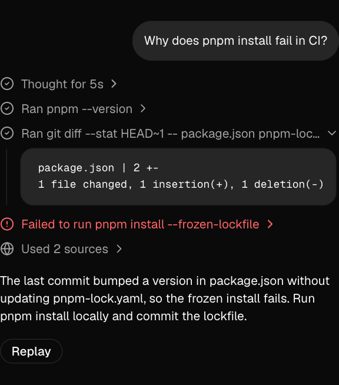
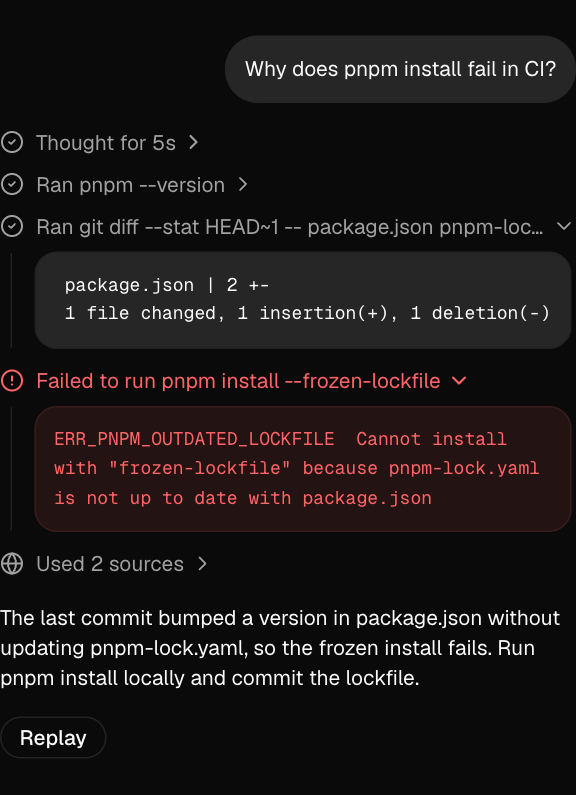
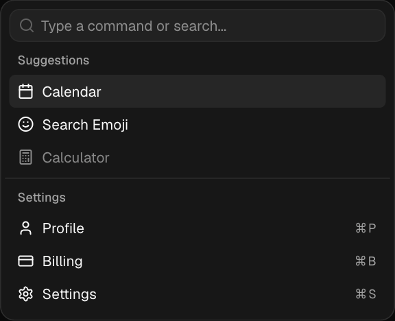
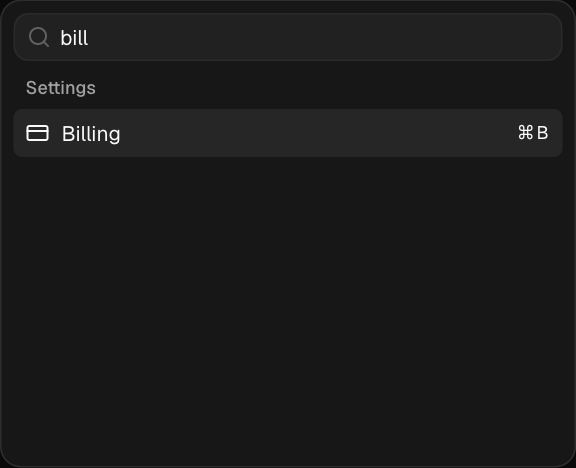
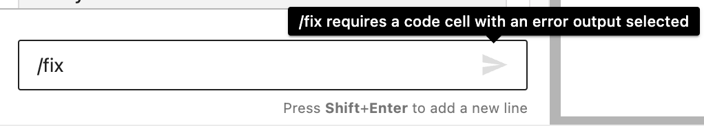
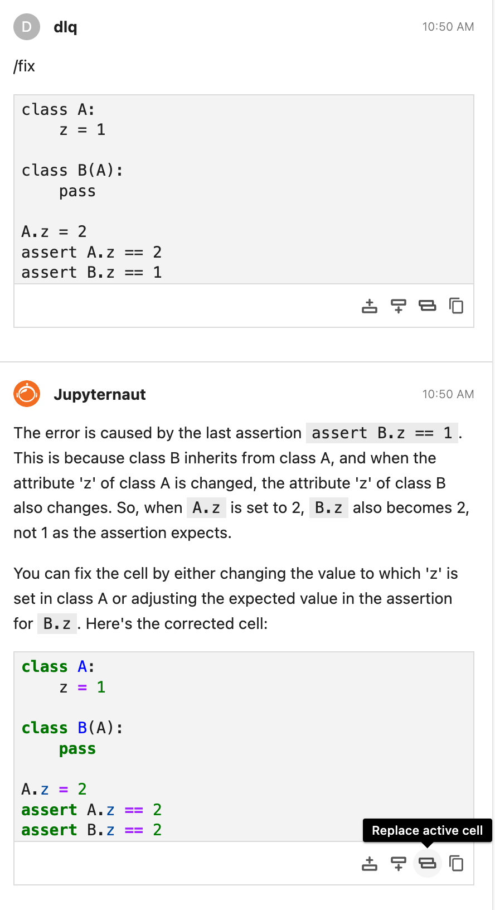
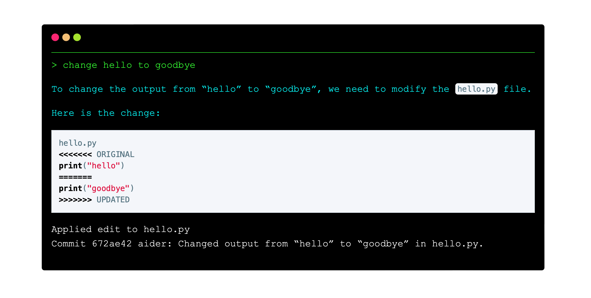
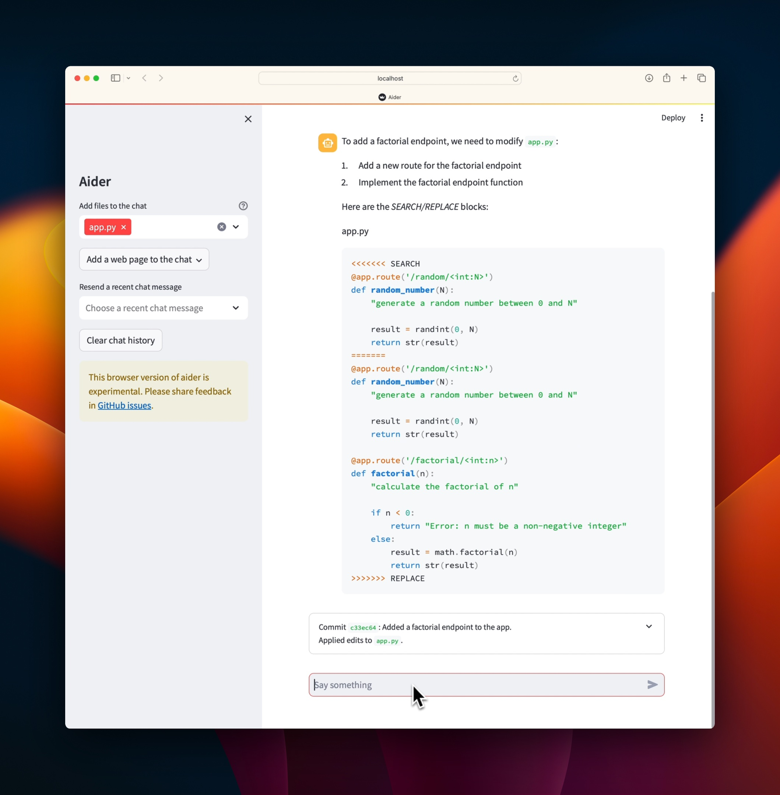
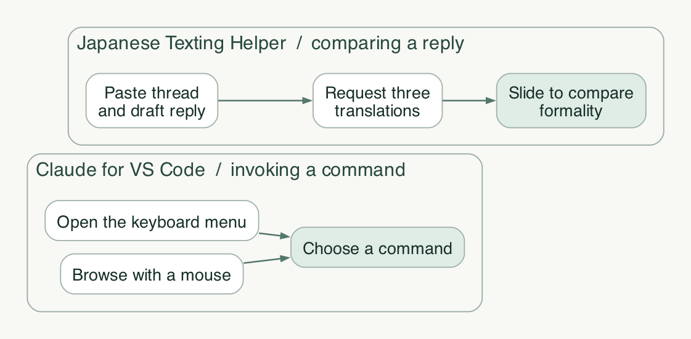

# Reviewing an agent's work

An agent edited three files and one test now fails. The reviewer must decide what happens next: accept the change, reject it, or tell the agent what to fix. This section asks what that reviewer needs to see to make the decision, and studies four published interfaces that answer part of the question.

The working answer is short. **Show the failed check, the change it exercises, and a place to steer the fix.** Each study below tests one piece of that answer.

> **Learning objectives**
> - Place a diagnostic beside the change it explains, without hiding the surrounding context.
> - Make a proposed edit name its target and the evidence it used.
> - Distinguish a proposed change from an applied one, and scope undo to one change.
> - Design a usability test that measures correction, not only completion.

## Three interactions worth borrowing

| When | Interface to study | What the reviewer can do |
|---|---|---|
| A check fails | [shadcn/ui Trace](https://ui.shadcn.com/docs/components/base/trace) | Open the failed command for its diagnostic without losing the diff and the answer around it. |
| An edit is ready | [Zed's review flow](https://zed.dev/docs/ai/agent-panel#reviewing-changes) | Step through changed hunks and keep or reject each one. |
| Several agents are active | [Nate Parrott's activity studies](https://nateparrott.com/claude-vscode/index.html) | Scan completed and pending work, then inspect one command. |

A steering message is most useful when it has an explicit target. "Keep the assertion, fix the implementation" is ambiguous in a long transcript. It is clear when the message is attached to the selected hunk.

## Open a failure without losing its context

The shadcn/ui Trace demo shows a scripted CI run. A reader investigating a failed install can see which command failed and read the proposed fix at once. Opening the failed row shows the package manager's diagnostic directly under that command. The diff above and the answer below stay in view.

| Completed trace | After opening the failed command |
|---|---|
|  |  |

The compact layout has a cost that both captures show: the diff command is truncated. A reviewer who needs the full command must open it too.

The Command demo from the same library solves a different problem: finding an action. With an empty search, the menu groups suggestions and settings, and keyboard shortcuts sit beside the actions that have them. Typing `bill` leaves Billing highlighted with its shortcut still visible. A person discovers the action by typing and learns a faster route for next time.

| Empty search | After typing `bill` |
|---|---|
|  |  |

*Cropped screenshots of the public shadcn/ui Base UI demos, captured 19 November 2026 in the dark theme. shadcn/ui is MIT licensed. The captures show the demos only, not live agent behavior.*

## Make a proposed edit name its target

In Jupyter AI v2.31.7, a notebook author can ask for help with a failing cell without pasting its code or traceback. The cell supplies the context, and the reply offers one specific edit. [Versioned user guide](https://jupyter-ai.readthedocs.io/en/v2/users/index.html#fixing-a-code-cell-with-an-error)

The author types `/fix`. The gray send arrow gives little guidance alone, but its tooltip names exactly which object to select. Selecting the failed cell enables Send and attaches both the cell and its error output. The message stays short because the notebook already knows which code failed.

The original cell expects `B.z == 1`. The assistant explains why Python returns 2 and proposes changing the assertion to `B.z == 2`. The toolbar offers **Replace active cell**.

This proposal leaves a real decision to the author. If the assertion encodes intended behavior, accepting the change hides a bug. If the cell teaches Python inheritance, changing the expected value is correct. **The reviewer must be able to tell whether the implementation or the expectation was supposed to change.**

The pattern to borrow: name the target, show the evidence used, then offer one scoped action. Put the target's name on the apply button. "Active cell" deserves care, because the author can change the selection during review.

*Both images are unmodified files from the Jupyter AI v2.31.7 source tree, BSD 3-Clause. [License](images/JUPYTER-AI-LICENSE.txt) · [Tagged source](https://github.com/jupyterlab/jupyter-ai/tree/v2.31.7)*

## Separate proposed changes from applied ones

Paul Gauthier's Aider offers a direct test for a coding agent. After a turn, can the developer point to the file, the change, and the commit that contains it?

The prompt asks to change a greeting. The response names `hello.py`. A code block puts the old and new string on adjacent lines, with labels that work without color. A separate line confirms that the edit was applied, and a final line names commit `672ae42`. The code block answers *what would change?* The lines below it answer *did it happen, and where can I find it?*

In the browser interface, the sidebar holds one removable file chip, `app.py`. The same filename heads the edit on the right. The commit row names the change, and the next-message field sits directly under it. The reader matches the selected file to the edited file without navigating away.

| Developer's question | Aider's documented behavior | Design implication |
|---|---|---|
| Can we discuss this first? | [Ask mode](https://aider.chat/docs/usage/modes.html) keeps the conversation read-only. A bare `/ask` changes the mode and the prompt becomes `ask>`. `/ask` with text applies to that one message. | Show the current mode at the input. Make the duration of a mode change visible. |
| Why is this taking another step? | [Architect mode](https://aider.chat/2024/09/26/architect.html) asks one model for a solution and a second to turn it into edits. Gauthier reported that some high-scoring pairs were too slow for interactive work. | Report what the second step produces. Measure time to a reviewable edit as well as pass rate. |
| Can I inspect or reverse this edit? | In the default [Git workflow](https://aider.chat/docs/git.html), Aider commits each change. `/diff` shows the last turn and `/undo` reverts the latest Aider commit. | Tie recovery to one specific change. A generic undo beside a long transcript has an unclear scope. |

*Both figures are unmodified first-party images from the Aider project at revision `5dc9490`, Apache License 2.0. [License](images/aider-LICENSE.txt) · [Upstream assets](https://github.com/Aider-AI/aider/tree/5dc9490bb35f9729ef2c95d00a19ccd30c26339c/aider/website/assets)*

## Give a recurring request a visible control

Two designers describe how a repeated interaction became a control.

**Nate Parrott** designed Claude for VS Code, the first Claude Code interface outside the terminal. His [design account](https://nateparrott.com/claude-vscode/index.html) shows four explorations of how to display an agent at work: a checklist, raw tool output, tools grouped by task, and tools embedded in a sentence. A checklist shows the plan. A sequence of tool calls gives individual actions to inspect. The released extension kept the terminal interaction model, and people could reach commands with a mouse or a keyboard menu. Parrott reports the explorations and the decision, not comparative usability results.

**Geoffrey Litt** built a [personal Japanese texting helper](https://www.geoffreylitt.com/2023/07/25/building-personal-tools-on-the-fly-with-llms) after he repeatedly pasted a thread into a chat model and asked for changes in politeness. The tool requests three translations at once, so a slider compares formality levels with no wait. The form captured a familiar routine but narrowed the range of follow-up questions. It worked because Litt could read the output and catch mistakes, including a substituted station name.

*Original diagram that interprets the two accounts.*

When someone repeats a request, ask what they are doing again. If they already know the command, a keyboard path saves steps. If they compare results, prepare the alternatives together and remove the wait between choices.

## Measure correction, not only completion

Amershi and colleagues' [Guidelines for Human-AI Interaction](https://www.microsoft.com/en-us/research/publication/guidelines-for-human-ai-interaction/) include [support efficient correction](https://www.microsoft.com/en-us/haxtoolkit/guideline/support-efficient-correction/). For the failing-test scenario, count the actions a reviewer needs to redirect the agent and verify its second attempt.

Maggie Appleton's [account of Elicit](https://maggieappleton.com/squish-structure) shows the same idea in research tools: a literature question becomes a table of papers and extracted fields that a person can inspect. In code review, the counterpart is tracing a claim such as "fixed" to the change and the test that support it.

## Key terms

- **Target**: the file, cell, or hunk that a proposed action will change.
- **Proposed change**: an edit shown for review that has not been applied.
- **Applied change**: an edit written to the working copy or committed, with a reference the reviewer can find.
- **Steering message**: an instruction that redirects an agent, ideally attached to a specific target.

## Review questions

### A proposed fix changes an assertion

An agent proposes to change `assert total == 100` to `assert total == 98`, and the test passes. What must the reviewer know before accepting it?

Worked answer

The reviewer must know whether the expected value or the implementation is wrong. If 100 is the specified behavior, the change hides a bug, and the agent should fix the code. Ask for the specification or the test's origin, and attach the steering message to the assertion line so the agent knows which side to keep.

### Two failing cells

A participant asks for a fix on one failing cell, then selects a second failing cell before applying it. Design the check that tells you whether the interface is clear.

Worked answer

Before the participant applies the fix, ask them to point to the target and predict which line will change. Record whether the proposal stayed attached to the first cell and whether the participant knew that. A completed task is not proof of clarity. The measure is a correct prediction of the effect.

### An undo button beside a transcript

A chat interface has one undo button below a long transcript with five edits. What is wrong, and how do you fix it?

Worked answer

The scope of undo is unclear: it can revert the last edit, the last turn, or everything. Attach undo to each applied change, and show the change's reference, such as a commit ID, so the reviewer can inspect it before reverting.

