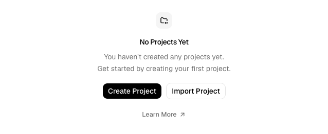
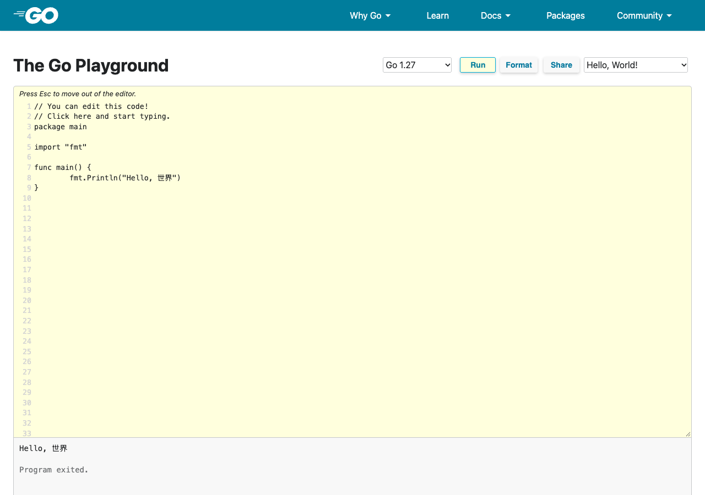

# Learning an API by editing it

A reader learns an API fastest when the first example runs, shows its result, and invites one change. This section studies two references that do this well. shadcn/ui shows a working preview beside the exact source that produced it and puts that source in your project. The Go Playground puts a complete program and its output in one view.

> **Learning objectives**
> - Show the precise source that produced an example, and give it a path into a real project.
> - Separate the code that belongs to an example from the API that the library promises to maintain.
> - Put a deterministic example and its observable result on one page, with errors where the result normally appears.
> - Choose the smallest edit that changes a meaningful behavior, and name the output that proves it.

## shadcn/ui puts the example in your project

On the [Empty component page](https://ui.shadcn.com/docs/components/base/empty), a folder icon sits above "No Projects Yet", two project actions, and a help link. **View Code** shows where those choices came from. The demo supplies the wording and buttons. The installed component supplies the reusable parts, such as `EmptyHeader`, `EmptyTitle`, and `EmptyContent`. A reader can decide which pieces to keep before touching an application.



*Capture of the live Base UI preview, 19 November 2026. shadcn/ui, copyright 2023 shadcn, MIT. [License](https://github.com/shadcn-ui/ui/blob/main/LICENSE.md)*

### What the installer adds

Run these three commands in a disposable React project that is configured for shadcn. The project supplies its own source paths, style, and shared dependencies. [CLI reference](https://ui.shadcn.com/docs/cli)

```sh
npx --yes shadcn@4.23.0 view empty
npx --yes shadcn@4.23.0 add empty --dry-run
npx --yes shadcn@4.23.0 add empty --yes
```

| Step | Result with shadcn 4.23.0 and the `base-nova` style |
|---|---|
| View | The item has type `registry:ui` and contains the TSX source for `registry/base-nova/ui/empty.tsx`. |
| Dry run | One new file, `src/components/ui/empty.tsx`, and one dependency, `cn`. |
| Add | The CLI creates that file and installs the dependency. |
| Local edit | Change the `EmptyTitle` element and its prop type from `div` to `h2`. The caller below now renders an `h2` with the same `empty-title` slot. |

```tsx
<Empty>
  <EmptyTitle>No runs yet</EmptyTitle>
</Empty>
```

Owning the source has a cost as well as a benefit. The owner can fix heading semantics once for every local use. The owner must also choose a heading level that suits every use, and reconcile future upstream changes by hand. The CLI provides a file diff for that review.

## The Go Playground: change one value, see one result

The [Go Playground](https://go.dev/play/) puts a complete program, a Run button, and its output in one view. A reader can predict what one line does, try it, and check the prediction without setting up a project.

**Try it.** Run the "Hello, World!" example. On line 8, change the greeting to `Hello, notebook`. Select **Run** again and read the first line under the editor.




The output changes from `Hello, 世界` to `Hello, notebook`, followed by `Program exited.` in both runs. The source and its actual output are visible together. On this short example, the editor also leaves about half a screen of blank space between the changed line and the result.

*Captured in Chrome at 1280 × 900 with Go 1.27, 19 November 2026. Go site material is CC BY 4.0, and code uses Go's BSD license. [Copyright](https://go.dev/copyright)*

## Apply the lesson to an SDK's first page

Put a runnable example at the first point where the reader has something to predict. Give it one visible value to change, one output to check, and an editor sized for that example. For an agent SDK, let the reader change the string a tool returns and see the matching tool result before any provider setup.

When an example needs a provider, start with an offline one, and label it as a fixture so the reader knows what a real provider adds. A static documentation page can show source and expected output at once. An in-browser editor that runs dependencies needs a runtime. A local command or a clearly labeled recording is a useful fallback.

## Key terms

- **Registry item**: a unit of source that a CLI copies into your project, with its declared dependencies.
- **Owned source**: code you copied from a library and now maintain yourself.
- **Fixture provider**: a deterministic stand-in for a real service, used so that an example's output is reproducible.

## Review questions

### Which example teaches more?

Example A installs a package and calls a function that prints a formatted report. Example B prints the same report, then asks the reader to change one column name and run again. Which teaches more, and why?

<details>
<summary>Worked answer</summary>

Example B. The reader makes a prediction, tests it, and sees the link between one input and one output. Example A shows that the code runs but not which part of it controls the result.

</details>

### Copy or depend?

A team copies a UI component into its repository instead of installing it as a package. Name one benefit and one cost.

<details>
<summary>Worked answer</summary>

The benefit: the team can change the component directly, for example to fix heading semantics for every local use. The cost: the team now owns upstream changes and must merge them by hand, with the CLI diff as its only aid.

</details>
