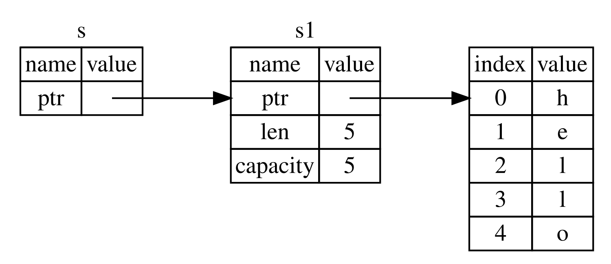

# Small interfaces that do real work

A good first example gives the reader a question they can answer by running it. Count the nonblank lines in a transcript. Then try the same operation on an input that fails halfway. Can the caller tell a complete count from a partial one? This section shows how a signature and its error contract answer that question.

> **Learning objectives**
> - Read a signature for what it tells the caller about failure, ownership, and reuse.
> - Choose between one end-of-work error check and per-call error checks.
> - Judge an interface by the work it leaves to its callers.
> - Put transport differences behind one interface and keep useful errors.

## What the sources teach

| Author and example | Design decision | What a caller can infer |
|---|---|---|
| *The Rust Programming Language*, [opening a file](https://doc.rust-lang.org/book/ch09-02-recoverable-errors-with-result.html) | The chapter shows both outcomes of `Result` with `match` before it shortens propagation to `?`. | A caller can recover from a missing file or pass the error up. The short form keeps that choice. |
| Rob Pike, [Errors are values](https://go.dev/blog/errors-are-values) | A scanner returns each token through one method, and the caller checks `Err` at the end. A writer remembers its first failed write and skips later writes. | One end check works when every failure has the same consequence. If the caller must recover at a particular write, keep that boundary. |
| Dave Cheney, [Functional options](https://dave.cheney.net/2014/10/17/functional-options-for-friendly-apis) | A device name is required. Speed and raw mode are named options applied at construction. | The first call is short. A later example changes one setting and keeps the rest familiar. |
| Rob Pike, [Self-referential options](https://commandcenter.blogspot.com/2014/01/self-referential-functions-and-design.html) | An option returns a function that restores the previous setting, and the caller can defer it. | An inverse operation earns its place when restoration matters. Constructor-only settings need a simpler contract. |

## One operation in two languages

Both programs count nonblank lines in a UTF-8 transcript and process one line at a time. Either a complete count or a read error reaches the caller.

**Rust.** The `?` is on the operation that can fail, so a failed line read returns immediately. The signature takes a mutable borrow, so the caller can reuse its reader.

```rust
use std::io::{self, BufRead};

fn count_messages(input: &mut impl BufRead) -> io::Result<usize> {
    let mut count = 0;
    for line in input.lines() {
        if !line?.trim().is_empty() {
            count += 1;
        }
    }
    Ok(count)
}

fn main() -> io::Result<()> {
    let mut transcript = io::Cursor::new("first\n\nsecond\n");
    println!("{}", count_messages(&mut transcript)?);
    Ok(())
}
```

**Go.** The loop ends on EOF or on a read failure. The `Err` check tells them apart before the function returns a count. The function takes an `io.Reader`, so the same code works with a string, a file, or a pipe.

```go
package main

import (
    "bufio"
    "fmt"
    "io"
    "strings"
)

func countMessages(input io.Reader) (int, error) {
    lines := bufio.NewScanner(input)
    count := 0
    for lines.Scan() {
        if strings.TrimSpace(lines.Text()) != "" {
            count++
        }
    }
    if err := lines.Err(); err != nil {
        return 0, err
    }
    return count, nil
}

func main() {
    n, err := countMessages(strings.NewReader("first\n\nsecond\n"))
    if err != nil {
        panic(err)
    }
    fmt.Println(n)
}
```

Save each block as `main.rs` or `main.go`. Run `rustc main.rs -o count && ./count` or `go run main.go`. Both print `2`. Go's default scanner also reports an error when a line exceeds its buffer limit, so a format with long lines needs an explicit [size policy](https://pkg.go.dev/bufio#Scanner).

## Draw what a signature leaves implicit



Figure 4-6 of *The Rust Programming Language* gives the reference, its owner, and the backing bytes separate positions on the page. The two arrows explain why a function can inspect the string without copying its allocation. In an SDK tutorial, a figure this small can separate a conversation from the runs it contains. [References and Borrowing](https://doc.rust-lang.org/book/ch04-02-references-and-borrowing.html)

*Figure © 2010 The Rust Project Developers. Unmodified SVG under the MIT option. [License](images/rust-LICENSE-MIT.txt)*

## Judge an interface by the work it leaves to callers

David Thomas and Andrew Hunt suggest starting with the data transformation and keeping unrelated decisions independent. [Tips 13, 17 and 49](https://pragprog.com/tips/) A concrete test follows. If the input moves from a file to a network connection, which lines of the caller change? If the parsing loop or the renderer changes, the transport choice has leaked too far.

John Ousterhout describes a text editor whose storage API gained a method for each editing gesture. One method that deletes a range covers Backspace, Delete, and a selection. The editor knows which range the person chose, and the storage layer knows how to remove it. A one-character delete would have a smaller signature, but every caller would need a loop. [A Philosophy of Software Design, §§6.2 to 6.5](https://web.stanford.edu/~ouster/cgi-bin/aposd2ndEdExtract.pdf)

### One reader, two transcript segments

Go's `io.Reader` lets a consumer ask for bytes, and a JSON decoder already handles values that span reads. In this example, a saved transcript ends halfway through a JSON object and a continuation completes it. The decoder consumes both as one input. [MultiReader](https://pkg.go.dev/io#MultiReader) · [Decoder.Decode](https://pkg.go.dev/encoding/json#Decoder.Decode)

```go
package main

import (
    "encoding/json"
    "fmt"
    "io"
    "log"
    "strings"
)

func eventNames(input io.Reader) ([]string, error) {
    var names []string
    decoder := json.NewDecoder(input)
    for {
        var event struct{ Name string }
        switch err := decoder.Decode(&event); err {
        case io.EOF:
            return names, nil
        case nil:
            names = append(names, event.Name)
        default:
            return names, err
        }
    }
}

func main() {
    saved := strings.NewReader(`{"name":"started"}{"na`)
    continuation := strings.NewReader(`me":"finished"}`)
    names, err := eventNames(io.MultiReader(saved, continuation))
    if err != nil {
        log.Fatal(err)
    }
    fmt.Println(names)
}
```

The expected output is `[started finished]`. Replace the continuation with an empty reader and the decoder reports `unexpected EOF`. The function returns the first complete name with that error. A live monitor would deliver one decoded event at a time, so the caller can display it promptly and bound what it keeps.

## Apply the lesson to an SDK's first examples

1. Start with a complete action. Submit one message and print its final answer with an in-memory provider. Show the expected output beside the command.
2. Change one decision per example. In the second example, change only the provider. In the third, keep the provider and change how the answer is consumed.
3. Give the reader a failure they can recognize. Make the example provider stop halfway. Show which operation reports it, whether partial text survives, and whether a retry continues the same run.

## Key terms

- **Error contract**: what a function promises about when it fails and what the caller receives.
- **General-purpose interface**: one operation that serves several callers, so that no caller rebuilds it.
- **Leaked decision**: a choice, such as transport, whose details appear in code that should not depend on it.

## Review questions

### One check or many?

A batch writer returns no error from `Write` and reports the first failure from `Flush`. When is that design wrong?

<details>
<summary>Worked answer</summary>

It is wrong when the caller must react to a specific write, for example to retry one record or to stop before a later write has side effects. Then each write needs its own error. One end check is enough only when every failure has the same consequence.

</details>

### A smaller signature

A storage API offers `deleteChar(pos)`. A reviewer proposes `deleteRange(start, end)`. Which interface is smaller in practice?

<details>
<summary>Worked answer</summary>

`deleteRange` is smaller in practice, although its signature has more parameters. With `deleteChar`, every caller that deletes a selection must write a loop and handle its edge cases. Measure an interface by the work it leaves to callers.

</details>
