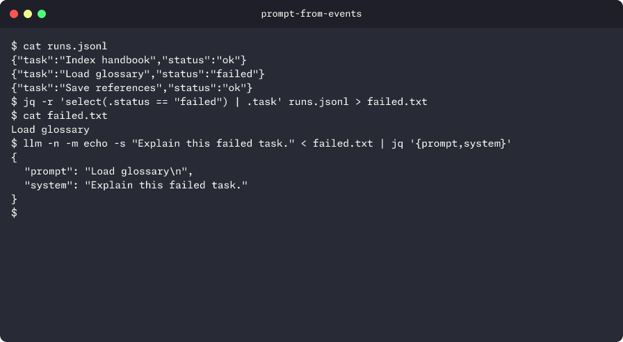

# Inspecting a pipeline into a model

A developer who debugs an agent often needs to answer two questions. Which events did the program select? What did the model actually receive? `jq` and Simon Willison's `llm` CLI let you answer each question on its own, because every intermediate value is a plain stream you can stop and read.

> **Learning objectives**
> - Explain the `jq` filter contract: one input value in, zero or more values out.
> - Replace one consumer in a pipeline without changing the stages before it.
> - Inspect the exact request a model receives, with no credentials and no network call.
> - Tell one prompt with many items from one prompt per item.

## jq makes each intermediate value executable

The [jq tutorial](https://jqlang.org/tutorial/) uses a saved response from GitHub's commits API. The reader counts the commits, inspects one, then selects fields from each, with no new fetch. The short loop comes from one contract: a filter reads a JSON value and emits zero, one, or many values, and the next filter runs once per emitted value. [Manual](https://jqlang.org/manual/)

Try it with three fictional agent events in a scratch directory. The predicate passes one event, and the projection produces its name. The `-r` flag writes the string as plain text.

```sh
cat > runs.jsonl <<'EVENTS'
{"task":"Index handbook","status":"ok"}
{"task":"Load glossary","status":"failed"}
{"task":"Save references","status":"ok"}
EVENTS
jq -r 'select(.status == "failed") | .task' runs.jsonl
```

The output is one line, `Load glossary`. Change the status in the filter to `"paused"` and the output is empty. An agent workflow can use that empty result to skip a model call.

## llm makes the provider replaceable

Willison [summarizes a Hacker News discussion](https://simonwillison.net/2024/Jun/17/cli-language-models/) by converting its nested JSON to text with `jq` and piping the text into `llm`. Input, system instruction, and model each have their own place in the command. His [echo plugin](https://github.com/simonw/llm-echo) makes those boundaries visible: it returns the assembled request as JSON and runs locally with no credentials.

Keep the selection and append a consumer. The first run downloads `llm` and the plugin through `uv`. The `-n` flag turns off prompt logging.

```sh
jq -r 'select(.status == "failed") | .task' runs.jsonl |
  uvx --from llm==0.38 --with llm-echo==0.5 llm -n -m echo \
    -s 'Explain this failed task.' |
  jq '{prompt,system}'
```

```json
{
  "prompt": "Load glossary\n",
  "system": "Explain this failed task."
}
```



*Original capture with jq 1.8.2, llm 0.38, and llm-echo 0.5. The run saves the filtered names to a file so the intermediate value is readable. [jq license](https://github.com/jqlang/jq/blob/master/COPYING) · [llm license](https://github.com/simonw/llm/blob/main/LICENSE)*

The newline in `prompt` comes from `jq`. If two tasks fail, the model receives both names in **one prompt**. A host that needs one decision per event must call its consumer once per event. Showing the input, the intermediate value, and the assembled request makes that difference testable before any live model runs.

## Key terms

- **Filter**: a `jq` program that maps one input value to a stream of output values.
- **Consumer**: the last stage of a pipeline, which acts on what earlier stages emit.
- **Echo provider**: a stand-in model that returns its own request, used to inspect prompts.

## Review questions

### Two failed tasks

Add a second failed event to `runs.jsonl` and run the pipeline again. Predict the `prompt` field before you run it.

<details>
<summary>Worked answer</summary>

`"Load glossary\n<second task>\n"`. Both names arrive in one prompt, because `llm` reads all of standard input as one message. To get one answer per event, loop over the lines and call `llm` once for each.

</details>

### Where to debug

An agent gives a wrong explanation for a failed task. Which stage do you inspect first, and how?

<details>
<summary>Worked answer</summary>

Inspect the request first: replace the model with the echo provider and read the exact prompt and system message. If the request is wrong, the bug is in selection or prompt assembly, and the model is not the cause. If the request is correct, compare models or change the instruction.

</details>
