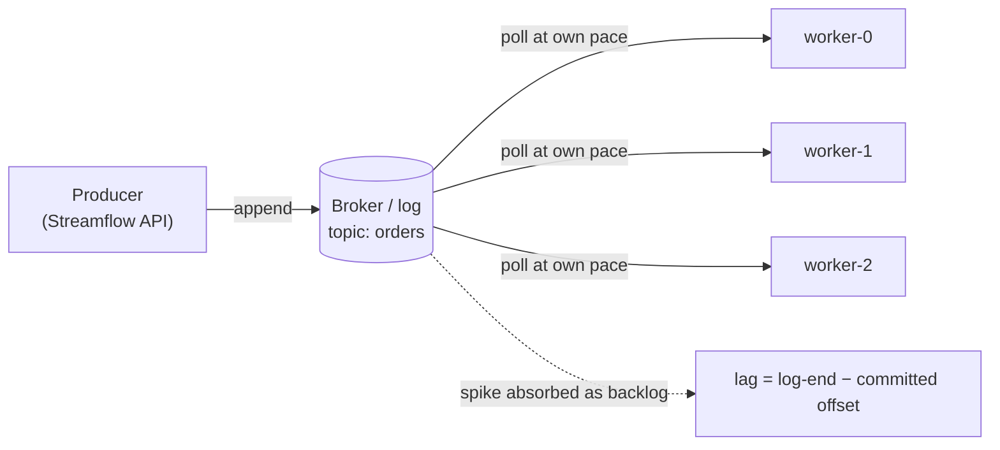
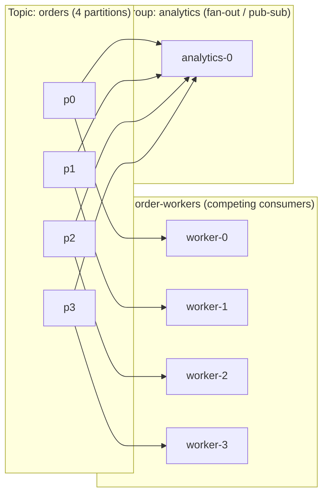

# Queues, logs, and consumers

This part of [Messaging and Distributed Queueing](README.md) develops the mechanisms below. Work the numerical examples or trace the code before checking the answer.

> **Learning objectives**
> - Choose queue or log semantics from ownership and replay needs.

## Why decouple at all

A producer appends a message to a log or queue and moves on; a pool of workers consumes at its own pace. That buys three properties at once. The first is **elasticity**: you scale producers and consumers independently, and adding workers drains the backlog faster. The second is **resilience**: a worker crash does not lose the message, because it stays in the broker until it has been durably processed. The third is **load-leveling**: a traffic spike becomes a *longer queue* rather than a meltdown. The broker absorbs the burst, and the workers catch up.

Every design decision in the rest of the chapter (queue versus log, push versus pull, competing versus fan-out, the delivery semantics) is a different answer to one question: how does a message get from a producer to the worker that handles it, and what happens when something fails along the way?

## Queue versus log

The classic message **queue** (RabbitMQ, Amazon SQS, JMS) and the **log** (Kafka, Redpanda, Pulsar) sit at opposite ends of one axis: who remembers what has been consumed.

A classic queue deletes on acknowledgement. The broker holds each message until a consumer acknowledges it, then deletes it, and along the way it tracks per-message state: in flight, acknowledged, redelivered. Once a message is gone, nobody can read it again. That is ideal for distributing tasks and poor for letting three independent systems each read the same stream.

A log retains and replays. Kafka keeps every message for a **retention window**, bounded by time or size, regardless of who has read it. A partition is an ordered, append-only sequence, and each message gets a monotonic **offset**. The broker is deliberately dumb: it does not track per-consumer progress. Instead, **each consumer group records its own committed offset**, which amounts to saying "I have processed up to offset N."

The consequences cascade from that single choice. A new consumer group can reset to offset 0 and **replay** history, which is impossible in a delete-on-read queue. Any number of groups can read the same partition at different positions for free, so **multiple independent readers** come at no extra cost. And the broker **scales trivially**, because it only appends and serves byte ranges; it never maintains a per-message set of acknowledged and unacknowledged messages. The table below lines up the differences.

| Dimension | Classic queue (SQS, RabbitMQ) | Log (Kafka, Redpanda) |
|-----------|-------------------------------|------------------------|
| Lifecycle | Delete on acknowledgement | Retained for a retention window |
| Progress state | Broker tracks per-message | Consumer tracks its own offset |
| Replay | No (message gone after ack) | Yes (reset offset) |
| Multiple readers of same data | Needs fan-out copies | Native (one group per reader) |
| Ordering | Per-queue, weak (SQS FIFO is the exception) | Strict per-partition |

The replayable log is also what makes the Kappa architecture possible, which is the data-engineering view of the same Kafka. Log compaction, watermarks, and the stream processing built on top are covered in [Batch and Streaming Processing](../../data-engineering/03-batch-streaming/README.md) in *Data Engineering*; this chapter keeps to the messaging dynamics and does not repeat that material.

## Push, pull, and long-polling

Once you know where messages live, the next question is who controls the pace at which they are delivered.

With **push** (RabbitMQ, SQS via callbacks, webhooks), the broker sends messages to the consumer as they arrive. That is fast when the consumer keeps up and dangerous when it does not, because the broker can outrun a slow consumer. The defense is a **prefetch or credit limit**: with RabbitMQ's `prefetch_count`, for example, the consumer says "send me at most K unacknowledged messages."

With **pull** (Kafka), the consumer calls `poll()` and asks for the next batch when it is ready. It never receives more than it requested.

**Long-polling** (SQS `ReceiveMessage` with `WaitTimeSeconds`) is pull with waiting. The consumer asks, and the broker holds the request open until a message appears or the timeout fires. Technically it is pull, but operationally it behaves like a responsive push work queue: low latency without busy-spinning.

The important property is that pull gives you **backpressure for free**. Backpressure is the system telling a fast producer "slow down, the consumers are behind." With pull, this happens without any protocol at all. A slow worker simply calls `poll()` less often, so it pulls fewer messages, so its **consumer lag** (log-end offset minus committed offset) grows. Nothing is pushed onto it, nothing overflows, and nothing is dropped. The lag *is* the backpressure signal, and it is exactly what your autoscaler watches when KEDA scales a consumer group on lag, as described in [Containers, Kubernetes, and Workloads](../10-containers-kubernetes/README.md). With push you must *build* backpressure out of prefetch windows or flow-control credits, or risk burying a consumer. Here is how the three models compare.

| | **Pull (Kafka)** | **Push (RabbitMQ, webhooks)** | **Long-poll (SQS)** |
|--|------------------|-------------------------------|---------------------|
| Who sets pace | Consumer (`poll()`) | Broker | Consumer (asks; broker waits) |
| Backpressure | Free (poll less → lag grows) | Must add prefetch/credits | Free (ask less often) |
| Backlog visibility | **Consumer lag** | Queue depth | `ApproximateNumberOfMessages` |
| Replay | Yes (reset offset) | No (gone after ack) | No |
| Ordering | Per-partition | Usually none | None (FIFO queues excepted) |
| Best for | High-throughput streams, replay, many readers | Per-message ack, simple work queues | Decoupled work queues at AWS |

Run [`code/backpressure_demo.py`](code/backpressure_demo.py) or [`code/backpressure-demo.go`](code/backpressure-demo.go) to see this happen: the push model drops the surplus while the pull model retains it as lag.

## Competing consumers and publish-subscribe

Pace is one dimension; fan-out is another. *Enterprise Integration Patterns* names two foundational ways to distribute messages. With **competing consumers** (a work queue), each message goes to exactly one worker in a pool, and adding workers spreads the load. This is how you scale processing. With **publish-subscribe** (fan-out), each message goes to every subscriber. This is how independent systems react to the same event: one service takes the payment, one sends the email, one updates analytics.

Kafka does both at once through **consumer groups**. Within one group, partitions are divided among the members, which gives you competing consumers: each partition is owned by exactly one consumer in the group, so the group handles each message once. Across groups, every group sees every message, which gives you publish-subscribe. In Streamflow, the `order-workers` group and an independent `analytics` group both read all of `orders`, each at its own offsets.

There is an operational corollary you should see coming: a fifth worker in `order-workers` would sit idle, because there is no partition left for it to own. Partition count is the parallelism ceiling. That limit, together with rebalancing and pool sizing, is worked through in the [partitioned consumers](../07-durable-orchestration/README.md#partitioned-consumers) part of [Durable Orchestration and Workers](../07-durable-orchestration/README.md) in *Systems Engineering*, with real Kafka consumers in its [Kafka consumers side quest](../07-durable-orchestration/13-kafka-consumers/). When you partition, key messages by entity (per order, per user) whenever per-entity ordering matters, since ordering is guaranteed only within a partition.

## Summary

Choose queue or log semantics from ownership and replay needs. State the assumptions before applying the result to a different workload.

## Review questions

1. What happens to a completed message when a worker dies before acknowledgment?

   

Answer

   A broker may redeliver it, so processing must tolerate duplicate delivery.

   

[Chapter contents](README.md) · [Next: Delivery, backpressure, and capacity](02-delivery-backpressure-and-capacity.md)
