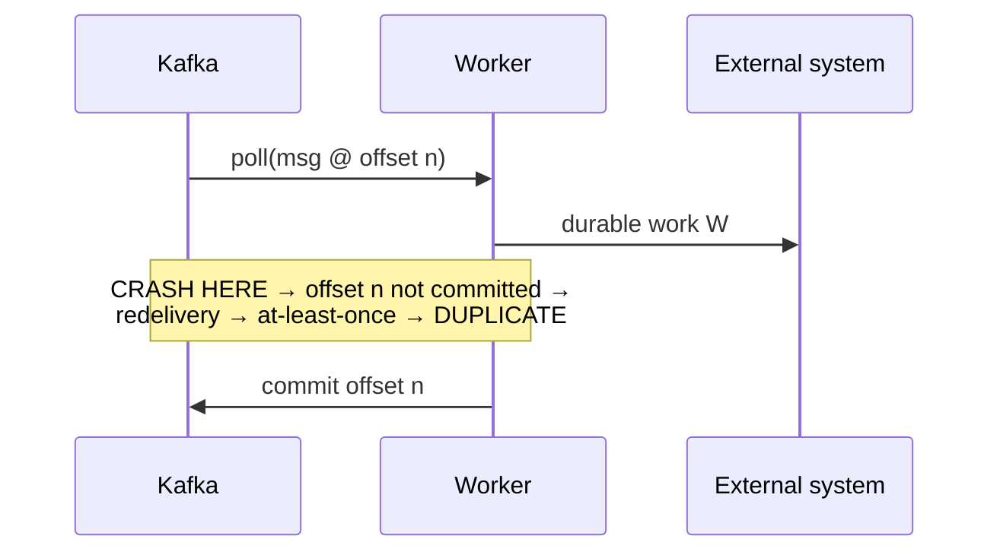

# Delivery, backpressure, and capacity

This part of [Messaging and Distributed Queueing](README.md) develops the mechanisms below. Work the numerical examples or trace the code before checking the answer.

> **Learning objectives**
> - Trace crash windows and apply backpressure when arrival rate exceeds service rate.

## Delivery semantics and the crash window

Now consider what happens when a worker fails. Let the worker's job be three steps: (1) `poll` a message at offset $n$, (2) do durable work $W$, and (3) `commit` offset $n$. The delivery semantics depend entirely on the order of steps 2 and 3 and on where a crash lands.

**At-most-once** commits before the work: `poll → commit → W`. If the crash lands after the commit but before $W$ completes, the message is lost, because the offset has already advanced and the work was never durably done. You get no duplicates but possible loss, which is rarely acceptable.

**At-least-once** commits after the work: `poll → W → commit`. This is the default and the correct choice. Its **crash window** is the interval between $W$ finishing and the commit landing. A crash there leaves the offset un-advanced, so the message is **redelivered**, and you get a **duplicate**. You get no loss but possible duplicates.

**"Exactly-once"** is the most misunderstood of the three. Kafka transactions plus the idempotent producer do give exactly-once *within Kafka-to-Kafka processing*: consume, transform, and produce, atomically tied to the offset commit. But the instant your handler touches an external system, such as a payment gateway or an email send, that external effect is outside the transaction and you are back to at-least-once.

The real fix is **idempotency**: make applying the same message twice equal applying it once, by deduplicating on a natural key, using conditional writes, or doing a `SETNX` on an idempotency key. The operational mechanics (the idempotency key, the transactional outbox, dead-letter queues, retry topics) are covered in [Durable Orchestration and Workers](../07-durable-orchestration/README.md). Here you need only the conceptual frame.

> **Warning:** Assume at-least-once delivery everywhere. The duplicate is not a bug; it is the contract. A handler that is not idempotent will eventually double-charge, double-send, or double-count.

## The math: Little's Law and backpressure as an integral

With the mechanics in place, two formulas explain almost all queueing intuition.

**Little's Law** relates the three quantities you actually measure:

$$ L = \lambda W $$

Here $L$ is the average number of in-flight (unacknowledged or uncommitted) messages, $\lambda$ is the arrival rate, and $W$ is the average time a message spends in the system, its latency. The law holds for *any* stable system, regardless of arrival distribution or service discipline, and you can read it three ways. Fix the throughput $\lambda$ and halve the latency $W$, and you halve the in-flight count $L$, so fewer messages sit parked in memory unacknowledged. Observe $L$ and $\lambda$, and you can infer $W = L / \lambda$ without timing anything. And if a worker pool of $c$ consumers each holds up to $p$ in-flight messages, then $L \le c \cdot p$, so the maximum sustainable arrival rate is $\lambda \le c \cdot p / W$.

**Backpressure as an integral** describes how the backlog evolves. Queue depth (consumer lag) is the running area between the arrival and service curves:

$$ \text{lag}(t) = \int_0^t \big(\lambda(s) - \mu(s)\big)\, ds $$

Here $\mu$ is the service rate, how fast the pool drains. When $\lambda > \mu$, lag accumulates; when $\mu > \lambda$, it drains. A spike is a temporary $\lambda > \mu$ that integrates into a hump of lag and pays back down later. That is load-leveling made quantitative. A pull consumer guarantees that $\mu$ is set by the consumer, so lag can grow only as fast as the real shortfall, and nothing is forced on a worker beyond $\mu$. [`code/backpressure_demo.py`](code/backpressure_demo.py) computes exactly this integral as its running backlog.

## Summary

Trace crash windows and apply backpressure when arrival rate exceeds service rate. State the assumptions before applying the result to a different workload.

## Review questions

1. Can a larger queue fix sustained overload?

   

Answer

   No. It delays failure and increases waiting time; reduce arrivals or increase sustainable service capacity.

   

[Chapter contents](README.md) · [Next: Coordination and technology choice](03-coordination-and-technology-choice.md)
