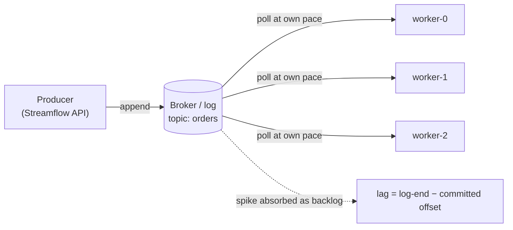
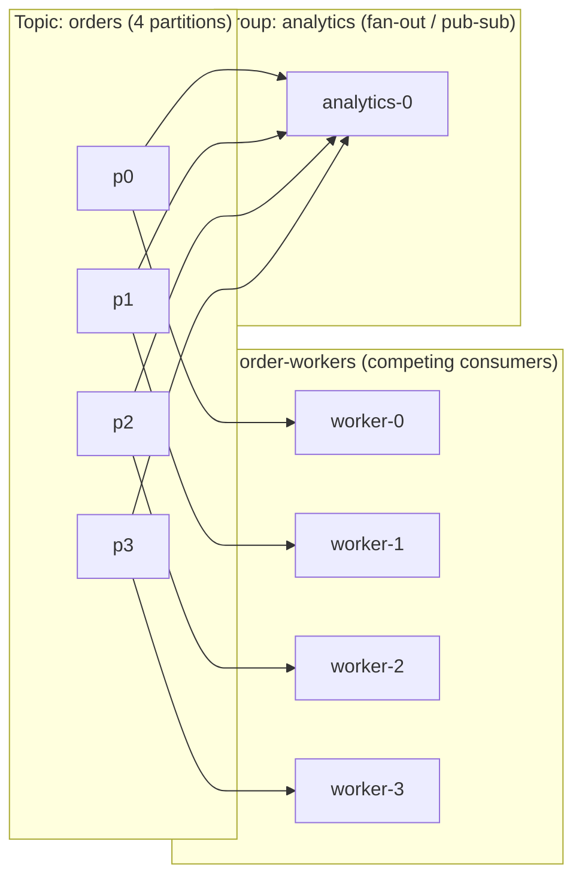
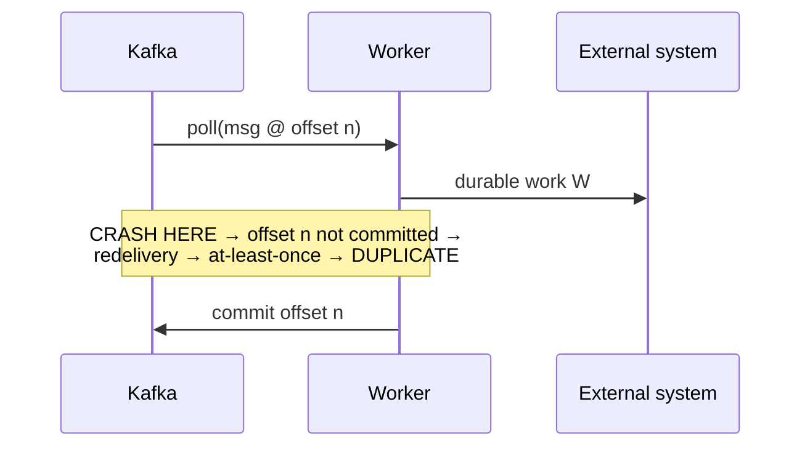

# Messaging and Distributed Queueing

Most services start life synchronous: a request arrives, the handler does the work, and the response goes back on the same connection. That works until the work is slow, bursty, or unreliable, and then the caller is stuck waiting on whatever is slowest downstream. Asynchronous messaging breaks that coupling. It separates *receiving* a request from *doing* it: a producer drops a message into a broker and walks away, and a pool of workers consumes at its own pace. That one indirection is behind most of the event-driven architectures you will meet in practice.

This chapter is about the dynamics of that indirection. It begins with the deepest dividing line in the space, the difference between a queue that deletes messages on acknowledgement and a log that retains and replays them, and then works outward: who controls the pace of delivery (push, pull, or long-poll), how one stream can feed both a worker pool and many independent subscribers, where the crash window sits that makes "exactly-once" so slippery, and the two formulas (Little's Law and backpressure as an integral) that explain most queueing intuition. It closes with the question every broker cluster must answer, who owns the metadata, and the three answers the industry has given: ZooKeeper, KRaft, and Redpanda.

The running example is **Streamflow**, the event-driven order platform that threads through this book. Its API produces to an `orders` topic; worker pools and analytics jobs consume from it. The containers you scheduled in [Containers, Kubernetes, and Workloads](../10-containers-kubernetes/README.md) are the consumers you will reason about here.

> **Learning objectives**
> - Explain the difference between a delete-on-ack queue and a retained, replayable log, and choose between them for a given workload.
> - Explain why pull-based consumption gives backpressure for free, and what push brokers must add to match it.
> - Show how Kafka consumer groups provide both competing consumers and publish-subscribe at once.
> - Locate the crash window behind at-least-once delivery and design handlers that tolerate duplicates through idempotency.
> - Use Little's Law and the lag integral to reason about in-flight messages, latency, and sustainable throughput.
> - Compare ZooKeeper (ZAB), Kafka KRaft (Raft), and Redpanda (Raft per partition) as answers to cluster coordination.

## Before you begin

You should be comfortable with the replication, quorum, and consensus vocabulary from [System Design](../01-system-design/README.md) in this book. Knowing how a workload is deployed and scaled on Kubernetes, from [Containers, Kubernetes, and Workloads](../10-containers-kubernetes/README.md), helps when lag-based autoscaling comes up.

The chapter ships three small programs you can run while you read. [`code/backpressure_demo.py`](code/backpressure_demo.py) (plain `python3`, no dependencies) and its Go twin [`code/backpressure-demo.go`](code/backpressure-demo.go) (`go run`) simulate a push and a pull consumer side by side: watch the push model drop messages while the pull model converts the surplus into lag, with nothing lost. [`code/raft_election.go`](code/raft_election.go) (`go run`) runs a Raft leader election; trace the terms and votes and confirm that a minority partition can never elect a leader. That is the KRaft controller quorum in miniature. If you want hands-on time with a real broker, stand up a single-broker [Redpanda](https://redpanda.com/) (no ZooKeeper, Kafka-API compatible) and a vanilla [Kafka in KRaft mode](https://kafka.apache.org/documentation/#kraft), produce 1000 messages to `orders`, then start a second consumer *group* and replay from offset 0. You will have proved fan-out and retention for yourself.

## Why decouple at all

A producer appends a message to a log or queue and moves on; a pool of workers consumes at its own pace. That buys three properties at once. The first is **elasticity**: you scale producers and consumers independently, and adding workers drains the backlog faster. The second is **resilience**: a worker crash does not lose the message, because it stays in the broker until it has been durably processed. The third is **load-leveling**: a traffic spike becomes a *longer queue* rather than a meltdown. The broker absorbs the burst, and the workers catch up.

Every design decision in the rest of the chapter (queue versus log, push versus pull, competing versus fan-out, the delivery semantics) is a different answer to one question: how does a message get from a producer to the worker that handles it, and what happens when something fails along the way?

## Queue versus log

The classic message **queue** (RabbitMQ, Amazon SQS, JMS) and the **log** (Kafka, Redpanda, Pulsar) sit at opposite ends of one axis: who remembers what has been consumed.

A classic queue deletes on acknowledgement. The broker holds each message until a consumer acknowledges it, then deletes it, and along the way it tracks per-message state: in flight, acknowledged, redelivered. Once a message is gone, nobody can read it again. That is ideal for distributing tasks and poor for letting three independent systems each read the same stream.

A log retains and replays. Kafka keeps every message for a **retention window**, bounded by time or size, regardless of who has read it. A partition is an ordered, append-only sequence, and each message gets a monotonic **offset**. The broker is deliberately dumb: it does not track per-consumer progress. Instead, **each consumer group records its own committed offset**, which amounts to saying "I have processed up to offset N."

The consequences cascade from that single choice. A new consumer group can reset to offset 0 and **replay** history, which is impossible in a delete-on-read queue. Any number of groups can read the same partition at different positions for free, so **multiple independent readers** come at no extra cost. And the broker **scales trivially**, because it only appends and serves byte ranges; it never maintains a per-message set of acknowledged and unacknowledged messages. The table below lines up the differences.

| Dimension | Classic queue (SQS, RabbitMQ) | Log (Kafka, Redpanda) |
|-----------|-------------------------------|------------------------|
| Lifecycle | Delete on acknowledgement | Retained for a retention window |
| Progress state | Broker tracks per-message | Consumer tracks its own offset |
| Replay | No (message gone after ack) | Yes (reset offset) |
| Multiple readers of same data | Needs fan-out copies | Native (one group per reader) |
| Ordering | Per-queue, weak (SQS FIFO is the exception) | Strict per-partition |

The replayable log is also what makes the Kappa architecture possible, which is the data-engineering view of the same Kafka. Log compaction, watermarks, and the stream processing built on top are covered in [Batch and Streaming Processing](../../data-engineering/03-batch-streaming/README.md) in *Data Engineering*; this chapter keeps to the messaging dynamics and does not repeat that material.

## Push, pull, and long-polling

Once you know where messages live, the next question is who controls the pace at which they are delivered.

With **push** (RabbitMQ, SQS via callbacks, webhooks), the broker sends messages to the consumer as they arrive. That is fast when the consumer keeps up and dangerous when it does not, because the broker can outrun a slow consumer. The defense is a **prefetch or credit limit**: with RabbitMQ's `prefetch_count`, for example, the consumer says "send me at most K unacknowledged messages."

With **pull** (Kafka), the consumer calls `poll()` and asks for the next batch when it is ready. It never receives more than it requested.

**Long-polling** (SQS `ReceiveMessage` with `WaitTimeSeconds`) is pull with waiting. The consumer asks, and the broker holds the request open until a message appears or the timeout fires. Technically it is pull, but operationally it behaves like a responsive push work queue: low latency without busy-spinning.

The important property is that pull gives you **backpressure for free**. Backpressure is the system telling a fast producer "slow down, the consumers are behind." With pull, this happens without any protocol at all. A slow worker simply calls `poll()` less often, so it pulls fewer messages, so its **consumer lag** (log-end offset minus committed offset) grows. Nothing is pushed onto it, nothing overflows, and nothing is dropped. The lag *is* the backpressure signal, and it is exactly what your autoscaler watches when KEDA scales a consumer group on lag, as described in [Containers, Kubernetes, and Workloads](../10-containers-kubernetes/README.md). With push you must *build* backpressure out of prefetch windows or flow-control credits, or risk burying a consumer. Here is how the three models compare.

| | **Pull (Kafka)** | **Push (RabbitMQ, webhooks)** | **Long-poll (SQS)** |
|--|------------------|-------------------------------|---------------------|
| Who sets pace | Consumer (`poll()`) | Broker | Consumer (asks; broker waits) |
| Backpressure | Free (poll less → lag grows) | Must add prefetch/credits | Free (ask less often) |
| Backlog visibility | **Consumer lag** | Queue depth | `ApproximateNumberOfMessages` |
| Replay | Yes (reset offset) | No (gone after ack) | No |
| Ordering | Per-partition | Usually none | None (FIFO queues excepted) |
| Best for | High-throughput streams, replay, many readers | Per-message ack, simple work queues | Decoupled work queues at AWS |

Run [`code/backpressure_demo.py`](code/backpressure_demo.py) or [`code/backpressure-demo.go`](code/backpressure-demo.go) to see this happen: the push model drops the surplus while the pull model retains it as lag.

## Competing consumers and publish-subscribe

Pace is one dimension; fan-out is another. *Enterprise Integration Patterns* names two foundational ways to distribute messages. With **competing consumers** (a work queue), each message goes to exactly one worker in a pool, and adding workers spreads the load. This is how you scale processing. With **publish-subscribe** (fan-out), each message goes to every subscriber. This is how independent systems react to the same event: one service takes the payment, one sends the email, one updates analytics.

Kafka does both at once through **consumer groups**. Within one group, partitions are divided among the members, which gives you competing consumers: each partition is owned by exactly one consumer in the group, so the group handles each message once. Across groups, every group sees every message, which gives you publish-subscribe. In Streamflow, the `order-workers` group and an independent `analytics` group both read all of `orders`, each at its own offsets.

There is an operational corollary you should see coming: a fifth worker in `order-workers` would sit idle, because there is no partition left for it to own. Partition count is the parallelism ceiling. That limit, together with rebalancing and pool sizing, is worked through in the [partitioned consumers](../07-durable-orchestration/README.md#partitioned-consumers) part of [Durable Orchestration and Workers](../07-durable-orchestration/README.md) in *Systems Engineering*, with real Kafka consumers in its [Kafka consumers side quest](../07-durable-orchestration/13-kafka-consumers/). When you partition, key messages by entity (per order, per user) whenever per-entity ordering matters, since ordering is guaranteed only within a partition.

## Delivery semantics and the crash window

Now consider what happens when a worker fails. Let the worker's job be three steps: (1) `poll` a message at offset $n$, (2) do durable work $W$, and (3) `commit` offset $n$. The delivery semantics depend entirely on the order of steps 2 and 3 and on where a crash lands.

**At-most-once** commits before the work: `poll → commit → W`. If the crash lands after the commit but before $W$ completes, the message is lost, because the offset has already advanced and the work was never durably done. You get no duplicates but possible loss, which is rarely acceptable.

**At-least-once** commits after the work: `poll → W → commit`. This is the default and the correct choice. Its **crash window** is the interval between $W$ finishing and the commit landing. A crash there leaves the offset un-advanced, so the message is **redelivered**, and you get a **duplicate**. You get no loss but possible duplicates.

**"Exactly-once"** is the most misunderstood of the three. Kafka transactions plus the idempotent producer do give exactly-once *within Kafka-to-Kafka processing*: consume, transform, and produce, atomically tied to the offset commit. But the instant your handler touches an external system, such as a payment gateway or an email send, that external effect is outside the transaction and you are back to at-least-once.

The real fix is **idempotency**: make applying the same message twice equal applying it once, by deduplicating on a natural key, using conditional writes, or doing a `SETNX` on an idempotency key. The operational mechanics (the idempotency key, the transactional outbox, dead-letter queues, retry topics) are covered in [Durable Orchestration and Workers](../07-durable-orchestration/README.md). Here you need only the conceptual frame.

> **Warning:** Assume at-least-once delivery everywhere. The duplicate is not a bug; it is the contract. A handler that is not idempotent will eventually double-charge, double-send, or double-count.

## The math: Little's Law and backpressure as an integral

With the mechanics in place, two formulas explain almost all queueing intuition.

**Little's Law** relates the three quantities you actually measure:

$$ L = \lambda W $$

Here $L$ is the average number of in-flight (unacknowledged or uncommitted) messages, $\lambda$ is the arrival rate, and $W$ is the average time a message spends in the system, its latency. The law holds for *any* stable system, regardless of arrival distribution or service discipline, and you can read it three ways. Fix the throughput $\lambda$ and halve the latency $W$, and you halve the in-flight count $L$, so fewer messages sit parked in memory unacknowledged. Observe $L$ and $\lambda$, and you can infer $W = L / \lambda$ without timing anything. And if a worker pool of $c$ consumers each holds up to $p$ in-flight messages, then $L \le c \cdot p$, so the maximum sustainable arrival rate is $\lambda \le c \cdot p / W$.

**Backpressure as an integral** describes how the backlog evolves. Queue depth (consumer lag) is the running area between the arrival and service curves:

$$ \text{lag}(t) = \int_0^t \big(\lambda(s) - \mu(s)\big)\, ds $$

Here $\mu$ is the service rate, how fast the pool drains. When $\lambda > \mu$, lag accumulates; when $\mu > \lambda$, it drains. A spike is a temporary $\lambda > \mu$ that integrates into a hump of lag and pays back down later. That is load-leveling made quantitative. A pull consumer guarantees that $\mu$ is set by the consumer, so lag can grow only as fast as the real shortfall, and nothing is forced on a worker beyond $\mu$. [`code/backpressure_demo.py`](code/backpressure_demo.py) computes exactly this integral as its running backlog.

## Coordination and metadata: ZooKeeper, KRaft, and Redpanda

Everything so far assumed the broker cluster agrees on its own shape. It has to: a cluster of brokers needs a single, agreed answer to "who is the controller, which broker leads partition $p$, and what is the current ISR (in-sync replica set)?" That metadata must be **linearizable**, meaning everyone agrees on it, and it must survive node failure. This is a consensus problem, and the industry has answered it three ways.

### ZooKeeper and ZAB

Classic Kafka stored cluster metadata in an *external* ZooKeeper ensemble. ZooKeeper runs **ZAB (ZooKeeper Atomic Broadcast)**, a primary-backup protocol in which one leader sequences all writes and atomically broadcasts them to followers, and a quorum must acknowledge before a write commits. Kafka's controller watched ZooKeeper znodes and propagated changes to the brokers. It works, but it has costs: a second distributed system to operate, metadata changes bottlenecked through watches, and partition counts limited by how fast metadata could propagate (tens of thousands of partitions before it became painful).

### Kafka KRaft

[KIP-500](https://cwiki.apache.org/confluence/display/KAFKA/KIP-500%3A+Replace+ZooKeeper+with+a+Self-Managed+Metadata+Quorum) replaced ZooKeeper with **KRaft**: a dedicated quorum of controller nodes that run **Raft** and store all cluster metadata in an internal `__cluster_metadata` log. The Raft leader is the active controller, and metadata becomes just another replicated log that brokers *tail* (pull, again) to learn the current state.

Controller election is Raft leader election. Candidates bump a **term**, request votes, and a **majority quorum** elects exactly one leader per term; [`code/raft_election.go`](code/raft_election.go) lets you watch this happen. Metadata propagation becomes log replication: brokers replay the metadata log instead of reacting to ZooKeeper watches, so failover is faster and recovery is simply "catch up the log."

Removing ZooKeeper matters for four reasons. You run one system instead of two. Metadata as a log scales to *millions* of partitions. Controller failover is faster. And operations are simpler, with a smaller failure surface. ZooKeeper removal was completed in Apache Kafka 4.0, so KRaft is now the only mode.

### Redpanda

Redpanda is a clean-room, Kafka-API-compatible rewrite that takes the consensus idea further. It has no JVM, no ZooKeeper, and no separate coordinator. It is written in C++ on the [Seastar](https://seastar.io/) framework with a **thread-per-core (shard-per-core)** model: each CPU core owns a slice of partitions and its own memory, which avoids lock contention and garbage-collection pauses. And instead of one coordinator, it runs **Raft per partition**: every partition is its own Raft group managing its own replication and leader, so consensus is embedded everywhere rather than centralized. The result is lower tail latency and a single binary, the strongest contrast to the JVM-plus-ZooKeeper lineage.

### The frontier and the counterexample

Three further developments are worth knowing. **KIP-932 share groups**, "queues for Kafka," add queue-like competing-consumer semantics with per-message acknowledgement *on top of* the log, decoupling consumer count from partition count. That directly attacks the partition-equals-parallelism ceiling from the worker side. **KIP-405 tiered storage** offloads cold log segments to object storage such as S3 while hot data stays on local disk, which makes effectively infinite retention cheap and decouples storage from broker disk. And **Apache Pulsar** is the contrasting architecture. It separates *serving* (stateless brokers) from *storage* (the [Apache BookKeeper](https://bookkeeper.apache.org/) segment store). Brokers hold no data, so they scale and rebalance independently of storage, and segments stripe across bookies. Pulsar also offers native queue *and* stream semantics. It is the architectural opposite of Kafka's broker-owns-its-partitions model, and worth knowing as the counterexample.

## Choosing a technique

The chapter's ideas reduce to a set of choices, each with a situation where it is the right one. The table collects them for quick reference.

| Technique | When to apply |
|-----------|---------------|
| Log over queue (Kafka/Redpanda) | Replay, multiple independent readers, retention as source of truth |
| Classic queue (SQS/RabbitMQ) | Simple task distribution, per-message ack, no replay needed |
| Pull / long-poll consumption | When you want backpressure for free and lag-based scaling |
| Push + prefetch limits | Low-latency task delivery where you can bound in-flight work |
| Competing consumers (one group) | Scaling work across a pool |
| Publish-subscribe (multiple groups) | Independent systems reacting to the same events |
| Key by entity | When per-entity ordering matters (per-order, per-user) |
| At-least-once + idempotency | Default for anything touching external systems |
| KRaft / Raft quorum | Self-managed metadata, scale to many partitions, no ZooKeeper |
| Redpanda (thread-per-core, Raft/partition) | No-JVM, low-tail-latency, single-binary Kafka API |
| Tiered storage (KIP-405) | Cheap effectively-infinite retention |
| Share groups (KIP-932) | Queue semantics + parallelism beyond partition count |
| Pulsar (broker/storage split) | Independent scaling of serving vs storage |

## Where this leads

The consuming side of these dynamics (rebalancing, dead-letter queues, sizing the pool) continues in [Durable Orchestration and Workers](../07-durable-orchestration/README.md) in *Systems Engineering*. The data-engineering view of the same Kafka, with watermarks, compaction, and Kappa, is in [Batch and Streaming Processing](../../data-engineering/03-batch-streaming/README.md). Lag-based autoscaling with KEDA lives in [Containers, Kubernetes, and Workloads](../10-containers-kubernetes/README.md). The consensus and replicated-state-machine fundamentals behind Raft, ZAB, quorums, and linearizability are in [System Design](../01-system-design/README.md). And "exactly-once is idempotency" is a property you can test, which [The Testing Mentality](../../software-engineering/03-testing/README.md) in *Software Engineering* teaches you to do. The [Apache stack](../14-apache-stack/README.md) chapter later in this book places Kafka and Pulsar on the wider map.

These ideas show up across the industry. LinkedIn created Kafka and runs it at trillions of messages per day, which is where the log as a unifying abstraction came from. Confluent, the company built around Kafka, drove KRaft and tiered storage. Redpanda Data builds the Kafka-API-compatible C++ engine with thread-per-core and Raft per partition. Amazon offers SQS and SNS (queue plus pub-sub) and MSK (managed Kafka). StreamNative and Yahoo are behind Apache Pulsar and its BookKeeper-backed broker/storage split. For almost any backend or data role, async messaging behind a log is the default architecture, so queue versus log, push versus pull, and delivery semantics are core vocabulary.

### Further reading

- [Apache Kafka documentation](https://kafka.apache.org/documentation/): the Design, Implementation, and Replication sections.
- [The Log: What every software engineer should know about real-time data's unifying abstraction](https://engineering.linkedin.com/distributed-systems/log-what-every-software-engineer-should-know-about-real-time-datas-unifying-abstraction) by Jay Kreps: why a log subsumes queues and pub-sub.
- *Designing Data-Intensive Applications* (Kleppmann), Chapter 11, "Stream Processing."
- [Enterprise Integration Patterns](https://www.enterpriseintegrationpatterns.com/): Competing Consumers, Publish-Subscribe, Dead Letter Channel.
- [*In Search of an Understandable Consensus Algorithm*](https://raft.github.io/raft.pdf): the Raft paper, the consensus behind KRaft and Redpanda.
- [ZooKeeper: Wait-free coordination for Internet-scale systems](https://www.usenix.org/legacy/event/atc10/tech/full_papers/Hunt.pdf): ZAB and the coordinator Kafka shed.
- [KIP-500](https://cwiki.apache.org/confluence/display/KAFKA/KIP-500%3A+Replace+ZooKeeper+with+a+Self-Managed+Metadata+Quorum) (KRaft), [KIP-405](https://cwiki.apache.org/confluence/display/KAFKA/KIP-405%3A+Kafka+Tiered+Storage) (tiered storage), and [KIP-932](https://cwiki.apache.org/confluence/display/KAFKA/KIP-932%3A+Queues+for+Kafka) (share groups).

## Key terms

- **Log**: an append-only, ordered sequence of messages retained for a window regardless of who has read it.
- **Offset**: the monotonic position of a message within a partition; consumers record the offset they have processed up to.
- **Consumer group**: a set of consumers that divide a topic's partitions among themselves; different groups each see every message.
- **Consumer lag**: log-end offset minus committed offset; the backlog a group still has to process.
- **Backpressure**: the signal that tells a fast producer the consumers are behind; free under pull, built from prefetch limits under push.
- **At-least-once delivery**: committing after the work, so a crash between work and commit causes a redelivered duplicate but never a loss.
- **Idempotency**: the property that applying the same message twice has the same effect as applying it once.
- **KRaft**: Kafka's Raft-based controller quorum that stores cluster metadata in an internal log and replaced ZooKeeper.

## Summary

- A queue deletes on acknowledgement; a log retains and replays, and its consumers own their offsets. That is the deepest dividing line in messaging.
- Pull consumption gives backpressure for free: surplus stays in the log as lag, and lag is the signal autoscalers watch.
- Consumer groups give competing consumers within a group and publish-subscribe across groups, with partition count as the parallelism ceiling.
- "Exactly-once" is mostly idempotency; the crash window between work and commit makes at-least-once the honest default.
- Little's Law ($L = \lambda W$) and the lag integral turn queueing intuition into numbers.
- Someone must own the metadata: ZooKeeper did it externally with ZAB, KRaft folds it into Kafka with Raft, and Redpanda runs Raft per partition with no coordinator at all.

## Review questions

1. Why can a Kafka topic serve both a worker pool and an independent analytics job reading the same messages, when a classic SQS queue cannot do this without copies?
   

Answer
The log retains messages for a retention window regardless of who has read them, and each consumer group tracks its own committed offset. Two groups simply read the same partitions at different positions. A classic queue deletes a message once it is acknowledged, so a second reader would need its own fan-out copy.

2. A slow pull consumer and a slow push consumer each receive a burst three times larger than they can process. What happens to each?
   

Answer
The pull consumer calls <code>poll()</code> less often, so the surplus stays in the log and shows up as growing consumer lag; nothing is dropped. The push consumer is sent messages faster than it can handle them; without prefetch or credit limits it is overwhelmed and messages can be dropped or pile up in its memory.

3. A worker polls a message, charges a card, and then commits the offset. Where is the crash window and what is the consequence?
   

Answer
Between the charge completing and the commit landing. A crash there leaves the offset uncommitted, so the message is redelivered and the card can be charged twice. Kafka transactions do not help because the payment gateway is outside the transaction; the fix is an idempotency key the charge path deduplicates on.

4. A pool of 8 consumers each holds at most 50 in-flight messages, and average processing latency is 0.2 seconds. What is the maximum sustainable arrival rate?
   

Answer
By Little's Law, $L \le c \cdot p = 8 \cdot 50 = 400$, so $\lambda \le c \cdot p / W = 400 / 0.2 = 2000$ messages per second.

5. Why does a sixth consumer in a group reading a five-partition topic do nothing?
   

Answer
Within a group each partition is owned by exactly one consumer. With five partitions there are only five owners; the sixth consumer has no partition to own and sits idle. Partition count is the parallelism ceiling (KIP-932 share groups aim to lift it).

6. What did Kafka gain by replacing ZooKeeper with KRaft, and how does Redpanda go further?
   

Answer
KRaft removes a second distributed system, stores metadata as a Raft-replicated log that brokers tail, scales to millions of partitions, and fails over faster. Redpanda drops the JVM and any central coordinator entirely, running a Raft group per partition on a thread-per-core C++ runtime for lower tail latency.

