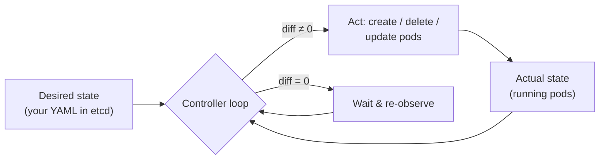
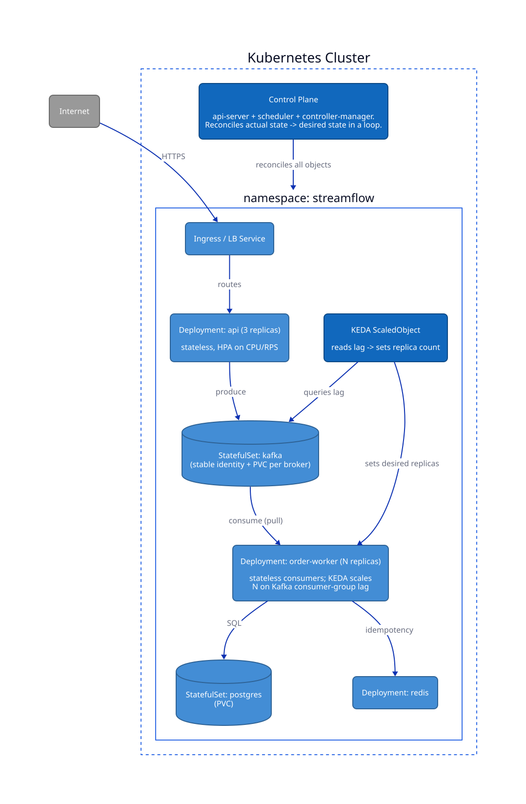
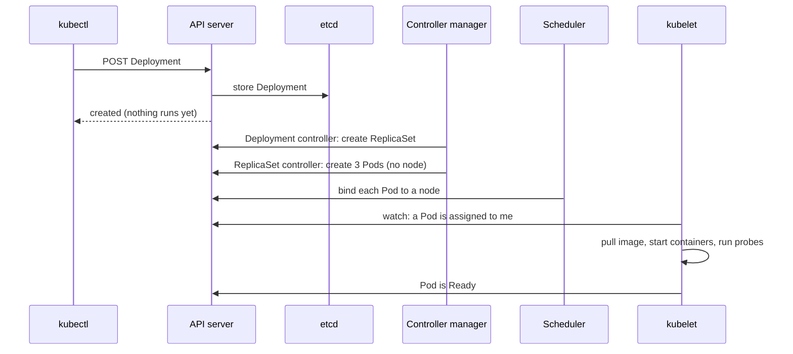
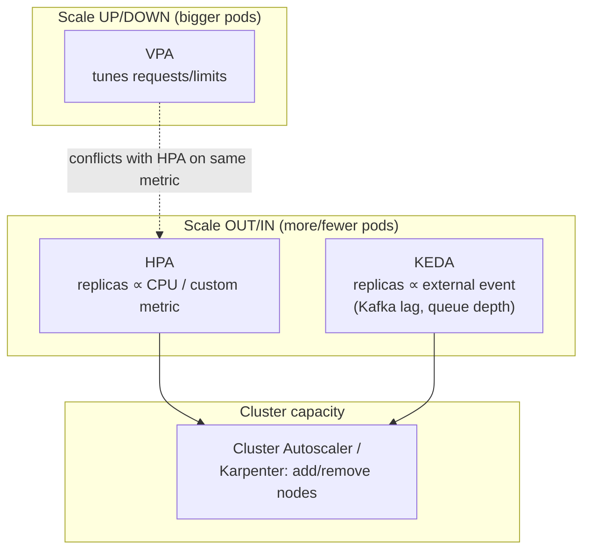

# Kubernetes Workloads and Deployment

Kubernetes is not a deploy tool; it is a **control system**. You write down the desired state of the world (three replicas, this image, this much memory), and a set of controllers runs an endless loop: observe the actual state, diff it against the desired state, act to close the gap. A Pod dies, the loop notices, and it makes a new one. You change the image, and the loop rolls Pods one at a time. Once you see everything as this loop, the platform stops being magic, and you can draw it honestly as a [C4 deployment view](../../software-engineering/11-diagramming/) in *Software Engineering*.

This chapter takes that idea from concept to a running platform. The opening pages lay out the model: what a container actually is, the handful of Kubernetes objects you use every day, the control-plane components that act on them, the stateful-versus-stateless split that decides how a workload is run, the caveats where real outages live, and the three axes of scaling. The sections then apply it to a real system. You start with a tracer deployment, the smallest thing that streams a completion end to end on a kind cluster, and harden it step by step: reproducible images, a local registry, production Helm charts with the observability stack, a fast dev loop, CI, and finally the stateful durable server, autoscaled workers, and the agent worker.

> **Learning objectives**
> - Explain a container as a namespaced, cgroup-limited process with a layered filesystem, and build small, reproducible, non-root images.
> - Read any Kubernetes behavior as a consequence of the reconciliation loop, and choose the right object (Deployment, StatefulSet, Service, Job, autoscaler) for a workload.
> - Configure requests and limits, readiness and liveness probes, graceful shutdown, and PodDisruptionBudgets so they prevent outages instead of causing them.
> - Package the serving platform as images and Helm charts with values schemas, run it on kind with a local registry, and keep it green with a Tilt loop and CI.
> - Run stateful and queue-driven workloads: a StatefulSet with a persistent WAL and workers scaled on queue depth with KEDA.

## Before you begin

You need Linux basics and comfort with a shell. The deployment view from [Diagramming with the C4 Model](../../software-engineering/11-diagramming/) in *Software Engineering* is the picture you will be operating. [Containers and Kubernetes](../../programming-and-algorithms/01-language-primers/07-containers-and-kubernetes.md) in *Programming and Algorithms* introduces images, layers, Pods, Deployments, Services, Helm, and kind on a toy server; the sections here assume it. The programs being packaged come from *AI Engineering* (the engine, starting at [Your first endpoint](../../ai-engineering/23-model-serving/01-your-first-endpoint.md)) and *AI Engineering* ([the tracer gateway](../../ai-engineering/25-ai-gateway/01-streaming-proxy.md) and [Durable Orchestration and Workers](../07-durable-orchestration/)), but you can read the Kubernetes side without having built them.

The best way to learn the model is to poke it. Build the annotated [`Dockerfile`](manifests/Dockerfile) in this chapter's directory and inspect its layers with `docker history`, then make it smaller. Apply the [manifests](manifests/) to a local cluster ([kind](https://kind.sigs.k8s.io/) or [k3d](https://k3d.io/)), kill a Pod, and watch the Deployment recreate it. Set a memory limit below what the app needs and watch it get `OOMKilled`; internalize that a limit is a quota, not a suggestion.

## Containers: what they actually are

A container is a Linux process isolated by **namespaces** (its own view of PIDs, mounts, network, and users) and constrained by **cgroups** (CPU and memory quotas). It is not a VM. The image is a stack of read-only **layers**, a content-addressed tarball per `RUN` or `COPY`, unioned at runtime with a thin writable layer. Three consequences follow.

First, the kernel is shared. A container cannot run a different OS kernel than the host (there are no Linux containers on a Windows kernel without a VM). That makes containers lighter than VMs and their isolation weaker, and it is both the whole point and the source of most surprises. Second, layers cache. Order your `Dockerfile` from least to most frequently changed so a code edit does not bust the dependency layer; the annotated [`Dockerfile`](manifests/Dockerfile) shows how. Third, builds can have multiple stages. Compile in a fat builder stage and copy only the binary into a tiny runtime (`distroless` or `scratch`): a smaller image means faster pulls and a smaller attack surface.

**Twelve-Factor** is the contract that makes a container orchestratable: config from the environment, stateless processes, logs to stdout, and disposability (fast startup, graceful shutdown). Violate it and Kubernetes will fight you.

## The objects you actually use

A small set of objects covers almost everything. Here is each one, what it gives you, and where it appears in Streamflow, the running example of this book:

| Object | What it gives you | For Streamflow |
|--------|-------------------|----------------|
| **Pod** | One or more co-scheduled containers sharing network and storage (the smallest unit) | rarely created directly |
| **Deployment** | Declarative replicas and rolling updates for **stateless** Pods | the `api` and `order-worker` |
| **ReplicaSet** | Keeps exactly N identical Pods (replicas) alive; a Deployment owns one per revision | created for you, never by hand |
| **StatefulSet** | Stable identity, a per-Pod persistent volume, ordered rollout | `kafka`, `postgres` |
| **Service** | A stable virtual IP and DNS name, load-balancing across Pods | `api` ClusterIP, ingress LB |
| **ConfigMap / Secret** | Externalized config and credentials (twelve-factor) | broker list, DB DSN |
| **Job / CronJob** | Run-to-completion and scheduled batch work | nightly reconciliation |
| **HPA / KEDA ScaledObject** | Autoscaling controllers (see below) | scale workers on lag |

The C4 deployment view maps directly onto these objects:

## The control plane: who does what

The objects above are records. Something has to read them and make the world match, and that something is a handful of processes split into two groups. The **control plane** decides; each **worker node** does the work. No component commands another directly: every one of them watches the API server and runs its own reconciliation loop.

| Component | Runs on | Job |
|-----------|---------|-----|
| **API server** | control plane | The only front door. Authenticates, authorizes (RBAC), runs admission webhooks, and reads and writes objects. Every other component talks only to it. |
| **etcd** | control plane | The consistent key-value store that holds every object, which is to say the desired state. Lose it without a backup and you lose the cluster. |
| **Controller manager** | control plane | Runs the built-in controllers (Deployment, ReplicaSet, Job, node, EndpointSlice), each a reconciliation loop over one kind of object. |
| **Scheduler** | control plane | Assigns each unscheduled Pod to a node: filters out nodes that cannot fit it, scores the rest, and writes the choice onto the Pod. |
| **kubelet** | every node | Watches for Pods assigned to its node, starts their containers, runs their probes, and reports status back. |
| **Container runtime** | every node | containerd (or CRI-O), which pulls images and starts the actual processes when the kubelet asks. |
| **kube-proxy** | every node | Programs iptables, IPVS, or nftables rules so a Service's virtual IP reaches the ready Pods behind it. |
| **Device plugins** | every node | Advertise hardware such as GPUs to the kubelet as countable extended resources. |

`kubectl` is none of these. It is a client that turns your YAML into HTTPS calls to the API server, and its job ends there.

The clearest way to see the split is to follow one command, `kubectl apply -f deployment.yaml` for a Deployment with three replicas:

1. **kubectl** POSTs the Deployment. The API server authenticates you, checks RBAC, runs admission webhooks, stores the object in etcd, and replies `created`. At this point nothing is running; you have only recorded an intent.
2. **The Deployment controller** sees a Deployment with no ReplicaSet for its template and creates one.
3. **The ReplicaSet controller** sees "want 3, have 0" and creates three Pod objects. They have no node yet, so they show as `Pending`.
4. **The scheduler** sees unassigned Pods. For each, it filters out nodes without enough free CPU, memory, or extended resources, nodes whose taints the Pod does not tolerate, and nodes that fail its selectors or affinity, then scores the survivors and writes `nodeName` onto the Pod. If no node passes the filter, the Pod stays `Pending` and the Cluster Autoscaler may add one.
5. **The kubelet** on that node sees a Pod assigned to it. It asks any device plugins for the extended resources the Pod requested, mounts volumes, and tells the container runtime to pull the image and start the containers.
6. **The kubelet** runs the startup, readiness, and liveness probes and reports status. When readiness passes, the EndpointSlice controller adds the Pod to its Service, and **kube-proxy** on every node routes the Service's IP to it.

Now kill one of the Pods. The ReplicaSet controller sees "want 3, have 2", creates a replacement, and the cycle runs again from step 4. A rolling update is the same loop one level up: the Deployment controller creates a second ReplicaSet for the new template and shifts the replica counts from old to new in steps, keeping the old ReplicaSet around so a rollback is just shifting them back.

Everything you add later fits the same shape. An HPA or KEDA is a controller that edits a Deployment's `replicas`. The Cluster Autoscaler and Karpenter watch for `Pending` Pods and add nodes. Operators such as the NVIDIA GPU Operator, and workload types such as LeaderWorkerSet, define their own objects (Custom Resource Definitions) and ship a controller that reconciles them. Once you can name which loop owns a field, you can debug almost any "why isn't it doing what I said" by asking what that loop sees.

## Workloads: stateful versus stateless

Of all the choices in that table, one axis decides how a workload is deployed, scaled, and operated, and getting it wrong means nothing else saves you. "Stateful versus stateless" is not about whether the process *does* work; it is about **where the durable state lives**.

A **stateless** workload runs as a Deployment: any Pod is interchangeable, and you scale by adding identical replicas. The `api` and `order-worker` are stateless *even though they do real work*, because their state lives in Kafka, Postgres, or Redis, not on local disk. That externalization is exactly what makes them trivially horizontally scalable, and it is the precondition for the lag-based scaling in [Durable Orchestration and Workers](../07-durable-orchestration/).

A **stateful** workload runs as a StatefulSet: Pods have stable network identities (`kafka-0`, `kafka-1`) and their own persistent volumes, with ordered rollout. You need this for the systems that *are* the state, brokers and databases. Be warned that running stateful systems on Kubernetes is genuinely hard (storage classes, backups, leader failover, rebalancing). Many teams run Kafka and Postgres as managed services and keep only stateless workloads in the cluster. Know the tradeoff before you volunteer to operate a Kafka StatefulSet; the coordination cost behind it is unpacked in Chapter 5, [Messaging and Distributed Queueing](../05-messaging-and-queueing/).

The rule of thumb: push every byte of state you can into a managed datastore so your own services stay stateless, and reserve StatefulSets for the data systems that have no stateless form. [Durable and worker images and charts](07-durable-and-worker-charts.md) is where this chapter meets that exception head on.

## The caveats nobody warns you about

The concepts rarely cause outages; the caveats do. Each of these has a one-line fix and a painful failure mode, which makes this the most important part of the chapter's model.

**Requests versus limits.** `requests` is what the scheduler reserves; `limits` is the hard cap. Exceed a memory limit and the container is `OOMKilled` instantly: not throttled, killed. Exceed a CPU limit and it is throttled (slow), not killed. Set memory requests equal to limits for predictability, and be careful with CPU limits, which can throttle latency-sensitive services. Forget requests altogether and the scheduler over-packs the node until everything thrashes.

**Liveness versus readiness probes.** Do not confuse them. *Readiness* asks "can I serve traffic now?" Fail it and the Pod is removed from the Service, **not restarted**; use it during startup and when a dependency is down. *Liveness* asks "am I wedged and in need of a restart?" Fail it and the Pod is **killed and restarted**. The classic outage is a liveness probe that checks a downstream dependency: the dependency blips, every Pod fails liveness, the whole Deployment restart-loops, and a minor blip becomes a full outage. Liveness probes must check only the Pod itself.

**Graceful shutdown and SIGTERM.** On scale-down or rollout, Kubernetes sends `SIGTERM`, waits `terminationGracePeriodSeconds` (default 30 s), then sends `SIGKILL`. A worker that ignores SIGTERM is killed mid-message, which means duplicate or lost work. You must trap SIGTERM: stop accepting new work, finish in-flight messages, commit offsets, and exit ([Durable Orchestration and Workers](../07-durable-orchestration/) shows the consumer side). The Pod is also removed from the Service *asynchronously*, so handle in-flight requests during the drain with a `preStop` sleep.

**The image tag trap.** `image: app:latest` is non-deterministic: two nodes can pull different bytes, and you cannot roll back. Pin a digest or an immutable tag.

**PodDisruptionBudgets.** Without a PDB, a node drain (an upgrade, an autoscale-down) can evict *all* your replicas at once. Declare a PDB so voluntary disruptions stay safe, and size it so a drain can still finish.

**Networking is flat but mediated.** Every Pod gets an IP, and Pods reach each other directly, but you reach them through a Service (stable), not a Pod IP (ephemeral). `NetworkPolicy` denies nothing by default: without one, every Pod can talk to every other Pod.

**Init containers and startup order.** Kubernetes does not guarantee your dependencies are up. Do not assume Kafka is ready when the worker starts; use init containers, readiness gating, and retry with backoff in the app.

## The scaling process

The last piece of the model is scaling, which has three independent axes (Pods, Pod size, and nodes) plus event-driven scaling. They compose:

The **Horizontal Pod Autoscaler (HPA)** adds and removes Pod replicas based on CPU, memory, or custom metrics, and it is the default for stateless web services. For workers, though, CPU is a terrible proxy for queue backlog: a worker can be idle (low CPU) while millions of messages pile up. The **Vertical Pod Autoscaler (VPA)** right-sizes `requests` and `limits`; do not run it and an HPA on the *same* metric, because they fight, and expect it to need a Pod restart to apply. The **Cluster Autoscaler** (or Karpenter) adds nodes when Pods cannot be scheduled and removes underused ones, which is why "scaling Pods" can be slow: you may be waiting on a new VM to boot.

**KEDA** is the right tool for queue workers, and for them none of the built-in autoscalers does what you want without it. It scales the worker Deployment on Kafka consumer-group lag (or SQS depth, or a Prometheus query) and can scale to zero when idle. This is how Streamflow scales: lag rises, KEDA raises replicas (capped at the partition count, as [Durable Orchestration and Workers](../07-durable-orchestration/) explains), and the Cluster Autoscaler adds nodes if needed.

The full scaling story for a worker is therefore a chain: KEDA watches lag, sets desired replicas (at most the partition count), the scheduler places Pods, the Cluster Autoscaler grows the node pool if Pods are Pending, the Pods join the consumer group, a rebalance assigns them partitions, and the lag drains. Every arrow is a place it can stall, which is why you draw it. The annotated manifests [`deployment.yaml`](manifests/deployment.yaml), [`hpa.yaml`](manifests/hpa.yaml), and [`keda-scaledobject.yaml`](manifests/keda-scaledobject.yaml) show each piece.

## Techniques at a glance

Pulling the model together, these are the techniques this chapter applies and when each one is called for:

| Technique | When to apply |
|-----------|---------------|
| Multi-stage and distroless builds | Every production image |
| Pin images by digest | Every deployment (never `:latest`) |
| Set memory requests equal to limits | Every workload (avoid surprise OOMKills) |
| Liveness checks the Pod itself only | Every liveness probe |
| Trap SIGTERM, drain gracefully | Every worker and server |
| PodDisruptionBudget | Any workload with an availability target |
| HPA on a custom metric | Stateless services where CPU correlates with load |
| KEDA on queue lag | Any queue or stream worker (Streamflow's workers) |
| Cluster Autoscaler or Karpenter | Clusters with variable load |
| Run stateful systems as managed services | When you do not want to operate Kafka or a database on Kubernetes |

The same ideas run through the industry. Google's Borg was Kubernetes's predecessor and the birthplace of the reconciliation model, and GKE runs it today. Amazon's EKS, Karpenter, and Fargate focus on node autoscaling and serverless Pods. Netflix moved from its custom Titus scheduler to Kubernetes with an emphasis on resilience and graceful degradation, and AI labs run Kubernetes with GPU orchestration to scale stateless inference workers. In any platform or SRE role, you own the caveats above.

## In this chapter

1. [Tracer deploy: images, a kind cluster, two Helm charts, and Jaeger](01-tracer-deploy.md). Turns the engine and gateway into two images and two Helm releases on a kind cluster with Jaeger, and traces one request through all nine hops from your machine to the model and back.
2. [Dockerfiles for the gateway and the engine](02-dockerfiles-for-gateway-and-engine.md). Hardens the images for production: bases pinned by digest, a `HEALTHCHECK`, OCI labels from build args, a static gateway binary, and nothing secret in any layer.
3. [kind cluster, local registry, and port mappings](03-kind-cluster-and-local-registry.md). Recreates the cluster with every platform port bound to 127.0.0.1 and wires the nodes to a local registry, all from one script.
4. [Helm charts and the observability stack](04-helm-charts-and-observability-stack.md). Grows the charts into production charts with values schemas, a checked policy, PodDisruptionBudgets, a ledger volume, one engine release per role, and a pinned observability umbrella chart.
5. [The Tilt dev loop](05-tilt-dev-loop.md). Builds a seconds-fast inner loop: live-updated Go, rebuilt Rust, the production charts, a context guard, and a budgeted `tilt ci`.
6. [CI for the platform repo](06-ci-for-your-repo.md). Adds a pipeline of pinned, least-privilege jobs that lint, test, build images, deploy to kind, and gate performance on main.
7. [Durable and worker images and charts](07-durable-and-worker-charts.md). Runs the durable server as a StatefulSet with a WAL claim and quota, and scales drain-aware workers on queue depth with KEDA.
8. [The agent image and chart](08-agent-image-and-chart.md). Packages the agent worker as its own failure domain on the `agent` queue, and critiques two of its values.

The architecture principles from [Cloud Native](../09-cloud-native/) explain the broader context of orchestration, GitOps, and cloud-native patterns. Next, Chapter 11, [Observability](../11-observability/) covers the probes, metrics, and SLOs you scale and alert on; [Messaging and Distributed Queueing](../05-messaging-and-queueing/) explains the brokers your stateless Pods lean on; and [The Testing Mentality](../../software-engineering/03-testing/) in *Software Engineering* shows how to validate YAML and policy before it reaches the cluster.

## Key terms

- **Reconciliation loop / control loop**: a controller's endless cycle of observing actual state, diffing it against declared desired state, and acting to close the gap; every Kubernetes behavior follows from it.
- **Control plane**: the API server, etcd, scheduler, and controller manager, which store desired state and decide what should run where; worker nodes carry out those decisions.
- **Scheduler**: the control-plane component that binds each unscheduled Pod to a node by filtering out nodes that cannot fit it and scoring the rest.
- **kubelet**: the agent on every node that starts the containers of Pods assigned to that node, runs their probes, and reports their status to the API server.
- **ReplicaSet**: the controller-managed object that keeps a fixed number of identical Pods running; a Deployment creates one per template revision and shifts replicas between them during a rollout.
- **Twelve-Factor App**: a set of principles that make a service orchestratable: config from the environment, stateless processes, logs to stdout, strict build/run separation, and disposability (fast startup, graceful shutdown).
- **Resource requests and limits**: a container's `requests` are what the scheduler reserves for it and its `limits` are the hard cap; exceeding a memory limit kills the container, while exceeding a CPU limit only throttles it.
- **OOMKilled**: the termination reason for a container killed for exceeding its memory limit (exit code 137); it is a kill, not a slowdown.
- **Stateless workload / stateful workload**: a stateless workload keeps its durable state elsewhere, so any replica is interchangeable and it runs as a Deployment; a stateful workload is the state, needing stable identity and its own volume as a StatefulSet.
- **Horizontal Pod Autoscaler (HPA)**: the Kubernetes controller that adds or removes Pod replicas based on CPU, memory, or custom metrics; the default for stateless services, but a poor fit for queue workers.
- **Vertical Pod Autoscaler (VPA)**: a controller that right-sizes a Pod's resource requests and limits from observed usage; it usually restarts Pods to apply changes and must not share a metric with an HPA.
- **Cluster Autoscaler**: the component (or Karpenter) that adds nodes when Pods cannot be scheduled and removes underused ones, which is why scaling Pods can wait on a new machine to boot.
- **NetworkPolicy**: a Kubernetes object that acts as a pod-to-pod firewall; without one, every Pod can reach every other Pod.

## Further reading

- [Kubernetes documentation](https://kubernetes.io/docs/): free and authoritative.
- [The Twelve-Factor App](https://12factor.net/): the contract a container must honor.
- John Arundel and Justin Domingus, *Cloud Native DevOps with Kubernetes*, 2nd edition.
- [Kubernetes the Hard Way](https://github.com/kelseyhightower/kubernetes-the-hard-way)
- [OCI Image Spec](https://github.com/opencontainers/image-spec)
- [KEDA documentation](https://keda.sh/)
