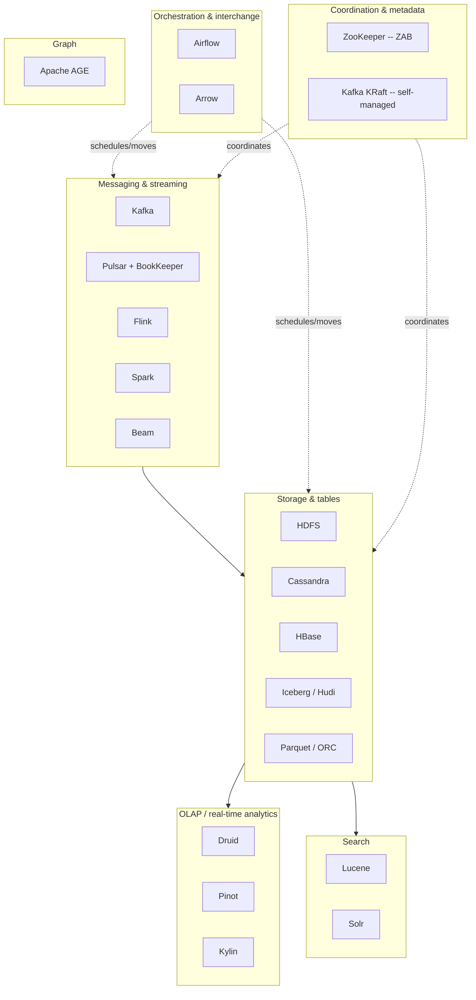

# The Apache Ecosystem

Sooner or later every data platform becomes a list of Apache project names: Kafka, Flink, Spark, Iceberg, Cassandra, Druid, Solr, Airflow, Arrow. Without a map, that list is trivia. This chapter gives you the map. It is a bird's-eye view rather than a deep dive: every box on it is covered in depth elsewhere in this book or its sibling books, and the value here is knowing *which* box to reach for and *why*, not re-deriving the internals.

The organizing idea is to group projects by the **problem they solve** rather than by age or popularity. Seven problem families cover the stack: coordination and metadata, messaging and streaming, storage and tables, OLAP and real-time analytics, search, orchestration and interchange, and graph. The chapter walks them in pipeline order, then steps back to the two threads that explain why the stack looks the way it does: much of it is an open re-implementation of Google's papers, and the Apache Software Foundation's governance model is what makes "Apache X" a signal of longevity. It closes with a decision table that maps problems to projects.

> **Learning objectives**
> - Name the one problem each major Apache data project solves, grouped into seven problem families.
> - Identify the single architectural decision that separates look-alike projects: Kafka and Pulsar, Flink and Spark, Iceberg and Hudi and Delta, Parquet and Iceberg.
> - Trace the Google-paper lineage behind HDFS, HBase, Hadoop, and Beam and Flink.
> - Explain what ASF governance guarantees and why it matters when you standardize on a project.
> - Choose a project for a stated requirement and say what you would swap if that requirement changed.

## Before you begin

This chapter leans on the storage and batch/streaming material in *Data Engineering* (start at its [front matter](../../data-engineering/README.md)), and on the replication, consensus, and CAP vocabulary of [System Design](../01-system-design/README.md) in this book. The earlier chapters of this book, [Messaging and Distributed Queueing](../05-messaging-and-queueing/README.md) and [Search and Indexing](../08-search-and-indexing/README.md), supply the depth behind two of the families here.

Read actively. For each family below, say out loud the one problem it solves before you read the projects in it; if you cannot, you will collect trivia instead of building a mental index. When two projects look interchangeable, look for the one architectural decision that separates them, because that difference is the whole reason both exist. And follow the links to go deep: do not try to learn Kafka or Iceberg from this page.

## A standard library for distributed data

The Apache Software Foundation is best understood as a **de-facto standard library for distributed data**. The recurring hard problems of large-scale systems (coordinate this cluster, move this firehose of events, store this petabyte cheaply, answer this aggregation in 50 ms, search this corpus, schedule this DAG) each get an open, governed, vendor-neutral reference implementation there. When a hard distributed-systems problem becomes common enough, an Apache project usually crystallizes as its reference answer.

The ASF does not write the code. It provides the **governance model** (meritocracy, the "Apache Way," and a foundation that holds the trademark and IP) that lets a project outlive any single company. That is why "Apache X" is a signal: it means a community, not a vendor, owns the roadmap. Here is the whole stack, grouped by problem:

Read the map as a pipeline. Events arrive through **messaging**, land in **storage** (raw files, wide-column rows, or open tables), and are served to **OLAP** engines and **search** indexes, with everything **coordinated** and **orchestrated**, and with **graph** as a specialized lens for when relationships are the data. The running example, **Streamflow**, threads the whole map: clickstream events flow into Kafka, then into Flink for real-time aggregates and Spark for nightly batch, then into Iceberg tables on object storage, and from there into Druid for sub-second dashboards and Solr for the product search box, all scheduled by Airflow. As you read each family, ask which project sits at each Streamflow stage, and what you would swap if a requirement changed: sub-second latency, multi-region writes, ad-hoc OLAP.

## Coordination and metadata

The unglamorous foundation answers questions like who the leader is, which broker owns which partition, and what the current cluster configuration is. This is a **consensus** problem, and getting it wrong corrupts everything above it. Two projects matter.

| Project | What it is | The one problem | Architecture idea |
|---------|------------|-----------------|-------------------|
| **ZooKeeper** | A replicated, hierarchical key-value store (znodes) for coordination | Reliable cluster metadata, leader election, locks | **ZAB** (ZooKeeper Atomic Broadcast): a leader-based total-order broadcast protocol, Paxos-adjacent; a strongly consistent small-data store |
| **Kafka KRaft** | Kafka's built-in Raft quorum that *replaces* ZooKeeper | Remove the external coordinator dependency | Metadata becomes an internal Raft-replicated log on the brokers themselves: one fewer system to operate, faster failover, far higher partition counts |

The story here is the move away from ZooKeeper. For a decade, ZooKeeper was the coordinator under Kafka, HBase, Solr, and more. Operating a separate ZooKeeper ensemble is real toil, and its consistency model (small data, watch-based) does not scale to millions of partitions. Kafka's **KRaft** mode, the production default since Kafka 3.x with ZooKeeper removed entirely in 4.0, folds coordination into the brokers via Raft. Both are covered in depth in [Messaging and Distributed Queueing](../05-messaging-and-queueing/README.md).

The non-Apache contrast is **etcd**. It is also Raft-based and also a consistent metadata store, but it became the coordination substrate of the cloud-native world as the backing store for Kubernetes (see [Containers, Kubernetes, and Workloads](../10-containers-kubernetes/README.md)). Same problem, two lineages: ZooKeeper from the Hadoop era, etcd from the Kubernetes era.

## Messaging and streaming

With the cluster coordinated, the next family moves an unbounded stream of events between systems and then computes over it. This is where the most active design tension in the stack lives.

| Project | What it is | The one problem | Architecture idea |
|---------|------------|-----------------|-------------------|
| **Kafka** | A distributed, partitioned, replicated commit **log** | Durable, replayable decoupling of producers from consumers | Append-only partitioned log; ordering within a partition; consumers read at their own offset. Storage and serving are **coupled** in the broker |
| **Pulsar** | A pub-sub messaging and streaming system | The same decoupling, with elastic, independently scaled storage | **Compute/storage separation**: stateless brokers serve; **Apache BookKeeper** (a separate log-storage service of "bookies") holds the durable ledgers. Built-in tiered storage and multi-tenancy |
| **Flink** | A true streaming, stateful processing engine | Low-latency, exactly-once stateful computation over unbounded streams | Event-at-a-time processing; keyed managed state; **Chandy-Lamport aligned checkpoints** for exactly-once recovery tied to source offsets |
| **Spark** | A general distributed compute engine (batch plus micro-batch streaming) | Optimized batch and good-enough streaming on one engine | Lazy DAG of transformations; Catalyst optimizer and Tungsten codegen; **Structured Streaming** treats a stream as an unbounded table (micro-batch by default) |
| **Beam** | A *unified programming model*, not an engine | Write one pipeline, run it on many engines | The **Dataflow model** (what, where, when, how) as a portable API; runners execute it on Flink, Spark, or Google Dataflow |
| **Storm / Samza** | First-generation stream processors (legacy) | Early real-time stream processing | Storm: at-least-once tuple processing; Samza: Kafka-native, local state. Mostly superseded by Flink; you will meet them in old systems |

Two contrasts define the family. **Kafka versus Pulsar** comes down to coupling. Kafka couples log storage to the broker, so adding storage means adding (and rebalancing) brokers. Pulsar splits them via BookKeeper, so you scale serving and storage on separate axes, at the cost of operating more moving parts. Kafka answers back with **tiered storage**, offloading cold log segments to object storage, which narrows the gap. **Flink versus Spark** comes down to which workload is first-class. Flink is streaming-first: sub-second latency, heavy stateful logic, complex event processing. Spark is batch-first with micro-batch streaming bolted on cleanly. Reach for Flink when latency and state dominate, and for Spark when you want one engine for big batch plus simpler streaming. Beam sits above both as a portability layer for teams that refuse to marry an engine. The log itself is covered in [Messaging and Distributed Queueing](../05-messaging-and-queueing/README.md); the processing engines, exactly-once, and watermarks are in [Batch and Streaming Processing](../../data-engineering/03-batch-streaming/README.md) in *Data Engineering*.

## Storage and tables

Streams have to land somewhere. This family is where the bytes actually live, and how files become tables with guarantees.

| Project | What it is | The one problem | Architecture idea |
|---------|------------|-----------------|-------------------|
| **Hadoop / HDFS** | A distributed filesystem (the historical foundation) | Store petabytes across commodity disks | **GFS re-implementation**: NameNode (metadata) plus DataNodes (blocks), 3x replication. Largely displaced by cloud **object storage** (S3, GCS), but the conceptual ancestor of the whole lake |
| **Cassandra** | A masterless wide-column store | Always-on, write-heavy, multi-region writes | **Dynamo lineage**: consistent-hash ring, no single point of failure, tunable quorum consistency; **LSM-tree** storage. Query-first modeling; partition key equals shard key |
| **HBase** | A distributed sorted map on HDFS | Random read/write over huge sparse tables | **Bigtable re-implementation**: sorted rows split into regions, LSM (memstore plus HFiles); strong per-row consistency. Reach for it when you need Bigtable semantics on-premises |
| **Iceberg** | An open **table format** over data files | ACID, time travel, schema and partition evolution on object storage | **Snapshot plus manifest** design: each commit writes a new immutable metadata snapshot pointing at manifest lists, then manifests, then data files. **Hidden partitioning** decouples layout from queries. The emerging open standard |
| **Hudi** | An open table format specialized for upserts | Fast incremental upserts and CDC on the lake | Copy-on-write versus merge-on-read tables; record-level indexes for mutate-heavy ingest |
| **Delta Lake** | A table format (**Linux Foundation, not Apache**) | ACID transactions via a write-ahead log | A transaction log (`_delta_log`) of ordered JSON commits; Databricks-native origin. Listed here because it competes head-on with Iceberg and Hudi |
| **Parquet / ORC** | Columnar **file formats** (the bytes on disk) | Compact, scan-efficient analytical storage | Columnar layout, per-column encoding and compression, and row-group statistics (min/max, zone maps) for predicate pushdown. The substrate Iceberg, Hudi, and Delta organize |

The layering here confuses almost everyone, so state it plainly: Parquet and ORC are *file* formats, which say how one file is encoded, while Iceberg, Hudi, and Delta are *table* formats, a metadata layer that turns a directory of those files into a transactional table. **Iceberg's rise** is the headline. Its engine-agnostic snapshot-and-manifest design, and its REST catalog, made it the format every major engine and cloud vendor now supports, and it is the point where the divide between lake and warehouse finally collapses into the **lakehouse**. Storage engines and table and file formats are covered in depth in [Storage and Warehousing](../../data-engineering/02-storage-warehousing/README.md); Cassandra's distribution model is also discussed in [Distributed Data and Caching](../06-distributed-data-and-caching/README.md) in *Systems Engineering*.

## OLAP and real-time analytics

Between a streaming engine and a slow warehouse there is a gap: sub-second aggregations over fresh data. Three projects fill it.

| Project | What it is | The one problem | Architecture idea |
|---------|------------|-----------------|-------------------|
| **Druid** | A real-time analytics database | Low-latency slice-and-dice over event streams | Segment-based columnar storage, time-partitioned; ingests from Kafka *and* serves queries; pre-aggregation at ingest. Powers live dashboards |
| **Pinot** | A real-time OLAP datastore | Ultra-low-latency, high-QPS user-facing analytics | Columnar segments with rich indexing (inverted, star-tree, range); built for serving analytics *to end users* at scale, such as "who viewed your profile" |
| **Kylin** | A distributed OLAP engine | Sub-second queries on huge dimensional data | **Pre-computed OLAP cubes** over Hadoop and Hive; trades storage and build time for instant cube lookups. More legacy and batch-cube oriented than Druid or Pinot |

Reach here when your dashboard query is too latency-sensitive or too high-QPS for a warehouse, but too analytical (a group-by over millions of rows) for an OLTP store. Druid and Pinot both ingest directly from Kafka, which closes the loop with the messaging family; Streamflow's live dashboards sit here. [Storage and Warehousing](../../data-engineering/02-storage-warehousing/README.md) covers the columnar storage underneath.

## Search

Full-text relevance ranking is a different problem from both OLAP (aggregation) and key-value access (point lookup), and it has its own pair of projects.

| Project | What it is | The one problem | Architecture idea |
|---------|------------|-----------------|-------------------|
| **Lucene** | A full-text search *library* (the engine core) | Index a corpus and rank documents by relevance | The **inverted index** (term to postings list of documents), plus tokenization, analysis, and BM25 scoring. Not a server: a JAR you embed |
| **Solr** | A search *server* built on Lucene | Operate Lucene as a distributed, queryable service | Adds sharding, replication, an HTTP API, and faceting over Lucene. Elasticsearch and OpenSearch are the other Lucene-based servers |

The key relationship is that Lucene is the engine and Solr, Elasticsearch, and OpenSearch are servers wrapped around it. That is why interview questions about inverted indexes, analyzers, and BM25 are really *Lucene* questions, whichever server runs in production. Streamflow's product search box is Solr in front of a Lucene index. The internals are the subject of [Search and Indexing](../08-search-and-indexing/README.md).

## Orchestration and interchange

Someone has to schedule the pipeline, and data has to move between systems without being re-serialized at every hop. This family handles both.

| Project | What it is | The one problem | Architecture idea |
|---------|------------|-----------------|-------------------|
| **Airflow** | A workflow scheduler | Express and run dependency-ordered batch pipelines | **DAGs as Python code**; a scheduler triggers tasks when their upstreams succeed; rich retries and backfills. The default batch orchestrator |
| **Beam** | The unified pipeline model from the messaging family | Engine-portable data processing | Cross-listed: Beam is both a streaming abstraction and an orchestration-adjacent one |
| **Arrow** | An in-memory **columnar interchange** format | Move and share columnar data with zero copies and no serialization | A standardized in-memory columnar layout so Spark, pandas, DuckDB, and Parquet readers share buffers directly. **ADBC** is the emerging Arrow-native database connectivity standard, a columnar JDBC/ODBC |

Arrow matters more than it looks. Most data-system overhead is serializing and deserializing between processes. Arrow defines *one* in-memory columnar layout that everyone agrees on, so handing a table from Spark to pandas to DuckDB becomes a pointer pass rather than a re-encode. Arrow Flight, Flight SQL, and ADBC extend this to the wire. It is the quiet, frontier-relevant glue under the modern stack. Airflow DAGs and the modeling layer around them are covered in [Orchestration and Modeling](../../data-engineering/04-orchestration-modeling/README.md); Arrow and the columnar formats are in [Storage and Warehousing](../../data-engineering/02-storage-warehousing/README.md).

## Graph

The last family is for when the relationships *are* the data and traversals dominate.

| Project | What it is | The one problem | Architecture idea |
|---------|------------|-----------------|-------------------|
| **Apache AGE** | A **Postgres extension** for graphs | Run graph (Cypher) queries alongside relational tables | openCypher inside Postgres: one database for relational, vector (with pgvector), and graph data, instead of bolting on a separate Neo4j |

Reach here for multi-hop traversals (friends-of-friends, dependency chains, GraphRAG subgraphs) that would be self-join hell in plain SQL, when you would rather extend the Postgres you already run than operate a dedicated graph database. [Distributed Data and Caching](../06-distributed-data-and-caching/README.md) picks up graph-on-Postgres.

## Lineage and governance

Having walked the families, step back. Two threads explain why the stack looks the way it does.

The first is that a striking share of the foundation is an **open re-implementation of Google's papers**: GFS became HDFS, Bigtable became HBase (and, conceptually, Cassandra, which blends Bigtable's data model with Dynamo's distribution), MapReduce became Hadoop, and Dataflow became Beam and Flink. Read the paper and you have the architecture for free; the Apache project is the community-maintained implementation.

The second is the **ASF governance model**. The foundation holds the trademark and IP, enforces the Apache Way (public, merit-based, consensus-driven development), and requires a diverse community before a project graduates from the Incubator to top-level status. The payoff is **vendor neutrality and longevity**: "Apache X" signals that no single company can unilaterally relicense or abandon the project, which is exactly why enterprises standardize on it. Contrast the relicensing rug-pulls in the BSL and SSPL world, such as Elasticsearch's move described in [Search and Indexing](../08-search-and-indexing/README.md); the ASF model is the structural answer to that risk.

The frontier is moving toward **separation and interchange**: storage split from compute (Pulsar's BookKeeper, the lakehouse), the end of the separate coordinator (Kafka's KRaft), open table formats (Iceberg's rise), and zero-copy columnar interchange (Arrow and ADBC). These are where the coupled architectures of the 2010s are being unbundled, and they are worth tracking.

## Choosing the right project

The map is only useful if it turns a problem into a choice. The table below does that, with the tempting wrong answer alongside.

| Your problem | Reach for | Not |
|--------------|-----------|-----|
| Coordinate a cluster / store cluster metadata | KRaft (new), etcd (cloud-native), ZooKeeper (legacy) | A general database |
| Durable, replayable event backbone | Kafka (default) | A traditional message queue |
| Independently scale messaging storage and serving, multi-tenant | Pulsar (BookKeeper split) | Kafka, if operational simplicity matters more |
| Sub-second stateful streaming, exactly-once, CEP | Flink | Spark Structured Streaming |
| Big batch plus good-enough micro-batch on one engine | Spark | Flink |
| Engine-portable pipeline code | Beam | Binding to one engine |
| ACID tables and time travel on cheap object storage | Iceberg (open standard); Hudi (upsert-heavy); Delta (Databricks) | A raw directory of Parquet |
| Always-on, write-heavy, multi-region writes | Cassandra | A single-leader RDBMS |
| Bigtable-style sorted random access on-premises | HBase | A relational store |
| Sub-second, high-QPS user-facing analytics | Pinot (or Druid) | A cloud warehouse |
| Live operational dashboards over event streams | Druid | Batch warehouse queries |
| Full-text relevance search | Solr or Elasticsearch (Lucene under both) | A `LIKE '%...%'` query |
| Schedule dependency-ordered batch jobs | Airflow | Cron plus glue scripts |
| Zero-copy columnar data interchange | Arrow (plus ADBC) | Re-serializing between every system |
| Multi-hop graph queries beside relational data | Apache AGE | A separate graph database you must operate |

## Where this leads

Every family on the map has a deeper treatment. Kafka and Pulsar internals, KRaft, and ZAB are in [Messaging and Distributed Queueing](../05-messaging-and-queueing/README.md). Flink, Spark, Beam, exactly-once, and watermarks are in [Batch and Streaming Processing](../../data-engineering/03-batch-streaming/README.md). HDFS, Cassandra and HBase, Iceberg, Hudi, and Parquet, Druid and Pinot, and Arrow are in [Storage and Warehousing](../../data-engineering/02-storage-warehousing/README.md). Airflow DAGs, dbt, and the medallion pipeline are in [Orchestration and Modeling](../../data-engineering/04-orchestration-modeling/README.md). The Lucene inverted index, Solr, and BM25 are in [Search and Indexing](../08-search-and-indexing/README.md). Cassandra, Apache AGE, and etcd-style coordination appear in [Distributed Data and Caching](../06-distributed-data-and-caching/README.md), and etcd as the Kubernetes coordinator in [Containers, Kubernetes, and Workloads](../10-containers-kubernetes/README.md). The theory under every box (consensus, replication, CAP, Dynamo, and Bigtable) is in [System Design](../01-system-design/README.md).

The stack's origins are visible in who built what. LinkedIn created Kafka, Samza, and Pinot, and leans heavily on Lucene. Netflix created Iceberg and runs Kafka and Flink at massive scale. Confluent and StreamNative sell Kafka and Pulsar as products, driving KRaft, tiered storage, and BookKeeper. Databricks created Spark, along with Delta, and now supports Iceberg too. Uber created Hudi and runs Flink and Pinot. Apple and Bloomberg run large Cassandra and Solr fleets. For any data-platform or staff infrastructure role, knowing which box to reach for, and why, is the job.

### Further reading

- [The Apache Software Foundation projects directory](https://projects.apache.org/): the authoritative index of every top-level project.
- [Apache Lucene documentation](https://lucene.apache.org/core/documentation.html): the search core under Solr and Elasticsearch.
- [Apache Iceberg spec](https://iceberg.apache.org/spec/): the open table format reshaping the lakehouse.
- Project documentation: [Kafka](https://kafka.apache.org/documentation/), [Pulsar](https://pulsar.apache.org/docs/), [Flink](https://nightlies.apache.org/flink/flink-docs-stable/), [Spark](https://spark.apache.org/docs/latest/), [Cassandra](https://cassandra.apache.org/doc/latest/), [Druid](https://druid.apache.org/docs/latest/design/), [Pinot](https://docs.pinot.apache.org/), [Arrow](https://arrow.apache.org/docs/), [Airflow](https://airflow.apache.org/docs/).
- The lineage papers: ["The Google File System"](https://research.google/pubs/the-google-file-system/), ["Bigtable"](https://research.google/pubs/bigtable-a-distributed-storage-system-for-structured-data/), ["MapReduce"](https://research.google/pubs/mapreduce-simplified-data-processing-on-large-clusters/), and ["The Dataflow Model"](https://research.google/pubs/pub43864/).

## Key terms

- **Apache Way**: the ASF's public, merit-based, consensus-driven development model, backed by foundation ownership of trademark and IP.
- **Compute/storage separation**: an architecture in which serving nodes hold no durable data, so serving and storage scale independently (Pulsar with BookKeeper, the lakehouse).
- **File format**: how one file's bytes are encoded on disk (Parquet, ORC).
- **Table format**: a metadata layer that turns a directory of data files into a transactional table with snapshots and schema evolution (Iceberg, Hudi, Delta).
- **Real-time OLAP**: sub-second aggregation over fresh event data, served from columnar segments (Druid, Pinot).
- **Columnar interchange**: a shared in-memory columnar layout that lets systems pass tables without serialization (Arrow, ADBC).

## Summary

- Treat the ASF as a standard library for distributed data, and pick projects by the problem they solve, not by brand.
- Seven families cover the stack: coordination, messaging and streaming, storage and tables, OLAP, search, orchestration and interchange, and graph.
- Look-alike projects are separated by one architectural decision: coupled versus separated storage (Kafka, Pulsar), streaming-first versus batch-first (Flink, Spark), file versus table format (Parquet, Iceberg).
- Much of the stack re-implements Google's papers: GFS to HDFS, Bigtable to HBase, MapReduce to Hadoop, Dataflow to Beam and Flink.
- ASF governance buys vendor neutrality and longevity; the frontier is unbundling through storage/compute separation, KRaft, open table formats, and Arrow.

## Review questions

1. What is the one architectural decision that separates Kafka from Pulsar, and what does Kafka do to narrow the gap?
   

Answer
Kafka couples log storage to the broker, so adding storage means adding and rebalancing brokers. Pulsar separates stateless serving brokers from BookKeeper storage, so each scales independently at the cost of more moving parts. Kafka narrows the gap with tiered storage, offloading cold segments to object storage.

2. A colleague says "we use Parquet, so we don't need Iceberg." What distinction are they missing?
   

Answer
Parquet is a file format: it encodes one file efficiently. Iceberg is a table format: a snapshot-and-manifest metadata layer over many such files that provides ACID commits, time travel, and schema and partition evolution. Iceberg organizes Parquet files; it does not replace them.

3. Streamflow's product team wants a user-facing "orders in your area in the last minute" widget with thousands of queries per second. Which family and project would you reach for, and why not the warehouse?
   

Answer
Real-time OLAP, specifically Pinot (or Druid). It ingests directly from Kafka and serves sub-second, high-QPS aggregations from indexed columnar segments. A cloud warehouse is too slow and too expensive per query for user-facing QPS.

4. Why are questions about analyzers and BM25 "really Lucene questions" regardless of whether production runs Solr or Elasticsearch?
   

Answer
Both servers wrap per-shard Lucene indexes. The inverted index, analysis pipeline, and scoring all live in Lucene; the server adds sharding, replication, an API, and faceting.

5. Map each Google paper to its open re-implementation: GFS, Bigtable, MapReduce, Dataflow.
   

Answer
GFS to HDFS; Bigtable to HBase (and, conceptually, Cassandra's data model); MapReduce to Hadoop; Dataflow to Beam and Flink.

6. What does ASF governance guarantee that a single-vendor open-source project does not?
   

Answer
The foundation, not a company, holds the trademark and IP, and projects must have a diverse community to graduate. No single vendor can unilaterally relicense or abandon the project, which protects against the kind of BSL or SSPL relicensing that happened elsewhere.

