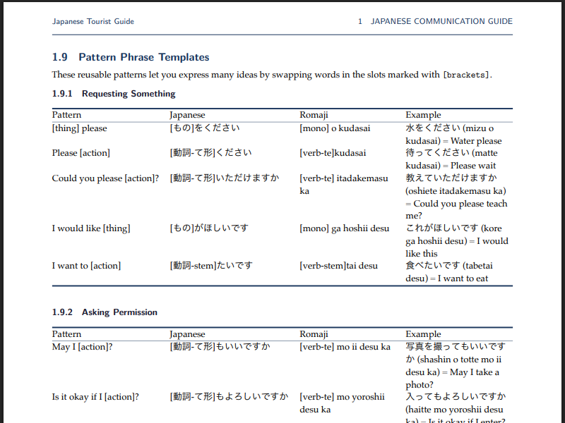
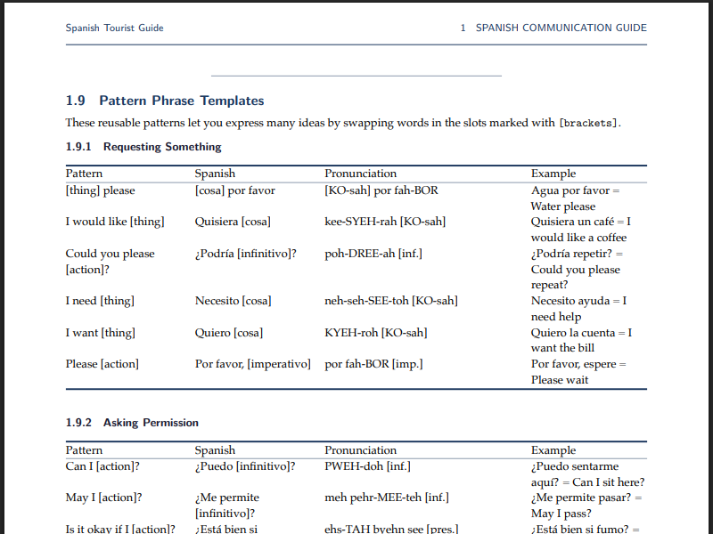
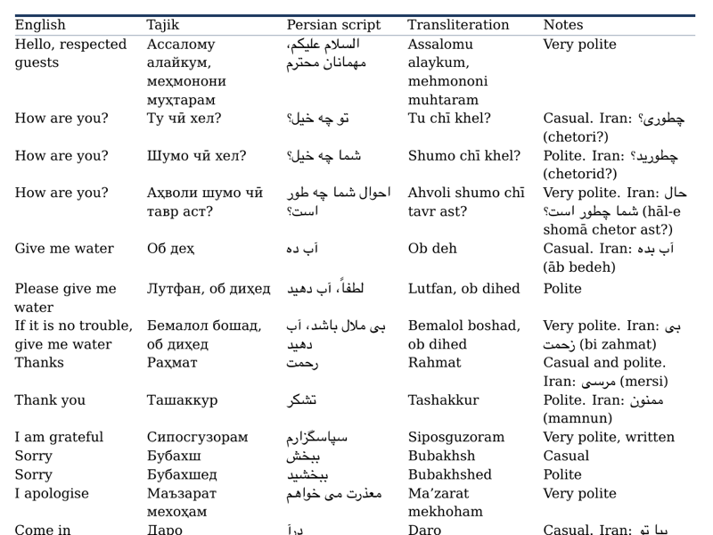
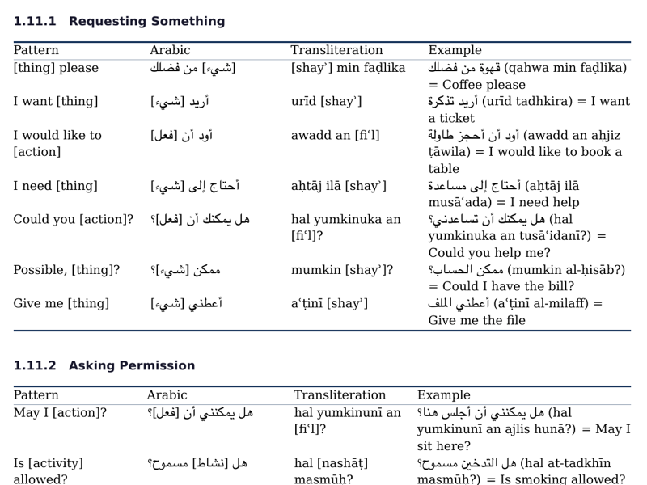
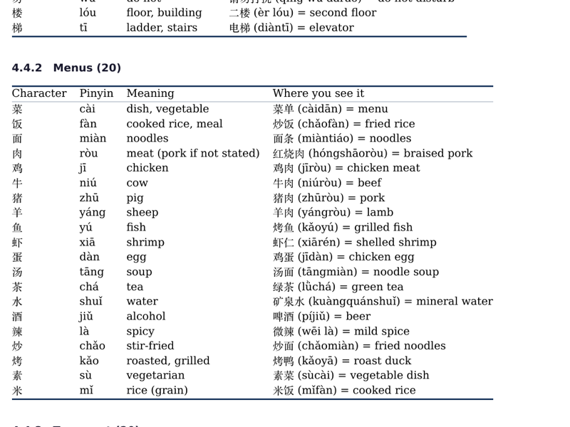
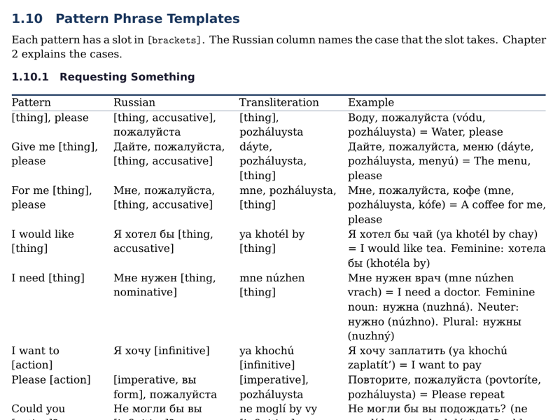

<p align="center">
  <h1 align="center">Languide</h1>
  <p align="center">
    Communication-focused language guides built from markdown
    <br /><br />
    <a href="https://github.com/urmzd/languide/releases">Download</a>
    &middot;
    <a href="https://github.com/urmzd/languide/issues">Report Bug</a>
    &middot;
    <a href="https://github.com/urmzd/languide/releases">Releases</a>
  </p>
</p>

<p align="center">
  <a href="https://github.com/urmzd/languide/actions/workflows/cd.yml"></a>
  &nbsp;
  <a href="LICENSE"></a>
</p>

<table align="center">
  <tr>
    <td align="center">
      
      <br />
      <sub><b>Japanese</b> — pattern phrases with romaji</sub>
    </td>
    <td align="center">
      
      <br />
      <sub><b>Spanish</b> — reusable phrase templates</sub>
    </td>
  </tr>
  <tr>
    <td align="center">
      
      <br />
      <sub><b>Tajik and Persian</b> — one phrase, two scripts</sub>
    </td>
    <td align="center">
      
      <br />
      <sub><b>Arabic</b> — right-to-left patterns with transliteration</sub>
    </td>
  </tr>
  <tr>
    <td align="center">
      
      <br />
      <sub><b>Mandarin</b> — survival characters with pinyin</sub>
    </td>
    <td align="center">
      
      <br />
      <sub><b>Russian</b> — patterns that name the case of each slot</sub>
    </td>
  </tr>
</table>

## Languages

| Guide | Script | Varieties |
|-------|--------|-----------|
| Arabic | Arabic | Modern Standard Arabic, with Levantine for everyday speech |
| French | Latin | France and Quebec |
| Japanese | Kana and kanji | Standard Japanese, with Kansai notes |
| Mandarin | Simplified characters with pinyin | Mainland Putonghua, with Taiwan notes |
| Russian | Cyrillic | Standard Russian |
| Spanish | Latin | Spain and Latin America |
| Tajik and Persian | Cyrillic and Perso-Arabic, side by side | Tajik, with Iranian Persian and Dari notes |

Each guide has a staged path in [`paths/`](paths/) sized for 30-minute sessions.

## Features

- **Scenario-based phrases** — greetings, restaurants, hotels, shopping, transport, emergencies, work
- **Pattern templates** with `[bracket]` slots for customizable phrases
- **Politeness tiers** — casual, polite, and very polite variants
- **Tables** for all phrase collections (no inline lists)
- **Practice tables** at the end of each chapter, for recall from memory
- **PDF generation** via a single shell script with Pandoc + XeLaTeX
- **Multi-language** workspace under `languages/<slug>/`

## Prerequisites

- [Pandoc](https://pandoc.org/) and a LaTeX engine (`xelatex` recommended)
- Bash 4 or later
- CJK font for Japanese and Mandarin (e.g., Noto Sans CJK)
- Arabic-script font for Arabic and Tajik (e.g., Noto Naskh Arabic)
- DejaVu or Liberation fonts for Russian and Tajik Cyrillic

## Quick Start

```bash
./scripts/build-guide.sh                     # build all guides
./scripts/build-guide.sh japanese            # build a single guide
./scripts/build-guide.sh --discover          # list available languages
```

## Usage

### Adding a New Language

The easiest way is with [Claude Code](https://github.com/anthropics/claude-code):

```bash
claude "/create-language french"
```

This generates all 12 chapters following the system prompt, validates against the quality checklist, and reports phrase counts.

To add one manually:

1. Create `languages/<slug>/chapters/` with numbered chapters following the structure below
2. Use `agents/system-prompt.md` as the generation prompt
3. Verify against `agents/checklist.md`
4. Add a track to `openlearn.json` and a path under `paths/<slug>/`
5. Run `./scripts/build-guide.sh <slug>` to produce `outputs/<slug>-guide.pdf`

### CLI Reference

```
./scripts/build-guide.sh [options] [LANGUAGE...]

Options:
  --languages-dir DIR   Directory containing language folders (default: languages)
  --output-dir DIR      Output directory for PDFs (default: outputs)
  --skip-font-check     Skip font detection
  --continue-on-error   Keep going if a language fails
  --manifest FILE       Write build manifest JSON to FILE
  --discover            List available languages and exit
```

### Fonts

Japanese and Mandarin need CJK fonts. Arabic and Tajik need an Arabic-script font. Russian and Tajik need a text font with Cyrillic. If glyphs are missing:

```bash
# macOS
brew install --cask font-noto-sans-cjk font-noto-serif-cjk font-noto-naskh-arabic font-dejavu

# Debian/Ubuntu
sudo apt-get install fonts-noto-cjk fonts-noto-core fonts-dejavu
```

Arabic-script text is set right to left by the `scripts/rtl.lua` Pandoc filter, which the build applies to the Arabic and Tajik guides.

## Repository Layout

```
languages/<slug>/chapters/   Numbered markdown chapters (00-cover.md … 11-work-and-business.md)
languages/<slug>/spec.md     Content specification for that language
agents/                      System prompt and quality checklist
skills/                      Claude Code skills for automating guide creation
scripts/build-guide.sh       Shell script for assembling chapters into PDFs
scripts/rtl.lua              Pandoc filter that sets Arabic-script text right to left
scripts/tables.lua           Pandoc filter that sizes table columns from their content
paths/<slug>/                Staged learning path for each guide
templates/                   LaTeX template for PDF styling
outputs/                     Built PDFs (gitignored)
```

### Chapter Structure

Each guide contains 12 chapters:

| Chapter | File | Content |
|---------|------|---------|
| Cover | `00-cover.md` | Introduction, usage notes, guide overview |
| Core Phrases | `01-core-phrases.md` | Pattern templates, greetings, emergencies, daily interactions |
| Language Foundations | `02-language-foundations.md` | Grammar, particles, sentence patterns |
| Pronunciation | `03-pronunciation.md` | Vowels, consonants, special sounds |
| Writing Systems | `04-writing-systems.md` | Scripts and characters, survival reading |
| Directions & Navigation | `05-directions-navigation.md` | Asking directions, landmarks |
| Transportation | `06-transportation.md` | Trains, buses, taxis, airports |
| Restaurants | `07-restaurants.md` | Ordering, dietary needs, payment |
| Shopping | `08-shopping.md` | Sizes, trying on, payment, returns |
| Hotels | `09-hotels.md` | Check-in/out, requests, problems |
| Cultural Guide | `10-cultural-guide.md` | Regional differences, etiquette |
| Work and Business | `11-work-and-business.md` | Introductions and roles, meetings, email, calls, office vocabulary |

### Conventions

- **Tables** for all phrase collections — 4-column format: `English | Target Language | Transliteration | Notes`
- **Pattern phrases** with `[brackets]` for customizable slots
- **Politeness tiers**: Casual / Polite / Very Polite
- **50+ phrases** per scenario chapter, **30+** for directions and emergencies, **70+** for work and business
- **Practice**: a ten-row `Prompt | Answer` table at the end of each chapter
- **No tourism tips** — focus on how to communicate, not what to see

## Agent Skill

This repo's conventions are available as portable agent skills in [`skills/`](skills/).

| Resource | Purpose |
|----------|---------|
| `agents/system-prompt.md` | Prompt for generating new language guides |
| `agents/checklist.md` | Quality checklist for guide content |
| `skills/create-language/SKILL.md` | Claude Code skill that automates guide creation |
| `AGENTS.md` | Agent conventions and project context |

## License

[Apache-2.0](../../LICENSE)
